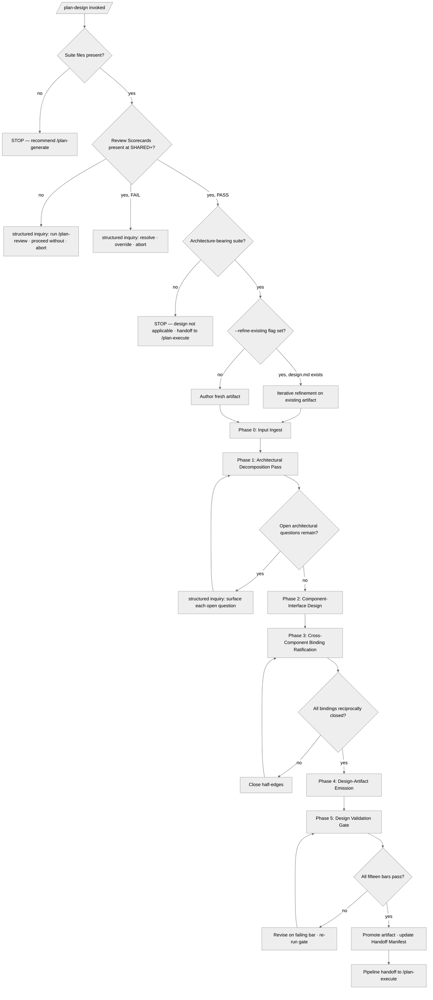

<!-- SPDX-License-Identifier: MIT -->

## Decision Tree

The tree distinguishes deterministic forks (suite-file presence, scorecard state, flag presence, gate-bar verdicts) from structured-inquiry forks (open architectural questions, scorecard-FAIL disposition) from iteration forks (Phase 1 open-question loop, Phase 3 binding-closure loop, Phase 5 gate-bar loop).
