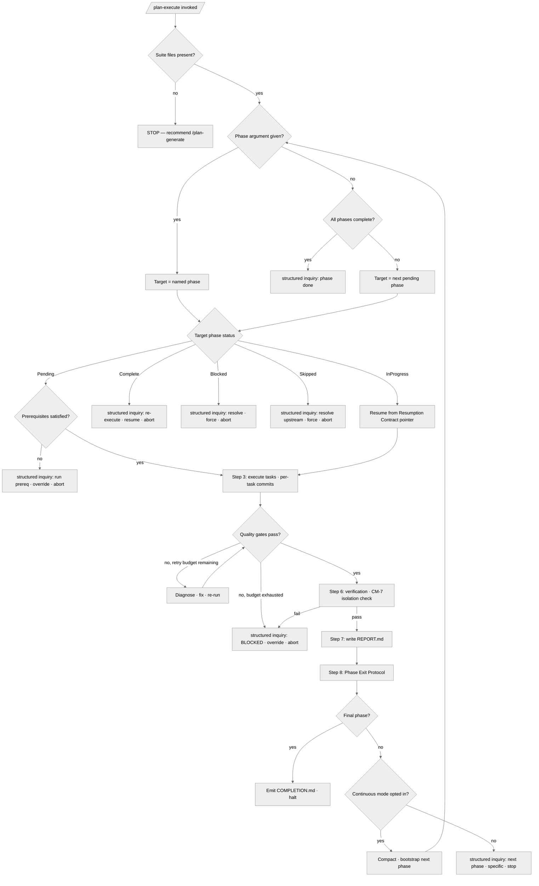

<!-- SPDX-License-Identifier: MIT -->

## Decision Tree

The command's branching logic at a glance — every decision either resolves
deterministically against state on disk or surfaces a structured-inquiry
invocation.

The tree distinguishes three fork classes: **deterministic forks** resolved
against state on disk (file presence, dependency-graph order, prerequisite
satisfaction), **structured-inquiry forks** where the operator's decision is
material and surfaces through the canonical channel, and **retry forks** where a
budget governs how many cycles attempt resolution before escalation.
