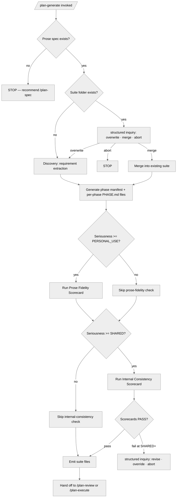

<!-- SPDX-License-Identifier: MIT -->

## Decision Tree

The tree distinguishes seriousness-driven branches (scorecards activate at
PERSONAL_USE+ and SHARED+) from operator-decision branches surfaced through
structured inquiry (overwrite-vs-merge, scorecard-fail handling).
