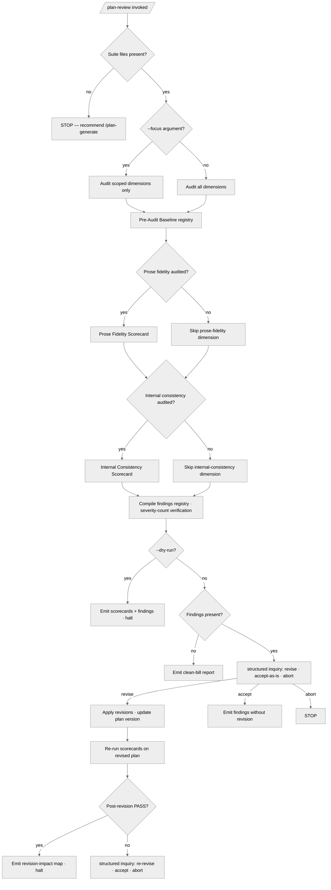

<!-- SPDX-License-Identifier: MIT -->

## Decision Tree

The tree distinguishes scope-narrowing forks (`--focus` reduces dimensional
coverage), audit-mode branches (each dimension activates its own scorecard),
and revision-loop forks where operator decision drives whether findings flow
into applied revisions or stand as advisory output.
