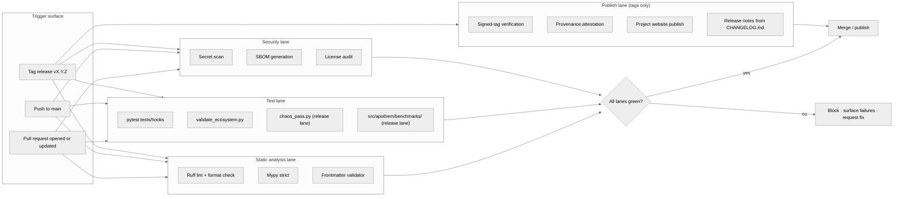

{/* SPDX-License-Identifier: MIT */}

**الخريطة البنيوية لسير عمل البناء · التحقّق · النشر الذي يُشترَط اجتيازه لكلّ تغيير في منظومة <bdi>Apothem</bdi>.** يُثبِّت هذا المستند سطح التصوير البصري. وتعيش ملفات سير عمل <bdi>GitHub Actions</bdi> التي يصفها في <bdi>`.github/workflows/`</bdi> (مثل <bdi>`ci.yml`</bdi> و<bdi>`release.yml`</bdi>)، أمّا أدوات الإصدار فتعيش في <bdi>`scripts/release/`</bdi>.

## شكل خط الأنابيب

## أدوار المسارات

- **مسار التحليل الساكن** — تغذية راجعة سريعة. يغطّي <bdi>Ruff</bdi> أسلوب
  <bdi>Python</bdi> ومجموعة قواعد منتقاة؛ ويفرض <bdi>mypy</bdi> انضباط الأنواع
  عند <bdi>strict</bdi>؛ ويعمل مُتحقِّق <bdi>frontmatter</bdi> بوصفه بوّابة
  لامتثال مخطّط القِطَع للقواعد والمهارات والعمّال المُفوَّضين والأوامر. لا يقع
  <bdi>markdownlint</bdi> في هذا المسار: فهو يعمل فقط بوصفه خطّاف
  <bdi>pre-commit</bdi>، ولا يُشغِّله <bdi>CI</bdi> (راجع
  [اصطلاحات <bdi>Markdown</bdi>](/docs/reference/markdown-conventions)).
- **مسار الاختبار** — يختبر <bdi>`pytest tests/hooks`</bdi> بيئة تشغيل الخطّافات
  على مصفوفة الأحداث الكاملة؛ و<bdi>`validate_ecosystem.py`</bdi> هو البوّابة
  البنيوية الرئيسية لاتّساق ما بين القِطَع؛ ويُفعَّل <bdi>`chaos_pass.py`</bdi>
  ومجموعة المقاييس المرجعية حسب الصنف تحت <bdi>`src/apothem/benchmarks/`</bdi>
  على مسار الإصدار لالتقاط التدهور عند المدخلات المتدهورة وتراجعات ميزانية وقت
  التشغيل.
- **مسار الأمن** — يلتقط فحص الأسرار بيانات الاعتماد المُودَعة بالخطأ؛ ويشكّل
  توليد <bdi>SBOM</bdi> وعمليات تدقيق التراخيص بوّابةً لسطح سلسلة التوريد في أي
  تثبيت للجاهزية للإنتاج.
- **مسار النشر** — لا يعمل إلّا على الإصدارات الموسومة. يؤكّد التحقّق من الوسم
  الموقَّع منشأ فرع الإصدار؛ ويُنشَر موقع المشروع من <bdi>`site/dist/`</bdi> إلى
  هدف <bdi>GitHub Pages</bdi>؛ وتُشتَقّ ملاحظات الإصدار من تنسيق
  <bdi>Keep-A-Changelog</bdi> في <bdi>`CHANGELOG.md`</bdi>.

## التهيئة الملموسة

تُثبَّت ملفّات سير العمل الفعلية (<bdi>`.github/workflows/ci.yml`</bdi>،
<bdi>`.github/workflows/release.yml`</bdi>، وغيرها) أثناء بناء منظومة الجاهزية
للإنتاج. يُعرِّف هذا المخطّط الشكل المعياري الذي تعكسه كلّ تهيئة مستقبلية.

## مراجع متقاطعة موثوقة

- <bdi>`pyproject.toml`</bdi> — مصدر الحقيقة لتهيئة <bdi>Ruff / mypy / pytest</bdi>.
- <bdi>`scripts/dev/validate_ecosystem.py`</bdi> — البوّابة الرئيسية لما بين القِطَع.
- <bdi>`scripts/dev/validate_hooks.py`</bdi> — التحقّق البنيوي الخاصّ بالخطّافات.
- <bdi>`scripts/dev/chaos_pass.py`</bdi> — مسح خصومي لكلّ خطّاف مُهيَّأ.
- <bdi>`src/apothem/benchmarks/`</bdi> — مُتحقِّقو ميزانية وقت التشغيل حسب الصنف.
- <bdi>`site/content/docs/developer-guide.mdx`</bdi> — سير عمل المُساهِم الموجَّه للمُشغِّل.
- <bdi>`CHANGELOG.md`</bdi> — مصدر ملاحظات الإصدار.
