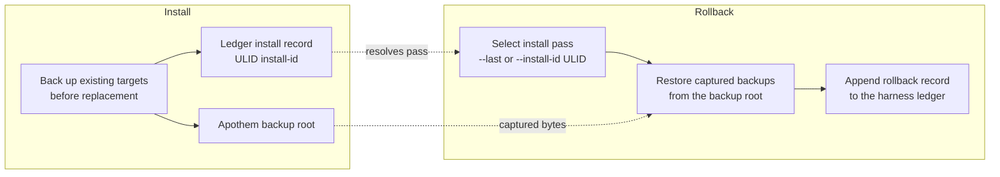

{/* SPDX-License-Identifier: MIT */}

## تدفُّق التثبيت

```mermaid
flowchart TD
    accTitle: Apothem install workflow
    accDescr: Top-down flowchart of the apothem install command from CLI invocation through adapter lookup, profile load, adapter install call, native config write, and a follow-up apothem verify check that the operator runs.
    A[apothem install --harness X] --> B[Resolve adapter through registry]
    B --> C[Load and validate profile YAML<br/>before writes]
    C --> D[Adapter.install(profile, project)]
    D --> E[Write native config and support cohorts]
    E --> F[Operator runs: apothem verify --harness X]
    F --> G{All checks pass?}
    G -- yes --> H[Done]
    G -- no --> I[Report failures]
```

## تدفُّق التحديث

عند <bdi>`apothem update --harness X`</bdi>:

1. يُحمِّل ويتحقَّق من <bdi>`~/.config/apothem/profile.yaml`</bdi> أو <bdi>`--profile PATH`</bdi>.
2. يحلّ إطار العمل المُحدَّد أو <bdi>`all`</bdi> عبر السجلّ المركزي.
3. يتحقَّق من خطّة التحويل الكاملة قبل أول عملية كتابة.
4. يستدعي <bdi>`Adapter.update(profile, project=...)`</bdi>.
5. يُبلِغ عن النتائج: مُنشأ، ومُحدَّث، وبلا تغيير، ومُتخطّى، وتحذير، وخطأ.

## تدفُّق إلغاء التثبيت

عند <bdi>`apothem uninstall --harness X`</bdi>:

1. يستدعي <bdi>`Adapter.uninstall()`</bdi>.
2. يزيل المُحوِّل الملفّات التي كتبها فقط؛ ويبقى الملف التعريفي المشترك بصيغة <bdi>YAML</bdi>
   والملفّات غير المتعلِّقة التي كتبها المُشغِّل دون مساس.
3. تُنسَخ الذاكرةُ والسياقاتُ ومخازنُ التعلّم في دليل العمل المشترك احتياطيًا وتُزال حين يكون هذا
   آخرَ إطار عمل مُثبَّت فيه. وتُزال من الموقع الذي سجّله التثبيت. ولا يُزال دليل <bdi>`plans/`</bdi> أبدًا.

## حلّ النطاق

يكتب كل مُحوِّل إلى جذر تثبيته الثابت الخاص به: المنزل الشخصي للمستخدم
لمُحوِّلات نطاق المستخدم، والمسار المحلّي للمشروع لمُحوِّلات نطاق المشروع. لا
تكشف واجهة <bdi>CLI</bdi> عن راية <bdi>`--scope`</bdi>؛ وتتطلّب مُحوِّلات نطاق
المشروع <bdi>`--project <path>`</bdi>. وتكتب سبعة من مُحوِّلات نطاق المشروع أيضًا
مجلّدات مشتركة في المنزل الشخصي للمستخدم، مثل <bdi>`~/.agents/skills/`</bdi>
و<bdi>`~/.config/apothem/`</bdi>، قبل أن تكتب ملف المشروع، ولا يُغيّر
<bdi>`--project`</bdi> مكان كتابتها. ويسردها
[مرجع التثبيت](/docs/cli-reference/install#المجلّدات-في-دليلك-المنزلي). وكل وجهة مُوثَّقة في
<bdi>`site/content/docs/harnesses/<harness>.mdx`</bdi>.

## معالجة الأخطاء

تتحقّق عمليّات التثبيت/التحديث قبل الكتابة، وتُنشئ نسخة احتياطية من الأهداف المُطابِقة الموجودة قبل استبدالها، ولا تدمج إلا الإدخالات الفرعية التي يديرها <bdi>Apothem</bdi> في أدلّة الاكتشاف المشتركة. وينفّذ <bdi>`--dry-run`</bdi> التحقّق نفسه، ويعيد النتيجة التي كانت ستسجّلها كل كتابة، مثل <bdi>`created`</bdi> أو <bdi>`updated`</bdi>، دون إنشاء أي أدلّة أو ملفّات.

## قابلية التراجع (النسخ الاحتياطي والتراجع)

كل تمريرة تثبيت قابلة للتراجع. تُلتقَط البايتات المُستبدَلة في جذر النسخ الاحتياطي
الخاص بـ<bdi>Apothem</bdi>، وتُسجَّل التمريرة في دفتر إطار العمل تحت مُعرِّف تثبيت
بصيغة <bdi>ULID</bdi>؛ ويختار [<bdi>`apothem rollback`</bdi>](/docs/cli-reference/rollback)
تمريرةً مُسجَّلة ويستعيد تلك النسخ الاحتياطية المُلتقَطة.


