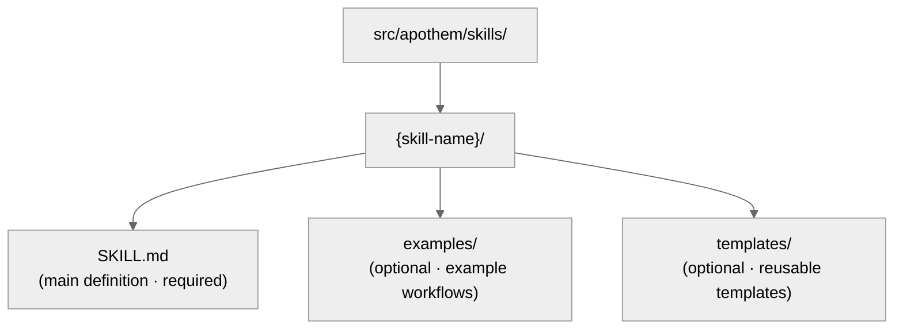

{/* SPDX-License-Identifier: MIT */}

يساعد هذا الدليل المطوّرين على صون منظومة <bdi>Apothem</bdi> وتوسيعها وفق معايير
جودة <bdi>SOTA</bdi>.

## مرجع سريع: أنواع المُنتَجات

يغطّي هذا الدليل خمسة أنواع من المُنتَجات، لكلٍّ منها غرض محدّد. تحمل القواعد
والأوامر والمساعِدات والمهارات بيانات أمامية بصيغة <bdi>YAML</bdi>؛ أمّا الخطّافات
فتُسجَّل في <bdi>`hooks.json`</bdi> و<bdi>`settings.json`</bdi> ولا تحمل بيانات أمامية.
وأنماط الإخراج صنف إضافي من المُنتَجات، له مفتاحان إلزاميان في البيانات الأمامية هما
<bdi>`name`</bdi> و<bdi>`description`</bdi>؛ راجع
[مخطط البيانات الأمامية](/docs/reference/frontmatter-schema).

| المُنتَج | المسار | الغرض | متى يُنشأ |
| -------- | ---- | ------- | -------------- |
| **قاعدة** | <bdi>`src/apothem/rules/*.md`</bdi> | تفويض سلوكي أو توجيه تشغيلي | عند إرساء مبدأ أو سياسة أو تفويض حوكمة جديد |
| **أمر** | <bdi>`src/apothem/commands/*.md`</bdi> | أمر بشرطة مائلة (<bdi>`/command-name`</bdi>) لسيرورات العمل المعقّدة | سير عمل جديد متعدّد الخطوات للمستخدم |
| **مساعِد** | <bdi>`src/apothem/agents/*.md`</bdi> | تعريف دائم لعامل مُفوَّض للمهام المتوازية | مهمة متخصّصة متكرّرة جديدة (تدقيق، استكشاف، فحص جودة) |
| **مهارة** | <bdi>`src/apothem/skills/{name}/SKILL.md`</bdi> | تقنية قابلة لإعادة الاستخدام ذات إشارة كشف | نمط تقنية جديد قابل للكشف وإعادة الاستخدام |
| **خطّاف** | <bdi>`src/apothem/hooks/`</bdi> + <bdi>`hooks.json`</bdi> + <bdi>`settings.json`</bdi> | تحقّق أو إدارة حالة يُطلقهما حدث | حدث جديد في دورة الحياة أو حاجة جديدة إلى التحقّق |

## عقد محوّل إطار العمل

تقيم حقائق هوية إطار العمل وقدراته في
<bdi>`src/apothem/lib/harness_registry.py`</bdi>. ولا يكتمل تغيير إطار العمل إلا عندما
تتوافق هذه الأسطح:

| السطح | التحديث المطلوب |
| --- | --- |
| صفّ السجلّ | المُعرِّف العام، ومفتاح الحزمة، ونقطة الدخول، والنطاق، وصيغة المُخرَج، والمسارات الهدف، ومسارات الوثائق، وملف القدرات، وتثبيت المعيار، واختبارات التجهيزات، ومفتاح بيانات الحزمة، ومصادر القوالب، وحالات القدرات. |
| حزمة المحوّل | <bdi>`__init__.py`</bdi>، <bdi>`install.py`</bdi>، <bdi>`update.py`</bdi>، <bdi>`uninstall.py`</bdi>، <bdi>`verify.py`</bdi>؛ أضف <bdi>`materializer.py`</bdi> فقط عندما يُصيِّر إطار العمل ملف إعداد أصليًا. |
| بيان الانتشار | مسارات القوالب والحزم للمحوّلات المدعومة بالبيان. |
| القدرات | <bdi>`src/apothem/harnesses/<package>/capabilities.yml`</bdi> مع كل قدرة مطلوبة، ومبرّر للحالات غير المدعومة أو التي ما زالت قيد الاكتشاف، إضافةً إلى خريطة <bdi>`conversion_losses`</bdi> لكل حزمة أوامر أو عوامل أو قواعد مُحوَّلة (راجع [سجلّ أُطُر العمل](/docs/reference/harness-registry)). |
| تثبيت الاصطلاح | <bdi>`STANDARD-CONVENTION-PIN.md`</bdi> مع رابط المورّد، وتاريخ اللقطة، واسم الملف/المخطط المرجعي، ومرجع الأدلّة، ومبرّر القدرات غير المدعومة. |
| الاختبارات | تكافؤ السجلّ، واختبار تجهيزة المحوّل، وصفّ خطة التثبيت الذهبية، وسلوك التشغيل التجريبي/عدم الكتابة، وثبات النتيجة عند التكرار، وتغطية بيانات الحزمة. |
| الوثائق | صفحة مرجع إطار العمل، وصفحة المقارنة، وملاحظات القدرات/<bdi>MCP</bdi>، وأمثلة تستخدم عناصر نائبة زائفة. |

يجب على المحوّلات ذات نطاق المشروع أن تضبط <bdi>`requires_project = True`</bdi>، وأن
تقبل <bdi>`project: Path | None`</bdi> في توابع دورة الحياة، وأن ترفض جذور المشاريع
المفقودة أو غير الآمنة قبل أيّ كتابة. ويجب على المحوّلات ذات نطاق المستخدم أن تُبقي
المسارات تحت جذر إعداد المستخدم الموثَّق لإطار العمل.

## سياسة التجهيزة الذهبية

يسجّل <bdi>`tests/fixtures/harness-golden-plans.json`</bdi> الشكل العام لخطة التثبيت
لأُطُر العمل السبعة عشر المُسجَّلة في السجلّ جميعها: المُعرِّف العام، ونمط التجسيد،
ومسار الحزمة/القالب المصدر، والمسار الهدف المُطبَّع تحت <bdi>`<ROOT>`</bdi>. وعندما
يتغيّر سلوك السجلّ أو البيان أو أهداف القوالب عمدًا، حدّث التجهيزة الذهبية في الكوميت
نفسه الذي يحمل تغيير المصدر، كي يُظهر الفرق التغيّر في السلوك.

## التحقّق قبل الكتابة

يتحقّق برنامج تشغيل التثبيت المشترك من كل مصدر وكل هدف قبل أول كتابة. ويرفض مصادر
البيان المفقودة، واجتياز مسار الهدف، ومسارات الهدف الواقعة خارج الجذر المختار، وعبور
الروابط الرمزية. وتُنفِّذ عمليات التشغيل التجريبي التحقّق نفسه وتُعيد نتائج مُهيكَلة
<bdi>`skipped`</bdi> أو <bdi>`unchanged`</bdi> دون إنشاء ملفات.

## التنقيح وبيانات الأمثلة

تُنقِّح تشخيصات الملف التعريفي الحقول التي تأخذ شكل الرمز المميّز، أو السرّ، أو كلمة
المرور، أو بيانات الاعتماد، أو مفتاح <bdi>API</bdi>، أو المفتاح الخاص، أو التخويل، أو
المصادقة، أو الترويسة. وتستخدم الوثائق والتجهيزات والأمثلة ومقتطفات <bdi>JSON</bdi>
القيم <bdi>`example.invalid`</bdi> و<bdi>`Example User`</bdi> و<bdi>`example-user`</bdi>
وعناصر نائبة واضحة بدلًا من أسرار أو حسابات شخصية تبدو حقيقية.

## قبل الكتابة: المخطط المرجعي

**العقد المقروء آليًا الذي تفرضه البوابة هو مخططات <bdi>JSON Schema</bdi> لكل صنف
تحت <bdi>`src/apothem/schemas/*.schema.json`</bdi> — إذ يرفض <bdi>`additionalProperties`</bdi>
المفاتيح غير المعروفة، فتكون الكلمة الفصل لبوابة المطابقة.** ويتتبّعها إسقاطان
مقروءان للبشر: <bdi>`site/content/docs/reference/frontmatter-schema.mdx`</bdi>
(فهرس المفاتيح المطلوبة) و<bdi>`site/content/docs/reference/artifact-schema.mdx`</bdi>
(قوالب لكل صنف وأمثلة محلولة). وحيثما تخالف صفحةٌ مخططاتِ <bdi>JSON Schema</bdi>،
تكون الغلبة للمخططات.

- اقرأ مخطط <bdi>JSON Schema</bdi> الخاص بنوع مُنتَجك تحت <bdi>`src/apothem/schemas/`</bdi>
- اقرأ <bdi>`site/content/docs/reference/artifact-schema.mdx`</bdi> § «<bdi>Schema</bdi>» للاطّلاع
  على القالب ومثال محلول
- انسخ الحقول المطلوبة، واملأ القيم الإلزامية، وأضف الحقول الاختيارية حسب الحاجة

## فحص سريع للبيانات الأمامية

يجب أن تجتاز البيانات الأمامية لكل مُنتَج هذه الفحوص. طبّق فحوص <bdi>`version`</bdi>
و<bdi>`updated`</bdi> و<bdi>`portability`</bdi> على الصنف الذي يحمل المفتاح فقط: فالقواعد
لا تحمل أيًّا منها، والمهارات لا تحمل <bdi>`portability`</bdi>.

```yaml
✓ Valid YAML syntax (use tools: `yamllint` or PowerShell `ConvertFrom-Yaml` where available)
✓ All mandatory fields present (per schema for artifact type)
✓ name: uses kebab-case
✓ version: semantic MAJOR.MINOR.PATCH
✓ updated: ISO 8601 date (YYYY-MM-DD)
✓ description: single-line, non-empty
✓ scope fields valid per artifact type (rules: pathFilter + alwaysApply; CLAUDE.md root: scope)
✓ portability: valid enum (`universal` | `universal-with-windows-caveats` | `unix-only` | `windows-only`)
✓ No typos in field names — must match canonical schema exactly
✓ Optional fields use correct enum values
```

## اصطلاحات التسمية

### أسماء المُنتَجات (<bdi>kebab-case</bdi>)

- **القواعد:** <bdi>`operational-mandates`</bdi>، <bdi>`clean-room-generation`</bdi>، <bdi>`context-management`</bdi>
- **الأوامر:** <bdi>`plan-execute`</bdi>، <bdi>`plan-spec`</bdi>، <bdi>`plan-generate`</bdi>
- **المساعِدات:** <bdi>`codebase-explorer`</bdi>، <bdi>`convention-auditor`</bdi>، <bdi>`quality-gate`</bdi>
- **المهارات:** <bdi>`plan-suite`</bdi>، <bdi>`ecosystem-audit`</bdi>

النمط: أحرف صغيرة، وشرطات بين الكلمات، دون مسافات أو شرطات سفلية.

### تسمية الملفات

- **القواعد:** <bdi>`{name}.md`</bdi>
- **الأوامر:** <bdi>`{name}.md`</bdi>
- **المساعِدات:** <bdi>`{name}.md`</bdi>
- **المهارات:** داخل المجلّد <bdi>`src/apothem/skills/{name}/SKILL.md`</bdi> (بحالة الأحرف نفسها تمامًا: <bdi>`SKILL.md`</bdi>)
- **الخطّافات:** داخل المجلّد <bdi>`src/apothem/hooks/`</bdi>. جميع معالجات الأحداث مكتوبة بلغة <bdi>Python</bdi>. يستخدم كل أمر خطّاف في قالب <bdi>`settings.json`</bdi> الخاص بـ <bdi>Claude Code</bdi> صيغة <bdi>exec</bdi>: إذ إن <bdi>`command`</bdi> هو العنصر النائب للمفسِّر <bdi>`${PYTHON_BIN}`</bdi>، ويُحلّ وقت التثبيت، و<bdi>`args`</bdi> يحمل مسار النص البرمجي ووسائطه. ويشغّل ذلك القالب الأمرين <bdi>`${HARNESS_ROOT}/.apothem/support/hooks/dispatch.py <event> [<message-name>]`</bdi> و<bdi>`${HARNESS_ROOT}/.apothem/support/conformity/gate.py --hook`</bdi> بالمسار المطلق، فلا تحتاج النسخة المثبّتة إلى حزمة <bdi>`apothem`</bdi> قابلة للاستيراد. أمّا إضافة <bdi>Claude Code</bdi> فتسجّل الخطّافات بدلًا من ذلك في <bdi>`src/apothem/hooks/hooks.json`</bdi>، بوصفها أوامر صدفة تشغّل <bdi>`hooks/lib/bootstrap.sh`</bdi> عبر <bdi>`bash`</bdi>؛ ويحدّد ذلك الملف الهيكلي موضع <bdi>Python</bdi> ويشغّل <bdi>`dispatch.py`</bdi>، فتبقى المعالجات بلغة <bdi>Python</bdi>. سجّل أي خطّاف جديد في <bdi>`hooks.json`</bdi> وفي قالب <bdi>`settings.json`</bdi> الخاص بـ <bdi>Claude Code</bdi>. ويوجّه <bdi>`dispatch.py`</bdi> الحدث <bdi>`SessionStart`</bdi> إلى <bdi>`session_start_bootstrap.main()`</bdi>، وكل حدث آخر مُدرَج في القائمة البيضاء إلى <bdi>`emit_hook_context.main()`</bdi>. وملفات الصدفة الهيكلية الوحيدة المسموح بها تحت <bdi>`src/apothem/hooks/`</bdi> أو <bdi>`scripts/`</bdi> هي الملفات الستة لتحديد الموقع والتمهيد (<bdi>`find-python.{ps1,sh}`</bdi>، و<bdi>`find-pwsh.{ps1,sh}`</bdi>، و<bdi>`bootstrap.{ps1,sh}`</bdi>)؛ وأي ملف <bdi>`.ps1`</bdi> / <bdi>`.sh`</bdi> آخر يُخفق في فحص النظافة <bdi>`scripts/dev/validate_hooks.py`</bdi>.

### الإحالات المتبادلة

عند الإحالة إلى مُنتَجات أخرى، استخدم الأسماء الدقيقة:

- القواعد: <bdi>`"operational-mandates"`</bdi> (قيمة حقل الاسم)
- الأوامر: <bdi>`/plan-execute`</bdi> (بالشرطة المائلة في الوثائق الموجّهة للبشر؛ ومن دونها في الشيفرة)
- المساعِدات: <bdi>`codebase-explorer`</bdi> (قيمة حقل الاسم)
- المهارات: <bdi>`plan-suite`</bdi> (قيمة حقل الاسم)

لا تستخدم أبدًا مسارات الملفات أو الأسماء المبتورة في النصّ النثري.

## قابلية النقل: <bdi>Windows</bdi> مقابل <bdi>Unix</bdi>

يجب على كل أمر أن يُعلن صراحةً حالة قابليته للنقل في الحقل <bdi>`portability`</bdi>.
ويجوز للمساعِد أن يُعلنها. ولا تحمل المهارات والقواعد وأنماط الإخراج حقل
<bdi>`portability`</bdi>.

### عامّ

- يعمل بالطريقة نفسها على <bdi>Windows</bdi> و<bdi>macOS</bdi> و<bdi>Linux</bdi>
- لا افتراضات بشأن الصدفة
- تستخدم المسارات الشرطات المائلة الأمامية (<bdi>`/`</bdi>)
- لا مسارات مطلقة ثابتة مُضمَّنة
- لا صيغة <bdi>PowerShell</bdi> خاصة بـ <bdi>Windows</bdi>

```yaml
portability: "universal"
```

### عامّ مع تحفّظات على <bdi>Windows</bdi>

- عامّ عبر مضيفات <bdi>POSIX</bdi>؛ وينطبق التحفّظ المُسمّى على متغيّر منصّة <bdi>Windows</bdi> المُعلَن في المحتوى
- وثّق التحفّظ صراحةً في المحتوى
- مثال: «الروابط الرمزية غير مدعومة على <bdi>Windows</bdi> قبل <bdi>Win 10</bdi>»

```yaml
portability: "universal-with-windows-caveats"
```

وثّق التحفّظ في ملاحظة تلي العنوان مباشرةً.

### مقتصر على <bdi>Unix</bdi> / مقتصر على <bdi>Windows</bdi>

- مقيَّد صراحةً بمنصّة واحدة
- نادر في <bdi>Apothem</bdi> — ينبغي أن تكون معظم المُنتَجات عامّة
- لا تستخدمه إلا إذا كانت الميزات الخاصة بالمنصّة أساسية

```yaml
portability: "unix-only"
```

وثّق السبب في القسم الأول من المُنتَج.

## النطاق: فعّال دائمًا مقابل مُرشَّح بالمسار

### فعّال دائمًا

تنطبق القاعدة في كل مكان.

```yaml
pathFilter: ""
alwaysApply: true
```

### مُرشَّح بالمسار

تنطبق القاعدة شرطيًا بحسب مسار الملف.

```yaml
pathFilter: "**/*.py, **/*.toml"
alwaysApply: false
```

يستخدم <bdi>`pathFilter`</bdi> أنماط <bdi>glob</bdi> (بالصيغة نفسها المستخدمة في <bdi>`.gitignore`</bdi>).
وعندما يطابق ملفٌّ المرشِّح، تُفعَّل القاعدة.

## دلالات النسخ

يحمل كل مُنتَج ذي نسخة نسخته الدلالية الخاصة (<bdi>`MAJOR.MINOR.PATCH`</bdi>).
تتطلّبها الأوامر والمهارات، ويجوز أن تحملها المساعِدات وأنماط الإخراج، ولا تحمل
القواعد أيَّ نسخة:

- **<bdi>PATCH</bdi>** — إصلاحات الأخطاء المطبعية، والتنسيق، وتحديث الروابط، والتعديلات المقتصرة على التعليقات. السلوك دون تغيير.
- **<bdi>MINOR</bdi>** — تغييرات إضافية غير كاسرة: أقسام اختيارية جديدة، وحقول اختيارية جديدة في البيانات الأمامية، وأمثلة جديدة. ويواصل المستهلكون الحاليون العمل دون أيّ تغيير.
- **<bdi>MAJOR</bdi>** — تغييرات كاسرة في المخطط أو العقد: أقسام محذوفة، وحقول مُعاد تسميتها، وسلوك مُعدَّل لتوجيه قائم، وتغييرات تتطلّب أن تتكيّف المُنتَجات التابعة.

أمثلة:

- <bdi>`vX.Y.Z`</bdi> → <bdi>`vX.Y.(Z+1)`</bdi> (<bdi>PATCH</bdi>: إصلاح خطأ مطبعي)
- <bdi>`vX.Y.Z`</bdi> → <bdi>`vX.(Y+1).0`</bdi> (<bdi>MINOR</bdi>: إضافة قسم اختياري جديد)
- <bdi>`v0.Y.Z`</bdi> → <bdi>`v(0+1).0.0`</bdi> (<bdi>MAJOR</bdi>: إعلان استقرار العقد؛ وتبدأ المُنتَجات الجديدة عند <bdi>`v0.Y.Z`</bdi>)
- <bdi>`vX.Y.Z`</bdi> → <bdi>`v(X+1).0.0`</bdi> (<bdi>MAJOR</bdi>: حذف حقل إلزامي من البيانات الأمامية)

ارفع <bdi>`version`</bdi> و<bdi>`updated`</bdi> معًا في كل تعديل يغيّر السلوك في مُنتَج
يحمل هذين الحقلين. وألحِق صفًّا مطابقًا بملف <bdi>`CHANGELOG.md`</bdi> على مستوى
المنظومة للإصدارات التي تجمع تغييرات في المُنتَجات.

## متى تُعدِّل مُنتَجًا

### القواعد

- عامِل بنية الإلزامي/الاختياري على أنها حاملة للحِمل — فإعادة هيكلتها تمتدّ آثارها
  إلى كل مُنتَج تابع.
- نقّح الأنماط المضادة وأمثلة تدرّج الجدّية والاستشهادات كلّما تعمّق الفهم.
- دوّن مبرّر أيّ تغيير بنيوي في ملف موضوع الذاكرة ذي الصلة.

### الأوامر

- شكل الوسائط جزء من العقد العام — لا تكسره إلا بنيّة صريحة، وانشر التغيير إلى كل
  مستدعٍ (رفع <bdi>MAJOR</bdi>).
- أبقِ خطوات سير العمل وعقود الإرجاع مُحكمة وحديثة.
- وثّق تسلسل الخطوات غير البديهي في موضعه.

### المساعِدات

- أبقِ <bdi>`disallowedTools`</bdi> في حدّه الأدنى الكافي؛ ووثّق المبرّر عندما
  يتغيّر.
- نقّح مبادئ التشغيل وعقود الإرجاع كلّما نضج دور المساعِد
  (رفع <bdi>MINOR</bdi>).
- تتبّع تحوّلات القدرات في موضعها كي يتمكّن المستدعون من إعادة ضبط توقّعاتهم.

### المهارات

- أبقِ خطوات الإجراء والأمثلة متزامنة مع الواقع.
- يجب أن تعكس إشارات الكشف صياغة المستخدمين الفعلية في الاستخدام الحالي.
- قسّم المهارة متى تجاوزت ~150 سطرًا (راجع
  <bdi>`auto-memory.md`</bdi> § <bdi>Topic File Management</bdi>).

## خطوة بخطوة: إضافة قاعدة جديدة

### 1. قيّم التعامد

هل تتداخل هذه القاعدة مع قواعد قائمة؟ ابحث في <bdi>`src/apothem/rules/`</bdi> عن محتوى ذي صلة.

إذا تجاوز التداخل 50%، ففكّر في توسيع قاعدة قائمة بدلًا من ذلك. راجع
<bdi>`persistent-conventions-vigilance.md`</bdi> § <bdi>Artifact Evolution</bdi>.

### 2. اكتب المحتوى

اتّبع البنية التالية:

- العنوان: <bdi>`# Rule: {Title}`</bdi>
- قسم الغرض
- الالتزامات / التوجيهات الأساسية (مرقّمة ومزوّدة بروابط)
- جدول تدرّج الجدّية (مطلوب دائمًا)
- قسم الأنماط المضادة
- قسم الإنفاذ

### 3. أنشئ البيانات الأمامية

استخدم المخطط من <bdi>`site/content/docs/reference/artifact-schema.mdx`</bdi> § <bdi>Schema: Rules</bdi>. واضبط:

- <bdi>`name:`</bdi> مُعرِّفًا بصيغة <bdi>kebab-case</bdi>
- <bdi>`description:`</bdi> ملخّصًا من سطر واحد للسجلّات
- <bdi>`pathFilter:`</bdi> قائمة <bdi>glob</bdi> للقواعد المُرشَّحة بالمسار؛ والسلسلة الفارغة (<bdi>`""`</bdi>) للقواعد الفعّالة دائمًا
- <bdi>`alwaysApply:`</bdi> <bdi>`true`</bdi> للقواعد الفعّالة دائمًا، و<bdi>`false`</bdi> للقواعد المُرشَّحة بالمسار

لا تحمل القواعد إلا هذه الحقول الأربعة — بلا <bdi>`version`</bdi> / <bdi>`updated`</bdi> / <bdi>`scope`</bdi> / <bdi>`portability`</bdi> / <bdi>`implements`</bdi>.

مثال:

```yaml
---
name: "my-new-rule"
description: "Brief one-liner"
pathFilter: ""
alwaysApply: true
---
```

### 4. حدّث ملف <bdi>README</bdi> الخاص بالقواعد

أضف صفًّا إلى جدول عائلة القاعدة في قسم «<bdi>Rule families</bdi>» من
<bdi>`src/apothem/rules/README.md`</bdi>:

```markdown
| `my-new-rule.md` | One-line concern of the new rule. |
```

اختر جدول العائلة الذي يتّفق مجال اهتمامه مع القاعدة.

### 5. ألحِق بملف <bdi>CHANGELOG.md</bdi>

أضف صفًّا تحت قسم <bdi>`### Added`</bdi> الخاص بالإصدار التالي يصف القاعدة الجديدة.

### 6. شغّل التحقّق

استدعِ مهارة <bdi>`ecosystem-audit`</bdi> للتحقّق من القاعدة الجديدة، مع التركيز على منطقة القواعد:

```text
Invoke the ecosystem-audit skill with --focus rules --fix
```

تحقّق من عدم الإبلاغ عن أيّ أخطاء في قاعدتك الجديدة.

## خطوة بخطوة: إضافة أمر جديد

الأوامر هي أوامر بشرطة مائلة مثل <bdi>`/plan-spec`</bdi> و<bdi>`/plan-execute`</bdi> و<bdi>`/security-audit`</bdi> وغيرها.

### 1. حدّد الدور

الأوامر سيرورات عمل يُطلقها المستخدم. ولا يشغّل النموذج أمرًا منها من تلقاء نفسه إلا
عندما يكون إعداد <bdi>`disable-model-invocation`</bdi> الخاص به <bdi>`false`</bdi>
(الخطوة 2). اسأل:

- هل هذا سير عمل يكتب فيه المستخدم <bdi>`/command-name`</bdi>؟
- هل يُنسِّق خطوات متعدّدة؟
- هل يمكن أن تنتهي مهلته أو أن يتطلّب إدخالًا من المستخدم في منتصف التنفيذ؟

إذا كانت الإجابة «لا» عن أيٍّ من هذه الأسئلة، فهو على الأرجح مهارة لا أمر.

### 2. أنشئ الملف

المسار: <bdi>`src/apothem/commands/{name}.md`</bdi>

البيانات الأمامية (من <bdi>`site/content/docs/reference/artifact-schema.mdx`</bdi> § <bdi>Schema: Commands</bdi>):

```yaml
---
name: "my-command"
version: "X.Y.Z"
updated: "2026-04-20"
description: "What this command does"
argument-hint: "[path/to/input] [--flag VALUE]"
disable-model-invocation: true
portability: "universal"
allowed-tools: "Read, Glob, Grep"
---
```

يجعل <bdi>`disable-model-invocation: true`</bdi> الأمرَ لا يُستدعى إلا من المُشغِّل؛
ومع <bdi>`false`</bdi> يجوز للنموذج تشغيله عندما يطابق طلبٌ وصفَه. تستخدم معظم
الأوامر <bdi>`true`</bdi>، لكن معظم مراحل خطّي أنابيب التخطيط والبحث تستخدم <bdi>`false`</bdi>.
ويسرد جدول الاستدعاء في <bdi>`src/apothem/commands/README.md`</bdi> إعداد كل
أمر؛ أضف صفًّا للأمر الجديد. وأبقِ
<bdi>`allowed-tools`</bdi> للقراءة فقط: فإطار العمل الذي يلتزم به يُشغِّل تلك الأدوات دون
أن يسأل. لا تمنح أداةً ذات آثار جانبية إلا بوصفها قاعدة محدودة النطاق، مثل
<bdi>`Bash(git log *)`</bdi>؛ إذ يرفض المخطط <bdi>`"*"`</bdi> وأيًّا من <bdi>`Bash`</bdi> أو <bdi>`PowerShell`</bdi>
أو <bdi>`Write`</bdi> أو <bdi>`Edit`</bdi> أو <bdi>`NotebookEdit`</bdi> أو <bdi>`WebFetch`</bdi> إذا كُتب دون نطاق.

### 3. اكتب المحتوى

البنية:

- العنوان: <bdi>`# /{name} — Human-Readable Title`</bdi>
- قسم الدور (مَن يُنفِّذ هذا)
- تعليمات عالية المستوى
- قسم سير العمل مع الخطوات
- عقد الإرجاع / صيغة المُخرَج

### 4. حدّث ملف <bdi>README</bdi> وملف <bdi>CHANGELOG.md</bdi>

أضف صفًّا إلى جدول قسم الأمر في <bdi>`src/apothem/commands/README.md`</bdi>، إضافةً إلى صفّ جدول الاستدعاء من الخطوة 2؛ وأضف صفًّا في <bdi>CHANGELOG</bdi> تحت قسم <bdi>`### Added`</bdi> الخاص بالإصدار التالي.

### 5. تحقّق

استدعِ مهارة <bdi>`ecosystem-audit`</bdi>، مع التركيز على الأوامر:

```text
Invoke the ecosystem-audit skill with --focus commands --fix
```

## خطوة بخطوة: إضافة مساعِد جديد

المساعِدات تعريفات دائمة لعمّال مُفوَّضين للعمل المتوازي.

### 1. حدّد النمط

هل يندرج هذا المساعِد ضمن أحد أنماط الفرق المُدرَجة أدناه؟

- فريق البحث: للقراءة فقط، وجمع المعلومات
- فريق التدقيق: التحقّق، وفحوص الاتساق
- فريق التنفيذ: تغييرات متوازية في الشيفرة
- فريق الجودة: الفحص الساكن، والاختبار، وفحص الأنواع، والأمان
- فريق التوثيق: تحديثات الوثائق
- أخرى: مهمة متخصّصة

### 2. أنشئ الملف

المسار:

```text
src/apothem/agents/{name}.md
```

البيانات الأمامية:

```yaml
---
name: "my-helper"
version: "X.Y.Z"
updated: "2026-04-20"
description: "What this helper specializes in"
tools: "Read, Glob, Grep, Bash"
disallowedTools: "Write, Edit"
maxTurns: 15
portability: "universal"
---
```

أغفِل <bdi>`model`</bdi> و<bdi>`effort`</bdi> و<bdi>`permissionMode`</bdi> كي يرث المساعِد
اختيارات الجلسة (الوضعية المحايدة)، وأغفِل <bdi>`memory`</bdi> ما لم يحتج
المساعِد إلى نطاق ذاكرة دائمة (<bdi>`user`</bdi> أو <bdi>`project`</bdi> أو <bdi>`local`</bdi>).

### 3. اكتب المحتوى

الأقسام:

- مبادئ التشغيل (للقراءة فقط، قائمة على الأدلّة، أحكام ثنائية، شاملة)
- سير العمل (خطوات مرقّمة)
- عقد الإرجاع (الحدّ الأقصى للرموز، والبنية، والحقول المطلوبة)

### 4. حدّث ملف <bdi>README</bdi> وملف <bdi>CHANGELOG.md</bdi>

أضف صفًّا إلى جدول الفهرس في <bdi>`src/apothem/agents/README.md`</bdi>؛ وأضف صفًّا في <bdi>CHANGELOG</bdi> تحت قسم <bdi>`### Added`</bdi> الخاص بالإصدار التالي.

### 5. اختبر

انشر المساعِد في سيناريو حقيقي وتحقّق من أنه يعمل كما هو موثَّق.

## خطوة بخطوة: إضافة مهارة جديدة

المهارات تقنيات قابلة لإعادة الاستخدام والكشف.

### 1. حدّد قابلية إعادة الاستخدام

قبل كتابة مهارة:

- هل صادفت هذه المشكلة/التقنية 3 مرات فأكثر؟
- هل يمكن كشفها؟ (هل يشير إليها نمطٌ في طلبات المستخدم؟)
- هل يمكنك تدوينها بطريقة قابلة لإعادة الإنتاج؟

إذا كانت الإجابة نعم عن الثلاثة جميعًا، فاكتب مهارة.

### 2. أنشئ البنية



### 3. اكتب <bdi>SKILL.md</bdi>

البيانات الأمامية:

```yaml
---
name: "skill-name"
version: "X.Y.Z"
updated: "2026-04-20"
description: "What this skill teaches"
archetype: "workflow-template"
userInvocable: true | false
disable-model-invocation: true | false
allowed-tools: "Read, Glob, Grep"
argument-hint: "[args]"               # optional; if userInvocable
---
```

بنية المحتوى:

- الغرض
- متى تُستخدم هذه المهارة
- المتطلّبات المسبقة
- الإجراء خطوة بخطوة
- الأخطاء الشائعة
- الأمثلة

### 4. حدّث ملف <bdi>README</bdi> وملف <bdi>CHANGELOG.md</bdi>

أضف صفًّا إلى جدول الفهرس، وصفًّا لكل ملف من ملفات المهارة إلى جدول محتويات المجلّد، في <bdi>`src/apothem/skills/README.md`</bdi>؛ وأضف صفًّا في <bdi>CHANGELOG</bdi> تحت قسم <bdi>`### Added`</bdi> الخاص بالإصدار التالي.

### 5. تحقّق

استدعِ مهارة <bdi>`ecosystem-audit`</bdi>، مع التركيز على المهارات:

```text
Invoke the ecosystem-audit skill with --focus skills --fix
```

## قائمة فحوص التحقّق قبل إنشاء الكوميت

- [ ] تجتاز البيانات الأمامية فحص صيغة <bdi>YAML</bdi>
- [ ] جميع الحقول الإلزامية موجودة وفق المخطط
- [ ] يستخدم الحقل <bdi>`name`</bdi> صيغة <bdi>kebab-case</bdi>
- [ ] <bdi>`version`</bdi> (للأصناف ذات النسخ فقط؛ فالقواعد لا تحمل نسخة) دلالي (<bdi>`MAJOR.MINOR.PATCH`</bdi>) ورُفِع إن تغيّر السلوك
- [ ] <bdi>`updated`</bdi> يطابق تاريخ اليوم لأيّ مُنتَج عدّلته يحمل هذا الحقل
- [ ] الحقل <bdi>`portability`</bdi> مضبوط وصالح (إلزامي في الأوامر، واختياري في المساعِدات)
- [ ] يحمل <bdi>CHANGELOG.md</bdi> التغيير في الفئة المناسبة تحت قسم الإصدار التالي
- [ ] لا إحالات داخلية خاصة بالخطط (امتثالًا لـ <bdi>CM-7</bdi>)
- [ ] الإحالات المتبادلة متّسقة مع المُنتَجات الأخرى
- [ ] المُنتَج الجديد مُسجَّل في فهرس <bdi>README</bdi> الخاص بمجلّده
- [ ] المُنتَج مُختبَر (إن انطبق ذلك)
- [ ] تعمل مهارة <bdi>`ecosystem-audit`</bdi> دون أخطاء
- [ ] يتّبع المحتوى الاصطلاحات البنيوية (صيغة العنوان، والأقسام، وما إلى ذلك)

## الإحالة إلى مُنتَجات أخرى

استخدم هذه الاصطلاحات بدقّة:

### الإحالة إلى قاعدة

```markdown
See `src/apothem/rules/operational-mandates.md` or shorthand: the Operational Mandates rule.
In prose: ... per CM-1–10 (Operational Mandates rule) ...
```

### الإحالة إلى أمر

```markdown
See `/plan-execute` command. Or: Run `/plan-execute`.
In prose: The `/plan-execute` command handles phase execution.
```

### الإحالة إلى مساعِد

```markdown
Deploy the `codebase-explorer` delegated worker.
In prose: The codebase-explorer worker finds patterns.
```

### الإحالة إلى مهارة

```markdown
Use the `plan-suite` skill.
In prose: The plan-suite skill provides the Master Plan Suite template.
```

### الإحالة إلى أقسام <bdi>CLAUDE.md</bdi>

```markdown
See CLAUDE.md § Harness Adapter Pattern.
Or: § Plans Discipline.
```

## الفحص الساكن والتنسيق

تستخدم جميع المُنتَجات:

- **<bdi>Markdown</bdi>:** <bdi>GFM</bdi> (<bdi>GitHub Flavored Markdown</bdi>)
- **<bdi>YAML</bdi>:** متوافق مع <bdi>YAML 1.2</bdi>
- **نهايات الأسطر:** <bdi>LF</bdi> (نمط <bdi>Unix</bdi>)
- **الترميز:** <bdi>UTF-8</bdi>
- **عرض السطر:** التفاف مرن عند 100 حرف للمحتوى (دون فواصل أسطر ثابتة)

استخدم المُنسِّق / المدقّق <bdi>`Ruff`</bdi> لملفات <bdi>Python</bdi>. ولملفات <bdi>Markdown</bdi>، استخدم
<bdi>`prettier`</bdi> أو ما يعادله.

## الاختبار والقياس

### تشغيل مجموعة الاختبارات

```bash
python -m pytest                      # unit, integration, property, conformity, scripts
python -m pytest tests/property       # Hypothesis properties (profile loader, frontmatter, merge)
```

مجموعة الاختبارات محكمة العزل: تنجح والنسخة المسحوبة تحت <bdi>`$TMPDIR`</bdi>، ومع
<bdi>`python`</bdi> على <bdi>`PATH`</bdi> يفتقر إلى المتطلّبات المسبقة لواجهة سطر الأوامر، لأن
اختبارات التكامل تُشغِّل المُفسِّر نفسه الذي يُشغِّل <bdi>pytest</bdi>، وتستبدل برموزٍ مساراتِ
المجلّدات المؤقّتة والمصدر المتداخلة بدءًا بالأطول.

### التغطية لكل حزمة

يقيس <bdi>CI</bdi> ثلاث حزم ويُلزِم كلًّا منها بحدّها الأدنى الخاص. ولا تُدمَج أيٌّ
منها في أخرى.

| الحزمة | المسارات | الحدّ الأدنى | موضع الحدّ الأدنى |
| --- | --- | --- | --- |
| <bdi>engine</bdi> | <bdi>`cli`</bdi>، <bdi>`harnesses`</bdi>، <bdi>`lib`</bdi>، <bdi>`hooks`</bdi>، <bdi>`statuslines`</bdi> | 80 | <bdi>`[tool.coverage.report] fail_under`</bdi> |
| <bdi>conformity</bdi> | <bdi>`src/apothem/conformity`</bdi> | 81 | <bdi>`[tool.coverage.package-floors]`</bdi> |
| <bdi>audit</bdi> | <bdi>`src/apothem/audit`</bdi> | 70 | <bdi>`[tool.coverage.package-floors]`</bdi> |

الرقم هو تغطية الأسطر مع الفروع، وهو النسبة المئوية نفسها التي يُبلغ عنها <bdi>coverage.py</bdi>
مع <bdi>`branch = true`</bdi>؛ ويسجّل مُنتَج المقاييس أيضًا رقم التغطية المقتصر على
العبارات تحت <bdi>`coverage_lines`</bdi>. والحدّ الأدنى لكل حزمة هو القيمة المقيسة لتغطية
الأسطر مع الفروع مُقرَّبةً إلى الأدنى. ارفع الحدّ الأدنى عندما ترتفع التغطية؛ ولا
تخفضه أبدًا لتمرير تغيير. للتحقّق محليًا:

```bash
python -m pytest --cov=src/apothem --cov-report=json:coverage.json
python scripts/dev/collect_metrics.py --coverage-json coverage.json --check-floors \
  --skip-hooks --skip-coldstart --harness zed
```

### مُنتَج المقاييس

تُشغِّل مهمة <bdi>`metrics`</bdi> في <bdi>CI</bdi> النص البرمجي <bdi>`scripts/dev/collect_metrics.py`</bdi> عند كل دفع
وكل طلب سحب، وترفع <bdi>`metrics.json`</bdi> (<bdi>`schema_version: 1`</bdi>). وكل قيمة
تساوي <bdi>`null`</bdi> تحمل سببها تحت <bdi>`nulls`</bdi>.

| المفتاح | ما يقيسه |
| --- | --- |
| <bdi>`coverage.engine`</bdi>، <bdi>`coverage.conformity`</bdi>، <bdi>`coverage.audit`</bdi> | النسبة المئوية لتغطية الأسطر مع الفروع لكل حزمة، مع <bdi>`coverage_floors`</bdi>. |
| <bdi>`always_on_bytes[harness]`</bdi>، <bdi>`always_on_files[harness]`</bdi> | لكلٍّ من أُطُر العمل الـ 17، بعد <bdi>`profile init`</bdi> و<bdi>`install --harness <id>`</bdi> في <bdi>`HOME`</bdi> ومشروع مؤقّتين: حجم ملفات التعليمات التي يُحمِّلها إطار العمل كاملةً عند الإقلاع، بالبايت على القرص. |
| <bdi>`cli_coldstart_ms`</bdi> | الوسيط لزمن <bdi>`python -m apothem --version`</bdi> (مع <bdi>`--help`</bdi> تحت <bdi>`cli_coldstart_detail_ms`</bdi>). |
| <bdi>`hook_e2e_ms[event]`</bdi>، <bdi>`hook_injected_chars[event]`</bdi> | لكل حدث ومُطابِق مُسجَّلَين (<bdi>`PreToolUse:Write`</bdi>، <bdi>`Stop`</bdi>، …): الزمن الإجمالي الوسيط لسلسلة الخطّافات على حمولة حقيقية، وعدد أحرف السياق التي تحقنها. |

تحديد الملفات التي تُعدّ مُحمَّلةً عند الإقلاع قاعدةٌ خاصة بكل إطار عمل، مأخوذة من
أسطح التعليمات الموثَّقة لدى كل مورّد. ولا تُحتسَب القوائم التي لا تحمل سوى وصف
(المهارات، والأوامر، والعوامل الفرعية). ويُكتَب نصّ القاعدة أيضًا في المُنتَج تحت
<bdi>`rules.always_on_bytes`</bdi>:

```text
antigravity     ~/.gemini/{GEMINI,AGENTS}.md, ~/.gemini/config/{GEMINI,AGENTS}.md,
                ~/.gemini/config/rules/*.md with trigger: always_on, project
                GEMINI.md and AGENTS.md. The plugin rules/ folder is not a
                documented launch surface.
claude-code     ~/.claude/CLAUDE.md and ~/.claude/rules/**/*.md without paths:
                frontmatter, plus the project equivalents.
codebuddy       .codebuddy/rules/**/*.md (project and home) unless
                alwaysApply: false, plus CODEBUDDY.md.
codex           ~/.codex/AGENTS.md and the project AGENTS.md.
cursor          .cursor/rules/**/*.mdc with alwaysApply: true, and AGENTS.md.
gemini-cli      ~/.gemini/GEMINI.md and the project GEMINI.md.
github-copilot  .github/copilot-instructions.md and the project AGENTS.md.
hermes          ~/.hermes/SOUL.md, project .hermes.md, AGENTS.md, CLAUDE.md.
                The support tree and apothem/rules/ are not launch surfaces.
kimi-code       ~/.kimi-code/AGENTS.md, project AGENTS.md and .kimi-code/AGENTS.md.
kiro            .kiro/steering/**/*.md with inclusion: always or no inclusion
                key, and the project AGENTS.md.
open-claw       Workspace bootstrap files ~/.openclaw/workspace/*.md.
opencode        ~/.config/opencode/AGENTS.md, the project AGENTS.md, and every
                file the instructions globs in opencode.json match.
qwen-code       The context files named by context.fileName in
                ~/.qwen/settings.json (default QWEN.md), in ~/.qwen/ and the project.
trae            .trae/rules/**/*.md with alwaysApply: true, and
                ~/.trae/user_rules/*.md.
windsurf        .devin/rules/**/*.md and .windsurf/rules/**/*.md with
                trigger: always_on, the global global_rules.md, and AGENTS.md.
zed             The first of .rules, .cursorrules, .windsurfrules, .clinerules,
                .github/copilot-instructions.md, AGENT.md, AGENTS.md, CLAUDE.md,
                GEMINI.md in the project, plus ~/.config/zed/AGENTS.md.
glm             Nothing: GLM is a model backend and loads no instruction files.
```

### التقييمات السلوكية

تقيس المجموعة الموجودة تحت <bdi>`evals/`</bdi> السلوكَ لا الشكل: 64 حالة إطلاق
(كل أمر وكل عامل فرعي يمكن للنموذج استدعاؤه ينطلق عند طلب يقع في مجاله، ويبقى صامتًا
عند طلب قريب منه لا يخصّه)، و32 حالة نتيجة (حالة واحدة لكل مرحلة تخطيط، ومرحلة بحث،
وبُعد تدقيق)، و6 أزواج لأثر القواعد (نصّ قاعدة فعّالة دائمًا مُفعَّلًا ومُعطَّلًا).
الحالات بيانات بسيطة يُتحقَّق منها مجانًا عبر
<bdi>`python -m pytest tests/unit/test_eval_suite.py`</bdi>؛ أمّا تشغيلها فمدفوع
التكلفة ويدوي. راجع [تشغيل التقييمات السلوكية](/docs/how-to/evals) للاطّلاع على سير عمل
<bdi>`Evals`</bdi>، والتشغيل المحلي، وكيفية إضافة حالة. وبعد تعديل قاعدة فعّالة دائمًا
لها زوج، شغِّل <bdi>`python scripts/dev/sync_eval_rule_cases.py`</bdi>.

### اختبارات الأداء المرجعية

يُشغِّل <bdi>`make benchmarks`</bdi> برامج التشغيل الخاصة بكل صنف تحت <bdi>`src/apothem/benchmarks/`</bdi>،
باستثناء <bdi>`bench_agents.py`</bdi>. ويخرج كلٌّ من برامج التشغيل بالرمز <bdi>`0`</bdi> عند النجاح،
أو <bdi>`1`</bdi> عند تجاوز الميزانية، أو <bdi>`2`</bdi> عند الخطأ (لم يُنفَّذ التشغيل المقيس)،
أو <bdi>`3`</bdi> عند عدم القياس.

- يُشغِّل <bdi>`bench_hooks.py`</bdi> كل أمر <bdi>`shell: bash`</bdi> يسجّله <bdi>`hooks/hooks.json`</bdi>،
  كما هو مكتوب، على حمولة حقيقية لكل حدث ومُطابِق، ويُبلغ عن الزمن الإجمالي
  الوسيط، وأبطأ أمر (مُقارَنًا بميزانية الحدث)، وعدد الأحرف المحقونة. والأمر الذي
  لا يمكن تشغيله كما سُجِّل (رمز الخروج 126 عندما يفتقر نص برمجي إلى بتّ التنفيذ)
  يُعدّ خطأً، لا نجاحًا.
- يُبلغ <bdi>`bench_agents.py`</bdi> عن <bdi>`NOT MEASURED`</bdi> (رمز الخروج 3): فإطلاق
  عامل فرعي يحتاج إلى إطار عمل مضيف واستدعاء للنموذج. ولا يُشغِّله <bdi>`make benchmarks`</bdi>.

يَعُدّ فحص ميزانية القواعد الفعّالة دائمًا (<bdi>`always-on-budget-grep`</bdi>) الكلماتِ
المفصولة بمسافات بيضاء، مع استبعاد قسم <bdi>Bindings</bdi> وأسطر الإشارة المرافقة. ويحمل
تقريره بصيغة <bdi>JSON</bdi> أيضًا <bdi>`always-on-loaded`</bdi>: البايتات والأحرف والكلمات
في المتون المجرّدة من البيانات الأمامية التي يُحمِّلها إطار العمل، مجموعةً على
القواعد الفعّالة دائمًا.

## تدقيق المنظومة: تشغيل التحقّق

يغطّي المنظومةَ سطحا تحقّق متكاملان:

**قابل للفحص آليًا (مدقّقات <bdi>Python</bdi>)** — شغِّلها قبل كل كوميت:

```bash
python scripts/dev/validate_hooks.py       # Hook structure + Python-only hygiene
python scripts/dev/validate_ecosystem.py   # Full tree + frontmatter + delegated hook checks
python scripts/dev/chaos_pass.py           # Adversarial sweep across configured hooks
pytest tests                                    # Unit tests for the hook runtime
```

**يقوده المساعد البرمجي** — لتدقيقات الإحالات المتبادلة والسرد والاصطلاحات:

```bash
/ecosystem-audit --focus all --fix
```

يُشغِّل هذا بالتوازي:

- **تدقيق البنية:** دقّة السجلّ، ووجود الملفات، وصلاحية البيانات الأمامية
- **تدقيق المُنتَجات:** الإحالات المتبادلة، وتغطية التفويضات، وترتيب خطّ الأنابيب
- **تدقيق الذاكرة:** ادّعاءات ملفات الذاكرة مقابل حالة نظام الملفات

المُخرَج المتوقّع: <bdi>`PASS`</bdi> مع صفر نتائج من كلا السطحين.

إذا أُبلِغ عن <bdi>`FINDINGS`</bdi>:

- راجع شدّة كل نتيجة (حرجة / مهمّة / استشارية)
- عالِج البنود الحرجة فورًا
- خطِّط للبنود المهمّة في الدورة التالية
- انظر في البنود الاستشارية في التكرار التالي

---

## أسئلة؟

ارجع إلى:

- مخطط البيانات الأمامية: <bdi>`site/content/docs/reference/artifact-schema.mdx`</bdi>
- دورة حياة المُنتَج: <bdi>`src/apothem/rules/persistent-conventions-vigilance.md`</bdi> § <bdi>Artifact Evolution</bdi>
- التفويضات التشغيلية: <bdi>`src/apothem/rules/operational-mandates.md`</bdi> <bdi>CM-1–10</bdi>
- مرجع حزمة الخطة: <bdi>`src/apothem/skills/plan-suite/master-template.md`</bdi>
- ملاحظات الإصدار: <bdi>`CHANGELOG.md`</bdi>
