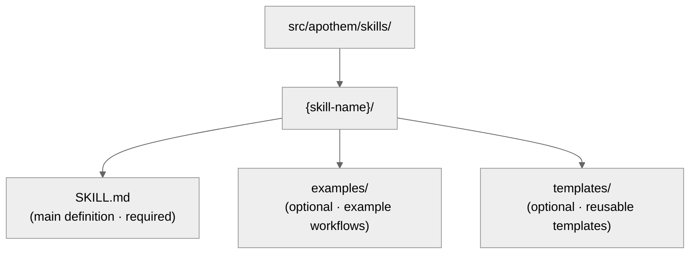

{/* SPDX-License-Identifier: MIT */}

يساعد هذا الدليل المطوّرين على صون منظومة <bdi>Apothem</bdi> وتوسيعها وفق معايير
جودة <bdi>SOTA</bdi>.

## مرجع سريع: أنواع المُنتَجات

يغطّي هذا الدليل خمسة أنواع من المُنتَجات، لكلٍّ منها غرض محدّد. تحمل القواعد
والأوامر والمساعِدات والمهارات بيانات أمامية بصيغة <bdi>YAML</bdi>؛ أمّا الخطّافات
فتُسجَّل في <bdi>`hooks.json`</bdi> و<bdi>`settings.json`</bdi> ولا تحمل بيانات أمامية.
وأنماط الإخراج صنف إضافي من المُنتَجات، له مفتاحان إلزاميان في البيانات الأمامية هما
<bdi>`name`</bdi> و<bdi>`description`</bdi>؛ راجع
[مخطط البيانات الأمامية](/docs/reference/frontmatter-schema).

| المُنتَج | المسار | الغرض | متى يُنشأ |
| -------- | ---- | ------- | -------------- |
| **قاعدة** | <bdi>`src/apothem/rules/*.md`</bdi> | تفويض سلوكي أو توجيه تشغيلي | عند إرساء مبدأ أو سياسة أو تفويض حوكمة جديد |
| **أمر** | <bdi>`src/apothem/commands/*.md`</bdi> | أمر بشرطة مائلة (<bdi>`/command-name`</bdi>) لسيرورات العمل المعقّدة | سير عمل جديد متعدّد الخطوات للمستخدم |
| **مساعِد** | <bdi>`src/apothem/agents/*.md`</bdi> | تعريف دائم لعامل مُفوَّض للمهام المتوازية | مهمة متخصّصة متكرّرة جديدة (تدقيق، استكشاف، فحص جودة) |
| **مهارة** | <bdi>`src/apothem/skills/{name}/SKILL.md`</bdi> | تقنية قابلة لإعادة الاستخدام ذات إشارة كشف | نمط تقنية جديد قابل للكشف وإعادة الاستخدام |
| **خطّاف** | <bdi>`src/apothem/hooks/`</bdi> + <bdi>`hooks.json`</bdi> + <bdi>`settings.json`</bdi> | تحقّق أو إدارة حالة يُطلقهما حدث | حدث جديد في دورة الحياة أو حاجة جديدة إلى التحقّق |

## عقد محوّل إطار العمل

تقيم حقائق هوية إطار العمل وقدراته في
<bdi>`src/apothem/lib/harness_registry.py`</bdi>. ولا يكتمل تغيير إطار العمل إلا عندما
تتوافق هذه الأسطح:

| السطح | التحديث المطلوب |
| --- | --- |
| صفّ السجلّ | المُعرِّف العام، ومفتاح الحزمة، ونقطة الدخول، والنطاق، وصيغة المُخرَج، والمسارات الهدف، ومسارات الوثائق، وملف القدرات، وتثبيت المعيار، واختبارات التجهيزات، ومفتاح بيانات الحزمة، ومصادر القوالب، وحالات القدرات. |
| حزمة المحوّل | <bdi>`__init__.py`</bdi>، <bdi>`install.py`</bdi>، <bdi>`update.py`</bdi>، <bdi>`uninstall.py`</bdi>، <bdi>`verify.py`</bdi>؛ أضف <bdi>`materializer.py`</bdi> فقط عندما يُصيِّر إطار العمل ملف إعداد أصليًا. |
| بيان الانتشار | مسارات القوالب والحزم للمحوّلات المدعومة بالبيان. |
| القدرات | <bdi>`src/apothem/harnesses/<package>/capabilities.yml`</bdi> مع كل قدرة مطلوبة، ومبرّر للحالات غير المدعومة أو التي ما زالت قيد الاكتشاف، إضافةً إلى خريطة <bdi>`conversion_losses`</bdi> لكل حزمة أوامر أو عوامل أو قواعد مُحوَّلة (راجع [سجلّ أُطُر العمل](/docs/reference/harness-registry)). |
| تثبيت الاصطلاح | <bdi>`STANDARD-CONVENTION-PIN.md`</bdi> مع رابط المورّد، وتاريخ اللقطة، واسم الملف/المخطط المرجعي، ومرجع الأدلّة، ومبرّر القدرات غير المدعومة. |
| الاختبارات | تكافؤ السجلّ، واختبار تجهيزة المحوّل، وصفّ خطة التثبيت الذهبية، وسلوك التشغيل التجريبي/عدم الكتابة، وثبات النتيجة عند التكرار، وتغطية بيانات الحزمة. |
| الوثائق | صفحة مرجع إطار العمل، وصفحة المقارنة، وملاحظات القدرات/<bdi>MCP</bdi>، وأمثلة تستخدم عناصر نائبة زائفة. |

يجب على المحوّلات ذات نطاق المشروع أن تضبط <bdi>`requires_project = True`</bdi>، وأن
تقبل <bdi>`project: Path | None`</bdi> في توابع دورة الحياة، وأن ترفض جذور المشاريع
المفقودة أو غير الآمنة قبل أيّ كتابة. ويجب على المحوّلات ذات نطاق المستخدم أن تُبقي
المسارات تحت جذر إعداد المستخدم الموثَّق لإطار العمل.

## سياسة التجهيزة الذهبية

يسجّل <bdi>`tests/fixtures/harness-golden-plans.json`</bdi> الشكل العام لخطة التثبيت
لأُطُر العمل السبعة عشر المُسجَّلة في السجلّ جميعها: المُعرِّف العام، ونمط التجسيد،
ومسار الحزمة/القالب المصدر، والمسار الهدف المُطبَّع تحت <bdi>`<ROOT>`</bdi>. وعندما
يتغيّر سلوك السجلّ أو البيان أو أهداف القوالب عمدًا، حدّث التجهيزة الذهبية في الكوميت
نفسه الذي يحمل تغيير المصدر، كي يُظهر الفرق التغيّر في السلوك.

## التحقّق قبل الكتابة

يتحقّق برنامج تشغيل التثبيت المشترك من كل مصدر وكل هدف قبل أول كتابة. ويرفض مصادر
البيان المفقودة، واجتياز مسار الهدف، ومسارات الهدف الواقعة خارج الجذر المختار، وعبور
الروابط الرمزية؛ وتُفحَص وصلة <bdi>Windows</bdi> (<bdi>junction</bdi>) بوصفها رابطًا رمزيًا. والاستثناءات هي الروابط التي
تنشئها أدوات إدارة ملفات الإعداد النقطية (<bdi>dotfiles</bdi>) عند <bdi>`~/.config`</bdi>، أو عند مجلّد مشترك للمهارات أو القواعد أو القوالب أو فوقه،
وهي تُتَّبَع ما دامت داخل الدليل المنزلي. وتُنفِّذ عمليات التشغيل التجريبي التحقّق نفسه وتُعيد نتائج مُهيكَلة
<bdi>`skipped`</bdi> أو <bdi>`unchanged`</bdi> دون إنشاء ملفات.

## التنقيح وبيانات الأمثلة

تُنقِّح تشخيصات الملف التعريفي الحقول التي تأخذ شكل الرمز المميّز، أو السرّ، أو كلمة
المرور، أو بيانات الاعتماد، أو مفتاح <bdi>API</bdi>، أو المفتاح الخاص، أو التخويل، أو
المصادقة، أو الترويسة. وتستخدم الوثائق والتجهيزات والأمثلة ومقتطفات <bdi>JSON</bdi>
القيم <bdi>`example.invalid`</bdi> و<bdi>`Example User`</bdi> و<bdi>`example-user`</bdi>
وعناصر نائبة واضحة بدلًا من أسرار أو حسابات شخصية تبدو حقيقية.

## قبل الكتابة: المخطط المرجعي

**العقد المقروء آليًا الذي تفرضه البوابة هو مخططات <bdi>JSON Schema</bdi> لكل صنف
تحت <bdi>`src/apothem/schemas/*.schema.json`</bdi> — إذ يرفض <bdi>`additionalProperties`</bdi>
المفاتيح غير المعروفة، فتكون الكلمة الفصل لبوابة المطابقة.** ويتتبّعها إسقاطان
مقروءان للبشر: <bdi>`site/content/docs/reference/frontmatter-schema.mdx`</bdi>
(فهرس المفاتيح المطلوبة) و<bdi>`site/content/docs/reference/artifact-schema.mdx`</bdi>
(قوالب لكل صنف وأمثلة محلولة). وحيثما تخالف صفحةٌ مخططاتِ <bdi>JSON Schema</bdi>،
تكون الغلبة للمخططات.

- اقرأ مخطط <bdi>JSON Schema</bdi> الخاص بنوع مُنتَجك تحت <bdi>`src/apothem/schemas/`</bdi>
- اقرأ <bdi>`site/content/docs/reference/artifact-schema.mdx`</bdi> § «<bdi>Schema</bdi>» للاطّلاع
  على القالب ومثال محلول
- انسخ الحقول المطلوبة، واملأ القيم الإلزامية، وأضف الحقول الاختيارية حسب الحاجة

## فحص سريع للبيانات الأمامية

يجب أن تجتاز البيانات الأمامية لكل مُنتَج هذه الفحوص. طبّق فحوص <bdi>`version`</bdi>
و<bdi>`updated`</bdi> و<bdi>`portability`</bdi> على الصنف الذي يحمل المفتاح فقط: فالقواعد
لا تحمل أيًّا منها، والمهارات لا تحمل <bdi>`portability`</bdi>.

```yaml
✓ Valid YAML syntax (use tools: `yamllint` or PowerShell `ConvertFrom-Yaml` where available)
✓ All mandatory fields present (per schema for artifact type)
✓ name: uses kebab-case
✓ version: semantic MAJOR.MINOR.PATCH
✓ updated: ISO 8601 date (YYYY-MM-DD)
✓ description: single-line, non-empty
✓ scope fields valid per artifact type (rules: pathFilter + alwaysApply; CLAUDE.md root: scope)
✓ portability: string, for example `universal` (the schemas do not enumerate its values)
✓ No typos in field names — must match canonical schema exactly
✓ Optional fields use correct enum values
```

## اصطلاحات التسمية

### أسماء المُنتَجات (<bdi>kebab-case</bdi>)

- **القواعد:** <bdi>`operational-mandates`</bdi>، <bdi>`clean-room-generation`</bdi>، <bdi>`context-management`</bdi>
- **الأوامر:** <bdi>`plan-execute`</bdi>، <bdi>`plan-spec`</bdi>، <bdi>`plan-generate`</bdi>
- **المساعِدات:** <bdi>`codebase-explorer`</bdi>، <bdi>`convention-auditor`</bdi>، <bdi>`quality-gate`</bdi>
- **المهارات:** <bdi>`plan-suite`</bdi>، <bdi>`ecosystem-audit`</bdi>

النمط: أحرف صغيرة، وشرطات بين الكلمات، دون مسافات أو شرطات سفلية.

### تسمية الملفات

- **القواعد:** <bdi>`{name}.md`</bdi>
- **الأوامر:** <bdi>`{name}.md`</bdi>
- **المساعِدات:** <bdi>`{name}.md`</bdi>
- **المهارات:** داخل المجلّد <bdi>`src/apothem/skills/{name}/SKILL.md`</bdi> (بحالة الأحرف نفسها تمامًا: <bdi>`SKILL.md`</bdi>)
- **الخطّافات:** داخل المجلّد <bdi>`src/apothem/hooks/`</bdi>. جميع معالجات الأحداث مكتوبة بلغة <bdi>Python</bdi>. يستخدم كل أمر خطّاف في قالب <bdi>`settings.json`</bdi> الخاص بـ <bdi>Claude Code</bdi> صيغة <bdi>exec</bdi>: إذ إن <bdi>`command`</bdi> هو العنصر النائب للمفسِّر <bdi>`${PYTHON_BIN}`</bdi>، ويُحلّ وقت التثبيت، و<bdi>`args`</bdi> يحمل <bdi>`-E`</bdi> و<bdi>`-s`</bdi> ومسار النص البرمجي ووسائطه. وتُبقي الرايتان <bdi>`PYTHONPATH`</bdi> ومتغيّرات <bdi>`PYTHON*`</bdi> الأخرى وحِزَم <bdi>site-packages</bdi> الخاصّة بالمستخدم خارج كل خطّاف؛ فأبقِهما على أي خطّاف تضيفه. ويشغّل ذلك القالب الأمرين <bdi>`${HARNESS_ROOT}/.apothem/support/hooks/dispatch.py <event> [<message-name>]`</bdi> و<bdi>`${HARNESS_ROOT}/.apothem/support/conformity/gate.py --hook`</bdi> بالمسار المطلق، فلا تحتاج النسخة المثبّتة إلى حزمة <bdi>`apothem`</bdi> قابلة للاستيراد. أمّا إضافة <bdi>Claude Code</bdi> فتسجّل الخطّافات بدلًا من ذلك في <bdi>`src/apothem/hooks/hooks.json`</bdi>، بوصفها أوامر صدفة تشغّل <bdi>`hooks/lib/bootstrap.sh`</bdi> عبر <bdi>`bash`</bdi>؛ ويحدّد ذلك الملف الهيكلي موضع <bdi>Python</bdi> ويشغّل <bdi>`dispatch.py`</bdi>، فتبقى المعالجات بلغة <bdi>Python</bdi>. سجّل أي خطّاف جديد في <bdi>`hooks.json`</bdi> وفي قالب <bdi>`settings.json`</bdi> الخاص بـ <bdi>Claude Code</bdi>. ويوجّه <bdi>`dispatch.py`</bdi> الحدث <bdi>`SessionStart`</bdi> إلى <bdi>`session_start_bootstrap.main()`</bdi>، وكل حدث آخر مُدرَج في القائمة البيضاء إلى <bdi>`emit_hook_context.main()`</bdi>. وملفات الصدفة الهيكلية الوحيدة المسموح بها تحت <bdi>`src/apothem/hooks/`</bdi> أو <bdi>`scripts/`</bdi> هي الملفات الستة لتحديد الموقع والتمهيد (<bdi>`find-python.{ps1,sh}`</bdi>، و<bdi>`find-pwsh.{ps1,sh}`</bdi>، و<bdi>`bootstrap.{ps1,sh}`</bdi>)؛ وأي ملف <bdi>`.ps1`</bdi> / <bdi>`.sh`</bdi> آخر يُخفق في فحص النظافة <bdi>`scripts/dev/validate_hooks.py`</bdi>.

### الإحالات المتبادلة

عند الإحالة إلى مُنتَجات أخرى، استخدم الأسماء الدقيقة:

- القواعد: <bdi>`"operational-mandates"`</bdi> (قيمة حقل الاسم)
- الأوامر: <bdi>`/plan-execute`</bdi> (بالشرطة المائلة في الوثائق الموجّهة للبشر؛ ومن دونها في الشيفرة)
- المساعِدات: <bdi>`codebase-explorer`</bdi> (قيمة حقل الاسم)
- المهارات: <bdi>`plan-suite`</bdi> (قيمة حقل الاسم)

لا تستخدم أبدًا مسارات الملفات أو الأسماء المبتورة في النصّ النثري.

## قابلية النقل: <bdi>Windows</bdi> مقابل <bdi>Unix</bdi>

يجب على كل أمر أن يُعلن صراحةً حالة قابليته للنقل في الحقل <bdi>`portability`</bdi>.
ويجوز للمساعِد أن يُعلنها. ولا تحمل المهارات والقواعد وأنماط الإخراج حقل
<bdi>`portability`</bdi>.

### عامّ

- يعمل بالطريقة نفسها على <bdi>Windows</bdi> و<bdi>macOS</bdi> و<bdi>Linux</bdi>
- لا افتراضات بشأن الصدفة
- تستخدم المسارات الشرطات المائلة الأمامية (<bdi>`/`</bdi>)
- لا مسارات مطلقة ثابتة مُضمَّنة
- لا صيغة <bdi>PowerShell</bdi> خاصة بـ <bdi>Windows</bdi>

```yaml
portability: "universal"
```

### عامّ مع تحفّظات على <bdi>Windows</bdi>

- عامّ عبر مضيفات <bdi>POSIX</bdi>؛ وينطبق التحفّظ المُسمّى على متغيّر منصّة <bdi>Windows</bdi> المُعلَن في المحتوى
- وثّق التحفّظ صراحةً في المحتوى
- مثال: «الروابط الرمزية غير مدعومة على <bdi>Windows</bdi> قبل <bdi>Win 10</bdi>»

```yaml
portability: "universal-with-windows-caveats"
```

وثّق التحفّظ في ملاحظة تلي العنوان مباشرةً.

### مقتصر على <bdi>Unix</bdi> / مقتصر على <bdi>Windows</bdi>

- مقيَّد صراحةً بمنصّة واحدة
- نادر في <bdi>Apothem</bdi> — ينبغي أن تكون معظم المُنتَجات عامّة
- لا تستخدمه إلا إذا كانت الميزات الخاصة بالمنصّة أساسية

```yaml
portability: "unix-only"
```

وثّق السبب في القسم الأول من المُنتَج.

## النطاق: فعّال دائمًا مقابل مُرشَّح بالمسار

### فعّال دائمًا

تنطبق القاعدة في كل مكان. خمس قواعد فعّالة دائمًا: <bdi>`agnostic-posture`</bdi>،
و<bdi>`authority-inquiry`</bdi>، و<bdi>`session-closure`</bdi>، و<bdi>`context-management`</bdi>، وفهرس
القواعد (<bdi>`apothem-rule-index`</bdi>). والمجموعة صغيرة لأن كل قاعدة فعّالة دائمًا
تستهلك من السياق في كل جلسة.

```yaml
pathFilter: ""
alwaysApply: true
```

### مُرشَّح بالمسار

تنطبق القاعدة شرطيًا بحسب مسار الملف.

```yaml
pathFilter: "**/*.py, **/*.toml"
alwaysApply: false
```

يستخدم <bdi>`pathFilter`</bdi> أنماط <bdi>glob</bdi> (بالصيغة نفسها المستخدمة في <bdi>`.gitignore`</bdi>).
وعندما يطابق ملفٌّ المرشِّح، تُفعَّل القاعدة.

## دلالات النسخ

يحمل كل مُنتَج ذي نسخة نسخته الدلالية الخاصة (<bdi>`MAJOR.MINOR.PATCH`</bdi>).
تتطلّبها الأوامر والمهارات، ويجوز أن تحملها المساعِدات وأنماط الإخراج، ولا تحمل
القواعد أيَّ نسخة:

- **<bdi>PATCH</bdi>** — تغيير سلوكي يُصحّح توجيهًا قائمًا دون كسر العقد.
- **<bdi>MINOR</bdi>** — تغييرات إضافية غير كاسرة: أقسام اختيارية جديدة، وحقول اختيارية جديدة في البيانات الأمامية، وأمثلة جديدة. ويواصل المستهلكون الحاليون العمل دون أي تغيير.
- **<bdi>MAJOR</bdi>** — تغييرات كاسرة في المخطط أو العقد: أقسام محذوفة، وحقول مُعاد تسميتها، وتغيير سلوك توجيه قائم، وتغييرات تتطلّب أن تتكيّف المُنتَجات التابعة.

لا تُغيّر إصلاحات الأخطاء المطبعية، وإصلاحات الروابط، والتنسيق، والتعديلات المقتصرة على التعليقات أو على الوثائق رقمَ الإصدار. ولا يرفعه إلا تغيير سلوكي. ومع ذلك يُحدِّث مثل هذا التعديل تاريخ <bdi>`updated`</bdi> الخاص بالمُنتَج.

أمثلة:

- <bdi>`vX.Y.Z` → `vX.Y.(Z+1)`</bdi> (<bdi>PATCH</bdi>: توجيه مُصحَّح يغيّر السلوك)
- <bdi>`vX.Y.Z` → `vX.Y.Z`</bdi> (بلا رفع: إصلاح خطأ مطبعي أو رابط؛ يتغيّر <bdi>`updated`</bdi>)
- <bdi>`vX.Y.Z` → `vX.(Y+1).0`</bdi> (<bdi>MINOR</bdi>: إضافة قسم اختياري جديد)
- <bdi>`v0.Y.Z` → `v(0+1).0.0`</bdi> (<bdi>MAJOR</bdi>: إعلان استقرار العقد؛ وتبدأ المُنتَجات الجديدة عند <bdi>`v0.Y.Z`</bdi>)
- <bdi>`vX.Y.Z` → `v(X+1).0.0`</bdi> (<bdi>MAJOR</bdi>: حذف حقل إلزامي من البيانات الأمامية)

ارفع <bdi>`version`</bdi> و<bdi>`updated`</bdi> معًا في كل تعديل يغيّر السلوك في مُنتَج
يحمل هذين الحقلين. وألحِق صفًّا مطابقًا بملف <bdi>`CHANGELOG.md`</bdi> على مستوى
المنظومة للإصدارات التي تجمع تغييرات في المُنتَجات.

### مراجعات حزمة الخطّة

لا تنطبق القاعدة الخاصة بالقِطَع أعلاه على حزم الخطط. إصدار حزمة الخطّة هو قيمة <bdi>`vX.Y.Z`</bdi> المسجّلة في ترويسة <bdi>`MASTER-PLAN.md`</bdi> وفي جدول سجلّ المراجعات. وتصحيح خطأ مطبعي في حزمة خطّة يُعدّ مراجعة ترفع رقم <bdi>PATCH</bdi>. تحدّد الخطوة 10.2 من <bdi>`/plan-review`</bdi> التصنيف، وتُلحِق صفّ سجلّ المراجعات.

- <bdi>`vX.Y.Z` → `vX.Y.(Z+1)`</bdi> (حزمة خطّة، تصحيح مطبعي: <bdi>PATCH</bdi>)
- <bdi>`vX.Y.Z` → `vX.Y.Z`</bdi> (قِطعة، تصحيح مطبعي: بلا رفع للإصدار؛ قاعدة القِطَع أعلاه)

## متى تُعدِّل مُنتَجًا

### القواعد

- عامِل بنية الإلزامي/الاختياري على أنها حاملة للحِمل — فإعادة هيكلتها تمتدّ آثارها
  إلى كل مُنتَج تابع.
- نقّح الأنماط المضادة وأمثلة تدرّج الجدّية والاستشهادات كلّما تعمّق الفهم.
- دوّن مبرّر أيّ تغيير بنيوي في ملف موضوع الذاكرة ذي الصلة.

### الأوامر

- شكل الوسائط جزء من العقد العام — لا تكسره إلا بنيّة صريحة، وانشر التغيير إلى كل
  مستدعٍ (رفع <bdi>MAJOR</bdi>).
- أبقِ خطوات سير العمل وعقود الإرجاع مُحكمة وحديثة.
- وثّق تسلسل الخطوات غير البديهي في موضعه.

### المساعِدات

- أبقِ <bdi>`disallowedTools`</bdi> في حدّه الأدنى الكافي؛ ووثّق المبرّر عندما
  يتغيّر.
- نقّح مبادئ التشغيل وعقود الإرجاع كلّما نضج دور المساعِد
  (رفع <bdi>MINOR</bdi>).
- تتبّع تحوّلات القدرات في موضعها كي يتمكّن المستدعون من إعادة ضبط توقّعاتهم.

### المهارات

- أبقِ خطوات الإجراء والأمثلة متزامنة مع الواقع.
- يجب أن تعكس إشارات الكشف صياغة المستخدمين الفعلية في الاستخدام الحالي.
- قسّم المهارة متى تجاوزت ~150 سطرًا (راجع
  <bdi>`auto-memory.md`</bdi> § <bdi>Topic File Management</bdi>).

## خطوة بخطوة: إضافة قاعدة جديدة

### 1. قيّم التعامد

هل تتداخل هذه القاعدة مع قواعد قائمة؟ ابحث في <bdi>`src/apothem/rules/`</bdi> عن محتوى ذي صلة.

إذا تجاوز التداخل 50%، ففكّر في توسيع قاعدة قائمة بدلًا من ذلك. راجع
<bdi>`persistent-conventions-vigilance.md`</bdi> § <bdi>Artifact Evolution</bdi>.

### 2. اكتب المحتوى

اتّبع البنية التالية:

- العنوان: <bdi>`# Rule: {Title}`</bdi>
- قسم الغرض
- الالتزامات / التوجيهات الأساسية (مرقّمة ومزوّدة بروابط)
- جدول تدرّج الجدّية (مطلوب دائمًا)
- قسم الأنماط المضادة
- قسم الإنفاذ

### 3. أنشئ البيانات الأمامية

استخدم المخطط من <bdi>`site/content/docs/reference/artifact-schema.mdx`</bdi> § <bdi>Schema: Rules</bdi>. واضبط:

- <bdi>`name:`</bdi> مُعرِّفًا بصيغة <bdi>kebab-case</bdi>
- <bdi>`description:`</bdi> ملخّصًا من سطر واحد للسجلّات
- <bdi>`pathFilter:`</bdi> قائمة <bdi>glob</bdi> للقواعد المُرشَّحة بالمسار؛ والسلسلة الفارغة (<bdi>`""`</bdi>) للقواعد الفعّالة دائمًا
- <bdi>`alwaysApply:` `true`</bdi> للقواعد الفعّالة دائمًا، و<bdi>`false`</bdi> للقواعد المُرشَّحة بالمسار

لا تحمل القواعد إلا هذه الحقول الأربعة — بلا <bdi>`version`</bdi> / <bdi>`updated`</bdi> / <bdi>`scope`</bdi> / <bdi>`portability`</bdi> / <bdi>`implements`</bdi>.

القاعدة الجديدة مُرشَّحة بالمسار. وتحتاج القاعدة الجديدة الفعّالة دائمًا إلى رفع القائمة
الأساسية وسقوف البايتات في التغيير نفسه: القائمة في
<bdi>`tests/unit/test_always_on_core.py`</bdi> والسقوف في
<bdi>`conformity/always_on_budget_grep.py`</bdi>. وتأخذ القاعدة المرافقة
(<bdi>`<parent>-<aspect>`</bdi>) قيمة <bdi>`pathFilter`</bdi> الخاصة بقاعدتها الأم، أو قيمة أضيق منها.

مثال:

```yaml
---
name: "my-new-rule"
description: "Brief one-liner"
pathFilter: "**/*.py"
alwaysApply: false
---
```

### 4. حدّث ملف <bdi>README</bdi> الخاص بالقواعد

أضف صفًّا إلى جدول عائلة القاعدة في قسم «<bdi>Rule families</bdi>» من
<bdi>`src/apothem/rules/README.md`</bdi>:

```markdown
| `my-new-rule.md` | One-line concern of the new rule. |
```

اختر جدول العائلة الذي يتّفق مجال اهتمامه مع القاعدة. وسمِّ القاعدة أيضًا في
سطر <bdi>`src/apothem/rules/apothem-rule-index.md`</bdi> الخاص بالموقف الذي
يستدعيها؛ إذ يفشل <bdi>`tests/unit/test_always_on_core.py`</bdi> عندما تغيب قاعدة
عن الفهرس.

### 5. ألحِق بملف <bdi>CHANGELOG.md</bdi>

أضف صفًّا تحت قسم <bdi>`### Added`</bdi> الخاص بالإصدار التالي يصف القاعدة الجديدة.

### 6. شغّل التحقّق

استدعِ مهارة <bdi>`ecosystem-audit`</bdi> للتحقّق من القاعدة الجديدة، مع التركيز على منطقة القواعد:

```text
Invoke the ecosystem-audit skill with --focus rules --fix
```

تحقّق من عدم الإبلاغ عن أيّ أخطاء في قاعدتك الجديدة.

## خطوة بخطوة: إضافة أمر جديد

الأوامر هي أوامر بشرطة مائلة مثل <bdi>`/plan-spec`</bdi> و<bdi>`/plan-execute`</bdi> و<bdi>`/security-audit`</bdi> وغيرها.

### 1. حدّد الدور

الأوامر سيرورات عمل يُطلقها المستخدم. ولا يشغّل النموذج أمرًا منها من تلقاء نفسه إلا
عندما يكون إعداد <bdi>`disable-model-invocation`</bdi> الخاص به <bdi>`false`</bdi>
(الخطوة 2). اسأل:

- هل هذا سير عمل يكتب فيه المستخدم <bdi>`/command-name`</bdi>؟
- هل يُنسِّق خطوات متعدّدة؟
- هل يمكن أن تنتهي مهلته أو أن يتطلّب إدخالًا من المستخدم في منتصف التنفيذ؟

إذا كانت الإجابة «لا» عن أيٍّ من هذه الأسئلة، فهو على الأرجح مهارة لا أمر.

### 2. أنشئ الملف

المسار: <bdi>`src/apothem/commands/{name}.md`</bdi>

البيانات الأمامية (من <bdi>`site/content/docs/reference/artifact-schema.mdx`</bdi> § <bdi>Schema: Commands</bdi>):

```yaml
---
name: "my-command"
version: "X.Y.Z"
updated: "2026-04-20"
description: "What this command does"
argument-hint: "[path/to/input] [--flag VALUE]"
disable-model-invocation: false
portability: "universal"
allowed-tools: "Read, Glob, Grep"
---
```

يجعل <bdi>`disable-model-invocation: true`</bdi> الأمرَ لا يُستدعى إلا من المُشغِّل؛
ومع <bdi>`false`</bdi> يجوز للنموذج تشغيله عندما يطابق طلبٌ وصفَه. والقيمة
الافتراضية <bdi>`false`</bdi> للأوامر التي للقراءة فقط وللأوامر الاستشارية، مع وصف يبدأ
بحالة الاستخدام؛ ويستخدمها 35 أمرًا من أصل 45. ويبقى الأمر <bdi>`true`</bdi> عندما
يُغيّر الحالة خارج شجرة العمل أو يعتمد على اختيار المُشغِّل للّحظة المناسبة (10 أوامر).
ويسرد جدول الاستدعاء في <bdi>`src/apothem/commands/README.md`</bdi> إعداد كل
أمر؛ أضف صفًّا للأمر الجديد. وأبقِ
<bdi>`allowed-tools`</bdi> للقراءة فقط: فإطار العمل الذي يلتزم به يُشغِّل تلك الأدوات دون
أن يسأل. لا تمنح أداةً ذات آثار جانبية إلا بوصفها قاعدة محدودة النطاق، مثل
<bdi>`Bash(git log *)`</bdi>؛ إذ يرفض المخطط <bdi>`"*"`</bdi> وأيًّا من <bdi>`Bash`</bdi> أو <bdi>`PowerShell`</bdi>
أو <bdi>`Write`</bdi> أو <bdi>`Edit`</bdi> أو <bdi>`NotebookEdit`</bdi> أو <bdi>`WebFetch`</bdi> إذا كُتب دون نطاق.

### 3. اكتب المحتوى

البنية:

- العنوان: <bdi>`# /{name} — Human-Readable Title`</bdi>
- قسم الدور (مَن يُنفِّذ هذا)
- تعليمات عالية المستوى
- قسم سير العمل مع الخطوات
- عقد الإرجاع / صيغة المُخرَج

يُقسِّم إصدار المهارات لدى أحد أُطر العمل كل أمر إلى ملف <bdi>`SKILL.md`</bdi> مختصر وملفات
<bdi>`references/`</bdi> بحسب أقسام <bdi>H2</bdi>. امنح الأمر قسم <bdi>`## Workflow`</bdi> واحدًا،
وأغلِق كل سياج شيفرة، وصنِّف أي نوع جديد من أقسام <bdi>H2</bdi> في
<bdi>`src/apothem/lib/claude_skill_split.py`</bdi>؛ إذ يفشل <bdi>`tests/unit/test_claude_skill_split.py`</bdi>
عند وجود نوع غير مُصنَّف. والقواعد موجودة في عقد تقسيم إصدار المهارات
(<bdi>Skill-emission split contract</bdi>) ضمن <bdi>`src/apothem/commands/README.md`</bdi>.

### 4. حدّث ملف <bdi>README</bdi> وملف <bdi>CHANGELOG.md</bdi>

أضف صفًّا إلى جدول قسم الأمر في <bdi>`src/apothem/commands/README.md`</bdi>، إضافةً إلى صفّ جدول الاستدعاء من الخطوة 2؛ وأضف صفًّا في <bdi>CHANGELOG</bdi> تحت قسم <bdi>`### Added`</bdi> الخاص بالإصدار التالي.

### 5. تحقّق

استدعِ مهارة <bdi>`ecosystem-audit`</bdi>، مع التركيز على الأوامر:

```text
Invoke the ecosystem-audit skill with --focus commands --fix
```

## خطوة بخطوة: إضافة مساعِد جديد

المساعِدات تعريفات دائمة لعمّال مُفوَّضين للعمل المتوازي.

### 1. حدّد النمط

هل يندرج هذا المساعِد ضمن أحد أنماط الفرق المُدرَجة أدناه؟

- فريق البحث: للقراءة فقط، وجمع المعلومات
- فريق التدقيق: التحقّق، وفحوص الاتساق
- فريق التنفيذ: تغييرات متوازية في الشيفرة
- فريق الجودة: الفحص الساكن، والاختبار، وفحص الأنواع، والأمان
- فريق التوثيق: تحديثات الوثائق
- أخرى: مهمة متخصّصة

### 2. أنشئ الملف

المسار:

```text
src/apothem/agents/{name}.md
```

البيانات الأمامية:

```yaml
---
name: "my-helper"
version: "X.Y.Z"
updated: "2026-04-20"
description: "What this helper specializes in"
tools: "Read, Glob, Grep, Bash"
disallowedTools: "Write, Edit"
maxTurns: 15
portability: "universal"
---
```

أغفِل <bdi>`model`</bdi> و<bdi>`effort`</bdi> و<bdi>`permissionMode`</bdi> كي يرث المساعِد
اختيارات الجلسة (الوضعية المحايدة)، وأغفِل <bdi>`memory`</bdi> ما لم يحتج
المساعِد إلى نطاق ذاكرة دائمة (<bdi>`user`</bdi> أو <bdi>`project`</bdi> أو <bdi>`local`</bdi>).

### 3. اكتب المحتوى

الأقسام:

- مبادئ التشغيل (للقراءة فقط، قائمة على الأدلّة، أحكام ثنائية، شاملة)
- سير العمل (خطوات مرقّمة)
- عقد الإرجاع (الحدّ الأقصى للرموز، والبنية، والحقول المطلوبة)

### 4. حدّث ملف <bdi>README</bdi> وملف <bdi>CHANGELOG.md</bdi>

أضف صفًّا إلى جدول الفهرس في <bdi>`src/apothem/agents/README.md`</bdi>؛ وأضف صفًّا في <bdi>CHANGELOG</bdi> تحت قسم <bdi>`### Added`</bdi> الخاص بالإصدار التالي.

### 5. اختبر

انشر المساعِد في سيناريو حقيقي وتحقّق من أنه يعمل كما هو موثَّق.

## خطوة بخطوة: إضافة مهارة جديدة

المهارات تقنيات قابلة لإعادة الاستخدام والكشف.

### 1. حدّد قابلية إعادة الاستخدام

قبل كتابة مهارة:

- هل صادفت هذه المشكلة/التقنية 3 مرات فأكثر؟
- هل يمكن كشفها؟ (هل يشير إليها نمطٌ في طلبات المستخدم؟)
- هل يمكنك تدوينها بطريقة قابلة لإعادة الإنتاج؟

إذا كانت الإجابة نعم عن الثلاثة جميعًا، فاكتب مهارة.

### 2. أنشئ البنية



### 3. اكتب <bdi>SKILL.md</bdi>

البيانات الأمامية:

```yaml
---
name: "skill-name"
version: "X.Y.Z"
updated: "2026-04-20"
description: "What this skill teaches"
archetype: "workflow-template"
userInvocable: true | false
disable-model-invocation: true | false
allowed-tools: "Read, Glob, Grep"
argument-hint: "[args]"               # optional; if userInvocable
---
```

بنية المحتوى:

- الغرض
- متى تُستخدم هذه المهارة
- المتطلّبات المسبقة
- الإجراء خطوة بخطوة
- الأخطاء الشائعة
- الأمثلة

### 4. حدّث ملف <bdi>README</bdi> وملف <bdi>CHANGELOG.md</bdi>

أضف صفًّا إلى جدول الفهرس، وصفًّا لكل ملف من ملفات المهارة إلى جدول محتويات المجلّد، في <bdi>`src/apothem/skills/README.md`</bdi>؛ وأضف صفًّا في <bdi>CHANGELOG</bdi> تحت قسم <bdi>`### Added`</bdi> الخاص بالإصدار التالي.

### 5. تحقّق

استدعِ مهارة <bdi>`ecosystem-audit`</bdi>، مع التركيز على المهارات:

```text
Invoke the ecosystem-audit skill with --focus skills --fix
```

## قائمة فحوص التحقّق قبل إنشاء الكوميت

- [ ] تجتاز البيانات الأمامية فحص صيغة <bdi>YAML</bdi>
- [ ] جميع الحقول الإلزامية موجودة وفق المخطط
- [ ] يستخدم الحقل <bdi>`name`</bdi> صيغة <bdi>kebab-case</bdi>
- [ ] <bdi>`version`</bdi> (للأصناف ذات النسخ فقط؛ فالقواعد لا تحمل نسخة) دلالي (<bdi>`MAJOR.MINOR.PATCH`</bdi>) ورُفِع إن تغيّر السلوك
- [ ] <bdi>`updated`</bdi> يطابق تاريخ اليوم لأيّ مُنتَج عدّلته يحمل هذا الحقل
- [ ] الحقل <bdi>`portability`</bdi> مضبوط وصالح (إلزامي في الأوامر، واختياري في المساعِدات)
- [ ] يحمل <bdi>CHANGELOG.md</bdi> التغيير في الفئة المناسبة تحت قسم الإصدار التالي
- [ ] لا إحالات داخلية خاصة بالخطط (امتثالًا لـ <bdi>CM-7</bdi>)
- [ ] الإحالات المتبادلة متّسقة مع المُنتَجات الأخرى
- [ ] المُنتَج الجديد مُسجَّل في فهرس <bdi>README</bdi> الخاص بمجلّده
- [ ] المُنتَج مُختبَر (إن انطبق ذلك)
- [ ] تعمل مهارة <bdi>`ecosystem-audit`</bdi> دون أخطاء
- [ ] يتّبع المحتوى الاصطلاحات البنيوية (صيغة العنوان، والأقسام، وما إلى ذلك)

## الإحالة إلى مُنتَجات أخرى

استخدم هذه الاصطلاحات بدقّة:

### الإحالة إلى قاعدة

```markdown
See `src/apothem/rules/operational-mandates.md` or shorthand: the Operational Mandates rule.
In prose: ... per CM-1–10 (Operational Mandates rule) ...
```

### الإحالة إلى أمر

```markdown
See `/plan-execute` command. Or: Run `/plan-execute`.
In prose: The `/plan-execute` command handles phase execution.
```

### الإحالة إلى مساعِد

```markdown
Deploy the `codebase-explorer` delegated worker.
In prose: The codebase-explorer worker finds patterns.
```

### الإحالة إلى مهارة

```markdown
Use the `plan-suite` skill.
In prose: The plan-suite skill provides the Master Plan Suite template.
```

### الإحالة إلى أقسام <bdi>CLAUDE.md</bdi>

```markdown
See CLAUDE.md § Harness Adapter Pattern.
Or: § Plans Discipline.
```

## الفحص الساكن والتنسيق

تستخدم جميع المُنتَجات:

- **<bdi>Markdown</bdi>:** <bdi>GFM</bdi> (<bdi>GitHub Flavored Markdown</bdi>)
- **<bdi>YAML</bdi>:** متوافق مع <bdi>YAML 1.2</bdi>
- **نهايات الأسطر:** <bdi>LF</bdi> (نمط <bdi>Unix</bdi>)
- **الترميز:** <bdi>UTF-8</bdi>
- **عرض السطر:** التفاف مرن عند 100 حرف للمحتوى (دون فواصل أسطر ثابتة)

استخدم المُنسِّق / المدقّق <bdi>`Ruff`</bdi> لملفات <bdi>Python</bdi>. ولملفات <bdi>Markdown</bdi>، استخدم
<bdi>`prettier`</bdi> أو ما يعادله.

## الاختبار والقياس

### تشغيل مجموعة الاختبارات

```bash
python -m pytest                      # unit, integration, property, conformity, scripts
python -m pytest tests/property       # Hypothesis properties (profile loader, frontmatter, merge)
python -m pytest tests/fuzz           # replay each fuzz target's seed inputs (no Atheris needed)
```

تعمل أهداف الاختبار العشوائي (<bdi>fuzz</bdi>) في <bdi>`tests/fuzz/`</bdi> تحت <bdi>Atheris</bdi> في <bdi>CI</bdi>. ولتشغيل أحدها على
جهازك (<bdi>Linux</bdi> أو <bdi>macOS</bdi>، و<bdi>Python 3.11</bdi> أو أحدث)، ثبّت <bdi>Atheris</bdi>، وضع
النسخة المسحوبة على المسار، ووجّه الهدف إلى نسخة من مدخلاته الأوّلية:

```bash
python -m pip install atheris
export PYTHONPATH="$PWD/src:$PWD/src/apothem/_vendor"
mkdir -p /tmp/corpus && cp tests/fuzz/seeds/lenient-json/*.txt /tmp/corpus/
python tests/fuzz/fuzz_lenient_json.py -max_total_time=60 /tmp/corpus
```

يسرد <bdi>`tests/fuzz/README.md`</bdi> الأهداف وما ينبغي فعله حين يجد أحدها انهيارًا.

مجموعة الاختبارات محكمة العزل: تنجح والنسخة المسحوبة تحت <bdi>`$TMPDIR`</bdi>، ومع
<bdi>`python`</bdi> على <bdi>`PATH`</bdi> يفتقر إلى المتطلّبات المسبقة لواجهة سطر الأوامر، لأن
اختبارات التكامل تُشغِّل المُفسِّر نفسه الذي يُشغِّل <bdi>pytest</bdi>، وتستبدل برموزٍ مساراتِ
المجلّدات المؤقّتة والمصدر المتداخلة بدءًا بالأطول.

### الاختبارات لا تكتب أبدًا في دليلك المنزلي الحقيقي

يجب ألّا يُشغِّل سكربت استكشافي أو مساعد آلي مُثبِّتات <bdi>Apothem</bdi>
أو محوّلاته على دليلك المنزلي الحقيقي أبدًا. شغّل السلوك داخل اختبار تحت
<bdi>`tests/`</bdi>، حيث يوجّه <bdi>`tests/conftest.py`</bdi> الدليل المنزلي، وسجلّ التثبيت،
وجذر النسخ الاحتياطية إلى مجلّدات مؤقّتة.

ويرفض <bdi>Apothem</bdi> أيضًا هذه الكتابات بنفسه أثناء تشغيل <bdi>pytest</bdi>، فلا يستطيع ملف اختبار
منسوخ خارج <bdi>`tests/`</bdi> ومُشغَّل دون <bdi>`tests/conftest.py`</bdi> أن يصل إلى
الدليل المنزلي الحقيقي عبر <bdi>Apothem</bdi>. فما دام <bdi>`PYTEST_CURRENT_TEST`</bdi> مضبوطًا وغير فارغ
(اختبار)، أو كان <bdi>`PYTEST_VERSION`</bdi> يحمل إصدار <bdi>pytest</bdi> الجاري تشغيله (الجلسة
كلّها، بما فيها الجمع وخطّافات الجلسة)، فإن أي كتابة أو إزالة أو نسخ أو
إعادة تسمية أو ملف قفل في <bdi>`~/.apothem`</bdi> الخاص بالحساب، أو <bdi>`~/.config/apothem`</bdi>، أو مجلّد
أداة يسمّيه سجلّ أُطُر العمل في الدليل المنزلي (<bdi>`~/.claude`</bdi>، و<bdi>`~/.qwen`</bdi>،
و<bdi>`~/.config/opencode`</bdi> وبقيّتها)، أو ملف خارج تلك المجلّدات يغيّره
بيان الانتشار (<bdi>`~/.antigravity/profile.yaml`</bdi> الذي كتبه إصدار
سابق) يتوقّف قبل أن يتغيّر أي شيء، مع خطأ كهذا:

```text
RealHomeWriteError: Apothem refused to create the lock file
C:\Users\you\.apothem\state\codex\<id>.install.lock: it is inside or holds
C:\Users\you\.apothem, a protected path in this account's real home, while a
pytest test is running (PYTEST_CURRENT_TEST is set:
test_probe.py::test_install (call)). Nothing in C:\Users\you\.apothem was
changed. ...
```

لا يُحتسَب <bdi>`PYTEST_VERSION`</bdi> بأي قيمة أخرى، مثل إصدار مثبَّت كـ <bdi>`8.2`</bdi> تُصدِّره
صدفة أو مهمة <bdi>CI</bdi>، ولا يُحتسَب كذلك <bdi>`PYTEST_CURRENT_TEST`</bdi> الفارغ. وخارج أي اختبار
يقول الخطأ <bdi>`PYTEST_VERSION holds
the version of the pytest imported in this process, <version>, outside any
test`</bdi> بدلًا من الاختبار؛ فهو لا يدّعي أن جلسة <bdi>pytest</bdi> تعمل،
إذ يمكن لعملية أن تستورد <bdi>pytest</bdi> دون أن تُشغِّل جلسة. أمّا <bdi>`PYTEST_VERSION`</bdi> الذي
تُصدِّره صدفة أو مهمة <bdi>CI</bdi> بالإصدار الدقيق لـ <bdi>pytest</bdi> المُثبَّت فيُحتسَب
بالقدر نفسه، خارج <bdi>pytest</bdi> أيضًا، وفي عملية لم تستورد
<bdi>pytest</bdi> يقول الخطأ عندئذ <bdi>`PYTEST_VERSION holds the installed pytest's
version, <version>, though no pytest runs in this process`</bdi>.

ويُرفَض بالطريقة نفسها التثبيتُ أو التحديث أو إلغاء التثبيت أو الاسترجاع على نطاق المشروع الذي يكون جذر مشروعه
هو الدليل المنزلي للحساب نفسه، قبل أن يكتب أي شيء: وإلا لوقعت ملفات مشروعه
مباشرةً في الدليل المنزلي. ويبقى مجلّد المشروع الواقع
داخل الدليل المنزلي مسموحًا. ويُرفَض أيضًا دليل البيانات الواقع مباشرةً في الدليل المنزلي،
أيًّا كان الاسم الذي يمنحه إيّاه الملف التعريفي (<bdi>`workspace.scope: user-home`</bdi> مع
<bdi>`directory_name`</bdi> خاص به)، قبل إنشائه وقبل إزالة مخازنه. ودليل البيانات الذي هو رابط
(وصلة <bdi>junction</bdi> على <bdi>Windows</bdi>) إلى مجلّد واقع مباشرةً
في الدليل المنزلي يُرفَض بالطريقة نفسها، وكذلك الدليل الذي يؤدّي إلى الدليل المنزلي
نفسه، مباشرةً أو عبر سلسلة من الروابط، والذي ستقع مخازنه مباشرةً
في الدليل المنزلي.

تُحتسَب هذه الصيغ لكتابة المجلّد المحمي: رابط أو وصلة إليه، ومجلّد
استُبدل به رابط أثناء الاختبار. وعلى <bdi>Windows</bdi> تُحتسَب أيضًا حالة الأحرف، والأسماء
القصيرة (<bdi>8.3</bdi>)، والبادئات <bdi>`\\?\`</bdi> و<bdi>`\\.\`</bdi> و<bdi>`\??\`</bdi>، ومشاركة الإدارة عبر الاسترجاع الحلقي
مثل <bdi>`\\localhost\C$`</bdi> أو <bdi>`\\--1.ipv6-literal.net\C$`</bdi>، والمشاركة التي يُوصَل إليها بأحد
عناوين الجهاز نفسه أو عبر محرّك أقراص مُعيَّن، وتدفّق البيانات
البديل (<bdi>`.apothem:name`</bdi>)، وكذلك مسار الجهاز الواقع خلف إحدى
تلك البادئات (<bdi>`GLOBALROOT\Device\HarddiskVolume2`</bdi> أو <bdi>`Volume{GUID}`</bdi>).
وعلى <bdi>macOS</bdi> يُتجاهَل كذلك اختلاف حالة الأحرف وتطبيع <bdi>Unicode</bdi>، ويُقرَأ
<bdi>`/System/Volumes/Data/<path>`</bdi> بوصفه <bdi>`/<path>`</bdi>. وقواعد السلاسل النصية هذه وحدها لا تُجري
أي اتصال بالشبكة: إذ يُفحَص مسار المشاركة، أو المسار على محرّك أقراص مُعيَّن، بسؤال
مضيف المشاركة. ويسرد <bdi>`tests/README.md`</bdi> الصيغ التي لا يراها الفحص،
مثل الرابط الصلب إلى ملف في مجلّد محمي، وتركيب الربط (<bdi>bind mount</bdi>) للدليل
المنزلي، والتركيب غير الحسّاس لحالة الأحرف على <bdi>Linux</bdi>.

تُطلِق واجهة سطر الأوامر الخطأ كما هو، في إلغاء التثبيت أيضًا. وتفحص بعض المراحل
مساراتها قبل التغيير الأول، فيترك الرفض هناك كل شيء
كما كان. ويفحص المسح للملفات القديمة كل مسار قديم. ويفحص الاسترجاع كل
مسار يسمّيه سجلّ تثبيته (حتى ما سيتركه في مكانه)، ومخازن البيانات
التي سيُزيلها، والمجلّدات على مستوى المستخدم في الدليل المنزلي التي سيرتّبها
أخيرًا. ويفحص الاسترجاع وإلغاء التثبيت جذر النسخ الاحتياطية والسجلّ، ويفحص
إلغاء تثبيت <bdi>OpenClaw</bdi> أيضًا <bdi>`openclaw.json`</bdi> وكل ملف قواعد
لمساحة عمل. ولا يُسجِّل إلغاء التثبيت المرفوض إلغاءَ تثبيت غير مكتمل في السجلّ إلا
حين يكون قد غيّر بالفعل ملفات خارج المجلّدات المحمية، في خطوة
تسبق الإزالة المشتركة أيضًا (الخطوة الأولى من إلغاء تثبيت الإعداد الأصلي،
مثلًا)، لتبقى النسخ الاحتياطية لتلك الملفات مُشارًا إليها. وتمتصّ بعض الجهات المستدعية الداخلية
الخطأ عمدًا (سطر سجلّ بأفضل جهد، مثلًا)، لذا يُسجَّل كل
رفض أيضًا، ويُفشِل <bdi>`tests/conftest.py`</bdi> الاختبار الذي سُجِّل بعده
رفض، حتى حين يكون الاختبار موسومًا بـ <bdi>`xfail`</bdi>. والرفض المُسجَّل خارج أي
اختبار أثناء جمع <bdi>pytest</bdi> لعقدة يُفشِل جمع تلك العقدة. وأي رفض آخر
مُسجَّل خارج أي اختبار، عند بدء الجلسة، أو بين تقريرَي جمع،
أو بعد الجمع، أو بين اختبارين، أو بعد آخر اختبار، أو في الملخّص أو في
<bdi>`pytest_unconfigure`</bdi>، يُبلَّغ عنه حين تنتهي الجلسة، مُسمًّى بموضع
حدوثه، ويُفشِل التشغيل، وكذلك حين يُنهي خطّاف بعدها التشغيل بـ
<bdi>`pytest.exit(returncode=0)`</bdi> أو <bdi>`sys.exit(0)`</bdi> (أو، على أي نظام، برمز يقتطعه
نظام <bdi>POSIX</bdi> إلى 0 أو 5، مثل 256)، وكذلك بعد أن يُنهي خطّاف آخر
ختام الجلسة بـ <bdi>`sys.exit`</bdi> أو باستثناء، وكذلك حين يُسجِّله عامل
تشغيل متوازٍ (<bdi>`-n`</bdi>)، قبل أن يسلّم حالات رفضه إلى العملية
الرئيسية أو بعد ذلك. ويكتب عامل التشغيل كل رفض، فور حصوله عليه، في ملف تقرؤه
العملية الرئيسية، لذا فالرفض الذي حصل عليه قبل أن ينهار أو يُوقَف قبل
ذلك التسليم، أو قبل أن يوقفه خطّاف ختام الجلسة هناك، يظل يُفشِل
التشغيل. وتبقى ثلاث حالات لا تظهر إلا على <bdi>`stderr`</bdi> وتترك رمز الخروج كما
هو: رفض مُسجَّل بعد <bdi>`yield`</bdi> في مُغلِّف <bdi>`tryfirst`</bdi> لـ <bdi>`pytest_unconfigure`</bdi>
سجّله <bdi>pytest</bdi> بعد الحارس، ورفض مُسجَّل في عملية تنظيف مُسجَّلة عبر
<bdi>`config.add_cleanup`</bdi> (كلٌّ منهما ما لم يُنهِ <bdi>`sys.exit`</bdi> ناجح التشغيلَ بعدها، أو
أنهى أحدُها ختام الجلسة قبله)، ورفض يُسجِّله عامل تشغيل لكنه لا
يسلّمه ولا يكتبه في ذلك الملف، لأن عامل التشغيل انتهى أو أُوقِف
أولًا (سجّله خطّاف ختام الجلسة ثم أسقط عامل التشغيل، مثلًا) أو
لأن ذلك الملف تعذّر إنشاؤه أو الكتابة فيه (حين تفشل آخر كتابة لعامل التشغيل
فيه في منتصفها، يبقى الجزء الذي وصل إلى الملف، وتُفشِل العملية الرئيسية
التشغيل بسببه، كما تفعل حين تترك تلك الكتابة الملف فارغًا، ما لم
تكن النسخة المكتوبة بجوار التسليم قد تركته فارغًا بالفعل وأخذت العملية الرئيسية
مُخرَج عامل التشغيل). وفي تلك الحالة الأخيرة لا يحوي المُخرَج إلا
حالات الرفض التي سلّمها عامل التشغيل: فالرفض الذي يجده بعد التسليم، والذي تترك كتابته
الملف فارغًا مجدّدًا، لا يظهر إلا على <bdi>`stderr`</bdi> الخاص بعامل التشغيل، ولا يظهر في أي مكان
حين ينهار عامل التشغيل أثناء تلك الكتابة؛ ويظل التشغيل يفشل بسبب حالات الرفض
التي سلّمها. وفي نهاية التشغيل تطلب العملية الرئيسية من
كل عامل تشغيل أن يخرج؛ ويُقاطَع عامل التشغيل الذي لا يزال يُشغِّل شيفرة <bdi>Python</bdi> بعد 5 ثوانٍ
(على <bdi>Windows</bdi>، لا يُقاطَع العامل العالق في انتظار أو في استدعاء آخر)، ويُوقَف أي
عامل تشغيل لا يزال يعمل بعد 10 ثوانٍ. ولا يستطيع الحارس تغيير
رمز الخروج لتشغيل ينتهي عبر <bdi>`os._exit`</bdi> في العملية الرئيسية (في خطّاف،
أو عملية تنظيف، أو معالِج <bdi>`atexit`</bdi>)، أو عبر مُغلِّف <bdi>`tryfirst`</bdi> لـ <bdi>`pytest_cmdline_main`</bdi>
سجّله <bdi>pytest</bdi> بعد الحارس، أو عبر خطّاف
<bdi>`pytest_cmdline_main`</bdi> يعود قبل أن تعمل أي جلسة؛ ومع <bdi>`os._exit`</bdi>
قد يضيع تقرير الحارس الطرفي أيضًا، وفي الحالتين الأولى والأخيرة
لا يظهر الرفض الذي لم يُبلِّغ عنه الحارس بعد إلا بوصفه سطره على <bdi>`stderr`</bdi>. ويُحفَظ
السجلّ لكل عملية على حدة: فالرفض الذي تمتصّه عملية <bdi>Apothem</bdi> فرعية لا يظهر
إلا سطرًا على <bdi>`stderr`</bdi> الخاص بالعملية الفرعية، ولا يُفشَل الاختبار بسببه.

الدليل المنزلي هو الذي يسجّله نظام التشغيل للحساب، لا <bdi>`HOME`</bdi>
ولا <bdi>`USERPROFILE`</bdi>. وتظل القراءات والتشغيلات التجريبية والمعاينات تعمل؛ أمّا فحص الحالة
الوحيد الذي يُسجِّل إلغاء تثبيت مكتملًا في السجلّ فهو كتابة، لذا
يُرفَض بهدوء ويُبلَّغ عنه. والاختبار الذي يجب أن يُشغِّل تثبيتًا حقيقيًا عمدًا
يبدأ <bdi>Apothem</bdi> دون <bdi>`PYTEST_CURRENT_TEST`</bdi> و<bdi>`PYTEST_VERSION`</bdi> في بيئة
العملية الفرعية.

لا يشمل الرفض المجلّدات التي يُبعِدها <bdi>`CODEX_HOME`</bdi> أو <bdi>`CLAUDE_CONFIG_DIR`</bdi>
أو <bdi>`XDG_CONFIG_HOME`</bdi> عن أسمائها الافتراضية، خارج
الدليل المنزلي أو داخله (يضع <bdi>`XDG_CONFIG_HOME=~/xdg`</bdi> مجلّد <bdi>OpenCode</bdi> في
<bdi>`~/xdg/opencode`</bdi>)، ولا مجلّد حالة الخطّافات، ولا البرامج غير المكتوبة بلغة <bdi>Python</bdi>،
مثل مُثبِّتات الصدفة. ويجري الفحص قبل الكتابة، بالمسار، لذا لا يُرى
المجلّد الذي يُستبدَل به رابط بين الخطوتين. وحين لا يملك النظام
سجلًّا للدليل المنزلي للحساب (مستخدم حاوية بلا مُدخَل <bdi>`passwd`</bdi>)، لا يكون
الدليل المنزلي للحساب محميًا إطلاقًا. والنسخة المسحوبة الواقعة داخل مجلّد
محمي (تحت <bdi>`~/.claude`</bdi>، مثلًا) تُرفَض كتابات <bdi>Apothem</bdi> فيها أثناء الاختبارات.
ولا يفعل الرفض شيئًا خارج <bdi>pytest</bdi>، أي حين لا تحمل البيئة
<bdi>`PYTEST_CURRENT_TEST`</bdi> غير فارغ ولا إصدار <bdi>pytest</bdi> المُثبَّت
في <bdi>`PYTEST_VERSION`</bdi>، ولهذا تظل القاعدة أعلاه سارية.
ويسرد <bdi>`tests/README.md`</bdi> كل الثغرات.

### التغطية لكل حزمة

يقيس <bdi>CI</bdi> ثلاث حزم ويُلزِم كلًّا منها بحدّها الأدنى الخاص. ولا تُدمَج أيٌّ
منها في أخرى.

| الحزمة | المسارات | الحدّ الأدنى | موضع الحدّ الأدنى |
| --- | --- | --- | --- |
| <bdi>engine</bdi> | <bdi>`cli`</bdi>، <bdi>`harnesses`</bdi>، <bdi>`lib`</bdi>، <bdi>`hooks`</bdi>، <bdi>`statuslines`</bdi> | 80 | <bdi>`[tool.coverage.report] fail_under`</bdi> |
| <bdi>conformity</bdi> | <bdi>`src/apothem/conformity`</bdi> | 81 | <bdi>`[tool.coverage.package-floors]`</bdi> |
| <bdi>audit</bdi> | <bdi>`src/apothem/audit`</bdi> | 70 | <bdi>`[tool.coverage.package-floors]`</bdi> |

الرقم هو تغطية الأسطر مع الفروع، وهو النسبة المئوية نفسها التي يُبلغ عنها <bdi>coverage.py</bdi>
مع <bdi>`branch = true`</bdi>؛ ويسجّل مُنتَج المقاييس أيضًا رقم التغطية المقتصر على
العبارات تحت <bdi>`coverage_lines`</bdi>. والحدّ الأدنى لكل حزمة هو القيمة المقيسة لتغطية
الأسطر مع الفروع مُقرَّبةً إلى الأدنى. ارفع الحدّ الأدنى عندما ترتفع التغطية؛ ولا
تخفضه أبدًا لتمرير تغيير. للتحقّق محليًا:

```bash
python -m pytest --cov=src/apothem --cov-fail-under=0 --cov-report=json:coverage.json
python scripts/dev/collect_metrics.py --coverage-json coverage.json --check-floors \
  --skip-hooks --skip-coldstart --harness zed
```

### مُنتَج المقاييس

تُشغِّل مهمة <bdi>`metrics`</bdi> في <bdi>CI</bdi> النص البرمجي <bdi>`scripts/dev/collect_metrics.py`</bdi> عند كل دفع
وكل طلب سحب بعد نجاح جزأَي التغطية كليهما، مستخدمةً بيانات التغطية التي
قاساها، وترفع <bdi>`metrics.json`</bdi> (<bdi>`schema_version: 1`</bdi>). وكل قيمة
تساوي <bdi>`null`</bdi> تحمل سببها تحت <bdi>`nulls`</bdi>.

| المفتاح | ما يقيسه |
| --- | --- |
| <bdi>`coverage.engine`</bdi>، <bdi>`coverage.conformity`</bdi>، <bdi>`coverage.audit`</bdi> | النسبة المئوية لتغطية الأسطر مع الفروع لكل حزمة، مع <bdi>`coverage_floors`</bdi>. |
| <bdi>`always_on_bytes[harness]`</bdi>، <bdi>`always_on_files[harness]`</bdi> | لكلٍّ من أُطُر العمل الـ 17، بعد <bdi>`profile init`</bdi> و<bdi>`install --harness <id>`</bdi> في <bdi>`HOME`</bdi> ومشروع مؤقّتين: حجم ملفات التعليمات التي يُحمِّلها إطار العمل كاملةً عند الإقلاع، بالبايت على القرص. |
| <bdi>`cli_coldstart_ms`</bdi> | الوسيط لزمن <bdi>`python -m apothem --version`</bdi> (مع <bdi>`--help`</bdi> تحت <bdi>`cli_coldstart_detail_ms`</bdi>). |
| <bdi>`hook_e2e_ms[event]`</bdi>، <bdi>`hook_injected_chars[event]`</bdi> | لكل حدث ومُطابِق مُسجَّلَين (<bdi>`PreToolUse:Write`</bdi>، <bdi>`Stop`</bdi>، …): الزمن الإجمالي الوسيط لسلسلة الخطّافات على حمولة حقيقية، وعدد أحرف السياق التي تحقنها. |

تحديد الملفات التي تُعدّ مُحمَّلةً عند الإقلاع قاعدةٌ خاصة بكل إطار عمل، مأخوذة من
أسطح التعليمات الموثَّقة لدى كل مورّد. ولا تُحتسَب القوائم التي لا تحمل سوى وصف
(المهارات، والأوامر، والعوامل الفرعية). ويُكتَب نصّ القاعدة أيضًا في المُنتَج تحت
<bdi>`rules.always_on_bytes`</bdi>:

```text
antigravity     ~/.gemini/{GEMINI,AGENTS}.md, ~/.gemini/config/{GEMINI,AGENTS}.md,
                ~/.gemini/config/rules/*.md with trigger: always_on, and in the
                project GEMINI.md, AGENTS.md, .agents/{GEMINI,AGENTS}.md and
                .agents/rules/*.md with trigger: always_on, plus, for each
                plugin in ~/.gemini/config/plugins/ with a plugin.json not
                marked disabled: true, its rules/AGENTS.md (else
                rules/GEMINI.md) and its rules/*.md with trigger: always_on.
                A rule file counts only when its first line opens the
                frontmatter. Each file counted up to 24,000 bytes. @ includes
                are not expanded, the user's own plugin on/off choice is not
                read, and the 20,000-token budget across always-on rules is
                not modeled.
claude-code     ~/.claude/CLAUDE.md and ~/.claude/rules/**/*.md without paths:
                frontmatter, plus the project equivalents and CLAUDE.local.md;
                the project AGENTS.md and .claude/AGENTS.md only when the
                project has no CLAUDE.md, .claude/CLAUDE.md or CLAUDE.local.md.
codebuddy       .codebuddy/rules/**/*.md (project and home) unless enabled:
                false or alwaysApply: false, ~/.codebuddy/CODEBUDDY.md, the
                project CODEBUDDY.local.md, and the first of CODEBUDDY.md and
                .codebuddy/CODEBUDDY.md, else AGENTS.md.
codex           The first non-empty of ~/.codex/AGENTS.override.md and
                ~/.codex/AGENTS.md, plus the first of AGENTS.override.md,
                AGENTS.md and the project_doc_fallback_filenames names that
                exists in the project (an empty one loads nothing), counted up
                to project_doc_max_bytes (32 KiB by default).
cursor          .cursor/rules/**/*.mdc with alwaysApply: true, and AGENTS.md.
gemini-cli      ~/.gemini/GEMINI.md and the project GEMINI.md.
github-copilot  .github/copilot-instructions.md and the project AGENTS.md.
hermes          ~/.hermes/SOUL.md when it holds text, plus the first of these
                kinds in the project with a non-empty file (Hermes loads one):
                .hermes.md or HERMES.md (the first of the two that exists is
                the only candidate), AGENTS.override.md or AGENTS.md,
                CLAUDE.md, then .cursorrules with .cursor/rules/*.mdc. The
                support tree and apothem/rules/ are not launch surfaces.
kimi-code       ~/.kimi-code/AGENTS.md, the first non-empty of
                ~/.agents/AGENTS.md and ~/.agents/agents.md, and the project
                .kimi-code/AGENTS.md and AGENTS.md; blank files load nothing.
                Kimi also reads AGENTS.md in each folder from the git root
                down; the scratch project has no .git, so only its root is
                read.
kiro            .kiro/steering/**/*.md with inclusion: always or no inclusion
                key, and the project AGENTS.md.
open-claw       The non-blank bootstrap files in ~/.openclaw/workspace/, in
                order: AGENTS.md, SOUL.md, IDENTITY.md, USER.md, BOOTSTRAP.md,
                MEMORY.md; each up to 20,000 characters (USER.md 4,000),
                60,000 in all. Approximate: OpenClaw's own trimming,
                head-and-tail truncation, missing-file markers and per-session
                filtering are not modeled.
opencode        ~/.config/opencode/AGENTS.md, the project AGENTS.md, and every
                file the instructions globs in opencode.json match.
qwen-code       The context files named by context.fileName in
                ~/.qwen/settings.json (default QWEN.md), in ~/.qwen/ and the project.
trae            .trae/rules/**/*.md with alwaysApply: true, and
                ~/.trae/user_rules/*.md.
windsurf        .devin/rules/**/*.md and .windsurf/rules/**/*.md with
                trigger: always_on, the global global_rules.md, and AGENTS.md.
zed             The first of .rules, .cursorrules, .windsurfrules, .clinerules,
                .github/copilot-instructions.md, AGENT.md, AGENTS.md, CLAUDE.md,
                GEMINI.md in the project, plus ~/.config/zed/AGENTS.md.
glm             Nothing: GLM is a model backend and loads no instruction files.
```

### التقييمات السلوكية

تقيس المجموعة الموجودة تحت <bdi>`evals/`</bdi> السلوكَ لا الشكل: 148 حالة إطلاق
(كل أمر وكل مهارة وكل عامل فرعي يمكن للنموذج استدعاؤه ينطلق عند طلب يقع في مجاله، ويبقى صامتًا
عند طلب قريب منه لا يخصّه، وستة أوامر لا يستدعيها إلا المستخدم لا تبدأ من تلقاء نفسها)، و32 حالة نتيجة (حالة واحدة لكل مرحلة تخطيط، ومرحلة بحث،
وبُعد تدقيق)، و6 أزواج لأثر القواعد (نصّ قاعدة من عيّنة مختارة مُفعَّلًا ومُعطَّلًا).
الحالات بيانات بسيطة يُتحقَّق منها مجانًا عبر
<bdi>`python -m pytest tests/unit/test_eval_suite.py`</bdi>؛ أمّا تشغيلها فمدفوع
التكلفة ويدوي. راجع [تشغيل التقييمات السلوكية](/docs/how-to/evals) للاطّلاع على سير عمل
<bdi>`Evals`</bdi>، والتشغيل المحلي، وكيفية إضافة حالة. وبعد تعديل قاعدة
لها زوج، شغِّل <bdi>`python scripts/dev/sync_eval_rule_cases.py`</bdi>.

### اختبارات الأداء المرجعية

يُشغِّل <bdi>`make benchmarks`</bdi> برامج التشغيل الخاصة بكل صنف تحت <bdi>`src/apothem/benchmarks/`</bdi>،
باستثناء <bdi>`bench_agents.py`</bdi>. ويخرج كلٌّ من برامج التشغيل بالرمز <bdi>`0`</bdi> عند النجاح،
أو <bdi>`1`</bdi> عند تجاوز الميزانية، أو <bdi>`2`</bdi> عند الخطأ (لم يُنفَّذ التشغيل المقيس)،
أو <bdi>`3`</bdi> عند عدم القياس.

- يُشغِّل <bdi>`bench_hooks.py`</bdi> كل أمر <bdi>`shell: bash`</bdi> يسجّله <bdi>`hooks/hooks.json`</bdi>،
  كما هو مكتوب، على حمولة حقيقية لكل حدث ومُطابِق، ويُبلغ عن الزمن الإجمالي
  الوسيط، وأبطأ أمر (مُقارَنًا بميزانية الحدث)، وعدد الأحرف المحقونة. والأمر الذي
  لا يمكن تشغيله كما سُجِّل (رمز الخروج 126 عندما يفتقر نص برمجي إلى بتّ التنفيذ)
  يُعدّ خطأً، لا نجاحًا.
- يُبلغ <bdi>`bench_agents.py`</bdi> عن <bdi>`NOT MEASURED`</bdi> (رمز الخروج 3): فإطلاق
  عامل فرعي يحتاج إلى إطار عمل مضيف واستدعاء للنموذج. ولا يُشغِّله <bdi>`make benchmarks`</bdi>.

يَعُدّ فحص ميزانية القواعد الفعّالة دائمًا (<bdi>`always-on-budget-grep`</bdi>) الكلماتِ
المفصولة بمسافات بيضاء، مع استبعاد قسم <bdi>Bindings</bdi> وأسطر الإشارة المرافقة. ويحمل
تقريره بصيغة <bdi>JSON</bdi> أيضًا <bdi>`always-on-loaded`</bdi>: البايتات والأحرف والكلمات
في المتون المجرّدة من البيانات الأمامية التي يُحمِّلها إطار العمل، مجموعةً على
القواعد الفعّالة دائمًا. وعند توجيه الفحص إلى مجلد القواعد المشحونة، يفشل أيضًا عندما
يتجاوز ذلك المجموع سقفًا للبايتات (يُبلَّغ عنه بوصفه <bdi>`always-on-ceiling-bytes`</bdi>) أو
يتجاوز فهرس القواعد سقفه الخاص. ويُحمِّل <bdi>Claude Code</bdi> نسخه من القواعد دون قسم
<bdi>Bindings</bdi>، لذا يكون حجمها المُحمَّل أصغر من الرقم الذي يُبلغ عنه هذا الفحص.

## تدقيق المنظومة: تشغيل التحقّق

يغطّي المنظومةَ سطحا تحقّق متكاملان:

**قابل للفحص آليًا (مدقّقات <bdi>Python</bdi>)** — شغِّلها قبل كل كوميت:

```bash
python scripts/dev/validate_hooks.py       # Hook structure + Python-only hygiene
python scripts/dev/validate_ecosystem.py   # Full tree + frontmatter + delegated hook checks
python scripts/dev/chaos_pass.py           # Adversarial sweep across configured hooks
pytest tests                                    # Unit tests for the hook runtime
```

**يقوده المساعد البرمجي** — لتدقيقات الإحالات المتبادلة والسرد والاصطلاحات:

```bash
/ecosystem-audit --focus all --fix
```

يُشغِّل هذا بالتوازي:

- **تدقيق البنية:** دقّة السجلّ، ووجود الملفات، وصلاحية البيانات الأمامية
- **تدقيق المُنتَجات:** الإحالات المتبادلة، وتغطية التفويضات، وترتيب خطّ الأنابيب
- **تدقيق الذاكرة:** ادّعاءات ملفات الذاكرة مقابل حالة نظام الملفات

المُخرَج المتوقّع: <bdi>`PASS`</bdi> مع صفر نتائج من كلا السطحين.

إذا أُبلِغ عن <bdi>`FINDINGS`</bdi>:

- راجع شدّة كل نتيجة (حرجة / مهمّة / استشارية)
- عالِج البنود الحرجة فورًا
- خطِّط للبنود المهمّة في الدورة التالية
- انظر في البنود الاستشارية في التكرار التالي

---

## أسئلة؟

ارجع إلى:

- مخطط البيانات الأمامية: <bdi>`site/content/docs/reference/artifact-schema.mdx`</bdi>
- دورة حياة المُنتَج: <bdi>`src/apothem/rules/persistent-conventions-vigilance.md`</bdi> § <bdi>Artifact Evolution</bdi>
- التفويضات التشغيلية: <bdi>`src/apothem/rules/operational-mandates.md` CM-1–10</bdi>
- مرجع حزمة الخطة: <bdi>`src/apothem/skills/plan-suite/master-template.md`</bdi>
- ملاحظات الإصدار: <bdi>`CHANGELOG.md`</bdi>
