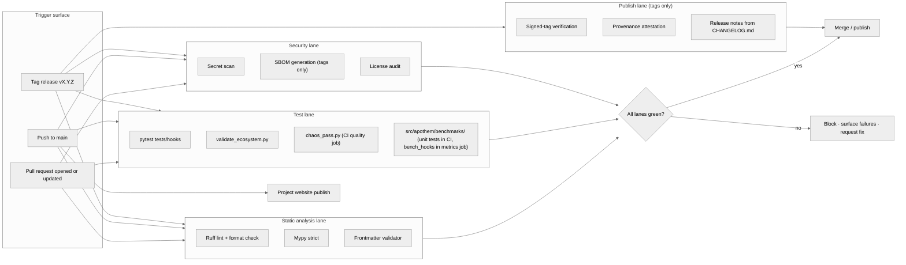

{/* SPDX-License-Identifier: MIT */}

**The structural map of the build · validate · publish workflow that gates
every change to the Apothem ecosystem.** This document installs the
visualization surface. The GitHub Actions workflow files it describes live in
`.github/workflows/` (for example `ci.yml` and `release.yml`), and the release
tooling lives in `scripts/release/`.

## Pipeline shape

## Lane roles

- **Static analysis lane** — fast feedback. Ruff covers Python style and a
  curated rule set; mypy enforces type discipline at strict; the frontmatter
  validator gates artifact-schema compliance for rules, skills, delegated
  workers, and commands. markdownlint is not in this lane: it runs only as a
  pre-commit hook, and CI does not run it (see
  [Markdown conventions](/docs/reference/markdown-conventions)).
- **Test lane** — `pytest tests/hooks` exercises the hook runtime against the
  full event matrix; `validate_ecosystem.py` is the primary structural gate
  for cross-artifact consistency; `chaos_pass.py` runs in the CI quality job on
  pushes and pull requests to `main` (path-filtered) to catch degradation under
  degraded inputs. The per-class benchmark drivers under
  `src/apothem/benchmarks/` run in CI through the pytest suite and through
  the `metrics` job. Each full pytest run in CI collects
  `tests/unit/test_benchmarks.py`, which calls every driver except
  `bench_install.py`. The `metrics` job runs
  `scripts/dev/collect_metrics.py`, which runs `bench_hooks.py --json` and
  records the result as `hook_e2e_ms`. `bench_tests.py` and `bench_install.py`
  time real runs only under `make benchmarks`. No workflow runs
  `make benchmarks`.
- **Security lane** — gitleaks in `ci.yml` catches accidental committed
  credentials. The license audit (`license-audit.yml`) fails on a dependency
  license outside its allowlist. It runs weekly and when dependency or license
  files change. The REUSE gate (`reuse.yml`) runs on every change and fails
  when a file has no license line or an SPDX expression does not parse.
  `release.yml` generates the SBOM for each tagged release.
- **Publish lane** — the release workflows are triggered by tag pushes; the npm
  and VS Code publishers can also be re-run by manual dispatch for an existing
  tag. Signed-tag verification confirms release-branch provenance; release notes
  derive from `CHANGELOG.md` Keep-A-Changelog format. The project website
  publishes from `site/dist/` to the GitHub Pages target on pushes to `main` that
  touch its build inputs, or on manual dispatch.

## Concrete configuration

The actual workflow files (`.github/workflows/ci.yml`,
`.github/workflows/release.yml`, etc.) are in the repository. This diagram
defines the canonical shape every future configuration mirrors.

## Authoritative cross-references

- `pyproject.toml` — Ruff / mypy / pytest configuration source of truth.
- `scripts/dev/validate_ecosystem.py` — the primary cross-artifact gate.
- `scripts/dev/validate_hooks.py` — hook-specific structural validation.
- `scripts/dev/chaos_pass.py` — adversarial sweep of every configured hook.
- `src/apothem/benchmarks/` — per-class runtime budget verifiers.
- `site/content/docs/developer-guide.mdx` — the operator-facing contributor workflow.
- `CHANGELOG.md` — release-note source.
