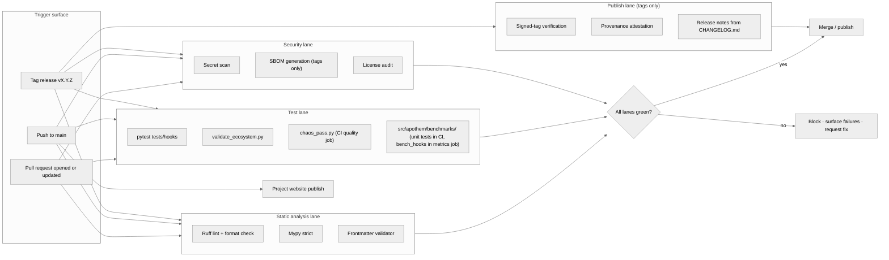

{/* SPDX-License-Identifier: MIT */}

**Die strukturelle Karte des Build-, Validierungs- und Veröffentlichungs-Workflows, der jede Änderung am Apothem-Ökosystem kontrolliert.** Dieses Dokument installiert die Visualisierungsoberfläche. Die GitHub-Actions-Workflow-Dateien, die es beschreibt, liegen in `.github/workflows/` (zum Beispiel `ci.yml` und `release.yml`), und das Release-Werkzeug liegt in `scripts/release/`.

## Pipeline-Form

## Spurrollen

- **Spur für statische Analyse** — schnelles Feedback. Ruff deckt den Python-Stil
  und ein kuratiertes Regelwerk ab; mypy erzwingt Typdisziplin im Strict-Modus;
  der Frontmatter-Validator prüft die Schemakonformität der Artefakte für Regeln,
  Skills, delegierte Worker und Befehle. markdownlint gehört nicht zu dieser
  Spur: Es läuft nur als Pre-Commit-Hook, und die CI führt es nicht aus (siehe
  [Markdown-Konventionen](/docs/reference/markdown-conventions)).
- **Test-Spur** — `pytest tests/hooks` übt die Hook-Laufzeit gegen die vollständige
  Ereignismatrix aus; `validate_ecosystem.py` ist das primäre strukturelle Gate
  für artefaktübergreifende Konsistenz; `chaos_pass.py` läuft im CI-Qualitätsjob
  bei Pushes und Pull Requests auf `main` (pfadgefiltert), um Verschlechterungen
  bei beeinträchtigten Eingaben zu erkennen. Die klassenbezogenen Benchmark-Treiber
  unter `src/apothem/benchmarks/` laufen in CI über die pytest-Suite und über den
  Job `metrics`. Jeder vollständige pytest-Lauf in CI sammelt
  `tests/unit/test_benchmarks.py`, das jeden Treiber außer `bench_install.py`
  aufruft. Der Job `metrics` führt `scripts/dev/collect_metrics.py` aus, das
  `bench_hooks.py --json` ausführt und das Ergebnis als `hook_e2e_ms` erfasst.
  `bench_tests.py` und `bench_install.py` messen echte Läufe nur unter
  `make benchmarks`. Kein Workflow führt `make benchmarks` aus.
- **Sicherheits-Spur** — gitleaks in `ci.yml` erkennt versehentlich committete
  Anmeldedaten. Das Lizenz-Audit (`license-audit.yml`) schlägt bei einer
  Abhängigkeitslizenz fehl, die nicht auf seiner Allowlist steht. Es läuft
  wöchentlich sowie dann, wenn sich Abhängigkeits- oder Lizenzdateien ändern.
  `release.yml` erzeugt die SBOM für jedes getaggte Release.
- **Veröffentlichungs-Spur** — die Release-Workflows werden durch Tag-Pushes
  ausgelöst; der npm- und der VS-Code-Publisher lassen sich für einen bestehenden
  Tag auch per manuellem Dispatch erneut ausführen. Die Signed-Tag-Verifikation
  bestätigt die Herkunft des Release-Branches; die Release-Notes leiten sich aus
  `CHANGELOG.md` im Keep-A-Changelog-Format ab. Die Projekt-Website wird von
  `site/dist/` auf das GitHub-Pages-Ziel veröffentlicht, bei Pushes auf `main`,
  die ihre Build-Eingaben berühren, oder bei manuellem Dispatch.

## Konkrete Konfiguration

Die tatsächlichen Workflow-Dateien (`.github/workflows/ci.yml`,
`.github/workflows/release.yml` usw.) liegen im Repository. Dieses Diagramm
definiert die kanonische Form, an der sich jede künftige Konfiguration
ausrichtet.

## Maßgebliche Querverweise

- `pyproject.toml` — Quelle der Wahrheit für die Ruff- / mypy- / pytest-Konfiguration.
- `scripts/dev/validate_ecosystem.py` — das primäre artefaktübergreifende Gate.
- `scripts/dev/validate_hooks.py` — hook-spezifische strukturelle Validierung.
- `scripts/dev/chaos_pass.py` — adversarialer Durchlauf jedes konfigurierten Hooks.
- `src/apothem/benchmarks/` — klassenbezogene Laufzeitbudget-Verifizierer.
- `site/content/docs/developer-guide.mdx` — der bedienerorientierte Contributor-Workflow.
- `CHANGELOG.md` — Quelle der Release-Notes.
