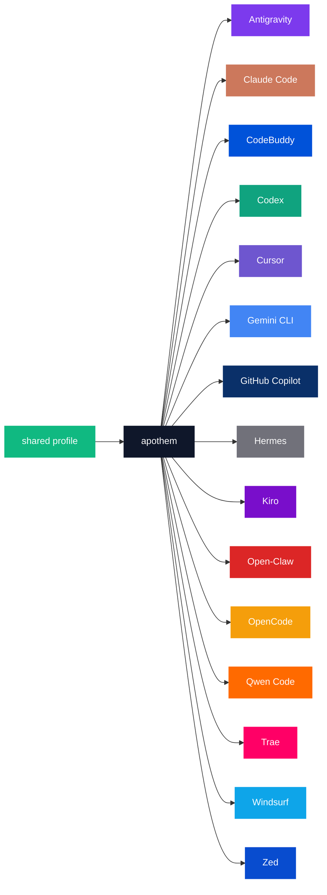

{/* SPDX-License-Identifier: MIT */}

Die kanonischen Aufzählungen Markenname × Farbcode unten stehen in einem `text`-Codeblock, um die wortgetreuen Bezeichner je Harness zu bewahren, die der Katalogzweck der Palette erfordert.

## Apothem-Kern

| Token | Hell | Dunkel | Verwendung |
|---|---|---|---|
| `apothem-hub` | `#0F172A` | `#F1F5F9` | Der zentrale Verteilungsknoten („apothem“) in jedem Architekturdiagramm. |
| `shared-profile` | `#10B981` | `#34D399` | Das Profil als Quelle der Wahrheit, das den apothem-Kern speist. |

## Harness-Palette

Fünfzehn der siebzehn Harnesses sind passend zu ihrer primären Markenidentität
eingefärbt, sodass Leser die Werkzeuge in einem Diagramm auseinanderhalten
können. Die Apothem-Bildmarke selbst verwendet nur die Farben Slate und Emerald
auf der Seite [Markenpalette](/docs/brand/palette); sie trägt keine Harness-Farbe.
Die verbleibenden zwei — `glm` und `kimi-code` — haben noch keine definierte
Markenfarbe; ihre Zeilen werden hinzugefügt, sobald die vorgelagerte Markenfarbe
festgelegt ist, gemäß dem Propagierungsschritt unter
[Aktualisierungen](#aktualisierungen).

```text
| Token             | Light     | Dark      | Source                                                                                                                                              |
|-------------------|-----------|-----------|-----------------------------------------------------------------------------------------------------------------------------------------------------|
| `antigravity`     | `#7C3AED` | `#9F67FF` | Google Antigravity deep-purple.                                                                                                                     |
| `claude-code`     | `#CC785C` | `#E89378` | Anthropic terracotta-orange.                                                                                                                        |
| `codebuddy`       | `#0052D9` | `#5E8EF7` | Tencent CodeBuddy blue.                                                                                                                             |
| `codex`           | `#10A37F` | `#19C796` | OpenAI signature teal.                                                                                                                              |
| `cursor`          | `#6E56CF` | `#9B85E3` | Cursor brand purple.                                                                                                                                |
| `gemini-cli`      | `#4285F4` | `#6BA4F7` | Google blue.                                                                                                                                        |
| `github-copilot`  | `#0A3069` | `#5B8FE3` | GitHub Mona deep-blue.                                                                                                                              |
| `hermes`          | `#71717A` | `#A1A1AA` | Community silver-grey.                                                                                                                              |
| `kiro`            | `#790ECB` | `#A862DD` | Kiro violet.                                                                                                                                        |
| `open-claw`       | `#DC2626` | `#F87171` | Community red-orange.                                                                                                                               |
| `opencode`        | `#F59E0B` | `#FBBF24` | Community amber.                                                                                                                                    |
| `qwen-code`       | `#FF6A00` | `#FF8C40` | Alibaba Qwen orange.                                                                                                                                |
| `trae`            | `#FF0066` | `#FF599C` | ByteDance Trae magenta.                                                                                                                             |
| `windsurf`        | `#0EA5E9` | `#38BDF8` | Windsurf sky-blue.                                                                                                                                  |
| `zed`             | `#084CCF` | `#5E8BE0` | Zed Industries blue.                                                                                                                                |
```

## Marken

Die Harness-Namen, Produktnamen und Markenfarben auf dieser Seite und auf der
gesamten Website gehören ihren Inhabern und sind Marken ihrer jeweiligen
Inhaber. Apothem nennt ein Werkzeug nur, um anzugeben, welches es konfiguriert,
und verwendet die Farbe eines Werkzeugs nur, um es in einem Diagramm
abzugrenzen. Apothem ist ein unabhängiges Projekt; es ist mit keinem dieser
Unternehmen oder Projekte verbunden, wird von keinem von ihnen gesponsert oder
unterstützt und liefert keines ihrer Logos aus.

## Begründung der Benennung

- **`apothem-hub`** — das geometrische Zentrum, das der Name hervorruft (das Apothema eines regelmäßigen Vielecks weist nach innen zu seinem Kern).
- **`shared-profile`** — die vorgelagerte Quelle, abgesetzt von der Farbe jedes einzelnen Harness, damit sie sich in jedem Diagramm als „Eingabe“-Pfeil liest.
- **Tokens je Harness** spiegeln den Harness-Slug wider, der überall in der Codebasis verwendet wird (`harnesses/<slug>/`, der Einstiegspunkt-Schlüssel, das CLI-Argument `--harness <slug>`). Ein Wort je Konzept; überall dieselbe Zeichenfolge.

## Verwendung in Mermaid



## Barrierefreiheit

Jedes Token für den hellen Modus auf dieser Seite, Kern- wie Harness-Token gleichermaßen, behält seine Markenfarbe unverzerrt, daher liegen acht davon unter dem WCAG-2.2-AA-Kontrast gegenüber weißem Text (≥4,5 : 1). Die übrigen Token für den hellen Modus erreichen ihn. Die acht, mit ihrem Kontrast gegenüber Weiß:

```text
shared-profile   2.54 : 1
claude-code      3.28 : 1
codex            3.20 : 1
gemini-cli       3.56 : 1
opencode         2.15 : 1
qwen-code        2.87 : 1
trae             3.86 : 1
windsurf         2.77 : 1
```

Die Spalte für den dunklen Modus ist zur Verwendung auf dunklen Hintergründen gedacht, und keines ihrer Tokens erreicht gegenüber weißem Text 4,5 : 1. Das Mermaid-Beispiel oben setzt auf jede Füllung weißen Text, daher erreichen seine Beschriftungen auf diesen acht Füllungen 4,5 : 1 nicht. Ein Diagramm, das auf einer dieser acht Füllungen einen WCAG-AA-Kontrast für Text auf Farbe benötigt, MUSS statt weißem Text dunklen Text (`#0F172A`, der auf ihnen 4,63 : 1 bis 8,31 : 1 misst) verwenden.

## Aktualisierungen

Die Palette wird nur aktualisiert, wenn ein Harness vorgelagert eine Markenänderung ratifiziert. Die Harness-Farben sind auf dieser Seite definiert, nicht in `assets/design-tokens.css` oder `site/app/global.css`. Markenänderungen je Harness werden atomar in diese Seite und in jeden betroffenen SVG-Master unter `assets/src/` übernommen.
