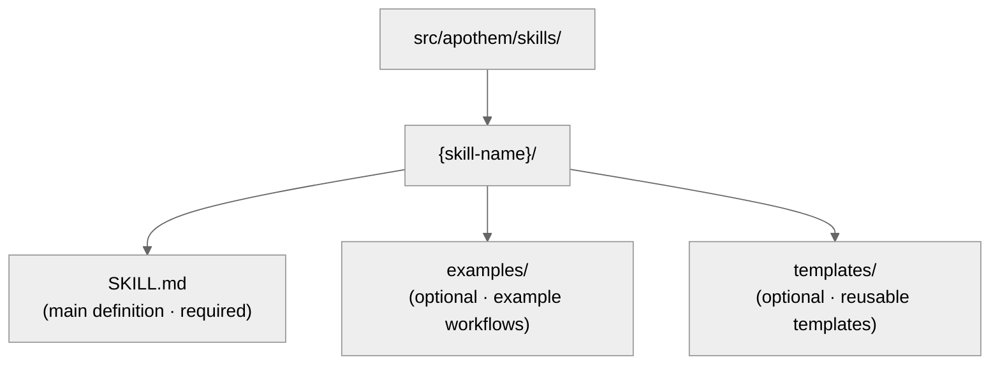

{/* SPDX-License-Identifier: MIT */}

Dieses Handbuch hilft Entwicklern, das Apothem-Ökosystem mit
SOTA-Qualitätsstandards zu pflegen und zu erweitern.

## Schnellreferenz: Artefakttypen

Dieses Handbuch behandelt fünf Artefakttypen, jeder mit einem bestimmten Zweck.
Regeln, Befehle, Helfer und Skills tragen YAML-Frontmatter; Hooks werden in
`hooks.json` und `settings.json` registriert und tragen keines. Output-Styles
sind eine weitere Artefaktklasse mit zwei erforderlichen Frontmatter-Schlüsseln,
`name` und `description`; siehe das
[Frontmatter-Schema](/docs/reference/frontmatter-schema).

| Artefakt | Pfad | Zweck | Wann erstellen |
| -------- | ---- | ------- | -------------- |
| **Regel** | `src/apothem/rules/*.md` | Verhaltensmandat oder operative Direktive | Neues Prinzip, neue Richtlinie oder neues Governance-Mandat festgelegt |
| **Befehl** | `src/apothem/commands/*.md` | Slash-Befehl (`/command-name`) für komplexe Workflows | Neuer mehrstufiger Benutzer-Workflow |
| **Helfer** | `src/apothem/agents/*.md` | Persistente Definition eines delegierten Workers für parallele Aufgaben | Neue wiederkehrende Spezialaufgabe (Audit, Erkundung, Qualitätsprüfung) |
| **Skill** | `src/apothem/skills/{name}/SKILL.md` | Wiederverwendbare Technik mit Erkennungssignal | Neues erkennbares, wiederverwendbares Technikmuster |
| **Hook** | `src/apothem/hooks/` + `hooks.json` + `settings.json` | Ereignisgesteuerte Validierung oder Zustandsverwaltung | Neues Lebenszyklus-Ereignis oder neuer Validierungsbedarf |

## Harness-Adapter-Vertrag

Identitäts- und Fähigkeitsfakten eines Harness liegen in
`src/apothem/lib/harness_registry.py`. Eine Harness-Änderung ist nur dann
vollständig, wenn diese Oberflächen übereinstimmen:

| Oberfläche | Erforderliche Aktualisierung |
| --- | --- |
| Registry-Zeile | Öffentliche ID, Paketschlüssel, Einstiegspunkt, Geltungsbereich, Ausgabeformat, Zielpfade, Doku-Pfade, Fähigkeitsdatei, Standard-Pin, Fixture-Tests, Package-Data-Schlüssel, Template-Quellen und Fähigkeitsstatus. |
| Adapter-Paket | `__init__.py`, `install.py`, `update.py`, `uninstall.py`, `verify.py`; fügen Sie `materializer.py` nur hinzu, wenn der Harness eine native Konfigurationsdatei rendert. |
| Propagation-Manifest | Template- und Kohortenpfade für manifestgestützte Adapter. |
| Fähigkeiten | `src/apothem/harnesses/<package>/capabilities.yml` mit jeder erforderlichen Fähigkeit und einer Begründung für nicht unterstützte oder discovery-pending-Zustände, plus einer `conversion_losses`-Map für jede konvertierte Befehls-, Agenten- oder Regelkohorte (siehe die [Harness-Registry](/docs/reference/harness-registry)). |
| Konventions-Pin | `STANDARD-CONVENTION-PIN.md` mit Vendor-URL, Snapshot-Datum, kanonischem Dateinamen/Schema, Belegreferenz und Begründung für nicht unterstützte Fähigkeiten. |
| Tests | Registry-Parität, Adapter-Fixture-Test, Golden-Install-Plan-Zeile, Dry-Run-/No-Write-Verhalten, Idempotenz und Package-Data-Abdeckung. |
| Doku | Harness-Referenzseite, Vergleichsseite, Fähigkeits-/MCP-Anmerkungen und Beispiele, die fiktive Platzhalter verwenden. |

Adapter mit Projekt-Geltungsbereich müssen `requires_project = True` setzen,
`project: Path | None` in den Lebenszyklusmethoden akzeptieren und fehlende
oder unsichere Projekt-Stammverzeichnisse vor Schreibvorgängen ablehnen.
Adapter mit Benutzer-Geltungsbereich müssen Pfade unter dem dokumentierten
Benutzerkonfigurations-Stammverzeichnis des Harness halten.

## Golden-Fixture-Richtlinie

`tests/fixtures/harness-golden-plans.json` zeichnet die öffentliche Form des
Install-Plans für alle siebzehn Harnesses der Registry auf: öffentliche ID,
Materialisierungsmodus, Quellpfad der Kohorte bzw. des Templates und
normalisierten Zielpfad unter `<ROOT>`. Wenn sich das Zielverhalten von
Registry, Manifest oder Template absichtlich ändert, aktualisieren Sie die
Golden-Fixture im selben Commit wie die Quelländerung, damit das Diff das
Verhaltensdelta zeigt.

## Validierung vor dem Schreiben

Der gemeinsame Install-Treiber validiert jede Quelle und jedes Ziel vor dem
ersten Schreibvorgang. Er lehnt fehlende Manifestquellen, Ziel-Traversierung,
Zielpfade außerhalb des gewählten Stammverzeichnisses und
Symlink-Überschreitungen ab; eine Windows-Junction wird wie ein Symlink
geprüft. Ausgenommen sind die Links, die Dotfile-Manager unter `~/.config` oder
an oder oberhalb eines gemeinsamen Skill-, Regel- oder Template-Ordners anlegen;
ihnen wird gefolgt, solange sie innerhalb des Home-Verzeichnisses bleiben.
Dry-Runs führen dieselbe Validierung aus und geben strukturierte `skipped`- oder
`unchanged`-Ergebnisse zurück, ohne Dateien zu erstellen.

## Schwärzung und Beispieldaten

Profildiagnosen schwärzen token-, secret-, password-, credential-, API-Key-,
private-key-, authorization-, auth- und header-förmige Felder. Dokumentation,
Fixtures, Beispiele und JSON-Snippets verwenden `example.invalid`,
`Example User`, `example-user` und offensichtliche Platzhalter statt echt
wirkender Geheimnisse oder persönlicher Konten.

## Bevor Sie schreiben: Das kanonische Schema

**Der maschinenlesbare, vom Gate durchgesetzte Vertrag sind die
klassenbezogenen JSON-Schemas unter `src/apothem/schemas/*.schema.json` —
`additionalProperties` lehnt unbekannte Schlüssel ab, sodass das
Konformitäts-Gate das letzte Wort hat.** Zwei menschenlesbare Projektionen
folgen ihnen: `site/content/docs/reference/frontmatter-schema.mdx` (der Index
der Pflichtschlüssel) und `site/content/docs/reference/artifact-schema.mdx`
(klassenbezogene Templates und durchgearbeitete Beispiele). Wo eine Seite den
JSON-Schemas widerspricht, haben die Schemas Vorrang.

- Lesen Sie das JSON-Schema für Ihren Artefakttyp unter `src/apothem/schemas/`
- Lesen Sie `site/content/docs/reference/artifact-schema.mdx` § „Schema“ für
  das Template und ein durchgearbeitetes Beispiel
- Kopieren Sie die erforderlichen Felder, tragen Sie die verpflichtenden Werte
  ein und fügen Sie optionale Felder nach Bedarf hinzu

## Frontmatter-Schnellprüfung

Das Frontmatter jedes Artefakts muss diese Prüfungen bestehen. Wenden Sie die
Prüfungen zu `version`, `updated` und `portability` nur auf eine Klasse an, die
den Schlüssel trägt: Regeln tragen keinen davon, und Skills tragen kein
`portability`.

```yaml
✓ Valid YAML syntax (use tools: `yamllint` or PowerShell `ConvertFrom-Yaml` where available)
✓ All mandatory fields present (per schema for artifact type)
✓ name: uses kebab-case
✓ version: semantic MAJOR.MINOR.PATCH
✓ updated: ISO 8601 date (YYYY-MM-DD)
✓ description: single-line, non-empty
✓ scope fields valid per artifact type (rules: pathFilter + alwaysApply; CLAUDE.md root: scope)
✓ portability: string, for example `universal` (the schemas do not enumerate its values)
✓ No typos in field names — must match canonical schema exactly
✓ Optional fields use correct enum values
```

## Namenskonventionen

### Artefaktnamen (kebab-case)

- **Regeln:** `operational-mandates`, `clean-room-generation`, `context-management`
- **Befehle:** `plan-execute`, `plan-spec`, `plan-generate`
- **Helfer:** `codebase-explorer`, `convention-auditor`, `quality-gate`
- **Skills:** `plan-suite`, `ecosystem-audit`

Muster: Kleinbuchstaben, Bindestriche zwischen Wörtern, keine Leerzeichen oder
Unterstriche.

### Dateibenennung

- **Regeln:** `{name}.md`
- **Befehle:** `{name}.md`
- **Helfer:** `{name}.md`
- **Skills:** Im Ordner `src/apothem/skills/{name}/SKILL.md` (exakte Schreibweise: `SKILL.md`)
- **Hooks:** Im Ordner `src/apothem/hooks/`. Alle Ereignis-Handler sind in Python
  geschrieben. Jeder Hook-Befehl in der `settings.json`-Vorlage für Claude Code
  verwendet die Exec-Form: `command` ist der Interpreter-Platzhalter
  `${PYTHON_BIN}`, der bei der Installation aufgelöst wird, und `args` enthält
  `-E`, `-s`, den Skriptpfad und seine Argumente. Die beiden Flags halten
  `PYTHONPATH`, die anderen `PYTHON*`-Variablen und die site-packages des
  Benutzers aus jedem Hook heraus; behalten Sie sie bei jedem Hook bei, den Sie
  hinzufügen. Diese Vorlage ruft
  `${HARNESS_ROOT}/.apothem/support/hooks/dispatch.py <event> [<message-name>]` und
  `${HARNESS_ROOT}/.apothem/support/conformity/gate.py --hook` über absolute Pfade auf, daher
  benötigt die installierte Kopie kein importierbares `apothem`-Paket. Das Plugin für
  Claude Code registriert Hooks stattdessen in `src/apothem/hooks/hooks.json`, und zwar als
  Shell-Befehle, die `hooks/lib/bootstrap.sh` über `bash` ausführen; dieser Stub findet
  Python und führt `dispatch.py` aus, sodass die Handler in Python bleiben. Registrieren Sie
  einen neuen Hook in `hooks.json` und in der `settings.json`-Vorlage für Claude Code.
  `dispatch.py` leitet `SessionStart` an `session_start_bootstrap.main()` weiter und jedes
  andere zugelassene Ereignis an `emit_hook_context.main()`. Die einzigen Shell-Stubs, die
  unter `src/apothem/hooks/` oder `scripts/` zulässig sind, sind die sechs Locator- und
  Bootstrap-Dateien (`find-python.{ps1,sh}`, `find-pwsh.{ps1,sh}`, `bootstrap.{ps1,sh}`);
  jede andere `.ps1`- oder `.sh`-Datei fällt bei der Hygieneprüfung
  `scripts/dev/validate_hooks.py` durch.

### Querverweise

Verwenden Sie beim Verweisen auf andere Artefakte exakte Namen:

- Regeln: `"operational-mandates"` (Wert des Felds name)
- Befehle: `/plan-execute` (mit Schrägstrich in Dokumentation für Menschen; im Code ohne)
- Helfer: `codebase-explorer` (Wert des Felds name)
- Skills: `plan-suite` (Wert des Felds name)

Verwenden Sie im Fließtext niemals Dateipfade oder gekürzte Namen.

## Portabilität: Windows vs. Unix

Jeder Befehl MUSS seinen Portabilitätsstatus ausdrücklich im Feld
`portability` deklarieren. Ein Helfer KANN ihn deklarieren. Skills, Regeln und
Output-Styles tragen kein Feld `portability`.

### Universal

- Funktioniert identisch unter Windows, macOS und Linux
- Keine Shell-Annahmen
- Pfade verwenden Schrägstriche (`/`)
- Keine fest codierten absoluten Pfade
- Keine Windows-spezifische PowerShell-Syntax

```yaml
portability: "universal"
```

### Universal mit Windows-Vorbehalten

- Universell auf POSIX-Hosts; der genannte Vorbehalt gilt für die im Inhalt deklarierte Windows-Plattformvariante
- Dokumentieren Sie den Vorbehalt ausdrücklich im Inhalt
- Beispiel: „Symlinks werden unter Windows vor Win 10 nicht unterstützt“

```yaml
portability: "universal-with-windows-caveats"
```

Dokumentieren Sie den Vorbehalt in einem Hinweis unmittelbar nach dem Titel.

### Nur Unix / Nur Windows

- Ausdrücklich auf eine Plattform beschränkt
- Selten in Apothem — die meisten sollten universell sein
- Nur verwenden, wenn plattformspezifische Funktionen unverzichtbar sind

```yaml
portability: "unix-only"
```

Dokumentieren Sie den Grund im ersten Abschnitt des Artefakts.

## Geltungsbereich: immer aktiv vs. pfadgefiltert

### Immer aktiv

Die Regel gilt überall. Fünf Regeln sind immer aktiv: `agnostic-posture`,
`authority-inquiry`, `session-closure`, `context-management` und der
Regelindex (`apothem-rule-index`). Die Menge ist klein, weil jede immer aktive
Regel in jeder Sitzung Kontext kostet.

```yaml
pathFilter: ""
alwaysApply: true
```

### Pfadgefiltert

Die Regel gilt bedingt, abhängig vom Dateipfad.

```yaml
pathFilter: "**/*.py, **/*.toml"
alwaysApply: false
```

`pathFilter` verwendet Glob-Muster (dasselbe Format wie `.gitignore`). Wenn
eine Datei dem Filter entspricht, wird die Regel aktiviert.

## Versionssemantik

Jedes versionierte Artefakt trägt seine eigene semantische Version
(`MAJOR.MINOR.PATCH`). Befehle und Skills verlangen sie, Helfer und
Output-Styles KÖNNEN sie tragen, und Regeln tragen keine:

- **PATCH** — eine Verhaltensänderung, die eine bestehende Direktive korrigiert, ohne den Vertrag zu brechen.
- **MINOR** — additive, nicht inkompatible Änderungen: neue optionale Abschnitte, neue optionale Frontmatter-Felder, neue Beispiele. Bestehende Konsumenten funktionieren ohne Änderung weiter.
- **MAJOR** — inkompatible Schema- oder Vertragsänderungen: entfernte Abschnitte, umbenannte Felder, geändertes Verhalten einer bestehenden Direktive, Änderungen, die nachgelagerte Artefakte zur Anpassung zwingen.

Tippfehlerkorrekturen, Linkkorrekturen, Formatierungen sowie reine Kommentar- oder Dokumentationsänderungen lassen die Version unverändert. Nur eine Verhaltensänderung erhöht sie. Eine solche Bearbeitung aktualisiert dennoch das Datum `updated` des Artefakts.

Beispiele:

- `vX.Y.Z` → `vX.Y.(Z+1)` (PATCH: eine korrigierte Direktive, die das Verhalten ändert)
- `vX.Y.Z` → `vX.Y.Z` (keine Erhöhung: Tippfehler- oder Linkkorrektur; `updated` ändert sich)
- `vX.Y.Z` → `vX.(Y+1).0` (MINOR: neuen optionalen Abschnitt hinzugefügt)
- `v0.Y.Z` → `v(0+1).0.0` (MAJOR: Vertrag als stabil deklariert; neue Artefakte beginnen bei `v0.Y.Z`)
- `vX.Y.Z` → `v(X+1).0.0` (MAJOR: verpflichtendes Frontmatter-Feld entfernt)

Heben Sie `version` und `updated` bei jeder verhaltensändernden Bearbeitung
eines Artefakts, das diese Felder trägt, gemeinsam an. Hängen Sie für Releases,
die Artefaktänderungen bündeln, eine passende Zeile an die ökosystemweite
`CHANGELOG.md` an.

### Revisionen von Plan-Suiten

Die Artefaktregel oben gilt nicht für Plan-Suiten. Die Version einer Plan-Suite ist der Wert `vX.Y.Z`, der im Kopf von `MASTER-PLAN.md` und in der Tabelle der Revisionshistorie erfasst wird. Eine Tippfehlerkorrektur an einer Plan-Suite ist eine Revision, die die PATCH-Nummer erhöht. Schritt 10.2 von `/plan-review` legt die Klassifizierung fest und hängt die Zeile der Revisionshistorie an.

- `vX.Y.Z` → `vX.Y.(Z+1)` (Plan-Suite, Tippfehler: PATCH)
- `vX.Y.Z` → `vX.Y.Z` (Artefakt, Tippfehler: keine Erhöhung; die Artefaktregel oben)

## Wann ein Artefakt zu bearbeiten ist

### Regeln

- Behandeln Sie die Mandatory/Optional-Struktur als tragend — eine
  Umstrukturierung wirkt sich auf jedes abhängige Artefakt aus.
- Verfeinern Sie Anti-Patterns, Seriousness-Scaling-Beispiele und
  Quellenangaben, wenn sich das Verständnis vertieft.
- Halten Sie die Begründung jeder strukturellen Änderung in der zugehörigen
  Memory-Topic-Datei fest.

### Befehle

- Die Form der Argumente ist Teil des öffentlichen Vertrags — brechen Sie sie
  nur mit ausdrücklicher Absicht und übertragen Sie die Änderung auf jeden
  Aufrufer (MAJOR-Anhebung).
- Halten Sie Workflow-Schritte und Rückgabeverträge knapp und aktuell.
- Dokumentieren Sie nicht offensichtliche Schrittabfolgen inline.

### Helfer

- Halten Sie `disallowedTools` minimal, aber ausreichend; dokumentieren Sie
  die Begründung, wenn sich die Liste ändert.
- Verfeinern Sie Operating Principles und Return Contracts, während die Rolle
  des Helfers reift (MINOR-Anhebung).
- Halten Sie Fähigkeitsverschiebungen inline fest, damit Aufrufer ihre
  Erwartungen neu kalibrieren können.

### Skills

- Halten Sie Procedure-Schritte und Examples mit der Realität synchron.
- Erkennungssignale müssen die tatsächlichen Formulierungen der Benutzer im
  aktuellen Gebrauch widerspiegeln.
- Teilen Sie einen Skill auf, sobald er ~150 Zeilen überschreitet (siehe
  `auto-memory.md` § Topic File Management).

## Schritt für Schritt: Eine neue Regel hinzufügen

### 1. Orthogonalität bewerten

Überschneidet sich diese Regel mit bestehenden Regeln? Durchsuchen Sie
`src/apothem/rules/` nach verwandtem Inhalt.

Bei einer Überschneidung von >50 % erwägen Sie stattdessen, eine bestehende
Regel zu erweitern. Siehe `persistent-conventions-vigilance.md` § Artifact
Evolution.

### 2. Inhalt schreiben

Folgen Sie dieser Struktur:

- Titel: `# Rule: {Title}`
- Purpose-Abschnitt
- Obligations / Core directives (nummeriert, verlinkt)
- Seriousness-Scaling-Tabelle (immer erforderlich)
- Anti-Patterns-Abschnitt
- Enforcement-Abschnitt

### 3. Frontmatter erstellen

Verwenden Sie das Schema aus `site/content/docs/reference/artifact-schema.mdx` § Schema: Rules. Setzen Sie:

- `name:` Bezeichner in kebab-case
- `description:` einzeilige Zusammenfassung für Registries
- `pathFilter:` Glob-Liste für pfadgefilterte Regeln; die leere Zeichenkette (`""`) für immer aktive Regeln
- `alwaysApply:` `true` für immer aktive Regeln, `false` für pfadgefilterte Regeln

Regeln tragen nur diese vier Felder — kein `version` / `updated` / `scope` / `portability` / `implements`.

Eine neue Regel ist pfadgefiltert. Eine neue immer aktive Regel erfordert, dass
die Kernliste und die Byte-Obergrenzen in derselben Änderung angehoben werden:
die Liste in `tests/unit/test_always_on_core.py` und die Obergrenzen in
`conformity/always_on_budget_grep.py`. Eine Begleitregel
(`<parent>-<aspect>`) übernimmt den `pathFilter` ihrer Elternregel oder einen
engeren.

Beispiel:

```yaml
---
name: "my-new-rule"
description: "Brief one-liner"
pathFilter: "**/*.py"
alwaysApply: false
---
```

### 4. Rules-README aktualisieren

Fügen Sie der Tabelle für die Familie der Regel im Abschnitt Rule families von
`src/apothem/rules/README.md` eine Zeile hinzu:

```markdown
| `my-new-rule.md` | One-line concern of the new rule. |
```

Wählen Sie die Familientabelle, deren Thema zur Regel passt. Nennen Sie die
Regel außerdem in der Zeile von `src/apothem/rules/apothem-rule-index.md` für
die Situation, die sie erfordert; `tests/unit/test_always_on_core.py` schlägt
fehl, wenn eine Regel im Index fehlt.

### 5. An CHANGELOG.md anhängen

Fügen Sie unter dem Abschnitt `### Added` des nächsten Releases eine Zeile
hinzu, die die neue Regel beschreibt.

### 6. Validierung ausführen

Rufen Sie den Skill `ecosystem-audit` auf, um die neue Regel zu verifizieren,
mit Fokus auf den Bereich der Regeln:

```text
Invoke the ecosystem-audit skill with --focus rules --fix
```

Verifizieren Sie, dass für Ihre neue Regel keine Fehler gemeldet werden.

## Schritt für Schritt: Einen neuen Befehl hinzufügen

Befehle sind Slash-Befehle wie `/plan-spec`, `/plan-execute`, `/security-audit` usw.

### 1. Rolle bestimmen

Befehle sind vom Benutzer ausgelöste Workflows. Das Modell führt einen Befehl
nur dann von sich aus aus, wenn seine Einstellung `disable-model-invocation`
den Wert `false` hat (Schritt 2). Fragen Sie:

- Ist dies ein Workflow, den der Benutzer als `/command-name` eingibt?
- Orchestriert er mehrere Schritte?
- Könnte er in ein Timeout laufen oder mitten in der Ausführung
  Benutzereingaben erfordern?

Wenn eine dieser Fragen mit „nein“ beantwortet wird, handelt es sich
wahrscheinlich um einen Skill, nicht um einen Befehl.

### 2. Datei erstellen

Pfad: `src/apothem/commands/{name}.md`

Frontmatter (aus `site/content/docs/reference/artifact-schema.mdx` § Schema: Commands):

```yaml
---
name: "my-command"
version: "X.Y.Z"
updated: "2026-04-20"
description: "What this command does"
argument-hint: "[path/to/input] [--flag VALUE]"
disable-model-invocation: false
portability: "universal"
allowed-tools: "Read, Glob, Grep"
---
```

`disable-model-invocation: true` macht einen Befehl ausschließlich vom
Operator aufrufbar; mit `false` darf das Modell ihn ausführen, wenn eine
Anfrage seiner Beschreibung entspricht. Der Standard ist `false` für lesende
und beratende Befehle, mit einer Beschreibung, die mit dem Anwendungsfall
beginnt; 35 der 45 Befehle verwenden ihn. Ein Befehl bleibt `true`, wenn er
Zustand außerhalb des Arbeitsbaums ändert oder davon abhängt, dass der
Operator den Zeitpunkt wählt (10 Befehle). Die Aufruftabelle in `src/apothem/commands/README.md` listet die Einstellung
jedes Befehls auf; fügen Sie für einen neuen Befehl eine Zeile hinzu. Halten
Sie `allowed-tools` auf lesende Werkzeuge beschränkt: Ein Harness, der dieses
Feld beachtet, führt diese Werkzeuge ohne Rückfrage aus. Gewähren Sie ein
Werkzeug mit Seiteneffekten nur als eingegrenzte Regel, etwa
`Bash(git log *)`; das Schema lehnt `"*"` und jedes der Werkzeuge `Bash`,
`PowerShell`, `Write`, `Edit`, `NotebookEdit` oder `WebFetch` ab, wenn es ohne
Eingrenzung geschrieben ist.

### 3. Inhalt schreiben

Struktur:

- Titel: `# /{name} — Human-Readable Title`
- Role-Abschnitt (wer dies ausführt)
- Übergeordnete Anweisungen
- Workflow-Abschnitt mit Schritten
- Return Contract / Ausgabeformat

Die Skill-Ausgabe eines Harness teilt jeden Befehl in eine schlanke `SKILL.md`
plus `references/`-Dateien nach H2-Abschnitten auf. Geben Sie einem Befehl
einen einzigen `## Workflow`-Abschnitt, schließen Sie jeden Code-Fence und
klassifizieren Sie jede neue H2-Art in `src/apothem/lib/claude_skill_split.py`;
`tests/unit/test_claude_skill_split.py` schlägt bei einer nicht klassifizierten
Art fehl. Die Regeln stehen im Skill-emission split contract von
`src/apothem/commands/README.md`.

### 4. README und CHANGELOG.md aktualisieren

Fügen Sie der Tabelle für den Abschnitt des Befehls in `src/apothem/commands/README.md` eine Zeile hinzu, zusätzlich zur Zeile der Aufruftabelle aus Schritt 2; fügen Sie unter dem Abschnitt `### Added` des nächsten Releases eine CHANGELOG-Zeile hinzu.

### 5. Validieren

Rufen Sie den Skill `ecosystem-audit` mit Fokus auf Befehle auf:

```text
Invoke the ecosystem-audit skill with --focus commands --fix
```

## Schritt für Schritt: Einen neuen Helfer hinzufügen

Helfer sind persistente Definitionen delegierter Worker für parallele Arbeit.

### 1. Muster identifizieren

Passt dieser Helfer zu einem der unten aufgeführten Team-Muster?

- Research Team: nur lesend, Informationsbeschaffung
- Audit Team: Verifikation, Konsistenzprüfungen
- Implementation Team: parallele Codeänderungen
- Quality Team: Lint, Test, Typprüfung, Sicherheit
- Documentation Team: Doku-Aktualisierungen
- Other: Spezialaufgabe

### 2. Datei erstellen

Pfad:

```text
src/apothem/agents/{name}.md
```

Frontmatter:

```yaml
---
name: "my-helper"
version: "X.Y.Z"
updated: "2026-04-20"
description: "What this helper specializes in"
tools: "Read, Glob, Grep, Bash"
disallowedTools: "Write, Edit"
maxTurns: 15
portability: "universal"
---
```

Lassen Sie `model`, `effort` und `permissionMode` weg, damit der Helfer die
Vorgaben der Sitzung erbt (die agnostische Haltung), und lassen Sie `memory`
weg, es sei denn, der Helfer benötigt einen Geltungsbereich für persistenten
Speicher (`user`, `project` oder `local`).

### 3. Inhalt schreiben

Abschnitte:

- Operating Principles (nur lesend, evidenzbasiert, binäre Urteile, erschöpfend)
- Workflow (nummerierte Schritte)
- Return Contract (max. Tokens, Struktur, erforderliche Felder)

### 4. README und CHANGELOG.md aktualisieren

Fügen Sie der Index-Tabelle in `src/apothem/agents/README.md` eine Zeile hinzu; fügen Sie unter dem Abschnitt `### Added` des nächsten Releases eine CHANGELOG-Zeile hinzu.

### 5. Testen

Setzen Sie den Helfer in einem realen Szenario ein und verifizieren Sie, dass
er wie dokumentiert funktioniert.

## Schritt für Schritt: Einen neuen Skill hinzufügen

Skills sind wiederverwendbare, erkennbare Techniken.

### 1. Wiederverwendbarkeit feststellen

Bevor Sie einen Skill schreiben:

- Haben Sie dieses Problem bzw. diese Technik 3+ Mal gesehen?
- Ist es erkennbar? (Signalisiert ein Muster in Benutzeranfragen es?)
- Können Sie es reproduzierbar kodifizieren?

Wenn alle drei Fragen mit „ja“ beantwortet werden, schreiben Sie einen Skill.

### 2. Struktur erstellen



### 3. SKILL.md schreiben

Frontmatter:

```yaml
---
name: "skill-name"
version: "X.Y.Z"
updated: "2026-04-20"
description: "What this skill teaches"
archetype: "workflow-template"
userInvocable: true | false
disable-model-invocation: true | false
allowed-tools: "Read, Glob, Grep"
argument-hint: "[args]"               # optional; if userInvocable
---
```

Inhaltsstruktur:

- Purpose
- When to Use This Skill
- Prerequisites
- Step-by-Step Procedure
- Common Mistakes
- Examples

### 4. README und CHANGELOG.md aktualisieren

Fügen Sie in `src/apothem/skills/README.md` der Tabelle Index eine Zeile und der Tabelle Folder contents für jede Datei des Skills eine Zeile hinzu; fügen Sie unter dem Abschnitt `### Added` des nächsten Releases eine CHANGELOG-Zeile hinzu.

### 5. Validieren

Rufen Sie den Skill `ecosystem-audit` mit Fokus auf Skills auf:

```text
Invoke the ecosystem-audit skill with --focus skills --fix
```

## Validierungs-Checkliste vor dem Commit

- [ ] Frontmatter besteht die YAML-Syntaxprüfung
- [ ] Alle verpflichtenden Felder gemäß Schema vorhanden
- [ ] Das Feld `name` verwendet kebab-case
- [ ] `version` (nur versionierte Klassen; Regeln tragen keine) ist semantisch (`MAJOR.MINOR.PATCH`) und wurde angehoben, falls sich das Verhalten geändert hat
- [ ] `updated` entspricht dem heutigen Datum für jedes Artefakt, das Sie bearbeitet haben und das das Feld trägt
- [ ] Feld `portability` gesetzt und gültig (bei Befehlen erforderlich, bei Helfern optional)
- [ ] CHANGELOG.md führt die Änderung in der passenden Kategorie unter dem Abschnitt des nächsten Releases
- [ ] Keine plan-internen Verweise (CM-7-Konformität)
- [ ] Querverweise sind mit anderen Artefakten konsistent
- [ ] Neues Artefakt im Index der README seines Ordners registriert
- [ ] Artefakt getestet (falls zutreffend)
- [ ] Skill `ecosystem-audit` läuft ohne Fehler
- [ ] Inhalt folgt den strukturellen Konventionen (Titelformat, Abschnitte usw.)

## Auf andere Artefakte verweisen

Verwenden Sie genau diese Konventionen:

### Auf eine Regel verweisen

```markdown
See `src/apothem/rules/operational-mandates.md` or shorthand: the Operational Mandates rule.
In prose: ... per CM-1–10 (Operational Mandates rule) ...
```

### Auf einen Befehl verweisen

```markdown
See `/plan-execute` command. Or: Run `/plan-execute`.
In prose: The `/plan-execute` command handles phase execution.
```

### Auf einen Helfer verweisen

```markdown
Deploy the `codebase-explorer` delegated worker.
In prose: The codebase-explorer worker finds patterns.
```

### Auf einen Skill verweisen

```markdown
Use the `plan-suite` skill.
In prose: The plan-suite skill provides the Master Plan Suite template.
```

### Auf CLAUDE.md-Abschnitte verweisen

```markdown
See CLAUDE.md § Harness Adapter Pattern.
Or: § Plans Discipline.
```

## Linting und Format

Alle Artefakte verwenden:

- **Markdown:** GFM (GitHub Flavored Markdown)
- **YAML:** YAML-1.2-konform
- **Zeilenenden:** LF (Unix-Stil)
- **Kodierung:** UTF-8
- **Zeilenbreite:** Weicher Umbruch bei 100 Zeichen für Inhalt (keine harten Umbrüche)

Verwenden Sie für Python-Dateien den Formatter / Linter `Ruff`. Verwenden Sie
für Markdown `prettier` oder ein Äquivalent.

## Testen und Messen

### Die Suite ausführen

```bash
python -m pytest                      # unit, integration, property, conformity, scripts
python -m pytest tests/property       # Hypothesis properties (profile loader, frontmatter, merge)
python -m pytest tests/fuzz           # replay each fuzz target's seed inputs (no Atheris needed)
```

Die Fuzz-Ziele in `tests/fuzz/` laufen in der CI unter Atheris. Um eines auf
Ihrem eigenen Rechner zu fuzzen (Linux oder macOS, Python 3.11 oder neuer),
installieren Sie Atheris, nehmen Sie den Checkout in den Pfad auf und richten
Sie das Ziel auf eine Kopie seiner Seeds:

```bash
python -m pip install atheris
export PYTHONPATH="$PWD/src:$PWD/src/apothem/_vendor"
mkdir -p /tmp/corpus && cp tests/fuzz/seeds/lenient-json/*.txt /tmp/corpus/
python tests/fuzz/fuzz_lenient_json.py -max_total_time=60 /tmp/corpus
```

`tests/fuzz/README.md` listet die Ziele auf und beschreibt, was zu tun ist, wenn
eines einen Absturz findet.

Die Suite ist hermetisch: Sie besteht mit dem Checkout unter `$TMPDIR` und mit
einem `python` auf dem `PATH`, dem die CLI-Voraussetzungen fehlen, weil die
Integrationstests den Interpreter ausführen, der pytest ausführt, und
verschachtelte temporäre Pfade und Quellpfade, längste zuerst, tokenisieren.

### Tests schreiben nie in Ihr echtes Home-Verzeichnis

Ein Probe-Skript oder ein automatisierter Assistent darf die Installer oder
Adapter von Apothem niemals gegen Ihr echtes Home-Verzeichnis ausführen. Führen
Sie Verhalten in einem Test unter `tests/` aus, wo `tests/conftest.py` das
Home-Verzeichnis, das Installationsprotokoll und das Sicherungsverzeichnis auf
temporäre Ordner richtet.

Apothem verweigert diese Schreibvorgänge außerdem selbst, während pytest läuft,
sodass eine Testdatei, die aus `tests/` herauskopiert und ohne
`tests/conftest.py` ausgeführt wird, das echte Home-Verzeichnis nicht über
Apothem erreichen kann. Solange `PYTEST_CURRENT_TEST` gesetzt und nicht leer ist
(ein Test) oder `PYTEST_VERSION` die Version des laufenden pytest enthält (die
ganze Sitzung, einschließlich Collection und Sitzungs-Hooks), bricht ein
Schreiben, Entfernen, Kopieren, Umbenennen oder eine Sperrdatei in `~/.apothem`
des Kontos, in `~/.config/apothem`, in einem Werkzeugordner im Home-Verzeichnis,
den die Harness-Registry nennt (`~/.claude`, `~/.qwen`, `~/.config/opencode` und
die übrigen), oder in einer Datei außerhalb dieser Ordner, die das
Propagation-Manifest ändert (die `~/.antigravity/profile.yaml`, die ein früheres
Release schrieb), ab, bevor sich etwas ändert, mit einem Fehler wie diesem:

```text
RealHomeWriteError: Apothem refused to create the lock file
C:\Users\you\.apothem\state\codex\<id>.install.lock: it is inside or holds
C:\Users\you\.apothem, a protected path in this account's real home, while a
pytest test is running (PYTEST_CURRENT_TEST is set:
test_probe.py::test_install (call)). Nothing in C:\Users\you\.apothem was
changed. ...
```

Ein `PYTEST_VERSION` mit einem anderen Wert, etwa ein Pin wie `8.2`, den eine
Shell oder ein CI-Job exportiert, zählt nicht, ebenso wenig ein leeres
`PYTEST_CURRENT_TEST`. Außerhalb eines Tests nennt der Fehler statt des Tests
`PYTEST_VERSION holds the version of the pytest imported in this process, <version>, outside any test`;
er behauptet nicht, dass eine pytest-Sitzung läuft, da ein Prozess pytest
importieren kann, ohne eine auszuführen. Ein `PYTEST_VERSION`, das eine Shell
oder ein CI-Job mit der exakten Version des installierten pytest exportiert,
zählt trotzdem, auch außerhalb von pytest, und in einem Prozess, der pytest
nicht importiert hat, lautet der Fehler dann
`PYTEST_VERSION holds the installed pytest's version, <version>, though no pytest runs in this process`.

Eine Installation, ein Update, eine Deinstallation oder ein Rollback auf
Projektebene, deren Projektwurzel das Home-Verzeichnis des Kontos selbst ist,
wird auf dieselbe Weise verweigert, bevor etwas geschrieben wird: Ihre
Projektdateien würden sonst direkt im Home-Verzeichnis landen. Ein Projektordner
innerhalb des Home-Verzeichnisses bleibt erlaubt. Ein Daten-Home direkt im
Home-Verzeichnis wird ebenfalls verweigert, welchen Namen das Profil ihm auch
gibt (`workspace.scope: user-home` mit einem eigenen `directory_name`), bevor es
angelegt wird und bevor seine Speicher entfernt werden. Ein Daten-Home, das ein
Link (unter Windows eine Junction) auf einen Ordner direkt im Home-Verzeichnis
ist, wird auf dieselbe Weise verweigert, ebenso eines, das direkt oder über eine
Kette von Links zum Home-Verzeichnis selbst führt und dessen Speicher direkt im
Home-Verzeichnis landen würden.

Diese Schreibweisen eines geschützten Ordners zählen: ein Link oder eine
Junction in ihn hinein und ein Ordner, der während des Tests gegen einen Link
ausgetauscht wird. Unter Windows zählen außerdem Groß- und Kleinschreibung,
Kurznamen (8.3), die Präfixe `\\?\`, `\\.\` und `\??\`, eine
Loopback-Admin-Freigabe wie `\\localhost\C$` oder `\\--1.ipv6-literal.net\C$`,
eine Freigabe, die über eine der eigenen Adressen des Rechners oder über ein
verbundenes Laufwerk erreicht wird, und ein alternativer Datenstrom
(`.apothem:name`), ebenso ein Gerätepfad hinter einem dieser Präfixe
(`GLOBALROOT\Device\HarddiskVolume2` oder `Volume{GUID}`). Unter macOS werden
außerdem Groß- und Kleinschreibung sowie Unicode-Normalisierung ignoriert, und
`/System/Volumes/Data/<path>` wird als `/<path>` gelesen. Nur diese
Zeichenkettenregeln kommen ohne Netzwerkkontakt aus: Ein Freigabepfad oder ein
Pfad auf einem verbundenen Laufwerk wird geprüft, indem der Host der Freigabe
befragt wird. `tests/README.md` listet die Schreibweisen auf, die die Prüfung
nicht erkennt, etwa einen Hardlink auf eine Datei in einem geschützten Ordner,
einen Bind-Mount des Home-Verzeichnisses und einen Linux-Mount ohne
Unterscheidung von Groß- und Kleinschreibung.

Die CLI gibt den Fehler unverändert aus, auch bei einer Deinstallation. Manche
Durchläufe prüfen ihre Pfade vor der ersten Änderung, sodass eine Verweigerung
dort alles so lässt, wie es war. Eine Stale-Bereinigung prüft jeden veralteten
Pfad. Ein Rollback prüft jeden Pfad, den sein Installationsdatensatz nennt
(selbst einen, den es an Ort und Stelle ließe), die Datenspeicher, die es
entfernen würde, und die Ordner auf Benutzerebene im Home-Verzeichnis, die es
zuletzt aufräumen würde. Ein Rollback und eine Deinstallation prüfen das
Sicherungsverzeichnis und das Protokoll, und eine OpenClaw-Deinstallation prüft
außerdem `openclaw.json` und jede Regeldatei eines Workspace. Eine verweigerte
Deinstallation vermerkt eine unvollendete Deinstallation im Protokoll nur dann,
wenn sie bereits Dateien außerhalb der geschützten Ordner geändert hatte, auch
in einem Schritt vor der gemeinsamen Entfernung (etwa dem ersten Schritt einer
Deinstallation der nativen Konfiguration), damit die Sicherungen dieser Dateien
referenziert bleiben. Einige interne Aufrufer fangen den Fehler absichtlich ab
(zum Beispiel eine Best-Effort-Protokollzeile), daher wird jede Verweigerung
auch geloggt, und `tests/conftest.py` lässt den Test scheitern, nach dem eine
geloggt wurde, selbst wenn der Test als `xfail` markiert ist. Eine, die
außerhalb eines Tests geloggt wird, während pytest einen Knoten sammelt, lässt
die Collection dieses Knotens scheitern. Jede andere, die außerhalb eines Tests
geloggt wird, beim Sitzungsstart, zwischen zwei Collect-Berichten, nach der
Collection, zwischen zwei Tests, nach dem letzten Test, in der Zusammenfassung
oder in `pytest_unconfigure`, wird gemeldet, wenn die Sitzung endet, benannt
nach dem Ort, an dem sie geschah, und lässt den Lauf scheitern, auch wenn ein
Hook den Lauf dann mit `pytest.exit(returncode=0)` oder `sys.exit(0)` beendet
(oder, auf jedem System, mit einem Code, den ein POSIX-System auf 0 oder 5
kürzt, etwa 256), auch nachdem ein anderer Hook das Sitzungsende mit `sys.exit`
oder einer Ausnahme beendet hat, und auch wenn ein paralleler Worker (`-n`) sie
loggt, bevor oder nachdem er seine Verweigerungen an den Hauptprozess übergeben
hat. Ein Worker schreibt jede Verweigerung, sobald er sie hat, in eine Datei,
die der Hauptprozess liest, sodass eine, die er hatte, bevor er abstürzte oder
vor dieser Übergabe gestoppt wurde oder bevor ein Sitzungsende-Hook ihn dort
stoppte, den Lauf trotzdem scheitern lässt. Drei Fälle erscheinen weiterhin nur
auf `stderr` und lassen den Exit-Code unverändert: einer, der nach dem `yield`
eines `tryfirst`-Wrappers für `pytest_unconfigure` geloggt wird, den pytest
nach dem Guard registriert hat, einer, der in einem mit `config.add_cleanup`
registrierten Cleanup geloggt wird (jeweils sofern nicht ein erfolgreiches
`sys.exit` den Lauf dann beendet oder eines das Sitzungsende davor beendet hat),
und einer, den ein Worker loggt, aber weder übergibt noch in diese Datei
schreibt, weil der Worker endete oder zuerst gestoppt wurde (etwa weil ein
Sitzungsende-Hook ihn loggte und dann den Worker abstürzen ließ) oder weil diese
Datei nicht angelegt oder beschrieben werden konnte (wenn der letzte
Schreibvorgang des Workers in sie teilweise fehlschlägt, bleibt der Teil, der
die Datei erreicht hat, erhalten, und der Hauptprozess lässt den Lauf daran
scheitern, wie er es tut, wenn dieser Schreibvorgang die Datei leer hinterließ,
es sei denn, die neben der Übergabe geschriebene Kopie hatte sie bereits leer
hinterlassen und der Hauptprozess übernahm die Ausgabe des Workers). In diesem
letzten Fall enthält die Ausgabe nur die Verweigerungen, die der Worker übergeben
hat: Eine, die er nach der Übergabe findet und deren Schreibvorgang die Datei
wieder leert, erscheint nur auf dem `stderr` des Workers, und nirgends, wenn
der Worker während dieses Schreibvorgangs abstürzt; der Lauf scheitert dennoch an
den übergebenen Verweigerungen. Am Ende des Laufs weist der Hauptprozess jeden
Worker an, sich zu beenden; ein Worker, der 5 Sekunden später noch Python-Code
ausführt, wird unterbrochen (unter Windows nicht einer, der in einem Sleep oder
einem anderen Aufruf blockiert), und jeder Worker, der nach 10 Sekunden noch
läuft, wird gestoppt. Der Guard kann den Exit-Code eines Laufs nicht ändern, der
über `os._exit` im Hauptprozess endet (in einem Hook, einem Cleanup oder einem
`atexit`-Handler), über einen `tryfirst`-Wrapper für `pytest_cmdline_main`, den
pytest nach dem Guard registriert hat, oder über einen Hook
`pytest_cmdline_main`, der zurückkehrt, bevor eine Sitzung läuft; bei
`os._exit` kann auch der Terminalbericht des Guards verloren gehen, und im
ersten und letzten Fall erscheint eine Verweigerung, die der Guard noch nicht
gemeldet hat, nur als ihre `stderr`-Zeile. Das Log wird pro Prozess geführt:
Eine Verweigerung, die ein untergeordneter Apothem-Prozess abfängt, erscheint
nur als Zeile auf dem `stderr` des Kindprozesses, und der Test scheitert nicht
daran.

Das Home-Verzeichnis ist das, welches das Betriebssystem für das Konto
verzeichnet, nicht `HOME` oder `USERPROFILE`. Lesevorgänge, Dry-Runs und
Vorschauen funktionieren weiterhin; die eine Statusprüfung, die eine
abgeschlossene Deinstallation im Protokoll vermerkt, ist ein Schreibvorgang und
wird daher still verweigert und gemeldet. Ein Test, der absichtlich eine echte
Installation ausführen muss, startet Apothem ohne `PYTEST_CURRENT_TEST` und
`PYTEST_VERSION` in der Umgebung des Kindprozesses.

Die Verweigerung deckt keine Ordner ab, die `CODEX_HOME`, `CLAUDE_CONFIG_DIR`
oder `XDG_CONFIG_HOME` von ihren Standardnamen wegverschieben, außerhalb oder
innerhalb des Home-Verzeichnisses (`XDG_CONFIG_HOME=~/xdg` legt den Ordner von
OpenCode nach `~/xdg/opencode`), nicht den Hook-Zustandsordner und keine
Programme, die nicht in Python geschrieben sind, etwa die Shell-Installer. Die
Prüfung läuft vor dem Schreibvorgang und anhand des Pfads, daher wird ein Ordner,
der zwischen beiden gegen einen Link ausgetauscht wird, nicht erkannt. Wenn das
System keinen Eintrag für das Home-Verzeichnis des Kontos hat (ein
Container-Benutzer ohne `passwd`-Eintrag), ist das Home-Verzeichnis des Kontos
überhaupt nicht geschützt. Ein Checkout, der in einem geschützten Ordner liegt
(etwa unter `~/.claude`), bekommt seine Apothem-Schreibvorgänge während der Tests
verweigert. Die Verweigerung wirkt außerhalb von pytest nicht, also wenn die
Umgebung weder ein nicht leeres `PYTEST_CURRENT_TEST` noch die Version des
installierten pytest in `PYTEST_VERSION` enthält; deshalb gilt die obige Regel
weiterhin. `tests/README.md` listet jede Lücke auf.

### Abdeckung pro Paket

Die CI misst drei Pakete und verlangt von jedem seine eigene Untergrenze.
Keines davon wird in ein anderes eingerechnet.

| Paket | Pfade | Untergrenze | Wo die Untergrenze festgelegt ist |
| --- | --- | --- | --- |
| engine | `cli`, `harnesses`, `lib`, `hooks`, `statuslines` | 80 | `[tool.coverage.report] fail_under` |
| conformity | `src/apothem/conformity` | 81 | `[tool.coverage.package-floors]` |
| audit | `src/apothem/audit` | 70 | `[tool.coverage.package-floors]` |

Der Wert ist die Zeilen- plus Zweigabdeckung, derselbe Prozentsatz, den
coverage.py mit `branch = true` meldet; das Metrik-Artefakt erfasst zusätzlich
den reinen Anweisungswert unter `coverage_lines`. Jede Paket-Untergrenze ist
der gemessene Zeilen- plus Zweigwert, abgerundet. Heben Sie eine Untergrenze
an, wenn die Abdeckung steigt; senken Sie niemals eine ab, um eine Änderung
bestehen zu lassen. Zur lokalen Prüfung:

```bash
python -m pytest --cov=src/apothem --cov-fail-under=0 --cov-report=json:coverage.json
python scripts/dev/collect_metrics.py --coverage-json coverage.json --check-floors \
  --skip-hooks --skip-coldstart --harness zed
```

### Das Metrik-Artefakt

Der CI-Job `metrics` führt `scripts/dev/collect_metrics.py` bei jedem Push und
Pull Request aus, sobald beide Coverage-Shards bestanden haben, verwendet die
von ihnen gemessenen Abdeckungsdaten und lädt `metrics.json`
(`schema_version: 1`) hoch. Für
jeden Wert, der `null` ist, steht der Grund unter `nulls`.

| Schlüssel | Was er misst |
| --- | --- |
| `coverage.engine`, `coverage.conformity`, `coverage.audit` | Zeilen- plus Zweigprozentsatz pro Paket, mit `coverage_floors`. |
| `always_on_bytes[harness]`, `always_on_files[harness]` | Für jeden der 17 Harnesses, nach `profile init` und `install --harness <id>` in ein temporäres `HOME`-Verzeichnis und ein temporäres Projekt: die Bytes der Anweisungsdateien auf dem Datenträger, die dieser Harness beim Start vollständig lädt. |
| `cli_coldstart_ms` | Median von `python -m apothem --version` (mit `--help` unter `cli_coldstart_detail_ms`). |
| `hook_e2e_ms[event]`, `hook_injected_chars[event]` | Pro registriertem Ereignis und Matcher (`PreToolUse:Write`, `Stop`, …): die mediane Gesamtzeit der Hook-Kette mit einer realen Payload und die Kontextzeichen, die sie injiziert. |

Welche Dateien als beim Start geladen zählen, ist eine harness-spezifische
Regel, die den dokumentierten Anweisungsoberflächen des jeweiligen Vendors
entnommen ist. Auflistungen, die nur eine Beschreibung tragen (Skills, Befehle,
Subagenten), werden nicht gezählt. Der Regeltext wird außerdem unter
`rules.always_on_bytes` in das Artefakt geschrieben:

```text
antigravity     ~/.gemini/{GEMINI,AGENTS}.md, ~/.gemini/config/{GEMINI,AGENTS}.md,
                ~/.gemini/config/rules/*.md with trigger: always_on, and in the
                project GEMINI.md, AGENTS.md, .agents/{GEMINI,AGENTS}.md and
                .agents/rules/*.md with trigger: always_on, plus, for each
                plugin in ~/.gemini/config/plugins/ with a plugin.json not
                marked disabled: true, its rules/AGENTS.md (else
                rules/GEMINI.md) and its rules/*.md with trigger: always_on.
                A rule file counts only when its first line opens the
                frontmatter. Each file counted up to 24,000 bytes. @ includes
                are not expanded, the user's own plugin on/off choice is not
                read, and the 20,000-token budget across always-on rules is
                not modeled.
claude-code     ~/.claude/CLAUDE.md and ~/.claude/rules/**/*.md without paths:
                frontmatter, plus the project equivalents and CLAUDE.local.md;
                the project AGENTS.md and .claude/AGENTS.md only when the
                project has no CLAUDE.md, .claude/CLAUDE.md or CLAUDE.local.md.
codebuddy       .codebuddy/rules/**/*.md (project and home) unless enabled:
                false or alwaysApply: false, ~/.codebuddy/CODEBUDDY.md, the
                project CODEBUDDY.local.md, and the first of CODEBUDDY.md and
                .codebuddy/CODEBUDDY.md, else AGENTS.md.
codex           The first non-empty of ~/.codex/AGENTS.override.md and
                ~/.codex/AGENTS.md, plus the first of AGENTS.override.md,
                AGENTS.md and the project_doc_fallback_filenames names that
                exists in the project (an empty one loads nothing), counted up
                to project_doc_max_bytes (32 KiB by default).
cursor          .cursor/rules/**/*.mdc with alwaysApply: true, and AGENTS.md.
gemini-cli      ~/.gemini/GEMINI.md and the project GEMINI.md.
github-copilot  .github/copilot-instructions.md and the project AGENTS.md.
hermes          ~/.hermes/SOUL.md when it holds text, plus the first of these
                kinds in the project with a non-empty file (Hermes loads one):
                .hermes.md or HERMES.md (the first of the two that exists is
                the only candidate), AGENTS.override.md or AGENTS.md,
                CLAUDE.md, then .cursorrules with .cursor/rules/*.mdc. The
                support tree and apothem/rules/ are not launch surfaces.
kimi-code       ~/.kimi-code/AGENTS.md, the first non-empty of
                ~/.agents/AGENTS.md and ~/.agents/agents.md, and the project
                .kimi-code/AGENTS.md and AGENTS.md; blank files load nothing.
                Kimi also reads AGENTS.md in each folder from the git root
                down; the scratch project has no .git, so only its root is
                read.
kiro            .kiro/steering/**/*.md with inclusion: always or no inclusion
                key, and the project AGENTS.md.
open-claw       The non-blank bootstrap files in ~/.openclaw/workspace/, in
                order: AGENTS.md, SOUL.md, IDENTITY.md, USER.md, BOOTSTRAP.md,
                MEMORY.md; each up to 20,000 characters (USER.md 4,000),
                60,000 in all. Approximate: OpenClaw's own trimming,
                head-and-tail truncation, missing-file markers and per-session
                filtering are not modeled.
opencode        ~/.config/opencode/AGENTS.md, the project AGENTS.md, and every
                file the instructions globs in opencode.json match.
qwen-code       The context files named by context.fileName in
                ~/.qwen/settings.json (default QWEN.md), in ~/.qwen/ and the project.
trae            .trae/rules/**/*.md with alwaysApply: true, and
                ~/.trae/user_rules/*.md.
windsurf        .devin/rules/**/*.md and .windsurf/rules/**/*.md with
                trigger: always_on, the global global_rules.md, and AGENTS.md.
zed             The first of .rules, .cursorrules, .windsurfrules, .clinerules,
                .github/copilot-instructions.md, AGENT.md, AGENTS.md, CLAUDE.md,
                GEMINI.md in the project, plus ~/.config/zed/AGENTS.md.
glm             Nothing: GLM is a model backend and loads no instruction files.
```

### Verhaltens-Evals

Die Suite unter `evals/` misst Verhalten statt Form: 148 Auslösefälle (jeder
vom Modell aufrufbare Befehl, Skill und Subagent wird bei einer Anfrage aus
seinem Bereich ausgelöst und bleibt bei einem Beinahe-Treffer still, und sechs
nur vom Benutzer aufrufbare Befehle starten nicht von selbst), 32 Ergebnisfälle
(einer pro Plan-Stufe, Forschungsstufe und Audit-Dimension) und 6
Regelwirkungspaare (der Text einer stichprobenartig gewählten Regel ein- und
ausgeschaltet).
Die Fälle sind reine Daten, die
`python -m pytest tests/unit/test_eval_suite.py` kostenlos validiert; ihre
Ausführung ist kostenpflichtig und erfolgt manuell. Unter
[Die Verhaltens-Evals ausführen](/docs/how-to/evals) finden Sie den
`Evals`-Workflow, einen lokalen Lauf und wie Sie einen Fall hinzufügen. Führen
Sie nach dem Bearbeiten einer Regel, die ein Paar hat,
`python scripts/dev/sync_eval_rule_cases.py` aus.

### Benchmarks

`make benchmarks` führt die klassenbezogenen Treiber unter
`src/apothem/benchmarks/` aus, mit Ausnahme von `bench_agents.py`. Jeder
Treiber endet mit `0` bestanden, `1` über dem Budget, `2` Fehler (der
gemessene Lauf wurde nicht ausgeführt) oder `3` nicht gemessen.

- `bench_hooks.py` führt jeden `shell: bash`-Befehl, den `hooks/hooks.json`
  registriert, wie geschrieben mit einer realen Payload pro Ereignis und
  Matcher aus und meldet die mediane Gesamtzeit, den langsamsten Befehl
  (geprüft gegen das Budget des Ereignisses) und die injizierten Zeichen. Ein
  Befehl, der nicht wie registriert laufen kann (Exit-Code 126, wenn einem
  Skript das Ausführungsbit fehlt), ist ein Fehler, kein Bestehen.
- `bench_agents.py` meldet `NOT MEASURED` (Exit-Code 3): Das Starten eines
  Subagenten benötigt einen Host-Harness und einen Modellaufruf.
  `make benchmarks` führt es nicht aus.

Die Budgetprüfung für immer aktive Regeln (`always-on-budget-grep`) zählt
durch Leerraum getrennte Wörter, wobei der Abschnitt Bindings und die
Begleitverweiszeilen ausgenommen sind. Ihr JSON-Bericht enthält außerdem
`always-on-loaded`: die Bytes, Zeichen und Wörter der vom Frontmatter befreiten
Rumpftexte, die ein Harness lädt, summiert über die immer aktiven Regeln.
Auf das ausgelieferte Regelverzeichnis angewendet, schlägt die Prüfung außerdem
fehl, wenn diese Summe eine Byte-Obergrenze überschreitet (gemeldet als
`always-on-ceiling-bytes`) oder der Regelindex seine eigene überschreitet.
Claude Code lädt seine Regelkopien ohne den Abschnitt Bindings, daher ist seine
geladene Größe kleiner als der Wert, den diese Prüfung meldet.

## Ecosystem-Audit: Validierung ausführen

Zwei einander ergänzende Validierungsoberflächen decken das Ökosystem ab:

**Maschinell prüfbar (Python-Validatoren)** — vor jedem Commit ausführen:

```bash
python scripts/dev/validate_hooks.py       # Hook structure + Python-only hygiene
python scripts/dev/validate_ecosystem.py   # Full tree + frontmatter + delegated hook checks
python scripts/dev/chaos_pass.py           # Adversarial sweep across configured hooks
pytest tests                                    # Unit tests for the hook runtime
```

**Vom Assistenten gesteuert** — für Audits von Querverweisen, Narrativ und
Konventionen:

```bash
/ecosystem-audit --focus all --fix
```

Dies führt parallel aus:

- **Struktur-Audit:** Registry-Genauigkeit, Dateiexistenz, Gültigkeit des Frontmatters
- **Artefakt-Audit:** Querverweise, Mandatsabdeckung, Pipeline-Reihenfolge
- **Memory-Audit:** Behauptungen der Memory-Dateien vs. Zustand des Dateisystems

Erwartete Ausgabe: `PASS` mit null Befunden aus beiden Oberflächen.

Wenn `FINDINGS` gemeldet werden:

- Prüfen Sie den Schweregrad jedes Befunds (Critical / Important / Advisory)
- Beheben Sie Critical-Punkte sofort
- Planen Sie Important-Punkte für den nächsten Zyklus ein
- Ziehen Sie Advisory-Punkte für die nächste Iteration in Betracht

---

## Fragen?

Siehe:

- Frontmatter-Schema: `site/content/docs/reference/artifact-schema.mdx`
- Artefakt-Lebenszyklus: `src/apothem/rules/persistent-conventions-vigilance.md` § Artifact Evolution
- Operative Mandate: `src/apothem/rules/operational-mandates.md` CM-1–10
- Plan-Suite-Referenz: `src/apothem/skills/plan-suite/master-template.md`
- Release-Notes: `CHANGELOG.md`
