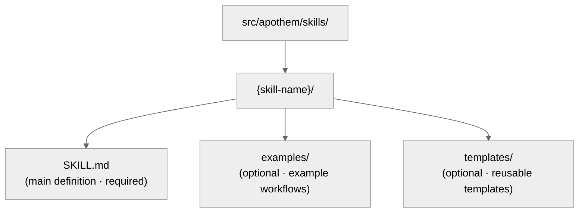

{/* SPDX-License-Identifier: MIT */}

Dieses Handbuch hilft Entwicklern, das Apothem-Ökosystem mit
SOTA-Qualitätsstandards zu pflegen und zu erweitern.

## Schnellreferenz: Artefakttypen

Dieses Handbuch behandelt fünf Artefakttypen, jeder mit einem bestimmten Zweck.
Regeln, Befehle, Helfer und Skills tragen YAML-Frontmatter; Hooks werden in
`hooks.json` und `settings.json` registriert und tragen keines. Output-Styles
sind eine weitere Artefaktklasse mit zwei erforderlichen Frontmatter-Schlüsseln,
`name` und `description`; siehe das
[Frontmatter-Schema](/docs/reference/frontmatter-schema).

| Artefakt | Pfad | Zweck | Wann erstellen |
| -------- | ---- | ------- | -------------- |
| **Regel** | `src/apothem/rules/*.md` | Verhaltensmandat oder operative Direktive | Neues Prinzip, neue Richtlinie oder neues Governance-Mandat festgelegt |
| **Befehl** | `src/apothem/commands/*.md` | Slash-Befehl (`/command-name`) für komplexe Workflows | Neuer mehrstufiger Benutzer-Workflow |
| **Helfer** | `src/apothem/agents/*.md` | Persistente Definition eines delegierten Workers für parallele Aufgaben | Neue wiederkehrende Spezialaufgabe (Audit, Erkundung, Qualitätsprüfung) |
| **Skill** | `src/apothem/skills/{name}/SKILL.md` | Wiederverwendbare Technik mit Erkennungssignal | Neues erkennbares, wiederverwendbares Technikmuster |
| **Hook** | `src/apothem/hooks/` + `hooks.json` + `settings.json` | Ereignisgesteuerte Validierung oder Zustandsverwaltung | Neues Lebenszyklus-Ereignis oder neuer Validierungsbedarf |

## Harness-Adapter-Vertrag

Identitäts- und Fähigkeitsfakten eines Harness liegen in
`src/apothem/lib/harness_registry.py`. Eine Harness-Änderung ist nur dann
vollständig, wenn diese Oberflächen übereinstimmen:

| Oberfläche | Erforderliche Aktualisierung |
| --- | --- |
| Registry-Zeile | Öffentliche ID, Paketschlüssel, Einstiegspunkt, Geltungsbereich, Ausgabeformat, Zielpfade, Doku-Pfade, Fähigkeitsdatei, Standard-Pin, Fixture-Tests, Package-Data-Schlüssel, Template-Quellen und Fähigkeitsstatus. |
| Adapter-Paket | `__init__.py`, `install.py`, `update.py`, `uninstall.py`, `verify.py`; fügen Sie `materializer.py` nur hinzu, wenn der Harness eine native Konfigurationsdatei rendert. |
| Propagation-Manifest | Template- und Kohortenpfade für manifestgestützte Adapter. |
| Fähigkeiten | `src/apothem/harnesses/<package>/capabilities.yml` mit jeder erforderlichen Fähigkeit und einer Begründung für nicht unterstützte oder discovery-pending-Zustände, plus einer `conversion_losses`-Map für jede konvertierte Befehls-, Agenten- oder Regelkohorte (siehe die [Harness-Registry](/docs/reference/harness-registry)). |
| Konventions-Pin | `STANDARD-CONVENTION-PIN.md` mit Vendor-URL, Snapshot-Datum, kanonischem Dateinamen/Schema, Belegreferenz und Begründung für nicht unterstützte Fähigkeiten. |
| Tests | Registry-Parität, Adapter-Fixture-Test, Golden-Install-Plan-Zeile, Dry-Run-/No-Write-Verhalten, Idempotenz und Package-Data-Abdeckung. |
| Doku | Harness-Referenzseite, Vergleichsseite, Fähigkeits-/MCP-Anmerkungen und Beispiele, die fiktive Platzhalter verwenden. |

Adapter mit Projekt-Geltungsbereich müssen `requires_project = True` setzen,
`project: Path | None` in den Lebenszyklusmethoden akzeptieren und fehlende
oder unsichere Projekt-Stammverzeichnisse vor Schreibvorgängen ablehnen.
Adapter mit Benutzer-Geltungsbereich müssen Pfade unter dem dokumentierten
Benutzerkonfigurations-Stammverzeichnis des Harness halten.

## Golden-Fixture-Richtlinie

`tests/fixtures/harness-golden-plans.json` zeichnet die öffentliche Form des
Install-Plans für alle siebzehn Harnesses der Registry auf: öffentliche ID,
Materialisierungsmodus, Quellpfad der Kohorte bzw. des Templates und
normalisierten Zielpfad unter `<ROOT>`. Wenn sich das Zielverhalten von
Registry, Manifest oder Template absichtlich ändert, aktualisieren Sie die
Golden-Fixture im selben Commit wie die Quelländerung, damit das Diff das
Verhaltensdelta zeigt.

## Validierung vor dem Schreiben

Der gemeinsame Install-Treiber validiert jede Quelle und jedes Ziel vor dem
ersten Schreibvorgang. Er lehnt fehlende Manifestquellen, Ziel-Traversierung,
Zielpfade außerhalb des gewählten Stammverzeichnisses und
Symlink-Überschreitungen ab. Dry-Runs führen dieselbe Validierung aus und
geben strukturierte `skipped`- oder `unchanged`-Ergebnisse zurück, ohne
Dateien zu erstellen.

## Schwärzung und Beispieldaten

Profildiagnosen schwärzen token-, secret-, password-, credential-, API-Key-,
private-key-, authorization-, auth- und header-förmige Felder. Dokumentation,
Fixtures, Beispiele und JSON-Snippets verwenden `example.invalid`,
`Example User`, `example-user` und offensichtliche Platzhalter statt echt
wirkender Geheimnisse oder persönlicher Konten.

## Bevor Sie schreiben: Das kanonische Schema

**Der maschinenlesbare, vom Gate durchgesetzte Vertrag sind die
klassenbezogenen JSON-Schemas unter `src/apothem/schemas/*.schema.json` —
`additionalProperties` lehnt unbekannte Schlüssel ab, sodass das
Konformitäts-Gate das letzte Wort hat.** Zwei menschenlesbare Projektionen
folgen ihnen: `site/content/docs/reference/frontmatter-schema.mdx` (der Index
der Pflichtschlüssel) und `site/content/docs/reference/artifact-schema.mdx`
(klassenbezogene Templates und durchgearbeitete Beispiele). Wo eine Seite den
JSON-Schemas widerspricht, haben die Schemas Vorrang.

- Lesen Sie das JSON-Schema für Ihren Artefakttyp unter `src/apothem/schemas/`
- Lesen Sie `site/content/docs/reference/artifact-schema.mdx` § „Schema“ für
  das Template und ein durchgearbeitetes Beispiel
- Kopieren Sie die erforderlichen Felder, tragen Sie die verpflichtenden Werte
  ein und fügen Sie optionale Felder nach Bedarf hinzu

## Frontmatter-Schnellprüfung

Das Frontmatter jedes Artefakts muss diese Prüfungen bestehen. Wenden Sie die
Prüfungen zu `version`, `updated` und `portability` nur auf eine Klasse an, die
den Schlüssel trägt: Regeln tragen keinen davon, und Skills tragen kein
`portability`.

```yaml
✓ Valid YAML syntax (use tools: `yamllint` or PowerShell `ConvertFrom-Yaml` where available)
✓ All mandatory fields present (per schema for artifact type)
✓ name: uses kebab-case
✓ version: semantic MAJOR.MINOR.PATCH
✓ updated: ISO 8601 date (YYYY-MM-DD)
✓ description: single-line, non-empty
✓ scope fields valid per artifact type (rules: pathFilter + alwaysApply; CLAUDE.md root: scope)
✓ portability: string, for example `universal` (the schemas do not enumerate its values)
✓ No typos in field names — must match canonical schema exactly
✓ Optional fields use correct enum values
```

## Namenskonventionen

### Artefaktnamen (kebab-case)

- **Regeln:** `operational-mandates`, `clean-room-generation`, `context-management`
- **Befehle:** `plan-execute`, `plan-spec`, `plan-generate`
- **Helfer:** `codebase-explorer`, `convention-auditor`, `quality-gate`
- **Skills:** `plan-suite`, `ecosystem-audit`

Muster: Kleinbuchstaben, Bindestriche zwischen Wörtern, keine Leerzeichen oder
Unterstriche.

### Dateibenennung

- **Regeln:** `{name}.md`
- **Befehle:** `{name}.md`
- **Helfer:** `{name}.md`
- **Skills:** Im Ordner `src/apothem/skills/{name}/SKILL.md` (exakte Schreibweise: `SKILL.md`)
- **Hooks:** Im Ordner `src/apothem/hooks/`. Alle Ereignis-Handler sind in Python
  geschrieben. Jeder Hook-Befehl in der `settings.json`-Vorlage für Claude Code
  verwendet die Exec-Form: `command` ist der Interpreter-Platzhalter
  `${PYTHON_BIN}`, der bei der Installation aufgelöst wird, und `args` enthält
  den Skriptpfad und seine Argumente. Diese Vorlage ruft
  `${HARNESS_ROOT}/.apothem/support/hooks/dispatch.py <event> [<message-name>]` und
  `${HARNESS_ROOT}/.apothem/support/conformity/gate.py --hook` über absolute Pfade auf, daher
  benötigt die installierte Kopie kein importierbares `apothem`-Paket. Das Plugin für
  Claude Code registriert Hooks stattdessen in `src/apothem/hooks/hooks.json`, und zwar als
  Shell-Befehle, die `hooks/lib/bootstrap.sh` über `bash` ausführen; dieser Stub findet
  Python und führt `dispatch.py` aus, sodass die Handler in Python bleiben. Registrieren Sie
  einen neuen Hook in `hooks.json` und in der `settings.json`-Vorlage für Claude Code.
  `dispatch.py` leitet `SessionStart` an `session_start_bootstrap.main()` weiter und jedes
  andere zugelassene Ereignis an `emit_hook_context.main()`. Die einzigen Shell-Stubs, die
  unter `src/apothem/hooks/` oder `scripts/` zulässig sind, sind die sechs Locator- und
  Bootstrap-Dateien (`find-python.{ps1,sh}`, `find-pwsh.{ps1,sh}`, `bootstrap.{ps1,sh}`);
  jede andere `.ps1`- oder `.sh`-Datei fällt bei der Hygieneprüfung
  `scripts/dev/validate_hooks.py` durch.

### Querverweise

Verwenden Sie beim Verweisen auf andere Artefakte exakte Namen:

- Regeln: `"operational-mandates"` (Wert des Felds name)
- Befehle: `/plan-execute` (mit Schrägstrich in Dokumentation für Menschen; im Code ohne)
- Helfer: `codebase-explorer` (Wert des Felds name)
- Skills: `plan-suite` (Wert des Felds name)

Verwenden Sie im Fließtext niemals Dateipfade oder gekürzte Namen.

## Portabilität: Windows vs. Unix

Jeder Befehl MUSS seinen Portabilitätsstatus ausdrücklich im Feld
`portability` deklarieren. Ein Helfer KANN ihn deklarieren. Skills, Regeln und
Output-Styles tragen kein Feld `portability`.

### Universal

- Funktioniert identisch unter Windows, macOS und Linux
- Keine Shell-Annahmen
- Pfade verwenden Schrägstriche (`/`)
- Keine fest codierten absoluten Pfade
- Keine Windows-spezifische PowerShell-Syntax

```yaml
portability: "universal"
```

### Universal mit Windows-Vorbehalten

- Universell auf POSIX-Hosts; der genannte Vorbehalt gilt für die im Inhalt deklarierte Windows-Plattformvariante
- Dokumentieren Sie den Vorbehalt ausdrücklich im Inhalt
- Beispiel: „Symlinks werden unter Windows vor Win 10 nicht unterstützt“

```yaml
portability: "universal-with-windows-caveats"
```

Dokumentieren Sie den Vorbehalt in einem Hinweis unmittelbar nach dem Titel.

### Nur Unix / Nur Windows

- Ausdrücklich auf eine Plattform beschränkt
- Selten in Apothem — die meisten sollten universell sein
- Nur verwenden, wenn plattformspezifische Funktionen unverzichtbar sind

```yaml
portability: "unix-only"
```

Dokumentieren Sie den Grund im ersten Abschnitt des Artefakts.

## Geltungsbereich: immer aktiv vs. pfadgefiltert

### Immer aktiv

Die Regel gilt überall.

```yaml
pathFilter: ""
alwaysApply: true
```

### Pfadgefiltert

Die Regel gilt bedingt, abhängig vom Dateipfad.

```yaml
pathFilter: "**/*.py, **/*.toml"
alwaysApply: false
```

`pathFilter` verwendet Glob-Muster (dasselbe Format wie `.gitignore`). Wenn
eine Datei dem Filter entspricht, wird die Regel aktiviert.

## Versionssemantik

Jedes versionierte Artefakt trägt seine eigene semantische Version
(`MAJOR.MINOR.PATCH`). Befehle und Skills verlangen sie, Helfer und
Output-Styles KÖNNEN sie tragen, und Regeln tragen keine:

- **PATCH** — eine Verhaltensänderung, die eine bestehende Direktive korrigiert, ohne den Vertrag zu brechen.
- **MINOR** — additive, nicht inkompatible Änderungen: neue optionale Abschnitte, neue optionale Frontmatter-Felder, neue Beispiele. Bestehende Konsumenten funktionieren ohne Änderung weiter.
- **MAJOR** — inkompatible Schema- oder Vertragsänderungen: entfernte Abschnitte, umbenannte Felder, geändertes Verhalten einer bestehenden Direktive, Änderungen, die nachgelagerte Artefakte zur Anpassung zwingen.

Tippfehlerkorrekturen, Linkkorrekturen, Formatierungen sowie reine Kommentar- oder Dokumentationsänderungen lassen die Version unverändert. Nur eine Verhaltensänderung erhöht sie. Eine solche Bearbeitung aktualisiert dennoch das Datum `updated` des Artefakts.

Beispiele:

- `vX.Y.Z` → `vX.Y.(Z+1)` (PATCH: eine korrigierte Direktive, die das Verhalten ändert)
- `vX.Y.Z` → `vX.Y.Z` (keine Erhöhung: Tippfehler- oder Linkkorrektur; `updated` ändert sich)
- `vX.Y.Z` → `vX.(Y+1).0` (MINOR: neuen optionalen Abschnitt hinzugefügt)
- `v0.Y.Z` → `v(0+1).0.0` (MAJOR: Vertrag als stabil deklariert; neue Artefakte beginnen bei `v0.Y.Z`)
- `vX.Y.Z` → `v(X+1).0.0` (MAJOR: verpflichtendes Frontmatter-Feld entfernt)

Heben Sie `version` und `updated` bei jeder verhaltensändernden Bearbeitung
eines Artefakts, das diese Felder trägt, gemeinsam an. Hängen Sie für Releases,
die Artefaktänderungen bündeln, eine passende Zeile an die ökosystemweite
`CHANGELOG.md` an.

### Revisionen von Plan-Suiten

Die Artefaktregel oben gilt nicht für Plan-Suiten. Die Version einer Plan-Suite ist der Wert `vX.Y.Z`, der im Kopf von `MASTER-PLAN.md` und in der Tabelle der Revisionshistorie erfasst wird. Eine Tippfehlerkorrektur an einer Plan-Suite ist eine Revision, die die PATCH-Nummer erhöht. Schritt 10.2 von `/plan-review` legt die Klassifizierung fest und hängt die Zeile der Revisionshistorie an.

- `vX.Y.Z` → `vX.Y.(Z+1)` (Plan-Suite, Tippfehler: PATCH)
- `vX.Y.Z` → `vX.Y.Z` (Artefakt, Tippfehler: keine Erhöhung; die Artefaktregel oben)

## Wann ein Artefakt zu bearbeiten ist

### Regeln

- Behandeln Sie die Mandatory/Optional-Struktur als tragend — eine
  Umstrukturierung wirkt sich auf jedes abhängige Artefakt aus.
- Verfeinern Sie Anti-Patterns, Seriousness-Scaling-Beispiele und
  Quellenangaben, wenn sich das Verständnis vertieft.
- Halten Sie die Begründung jeder strukturellen Änderung in der zugehörigen
  Memory-Topic-Datei fest.

### Befehle

- Die Form der Argumente ist Teil des öffentlichen Vertrags — brechen Sie sie
  nur mit ausdrücklicher Absicht und übertragen Sie die Änderung auf jeden
  Aufrufer (MAJOR-Anhebung).
- Halten Sie Workflow-Schritte und Rückgabeverträge knapp und aktuell.
- Dokumentieren Sie nicht offensichtliche Schrittabfolgen inline.

### Helfer

- Halten Sie `disallowedTools` minimal, aber ausreichend; dokumentieren Sie
  die Begründung, wenn sich die Liste ändert.
- Verfeinern Sie Operating Principles und Return Contracts, während die Rolle
  des Helfers reift (MINOR-Anhebung).
- Halten Sie Fähigkeitsverschiebungen inline fest, damit Aufrufer ihre
  Erwartungen neu kalibrieren können.

### Skills

- Halten Sie Procedure-Schritte und Examples mit der Realität synchron.
- Erkennungssignale müssen die tatsächlichen Formulierungen der Benutzer im
  aktuellen Gebrauch widerspiegeln.
- Teilen Sie einen Skill auf, sobald er ~150 Zeilen überschreitet (siehe
  `auto-memory.md` § Topic File Management).

## Schritt für Schritt: Eine neue Regel hinzufügen

### 1. Orthogonalität bewerten

Überschneidet sich diese Regel mit bestehenden Regeln? Durchsuchen Sie
`src/apothem/rules/` nach verwandtem Inhalt.

Bei einer Überschneidung von >50 % erwägen Sie stattdessen, eine bestehende
Regel zu erweitern. Siehe `persistent-conventions-vigilance.md` § Artifact
Evolution.

### 2. Inhalt schreiben

Folgen Sie dieser Struktur:

- Titel: `# Rule: {Title}`
- Purpose-Abschnitt
- Obligations / Core directives (nummeriert, verlinkt)
- Seriousness-Scaling-Tabelle (immer erforderlich)
- Anti-Patterns-Abschnitt
- Enforcement-Abschnitt

### 3. Frontmatter erstellen

Verwenden Sie das Schema aus `site/content/docs/reference/artifact-schema.mdx` § Schema: Rules. Setzen Sie:

- `name:` Bezeichner in kebab-case
- `description:` einzeilige Zusammenfassung für Registries
- `pathFilter:` Glob-Liste für pfadgefilterte Regeln; die leere Zeichenkette (`""`) für immer aktive Regeln
- `alwaysApply:` `true` für immer aktive Regeln, `false` für pfadgefilterte Regeln

Regeln tragen nur diese vier Felder — kein `version` / `updated` / `scope` / `portability` / `implements`.

Beispiel:

```yaml
---
name: "my-new-rule"
description: "Brief one-liner"
pathFilter: ""
alwaysApply: true
---
```

### 4. Rules-README aktualisieren

Fügen Sie der Tabelle für die Familie der Regel im Abschnitt Rule families von
`src/apothem/rules/README.md` eine Zeile hinzu:

```markdown
| `my-new-rule.md` | One-line concern of the new rule. |
```

Wählen Sie die Familientabelle, deren Thema zur Regel passt.

### 5. An CHANGELOG.md anhängen

Fügen Sie unter dem Abschnitt `### Added` des nächsten Releases eine Zeile
hinzu, die die neue Regel beschreibt.

### 6. Validierung ausführen

Rufen Sie den Skill `ecosystem-audit` auf, um die neue Regel zu verifizieren,
mit Fokus auf den Bereich der Regeln:

```text
Invoke the ecosystem-audit skill with --focus rules --fix
```

Verifizieren Sie, dass für Ihre neue Regel keine Fehler gemeldet werden.

## Schritt für Schritt: Einen neuen Befehl hinzufügen

Befehle sind Slash-Befehle wie `/plan-spec`, `/plan-execute`, `/security-audit` usw.

### 1. Rolle bestimmen

Befehle sind vom Benutzer ausgelöste Workflows. Das Modell führt einen Befehl
nur dann von sich aus aus, wenn seine Einstellung `disable-model-invocation`
den Wert `false` hat (Schritt 2). Fragen Sie:

- Ist dies ein Workflow, den der Benutzer als `/command-name` eingibt?
- Orchestriert er mehrere Schritte?
- Könnte er in ein Timeout laufen oder mitten in der Ausführung
  Benutzereingaben erfordern?

Wenn eine dieser Fragen mit „nein“ beantwortet wird, handelt es sich
wahrscheinlich um einen Skill, nicht um einen Befehl.

### 2. Datei erstellen

Pfad: `src/apothem/commands/{name}.md`

Frontmatter (aus `site/content/docs/reference/artifact-schema.mdx` § Schema: Commands):

```yaml
---
name: "my-command"
version: "X.Y.Z"
updated: "2026-04-20"
description: "What this command does"
argument-hint: "[path/to/input] [--flag VALUE]"
disable-model-invocation: true
portability: "universal"
allowed-tools: "Read, Glob, Grep"
---
```

`disable-model-invocation: true` macht einen Befehl ausschließlich vom
Operator aufrufbar; mit `false` darf das Modell ihn ausführen, wenn eine
Anfrage seiner Beschreibung entspricht. Die meisten Befehle verwenden `true`,
die meisten Stufen der Plan- und der Forschungs-Pipeline jedoch `false`.
Die Aufruftabelle in `src/apothem/commands/README.md` listet die Einstellung
jedes Befehls auf; fügen Sie für einen neuen Befehl eine Zeile hinzu. Halten
Sie `allowed-tools` auf lesende Werkzeuge beschränkt: Ein Harness, der dieses
Feld beachtet, führt diese Werkzeuge ohne Rückfrage aus. Gewähren Sie ein
Werkzeug mit Seiteneffekten nur als eingegrenzte Regel, etwa
`Bash(git log *)`; das Schema lehnt `"*"` und jedes der Werkzeuge `Bash`,
`PowerShell`, `Write`, `Edit`, `NotebookEdit` oder `WebFetch` ab, wenn es ohne
Eingrenzung geschrieben ist.

### 3. Inhalt schreiben

Struktur:

- Titel: `# /{name} — Human-Readable Title`
- Role-Abschnitt (wer dies ausführt)
- Übergeordnete Anweisungen
- Workflow-Abschnitt mit Schritten
- Return Contract / Ausgabeformat

### 4. README und CHANGELOG.md aktualisieren

Fügen Sie der Tabelle für den Abschnitt des Befehls in `src/apothem/commands/README.md` eine Zeile hinzu, zusätzlich zur Zeile der Aufruftabelle aus Schritt 2; fügen Sie unter dem Abschnitt `### Added` des nächsten Releases eine CHANGELOG-Zeile hinzu.

### 5. Validieren

Rufen Sie den Skill `ecosystem-audit` mit Fokus auf Befehle auf:

```text
Invoke the ecosystem-audit skill with --focus commands --fix
```

## Schritt für Schritt: Einen neuen Helfer hinzufügen

Helfer sind persistente Definitionen delegierter Worker für parallele Arbeit.

### 1. Muster identifizieren

Passt dieser Helfer zu einem der unten aufgeführten Team-Muster?

- Research Team: nur lesend, Informationsbeschaffung
- Audit Team: Verifikation, Konsistenzprüfungen
- Implementation Team: parallele Codeänderungen
- Quality Team: Lint, Test, Typprüfung, Sicherheit
- Documentation Team: Doku-Aktualisierungen
- Other: Spezialaufgabe

### 2. Datei erstellen

Pfad:

```text
src/apothem/agents/{name}.md
```

Frontmatter:

```yaml
---
name: "my-helper"
version: "X.Y.Z"
updated: "2026-04-20"
description: "What this helper specializes in"
tools: "Read, Glob, Grep, Bash"
disallowedTools: "Write, Edit"
maxTurns: 15
portability: "universal"
---
```

Lassen Sie `model`, `effort` und `permissionMode` weg, damit der Helfer die
Vorgaben der Sitzung erbt (die agnostische Haltung), und lassen Sie `memory`
weg, es sei denn, der Helfer benötigt einen Geltungsbereich für persistenten
Speicher (`user`, `project` oder `local`).

### 3. Inhalt schreiben

Abschnitte:

- Operating Principles (nur lesend, evidenzbasiert, binäre Urteile, erschöpfend)
- Workflow (nummerierte Schritte)
- Return Contract (max. Tokens, Struktur, erforderliche Felder)

### 4. README und CHANGELOG.md aktualisieren

Fügen Sie der Index-Tabelle in `src/apothem/agents/README.md` eine Zeile hinzu; fügen Sie unter dem Abschnitt `### Added` des nächsten Releases eine CHANGELOG-Zeile hinzu.

### 5. Testen

Setzen Sie den Helfer in einem realen Szenario ein und verifizieren Sie, dass
er wie dokumentiert funktioniert.

## Schritt für Schritt: Einen neuen Skill hinzufügen

Skills sind wiederverwendbare, erkennbare Techniken.

### 1. Wiederverwendbarkeit feststellen

Bevor Sie einen Skill schreiben:

- Haben Sie dieses Problem bzw. diese Technik 3+ Mal gesehen?
- Ist es erkennbar? (Signalisiert ein Muster in Benutzeranfragen es?)
- Können Sie es reproduzierbar kodifizieren?

Wenn alle drei Fragen mit „ja“ beantwortet werden, schreiben Sie einen Skill.

### 2. Struktur erstellen



### 3. SKILL.md schreiben

Frontmatter:

```yaml
---
name: "skill-name"
version: "X.Y.Z"
updated: "2026-04-20"
description: "What this skill teaches"
archetype: "workflow-template"
userInvocable: true | false
disable-model-invocation: true | false
allowed-tools: "Read, Glob, Grep"
argument-hint: "[args]"               # optional; if userInvocable
---
```

Inhaltsstruktur:

- Purpose
- When to Use This Skill
- Prerequisites
- Step-by-Step Procedure
- Common Mistakes
- Examples

### 4. README und CHANGELOG.md aktualisieren

Fügen Sie in `src/apothem/skills/README.md` der Tabelle Index eine Zeile und der Tabelle Folder contents für jede Datei des Skills eine Zeile hinzu; fügen Sie unter dem Abschnitt `### Added` des nächsten Releases eine CHANGELOG-Zeile hinzu.

### 5. Validieren

Rufen Sie den Skill `ecosystem-audit` mit Fokus auf Skills auf:

```text
Invoke the ecosystem-audit skill with --focus skills --fix
```

## Validierungs-Checkliste vor dem Commit

- [ ] Frontmatter besteht die YAML-Syntaxprüfung
- [ ] Alle verpflichtenden Felder gemäß Schema vorhanden
- [ ] Das Feld `name` verwendet kebab-case
- [ ] `version` (nur versionierte Klassen; Regeln tragen keine) ist semantisch (`MAJOR.MINOR.PATCH`) und wurde angehoben, falls sich das Verhalten geändert hat
- [ ] `updated` entspricht dem heutigen Datum für jedes Artefakt, das Sie bearbeitet haben und das das Feld trägt
- [ ] Feld `portability` gesetzt und gültig (bei Befehlen erforderlich, bei Helfern optional)
- [ ] CHANGELOG.md führt die Änderung in der passenden Kategorie unter dem Abschnitt des nächsten Releases
- [ ] Keine plan-internen Verweise (CM-7-Konformität)
- [ ] Querverweise sind mit anderen Artefakten konsistent
- [ ] Neues Artefakt im Index der README seines Ordners registriert
- [ ] Artefakt getestet (falls zutreffend)
- [ ] Skill `ecosystem-audit` läuft ohne Fehler
- [ ] Inhalt folgt den strukturellen Konventionen (Titelformat, Abschnitte usw.)

## Auf andere Artefakte verweisen

Verwenden Sie genau diese Konventionen:

### Auf eine Regel verweisen

```markdown
See `src/apothem/rules/operational-mandates.md` or shorthand: the Operational Mandates rule.
In prose: ... per CM-1–10 (Operational Mandates rule) ...
```

### Auf einen Befehl verweisen

```markdown
See `/plan-execute` command. Or: Run `/plan-execute`.
In prose: The `/plan-execute` command handles phase execution.
```

### Auf einen Helfer verweisen

```markdown
Deploy the `codebase-explorer` delegated worker.
In prose: The codebase-explorer worker finds patterns.
```

### Auf einen Skill verweisen

```markdown
Use the `plan-suite` skill.
In prose: The plan-suite skill provides the Master Plan Suite template.
```

### Auf CLAUDE.md-Abschnitte verweisen

```markdown
See CLAUDE.md § Harness Adapter Pattern.
Or: § Plans Discipline.
```

## Linting und Format

Alle Artefakte verwenden:

- **Markdown:** GFM (GitHub Flavored Markdown)
- **YAML:** YAML-1.2-konform
- **Zeilenenden:** LF (Unix-Stil)
- **Kodierung:** UTF-8
- **Zeilenbreite:** Weicher Umbruch bei 100 Zeichen für Inhalt (keine harten Umbrüche)

Verwenden Sie für Python-Dateien den Formatter / Linter `Ruff`. Verwenden Sie
für Markdown `prettier` oder ein Äquivalent.

## Testen und Messen

### Die Suite ausführen

```bash
python -m pytest                      # unit, integration, property, conformity, scripts
python -m pytest tests/property       # Hypothesis properties (profile loader, frontmatter, merge)
```

Die Suite ist hermetisch: Sie besteht mit dem Checkout unter `$TMPDIR` und mit
einem `python` auf dem `PATH`, dem die CLI-Voraussetzungen fehlen, weil die
Integrationstests den Interpreter ausführen, der pytest ausführt, und
verschachtelte temporäre Pfade und Quellpfade, längste zuerst, tokenisieren.

### Abdeckung pro Paket

Die CI misst drei Pakete und verlangt von jedem seine eigene Untergrenze.
Keines davon wird in ein anderes eingerechnet.

| Paket | Pfade | Untergrenze | Wo die Untergrenze festgelegt ist |
| --- | --- | --- | --- |
| engine | `cli`, `harnesses`, `lib`, `hooks`, `statuslines` | 80 | `[tool.coverage.report] fail_under` |
| conformity | `src/apothem/conformity` | 81 | `[tool.coverage.package-floors]` |
| audit | `src/apothem/audit` | 70 | `[tool.coverage.package-floors]` |

Der Wert ist die Zeilen- plus Zweigabdeckung, derselbe Prozentsatz, den
coverage.py mit `branch = true` meldet; das Metrik-Artefakt erfasst zusätzlich
den reinen Anweisungswert unter `coverage_lines`. Jede Paket-Untergrenze ist
der gemessene Zeilen- plus Zweigwert, abgerundet. Heben Sie eine Untergrenze
an, wenn die Abdeckung steigt; senken Sie niemals eine ab, um eine Änderung
bestehen zu lassen. Zur lokalen Prüfung:

```bash
python -m pytest --cov=src/apothem --cov-report=json:coverage.json
python scripts/dev/collect_metrics.py --coverage-json coverage.json --check-floors \
  --skip-hooks --skip-coldstart --harness zed
```

### Das Metrik-Artefakt

Der CI-Job `metrics` führt `scripts/dev/collect_metrics.py` bei jedem Push und
Pull Request aus und lädt `metrics.json` (`schema_version: 1`) hoch. Für
jeden Wert, der `null` ist, steht der Grund unter `nulls`.

| Schlüssel | Was er misst |
| --- | --- |
| `coverage.engine`, `coverage.conformity`, `coverage.audit` | Zeilen- plus Zweigprozentsatz pro Paket, mit `coverage_floors`. |
| `always_on_bytes[harness]`, `always_on_files[harness]` | Für jeden der 17 Harnesses, nach `profile init` und `install --harness <id>` in ein temporäres `HOME`-Verzeichnis und ein temporäres Projekt: die Bytes der Anweisungsdateien auf dem Datenträger, die dieser Harness beim Start vollständig lädt. |
| `cli_coldstart_ms` | Median von `python -m apothem --version` (mit `--help` unter `cli_coldstart_detail_ms`). |
| `hook_e2e_ms[event]`, `hook_injected_chars[event]` | Pro registriertem Ereignis und Matcher (`PreToolUse:Write`, `Stop`, …): die mediane Gesamtzeit der Hook-Kette mit einer realen Payload und die Kontextzeichen, die sie injiziert. |

Welche Dateien als beim Start geladen zählen, ist eine harness-spezifische
Regel, die den dokumentierten Anweisungsoberflächen des jeweiligen Vendors
entnommen ist. Auflistungen, die nur eine Beschreibung tragen (Skills, Befehle,
Subagenten), werden nicht gezählt. Der Regeltext wird außerdem unter
`rules.always_on_bytes` in das Artefakt geschrieben:

```text
antigravity     ~/.gemini/{GEMINI,AGENTS}.md, ~/.gemini/config/{GEMINI,AGENTS}.md,
                ~/.gemini/config/rules/*.md with trigger: always_on, project
                GEMINI.md and AGENTS.md. The plugin rules/ folder is not a
                documented launch surface.
claude-code     ~/.claude/CLAUDE.md and ~/.claude/rules/**/*.md without paths:
                frontmatter, plus the project equivalents.
codebuddy       .codebuddy/rules/**/*.md (project and home) unless
                alwaysApply: false, plus CODEBUDDY.md.
codex           ~/.codex/AGENTS.md and the project AGENTS.md.
cursor          .cursor/rules/**/*.mdc with alwaysApply: true, and AGENTS.md.
gemini-cli      ~/.gemini/GEMINI.md and the project GEMINI.md.
github-copilot  .github/copilot-instructions.md and the project AGENTS.md.
hermes          ~/.hermes/SOUL.md, project .hermes.md, AGENTS.md, CLAUDE.md.
                The support tree and apothem/rules/ are not launch surfaces.
kimi-code       ~/.kimi-code/AGENTS.md, project AGENTS.md and .kimi-code/AGENTS.md.
kiro            .kiro/steering/**/*.md with inclusion: always or no inclusion
                key, and the project AGENTS.md.
open-claw       Workspace bootstrap files ~/.openclaw/workspace/*.md.
opencode        ~/.config/opencode/AGENTS.md, the project AGENTS.md, and every
                file the instructions globs in opencode.json match.
qwen-code       The context files named by context.fileName in
                ~/.qwen/settings.json (default QWEN.md), in ~/.qwen/ and the project.
trae            .trae/rules/**/*.md with alwaysApply: true, and
                ~/.trae/user_rules/*.md.
windsurf        .devin/rules/**/*.md and .windsurf/rules/**/*.md with
                trigger: always_on, the global global_rules.md, and AGENTS.md.
zed             The first of .rules, .cursorrules, .windsurfrules, .clinerules,
                .github/copilot-instructions.md, AGENT.md, AGENTS.md, CLAUDE.md,
                GEMINI.md in the project, plus ~/.config/zed/AGENTS.md.
glm             Nothing: GLM is a model backend and loads no instruction files.
```

### Verhaltens-Evals

Die Suite unter `evals/` misst Verhalten statt Form: 64 Auslösefälle (jeder
vom Modell aufrufbare Befehl und Subagent wird bei einer Anfrage aus seinem
Bereich ausgelöst und bleibt bei einem Beinahe-Treffer still), 32 Ergebnisfälle
(einer pro Plan-Stufe, Forschungsstufe und Audit-Dimension) und 6
Regelwirkungspaare (der Text einer immer aktiven Regel ein- und ausgeschaltet).
Die Fälle sind reine Daten, die
`python -m pytest tests/unit/test_eval_suite.py` kostenlos validiert; ihre
Ausführung ist kostenpflichtig und erfolgt manuell. Unter
[Die Verhaltens-Evals ausführen](/docs/how-to/evals) finden Sie den
`Evals`-Workflow, einen lokalen Lauf und wie Sie einen Fall hinzufügen. Führen
Sie nach dem Bearbeiten einer immer aktiven Regel, die ein Paar hat,
`python scripts/dev/sync_eval_rule_cases.py` aus.

### Benchmarks

`make benchmarks` führt die klassenbezogenen Treiber unter
`src/apothem/benchmarks/` aus, mit Ausnahme von `bench_agents.py`. Jeder
Treiber endet mit `0` bestanden, `1` über dem Budget, `2` Fehler (der
gemessene Lauf wurde nicht ausgeführt) oder `3` nicht gemessen.

- `bench_hooks.py` führt jeden `shell: bash`-Befehl, den `hooks/hooks.json`
  registriert, wie geschrieben mit einer realen Payload pro Ereignis und
  Matcher aus und meldet die mediane Gesamtzeit, den langsamsten Befehl
  (geprüft gegen das Budget des Ereignisses) und die injizierten Zeichen. Ein
  Befehl, der nicht wie registriert laufen kann (Exit-Code 126, wenn einem
  Skript das Ausführungsbit fehlt), ist ein Fehler, kein Bestehen.
- `bench_agents.py` meldet `NOT MEASURED` (Exit-Code 3): Das Starten eines
  Subagenten benötigt einen Host-Harness und einen Modellaufruf.
  `make benchmarks` führt es nicht aus.

Die Budgetprüfung für immer aktive Regeln (`always-on-budget-grep`) zählt
durch Leerraum getrennte Wörter, wobei der Abschnitt Bindings und die
Begleitverweiszeilen ausgenommen sind. Ihr JSON-Bericht enthält außerdem
`always-on-loaded`: die Bytes, Zeichen und Wörter der vom Frontmatter befreiten
Rumpftexte, die ein Harness lädt, summiert über die immer aktiven Regeln.

## Ecosystem-Audit: Validierung ausführen

Zwei einander ergänzende Validierungsoberflächen decken das Ökosystem ab:

**Maschinell prüfbar (Python-Validatoren)** — vor jedem Commit ausführen:

```bash
python scripts/dev/validate_hooks.py       # Hook structure + Python-only hygiene
python scripts/dev/validate_ecosystem.py   # Full tree + frontmatter + delegated hook checks
python scripts/dev/chaos_pass.py           # Adversarial sweep across configured hooks
pytest tests                                    # Unit tests for the hook runtime
```

**Vom Assistenten gesteuert** — für Audits von Querverweisen, Narrativ und
Konventionen:

```bash
/ecosystem-audit --focus all --fix
```

Dies führt parallel aus:

- **Struktur-Audit:** Registry-Genauigkeit, Dateiexistenz, Gültigkeit des Frontmatters
- **Artefakt-Audit:** Querverweise, Mandatsabdeckung, Pipeline-Reihenfolge
- **Memory-Audit:** Behauptungen der Memory-Dateien vs. Zustand des Dateisystems

Erwartete Ausgabe: `PASS` mit null Befunden aus beiden Oberflächen.

Wenn `FINDINGS` gemeldet werden:

- Prüfen Sie den Schweregrad jedes Befunds (Critical / Important / Advisory)
- Beheben Sie Critical-Punkte sofort
- Planen Sie Important-Punkte für den nächsten Zyklus ein
- Ziehen Sie Advisory-Punkte für die nächste Iteration in Betracht

---

## Fragen?

Siehe:

- Frontmatter-Schema: `site/content/docs/reference/artifact-schema.mdx`
- Artefakt-Lebenszyklus: `src/apothem/rules/persistent-conventions-vigilance.md` § Artifact Evolution
- Operative Mandate: `src/apothem/rules/operational-mandates.md` CM-1–10
- Plan-Suite-Referenz: `src/apothem/skills/plan-suite/master-template.md`
- Release-Notes: `CHANGELOG.md`
