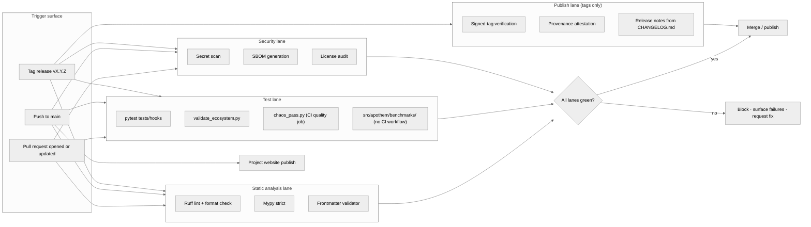

{/* SPDX-License-Identifier: MIT */}

**El mapa estructural del flujo de trabajo de compilación · validación · publicación que controla cada cambio en el ecosistema de Apothem.** Este documento instala la superficie de visualización. Los archivos del flujo de trabajo de GitHub Actions que describe están en `.github/workflows/` (por ejemplo, `ci.yml` y `release.yml`), y el utillaje de lanzamiento está en `scripts/release/`.

## Forma del pipeline

## Roles de los carriles

- **Carril de análisis estático** — retroalimentación rápida. Ruff cubre el estilo de Python y un conjunto de reglas curado; mypy impone disciplina de tipos en modo strict; el validador de frontmatter controla el cumplimiento del esquema de artefactos para reglas, skills, trabajadores delegados y comandos. markdownlint no forma parte de este carril: se ejecuta solo como hook de pre-commit y CI no lo ejecuta (consulta [Convenciones de Markdown](/docs/reference/markdown-conventions)).
- **Carril de pruebas** — `pytest tests/hooks` ejercita el tiempo de ejecución de hooks contra la matriz completa de eventos; `validate_ecosystem.py` es la puerta estructural principal para la coherencia entre artefactos; `chaos_pass.py` se ejecuta en el trabajo de calidad de CI en los push y las pull requests a `main` (filtrado por ruta) para detectar la degradación ante entradas degradadas. La suite de benchmarks por clase bajo `src/apothem/benchmarks/` no se ejecuta en ningún flujo de trabajo de CI.
- **Carril de seguridad** — el escaneo de secretos detecta credenciales confirmadas por accidente; la generación de SBOM y las auditorías de licencias controlan la superficie de la cadena de suministro para cualquier instalación de preparación para producción.
- **Carril de publicación** — los flujos de trabajo de lanzamiento se activan con los push de etiquetas; los publicadores de npm y de VS Code también pueden volver a ejecutarse mediante despacho manual para una etiqueta existente. La verificación de etiquetas firmadas confirma la procedencia de la rama de lanzamiento; las notas de lanzamiento derivan del formato Keep-A-Changelog de `CHANGELOG.md`. El sitio web del proyecto se publica desde `site/dist/` en el destino de GitHub Pages en los push a `main` que modifiquen sus entradas de compilación, o mediante despacho manual.

## Configuración concreta

Los archivos de flujo de trabajo reales (`.github/workflows/ci.yml`,
`.github/workflows/release.yml`, etc.) están en el repositorio. Este diagrama
define la forma canónica que reflejará toda configuración futura.

## Referencias cruzadas autoritativas

- `pyproject.toml` — fuente de verdad de la configuración de Ruff / mypy / pytest.
- `scripts/dev/validate_ecosystem.py` — la principal puerta entre artefactos.
- `scripts/dev/validate_hooks.py` — validación estructural específica de hooks.
- `scripts/dev/chaos_pass.py` — barrido adversarial de cada hook configurado.
- `src/apothem/benchmarks/` — verificadores del presupuesto de runtime por clase.
- `site/content/docs/developer-guide.mdx` — el flujo de trabajo del contribuyente orientado al operador.
- `CHANGELOG.md` — fuente de las notas de lanzamiento.
