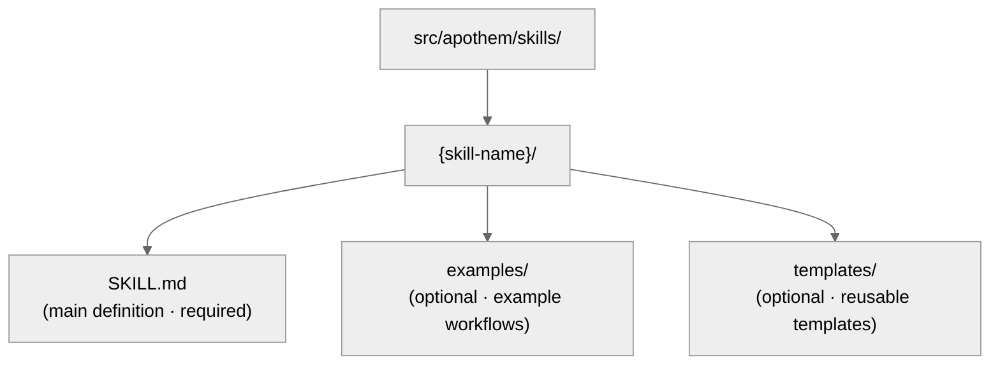

{/* SPDX-License-Identifier: MIT */}

Esta guía ayuda a los desarrolladores a mantener y extender el ecosistema de
Apothem con estándares de calidad SOTA.

## Referencia rápida: tipos de artefacto

El ecosistema de Apothem contiene cinco tipos de artefacto, cada uno con
propósitos y requisitos de frontmatter específicos.

| Artefacto | Ruta | Propósito | Cuándo crearlo |
| -------- | ---- | ------- | -------------- |
| **Regla** | `src/apothem/rules/*.md` | Mandato de comportamiento o directiva operativa | Se establece un nuevo principio, política o mandato de gobernanza |
| **Comando** | `src/apothem/commands/*.md` | Comando de barra (`/command-name`) para flujos de trabajo complejos | Nuevo flujo de trabajo de usuario de varios pasos |
| **Ayudante** | `src/apothem/agents/*.md` | Definición persistente de trabajador delegado para tareas en paralelo | Nueva tarea especializada recurrente (auditoría, exploración, control de calidad) |
| **Skill** | `src/apothem/skills/{name}/SKILL.md` | Técnica reutilizable con señal de detección | Nuevo patrón de técnica detectable y reutilizable |
| **Hook** | `src/apothem/hooks/` + `settings.json` | Validación o gestión de estado disparada por eventos | Nuevo evento de ciclo de vida o nueva necesidad de validación |

## Contrato del adaptador de entorno

Los datos de identidad y de capacidades de cada entorno residen en
`src/apothem/lib/harness_registry.py`. Un cambio de entorno solo está completo
cuando estas superficies concuerdan:

| Superficie | Actualización requerida |
| --- | --- |
| Fila del registro | ID público, clave de paquete, punto de entrada, ámbito, formato de salida, rutas de destino, rutas de documentación, archivo de capacidades, pin de estándar, pruebas de fixture, clave de package-data, fuentes de plantilla y estados de capacidad. |
| Paquete del adaptador | `__init__.py`, `install.py`, `update.py`, `uninstall.py`, `verify.py`; añade `materializer.py` solo cuando el entorno renderiza un archivo de configuración nativo. |
| Manifiesto de propagación | Rutas de plantilla y de cohorte para los adaptadores respaldados por manifiesto. |
| Capacidades | `src/apothem/harnesses/<package>/capabilities.yml` con cada capacidad requerida y la justificación de los estados no admitidos o pendientes de descubrimiento, además de un mapa `conversion_losses` para cada cohorte convertida de comandos, agentes o reglas (consulta el [registro de entornos](/docs/reference/harness-registry)). |
| Pin de convención | `STANDARD-CONVENTION-PIN.md` con la URL del proveedor, la fecha de la instantánea, el nombre de archivo/esquema canónico, la referencia de evidencia y la justificación de las capacidades no admitidas. |
| Pruebas | Paridad del registro, prueba de fixture del adaptador, fila golden del plan de instalación, comportamiento de dry-run/sin escritura, idempotencia y cobertura de package-data. |
| Documentación | Página de referencia del entorno, página de comparación, notas de capacidades/MCP y ejemplos que usan marcadores de posición ficticios. |

Los adaptadores de ámbito de proyecto deben establecer `requires_project = True`,
aceptar `project: Path | None` en los métodos de ciclo de vida y rechazar las
raíces de proyecto faltantes o inseguras antes de cualquier escritura. Los
adaptadores de ámbito de usuario deben mantener las rutas bajo la raíz de
configuración de usuario documentada del entorno.

## Política de fixtures golden

`tests/fixtures/harness-golden-plans.json` registra la forma pública del plan de
instalación de los diecisiete entornos del registro: ID público, modo de
materialización, ruta de cohorte/plantilla de origen y ruta de destino
normalizada bajo `<ROOT>`. Cuando el comportamiento del registro, del manifiesto
o del destino de las plantillas cambia de forma intencionada, actualiza el
fixture golden en el mismo commit que el cambio en el código fuente para que el
diff muestre la diferencia de comportamiento.

## Validación antes de escribir

El driver de instalación compartido valida cada origen y cada destino antes de
la primera escritura. Rechaza las fuentes de manifiesto faltantes, los
recorridos fuera del destino, las rutas de destino fuera de la raíz seleccionada
y los cruces de enlaces simbólicos. Los dry-runs ejecutan la misma validación y
devuelven resultados estructurados `skipped` o `unchanged` sin crear archivos.

## Ocultación y datos de ejemplo

Los diagnósticos del perfil ocultan los campos con forma de token, secreto,
contraseña, credencial, clave de API, clave privada, autorización, auth y
encabezado. La documentación, los fixtures, los ejemplos y los fragmentos JSON
usan `example.invalid`, `Example User`, `example-user` y marcadores de posición
evidentes en lugar de secretos o cuentas personales de apariencia real.

## Antes de escribir: el esquema canónico

**El contrato legible por máquina y aplicado por la puerta son los esquemas JSON
por clase bajo `src/apothem/schemas/*.schema.json` — `additionalProperties`
rechaza las claves desconocidas, así que la puerta de conformidad tiene la
última palabra.** Dos proyecciones legibles por humanos los siguen:
`site/content/docs/reference/frontmatter-schema.mdx` (el índice de claves
requeridas) y `site/content/docs/reference/artifact-schema.mdx` (plantillas por
clase y ejemplos desarrollados). Cuando una página discrepa de los esquemas
JSON, prevalecen los esquemas.

- Lee el esquema JSON de tu tipo de artefacto bajo `src/apothem/schemas/`
- Lee `site/content/docs/reference/artifact-schema.mdx` § «Schema» para ver la
  plantilla y un ejemplo desarrollado
- Copia los campos requeridos, rellena los valores obligatorios y añade campos opcionales según sea necesario

## Comprobación rápida del frontmatter

El frontmatter de cada artefacto debe superar estas comprobaciones:

```yaml
✓ Valid YAML syntax (use tools: `yamllint` or PowerShell `ConvertFrom-Yaml` where available)
✓ All mandatory fields present (per schema for artifact type)
✓ name: uses kebab-case
✓ version: semantic MAJOR.MINOR.PATCH
✓ updated: ISO 8601 date (YYYY-MM-DD)
✓ description: single-line, non-empty
✓ scope fields valid per artifact type (rules: pathFilter + alwaysApply; CLAUDE.md root: scope)
✓ portability: valid enum (`universal` | `universal-with-windows-caveats` | `unix-only` | `windows-only`)
✓ No typos in field names — must match canonical schema exactly
✓ Optional fields use correct enum values
```

## Convenciones de nomenclatura

### Nombres de artefacto (kebab-case)

- **Reglas:** `operational-mandates`, `clean-room-generation`, `context-management`
- **Comandos:** `plan-execute`, `plan-spec`, `plan-generate`
- **Ayudantes:** `codebase-explorer`, `convention-auditor`, `quality-gate`
- **Skills:** `plan-suite`, `ecosystem-audit`

Patrón: minúsculas, guiones entre palabras, sin espacios ni guiones bajos.

### Nomenclatura de archivos

- **Reglas:** `{name}.md`
- **Comandos:** `{name}.md`
- **Ayudantes:** `{name}.md`
- **Skills:** Dentro de la carpeta `src/apothem/skills/{name}/SKILL.md` (mayúsculas exactas: `SKILL.md`)
- **Hooks:** Dentro de la carpeta `src/apothem/hooks/`. Todos los manejadores de eventos están escritos en Python. Cada comando de hook de `settings.json` usa la forma exec: `command` es el marcador de intérprete `${PYTHON_BIN}`, que se resuelve en el momento de la instalación, y `args` contiene la ruta del script y sus argumentos. La plantilla de Claude Code ejecuta `${HARNESS_ROOT}/.apothem/support/hooks/dispatch.py <event> [<message-name>]` y `${HARNESS_ROOT}/.apothem/support/conformity/gate.py --hook` por ruta absoluta, así que la copia instalada no necesita un paquete `apothem` importable. `dispatch.py` enruta `SessionStart` a `session_start_bootstrap.main()` y todos los demás eventos de la lista blanca a `emit_hook_context.main()`. Los únicos stubs de shell permitidos bajo `src/apothem/hooks/` o `scripts/` son los seis archivos de localizador y arranque (`find-python.{ps1,sh}`, `find-pwsh.{ps1,sh}`, `bootstrap.{ps1,sh}`); cualquier otro archivo `.ps1` / `.sh` no supera la comprobación de higiene de `scripts/dev/validate_hooks.py`.

### Referencias cruzadas

Al hacer referencia a otros artefactos, usa los nombres exactos:

- Reglas: `"operational-mandates"` (valor del campo name)
- Comandos: `/plan-execute` (con barra en la documentación para humanos; sin ella en el código)
- Ayudantes: `codebase-explorer` (valor del campo name)
- Skills: `plan-suite` (valor del campo name)

Nunca uses rutas de archivo ni nombres truncados en la prosa.

## Portabilidad: Windows frente a Unix

Cada artefacto debe declarar explícitamente su estado de portabilidad.

### Universal (predeterminado)

- Funciona de forma idéntica en Windows, macOS y Linux
- Sin suposiciones sobre la shell
- Las rutas usan barras normales (`/`)
- Sin rutas absolutas codificadas de forma fija
- Sin sintaxis de PowerShell específica de Windows

```yaml
portability: "universal"
```

### Universal con salvedades de Windows

- Universal en todos los hosts POSIX; la salvedad indicada se aplica a la variante de la plataforma Windows declarada en el contenido
- Documenta la salvedad de forma explícita en el contenido
- Ejemplo: «Los enlaces simbólicos no se admiten en Windows antes de Win 10»

```yaml
portability: "universal-with-windows-caveats"
```

Documenta la salvedad en una nota inmediatamente después del título.

### Solo Unix / Solo Windows

- Restringido explícitamente a una plataforma
- Poco común en Apothem — la mayoría debería ser universal
- Úsalo solo si las funciones específicas de la plataforma son esenciales

```yaml
portability: "unix-only"
```

Documenta el motivo en la primera sección de la regla.

## Ámbito: siempre activo frente a filtrado por ruta

### Siempre activo

La regla se aplica en todas partes.

```yaml
scope: "always-on"
```

### Filtrado por ruta

La regla se aplica de forma condicional según la ruta del archivo.

```yaml
scope: "path-filtered"
pathFilter: "**/*.py, **/*.toml"
```

`pathFilter` usa patrones glob (el mismo formato que `.gitignore`). Cuando un
archivo coincide con el filtro, la regla se activa.

## Semántica de versiones

Cada artefacto lleva su propia versión semántica (`MAJOR.MINOR.PATCH`):

- **PATCH** — corrección de erratas, formato, actualización de enlaces, ediciones solo de comentarios. El comportamiento no cambia.
- **MINOR** — cambios aditivos que no rompen la compatibilidad: nuevas secciones opcionales, antipatrones adicionales, nuevos campos opcionales de frontmatter, nuevos ejemplos. Los consumidores existentes siguen funcionando sin cambios.
- **MAJOR** — cambios incompatibles de esquema o de contrato: secciones eliminadas, campos renombrados, comportamiento alterado de una directiva existente, cambios que obligan a los artefactos dependientes a adaptarse.

Ejemplos:

- `vX.Y.Z` → `vX.Y.(Z+1)` (PATCH: corrección de una errata)
- `vX.Y.Z` → `vX.(Y+1).0` (MINOR: se añadió una nueva entrada de Antipatrones)
- `vX.Y.Z` → `v(X+1).0.0` (MAJOR: se declaró estable el contrato)
- `vX.Y.Z` → `v(X+1).0.0` (MAJOR: se eliminó un campo obligatorio de frontmatter)

Incrementa `version` y `updated` a la vez en cada edición que cambie el
comportamiento. Añade una fila correspondiente al `CHANGELOG.md` del nivel del
ecosistema para los lanzamientos que agrupen cambios de artefactos.

## Cuándo editar un artefacto

### Reglas

- Trata la estructura Obligatorio/Opcional como portante — reestructurarla
  repercute en cada artefacto dependiente (se requiere un incremento MAJOR).
- Refina los Antipatrones, los ejemplos de Escalado por Seriedad y las citas a
  medida que se profundiza la comprensión (incremento MINOR).
- Registra la justificación de cualquier cambio estructural en el archivo de
  tema de memoria correspondiente.

### Comandos

- La forma de los argumentos forma parte del contrato público — rómpela solo con
  intención explícita y propaga el cambio a cada invocador (incremento MAJOR).
- Mantén los pasos del flujo de trabajo y los contratos de retorno precisos y
  actualizados.
- Documenta en línea la secuencia de pasos que no sea evidente.

### Ayudantes

- Mantén `disallowedTools` mínimo pero suficiente; documenta la justificación
  cuando cambie.
- Refina los Principios Operativos y los Contratos de Retorno a medida que madura
  el rol del ayudante (incremento MINOR).
- Registra en línea los cambios de capacidad para que los invocadores puedan
  recalibrar sus expectativas.

### Skills

- Mantén los pasos de Procedimiento y los Ejemplos sincronizados con la realidad.
- Las señales de detección deben reflejar la formulación real de los usuarios en
  el uso actual.
- Divide una skill en cuanto supere las ~150 líneas (consulta
  `auto-memory.md` § Topic File Management).

## Paso a paso: añadir una nueva regla

### 1. Evalúa la ortogonalidad

¿Se solapa esta regla con reglas existentes? Busca contenido relacionado en `src/apothem/rules/`.

Si el solapamiento supera el 50 %, plantéate ampliar una regla existente en su
lugar. Consulta `persistent-conventions-vigilance.md` § Artifact Evolution.

### 2. Escribe el contenido

Sigue esta estructura:

- Título: `# Rule: {Title}`
- Sección de Propósito
- Obligaciones / Directivas centrales (numeradas, enlazadas)
- Tabla de Escalado por Seriedad (siempre requerida)
- Sección de Antipatrones
- Sección de Cumplimiento

### 3. Crea el frontmatter

Usa el esquema de `site/content/docs/reference/artifact-schema.mdx` § Schema: Rules. Establece:

- `name:` identificador en kebab-case
- `description:` resumen de una línea para los registros
- `pathFilter:` lista de globs para las reglas filtradas por ruta; la cadena vacía (`""`) para las reglas siempre activas
- `alwaysApply:` `true` para las reglas siempre activas, `false` para las reglas filtradas por ruta

Las reglas llevan solo estos cuatro campos — sin `version` / `updated` / `scope` / `portability` / `implements`.

Ejemplo:

```yaml
---
name: "my-new-rule"
description: "Brief one-liner"
pathFilter: ""
alwaysApply: true
---
```

### 4. Actualiza CLAUDE.md

Añade una entrada a la tabla de registro `§7.2 Rules`:

```markdown
| My New Rule | `src/apothem/rules/my-new-rule.md` | Always-on | CM-5/CM-21 |
```

Mantén el orden alfabético dentro de la tabla.

### 5. Añade una entrada a CHANGELOG.md

Añade una fila bajo la sección `### Added` del próximo lanzamiento que describa
la nueva regla.

### 6. Ejecuta la validación

Invoca la skill `ecosystem-audit` para verificar la nueva regla, centrándote en el área de reglas:

```text
Invoke the ecosystem-audit skill with --focus rules --fix
```

Verifica que no se informe ningún error para tu nueva regla.

## Paso a paso: añadir un nuevo comando

Los comandos son comandos de barra como `/plan-spec`, `/plan-execute`, `/security-audit`, etc.

### 1. Determina el rol

Los comandos **nunca** están pensados para que el entorno los llame de forma
aislada. Son flujos de trabajo que dispara el usuario. Pregúntate:

- ¿Es este un flujo de trabajo en el que el usuario teclea `/command-name`?
- ¿Orquesta varios pasos?
- ¿Podría agotar el tiempo de espera o requerir intervención del usuario a mitad de la ejecución?

Si la respuesta a cualquiera de estas preguntas es «no», probablemente sea una
skill, no un comando.

### 2. Crea el archivo

Ruta: `src/apothem/commands/{name}.md`

Frontmatter (de `site/content/docs/reference/artifact-schema.mdx` § Schema: Commands):

```yaml
---
name: "my-command"
version: "X.Y.Z"
updated: "2026-04-20"
description: "What this command does"
argument-hint: "[path/to/input] [--flag VALUE]"
disable-model-invocation: true
portability: "universal"
allowed-tools: "Read, Glob, Grep"
---
```

`disable-model-invocation: true` hace que solo el operador pueda invocar un
comando; con `false`, el modelo puede ejecutarlo cuando una solicitud coincide
con su descripción. La mayoría de los comandos usan `true`, pero la mayoría de
las etapas de las canalizaciones de planificación y de investigación usan
`false`. La tabla de invocación de `src/apothem/commands/README.md` lista el
valor de cada comando; añade una fila para cada comando nuevo. Mantén
`allowed-tools` en solo lectura: un entorno que lo respeta ejecuta esas
herramientas sin preguntar. Concede una herramienta con efectos secundarios solo
como regla acotada, como `Bash(git log *)`; el esquema rechaza `"*"` y los
valores sin acotar `Bash`, `PowerShell`, `Write`, `Edit`, `NotebookEdit` y
`WebFetch`.

### 3. Escribe el contenido

Estructura:

- Título: `# /{name} — Human-Readable Title`
- Sección de Rol (quién lo ejecuta)
- Instrucciones de alto nivel
- Sección de Flujo de trabajo con pasos
- Contrato de retorno / formato de salida

### 4. Actualiza CLAUDE.md y CHANGELOG.md

Fila de registro en `§7.1 Commands`; fila de CHANGELOG bajo la sección `### Added` del próximo lanzamiento.

### 5. Valida

Invoca la skill `ecosystem-audit`, centrándote en los comandos:

```text
Invoke the ecosystem-audit skill with --focus commands --fix
```

## Paso a paso: añadir un nuevo ayudante

Los ayudantes son definiciones persistentes de trabajadores delegados para el
trabajo en paralelo.

### 1. Identifica el patrón

¿Encaja este ayudante en alguno de los patrones de equipo que se enumeran a continuación?

- Equipo de Investigación: solo lectura, recopilación de información
- Equipo de Auditoría: verificación, comprobaciones de coherencia
- Equipo de Implementación: cambios de código en paralelo
- Equipo de Calidad: lint, pruebas, comprobación de tipos, seguridad
- Equipo de Documentación: actualizaciones de la documentación
- Otro: tarea especializada

### 2. Crea el archivo

Ruta:

```text
src/apothem/agents/{name}.md
```

Frontmatter:

```yaml
---
name: "my-helper"
version: "X.Y.Z"
updated: "2026-04-20"
description: "What this helper specializes in"
tools: "Read, Glob, Grep, Bash"
disallowedTools: "Write, Edit"
maxTurns: 15
portability: "universal"
---
```

Omite `model`, `effort` y `permissionMode` para que el ayudante herede las
elecciones de la sesión (la postura agnóstica), y omite `memory` salvo que el
ayudante necesite un ámbito de memoria persistente (`user`, `project` o `local`).

### 3. Escribe el contenido

Secciones:

- Principios Operativos (solo lectura, basados en evidencia, veredictos binarios, exhaustivos)
- Flujo de trabajo (pasos numerados)
- Contrato de Retorno (máximo de tokens, estructura, campos requeridos)

### 4. Actualiza CLAUDE.md y CHANGELOG.md

Fila de registro en `§7.3 Helpers`; fila de CHANGELOG bajo la sección `### Added` del próximo lanzamiento.

### 5. Prueba

Despliega el ayudante en un escenario real y verifica que funciona como está documentado.

## Paso a paso: añadir una nueva skill

Las skills son técnicas reutilizables y detectables.

### 1. Identifica la reutilización

Antes de escribir una skill:

- ¿Has visto este problema/técnica 3 o más veces?
- ¿Es detectable? (¿La señala un patrón en las solicitudes del usuario?)
- ¿Puedes codificarla de forma reproducible?

Si las tres respuestas son sí, escribe una skill.

### 2. Crea la estructura



### 3. Escribe SKILL.md

Frontmatter:

```yaml
---
name: "skill-name"
version: "X.Y.Z"
updated: "2026-04-20"
description: "What this skill teaches"
archetype: "workflow-template"
userInvocable: true | false
disable-model-invocation: true | false
allowed-tools: "Read, Glob, Grep"
argument-hint: "[args]"               # optional; if userInvocable
---
```

Estructura del contenido:

- Propósito
- Cuándo usar esta skill
- Requisitos previos
- Procedimiento paso a paso
- Errores comunes
- Ejemplos

### 4. Actualiza CLAUDE.md y CHANGELOG.md

Fila de registro en `§7.5 Skills`; fila de CHANGELOG bajo la sección `### Added` del próximo lanzamiento.

### 5. Valida

Invoca la skill `ecosystem-audit`, centrándote en las skills:

```text
Invoke the ecosystem-audit skill with --focus skills --fix
```

## Lista de verificación antes de hacer commit

- [ ] El frontmatter supera la comprobación de sintaxis YAML
- [ ] Todos los campos obligatorios están presentes según el esquema
- [ ] El campo `name` usa kebab-case
- [ ] `version` es semántica (`MAJOR.MINOR.PATCH`) y se incrementó si cambió el comportamiento
- [ ] `updated` coincide con la fecha de hoy en cualquier artefacto que hayas tocado
- [ ] El campo `portability` está establecido y es válido
- [ ] CHANGELOG.md recoge el cambio en la categoría adecuada bajo la sección del próximo lanzamiento
- [ ] Sin referencias internas de planes (cumplimiento de CM-7)
- [ ] Las referencias cruzadas son coherentes con los demás artefactos
- [ ] El nuevo artefacto está registrado en el registro de CLAUDE.md
- [ ] El artefacto se ha probado (si corresponde)
- [ ] La skill `ecosystem-audit` se ejecuta sin errores
- [ ] El contenido sigue las convenciones estructurales (formato del título, secciones, etc.)

## Referenciar otros artefactos

Usa exactamente estas convenciones:

### Referenciar una regla

```markdown
See `src/apothem/rules/operational-mandates.md` or shorthand: the Operational Mandates rule.
In prose: ... per CM-1–10 (Operational Mandates rule) ...
```

### Referenciar un comando

```markdown
See `/plan-execute` command. Or: Run `/plan-execute`.
In prose: The `/plan-execute` command handles phase execution.
```

### Referenciar un ayudante

```markdown
Deploy the `codebase-explorer` delegated worker.
In prose: The codebase-explorer worker finds patterns.
```

### Referenciar una skill

```markdown
Use the `plan-suite` skill.
In prose: The plan-suite skill provides the Master Plan Suite template.
```

### Referenciar secciones de CLAUDE.md

```markdown
See CLAUDE.md § 7.2 (Rules registry).
Or: Section 4 (Seriousness-Scaled Governance).
```

## Linting y formato

Todos los artefactos usan:

- **Markdown:** GFM (GitHub Flavored Markdown)
- **YAML:** conforme a YAML 1.2
- **Finales de línea:** LF (estilo Unix)
- **Codificación:** UTF-8
- **Ancho de línea:** ajuste suave a 100 caracteres para el contenido (sin saltos de línea forzados)

Usa el formateador / linter `Ruff` para los archivos Python. Para Markdown, usa
`prettier` o un equivalente.

## Pruebas y medición

### Ejecutar la suite

```bash
python -m pytest                      # unit, integration, property, conformity, scripts
python -m pytest tests/property       # Hypothesis properties (profile loader, frontmatter, merge)
```

La suite es hermética: pasa con el checkout bajo `$TMPDIR` y con un `python` en
`PATH` que carece de los requisitos previos de la CLI, porque las pruebas de
integración ejecutan el intérprete que ejecuta pytest y tokenizan las rutas
temporales y de código fuente anidadas de la más larga a la más corta.

### Cobertura por paquete

La CI mide tres paquetes y exige a cada uno su propio umbral mínimo. Ninguno se
integra en otro.

| Paquete | Rutas | Umbral mínimo | Dónde se define el umbral |
| --- | --- | --- | --- |
| engine | `cli`, `harnesses`, `lib`, `hooks`, `statuslines` | 80 | `[tool.coverage.report] fail_under` |
| conformity | `src/apothem/conformity` | 81 | `[tool.coverage.package-floors]` |
| audit | `src/apothem/audit` | 70 | `[tool.coverage.package-floors]` |

La cifra es la cobertura de líneas más ramas, el mismo porcentaje que informa
coverage.py con `branch = true`; el artefacto de métricas también registra la
cifra solo de sentencias bajo `coverage_lines`. El umbral de cada paquete es el
valor medido de líneas más ramas redondeado hacia abajo. Sube un umbral cuando
la cobertura aumente; nunca bajes uno para que un cambio pase. Para comprobarlo
localmente:

```bash
python -m pytest --cov=src/apothem --cov-report=json:coverage.json
python scripts/dev/collect_metrics.py --coverage-json coverage.json --check-floors \
  --skip-hooks --skip-coldstart --harness zed
```

### El artefacto de métricas

El trabajo `metrics` de la CI ejecuta `scripts/dev/collect_metrics.py` en cada
push y cada pull request y sube `metrics.json` (`schema_version: 1`). Cada valor
que es `null` lleva su motivo bajo `nulls`.

| Clave | Qué mide |
| --- | --- |
| `coverage.engine`, `coverage.conformity`, `coverage.audit` | Porcentaje de líneas más ramas por paquete, con `coverage_floors`. |
| `always_on_bytes[harness]`, `always_on_files[harness]` | Para cada uno de los 17 entornos, tras `profile init` e `install --harness <id>` en un `HOME` y un proyecto temporales: los bytes en disco de los archivos de instrucciones que ese entorno carga completos al arrancar. |
| `cli_coldstart_ms` | Mediana de `python -m apothem --version` (con `--help` bajo `cli_coldstart_detail_ms`). |
| `hook_e2e_ms[event]`, `hook_injected_chars[event]` | Por cada evento y matcher registrados (`PreToolUse:Write`, `Stop`, …): la mediana del tiempo total de la cadena de hooks sobre una carga útil real y los caracteres de contexto que inyecta. |

Qué archivos cuentan como cargados al arrancar es una regla por entorno tomada
de las superficies de instrucciones documentadas de cada proveedor. Los listados
que solo llevan una descripción (skills, comandos, subagentes) no se cuentan. El
texto de la regla también se escribe en el artefacto bajo
`rules.always_on_bytes`:

```text
antigravity     ~/.gemini/{GEMINI,AGENTS}.md, ~/.gemini/config/{GEMINI,AGENTS}.md,
                ~/.gemini/config/rules/*.md with trigger: always_on, project
                GEMINI.md and AGENTS.md. The plugin rules/ folder is not a
                documented launch surface.
claude-code     ~/.claude/CLAUDE.md and ~/.claude/rules/**/*.md without paths:
                frontmatter, plus the project equivalents.
codebuddy       .codebuddy/rules/**/*.md (project and home) unless
                alwaysApply: false, plus CODEBUDDY.md.
codex           ~/.codex/AGENTS.md and the project AGENTS.md.
cursor          .cursor/rules/**/*.mdc with alwaysApply: true, and AGENTS.md.
gemini-cli      ~/.gemini/GEMINI.md and the project GEMINI.md.
github-copilot  .github/copilot-instructions.md and the project AGENTS.md.
hermes          ~/.hermes/SOUL.md, project .hermes.md, AGENTS.md, CLAUDE.md.
                The support tree and apothem/rules/ are not launch surfaces.
kimi-code       ~/.kimi-code/AGENTS.md, project AGENTS.md and .kimi-code/AGENTS.md.
kiro            .kiro/steering/**/*.md with inclusion: always or no inclusion
                key, and the project AGENTS.md.
open-claw       Workspace bootstrap files ~/.openclaw/workspace/*.md.
opencode        ~/.config/opencode/AGENTS.md, the project AGENTS.md, and every
                file the instructions globs in opencode.json match.
qwen-code       The context files named by context.fileName in
                ~/.qwen/settings.json (default QWEN.md), in ~/.qwen/ and the project.
trae            .trae/rules/**/*.md with alwaysApply: true, and
                ~/.trae/user_rules/*.md.
windsurf        .devin/rules/**/*.md and .windsurf/rules/**/*.md with
                trigger: always_on, the global global_rules.md, and AGENTS.md.
zed             The first of .rules, .cursorrules, .windsurfrules, .clinerules,
                .github/copilot-instructions.md, AGENT.md, AGENTS.md, CLAUDE.md,
                GEMINI.md in the project, plus ~/.config/zed/AGENTS.md.
glm             Nothing: GLM is a model backend and loads no instruction files.
```

### Evaluaciones de comportamiento

La suite bajo `evals/` mide el comportamiento en lugar de la forma: 64 casos de
activación (cada comando y subagente invocable por el modelo se activa ante una
solicitud de su dominio y no se activa ante un caso cercano que queda fuera de
él), 32 casos de resultado (uno por etapa de plan, etapa de investigación y
dimensión de auditoría) y 6 pares de efecto de regla (el texto de una regla
siempre activa, presente y ausente). Los casos son datos simples que
`python -m pytest tests/unit/test_eval_suite.py` valida sin coste; ejecutarlos
se factura y es manual. Consulta
[Ejecutar las evaluaciones de comportamiento](/docs/how-to/evals) para el flujo
de trabajo `Evals`, una ejecución local y cómo añadir un caso. Después de editar
una regla siempre activa que tiene un par, ejecuta
`python scripts/dev/sync_eval_rule_cases.py`.

### Benchmarks

`make benchmarks` ejecuta los drivers por clase bajo `src/apothem/benchmarks/`.
Cada uno sale con `0` si pasa, `1` si supera el presupuesto, `2` si hay un error
(la ejecución medida no se llevó a cabo) o `3` si no se midió.

- `bench_hooks.py` ejecuta cada comando `shell: bash` que registra
  `hooks/hooks.json`, tal como está escrito, sobre una carga útil real por
  evento y matcher, e informa la mediana del tiempo total, el comando más lento
  (comparado con el presupuesto del evento) y los caracteres inyectados. Un
  comando que no puede ejecutarse tal como está registrado (salida 126 cuando a
  un script le falta el bit de ejecución) es un error, no un aprobado.
- `bench_agents.py` informa `NOT MEASURED` (salida 3): lanzar un subagente
  requiere un entorno anfitrión y una llamada al modelo. `make benchmarks` no lo
  ejecuta.

La comprobación de presupuesto always-on (`always-on-budget-grep`) cuenta las
palabras separadas por espacios en blanco, excluyendo la sección Bindings y las
líneas de puntero a archivos complementarios. Su informe JSON también lleva
`always-on-loaded`: los bytes, caracteres y palabras de los cuerpos sin
frontmatter que carga un entorno, sumados sobre las reglas siempre activas.

## Auditoría del ecosistema: ejecutar la validación

Dos superficies de validación complementarias cubren el ecosistema:

**Comprobable por máquina (validadores de Python)** — ejecútalos antes de cada commit:

```bash
python scripts/dev/validate_hooks.py       # Hook structure + Python-only hygiene
python scripts/dev/validate_ecosystem.py   # Full tree + frontmatter + delegated hook checks
python scripts/dev/chaos_pass.py           # Adversarial sweep across configured hooks
pytest tests                                    # Unit tests for the hook runtime
```

**Dirigida por el asistente** — para auditorías de referencias cruzadas, de
narrativa y de convenciones:

```bash
/ecosystem-audit --focus all --fix
```

Esto ejecuta en paralelo:

- **Auditoría de estructura:** precisión del registro, existencia de archivos, validez del frontmatter
- **Auditoría de artefactos:** referencias cruzadas, cobertura de mandatos, orden de la canalización
- **Auditoría de memoria:** afirmaciones de los archivos de memoria frente al estado del sistema de archivos

Salida esperada: `PASS` con cero hallazgos en ambas superficies.

Si se informa `FINDINGS`:

- Revisa la severidad de cada hallazgo (Crítico / Importante / Consultivo)
- Aborda de inmediato los elementos Críticos
- Planifica los elementos Importantes para el próximo ciclo
- Considera los elementos Consultivos para la próxima iteración

---

## ¿Preguntas?

Consulta:

- Esquema de frontmatter: `site/content/docs/reference/artifact-schema.mdx`
- Ciclo de vida de los artefactos: `src/apothem/rules/persistent-conventions-vigilance.md` § Artifact Evolution
- Mandatos operativos: `src/apothem/rules/operational-mandates.md` CM-1–10
- Referencia de la suite de plan: `src/apothem/skills/plan-suite/master-template.md`
- Notas de lanzamiento: `CHANGELOG.md`
