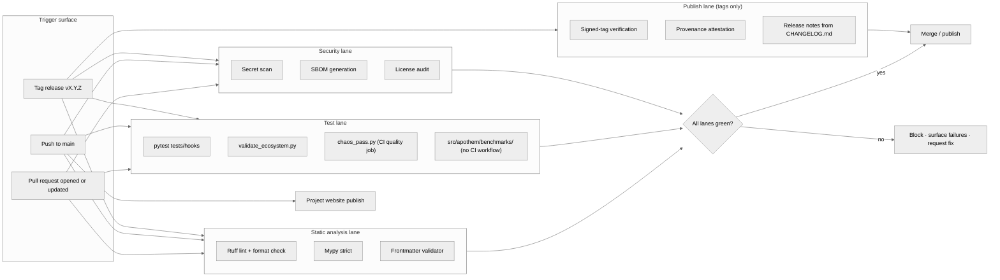

{/* SPDX-License-Identifier: MIT */}

**La carte structurelle du flux de travail de build · validation · publication
qui contrôle chaque changement de l'écosystème d'Apothem.** Ce document installe
la surface de visualisation. Les fichiers de flux de travail GitHub Actions qu'il
décrit se trouvent dans `.github/workflows/` (par exemple `ci.yml` et `release.yml`),
et l'outillage de publication se trouve dans `scripts/release/`.

## Forme du pipeline

## Rôles des couloirs

- **Couloir d'analyse statique** — retour rapide. Ruff couvre le style Python et
  un ensemble de règles sélectionnées ; mypy impose la discipline de typage en
  mode strict ; le validateur de frontmatter contrôle la conformité au schéma
  d'artefacts pour les règles, les skills, les travailleurs délégués et les
  commandes. markdownlint ne fait pas partie de ce couloir : il ne s'exécute que
  comme hook pre-commit, et la CI ne l'exécute pas (voir
  [Conventions Markdown](/docs/reference/markdown-conventions)).
- **Couloir de tests** — `pytest tests/hooks` exerce le runtime des hooks contre
  la matrice complète d'événements ; `validate_ecosystem.py` est la principale
  porte structurelle pour la cohérence inter-artefacts ; `chaos_pass.py` s'exécute
  dans le job qualité de la CI, sur les push et pull requests vers `main`
  (filtrés par chemin), pour détecter la dégradation sous des entrées dégradées.
  La suite de benchmarks par classe sous `src/apothem/benchmarks/` ne s'exécute
  dans aucun flux de travail CI.
- **Couloir de sécurité** — l'analyse de secrets repère les identifiants commités
  par accident ; la génération de SBOM et les audits de licence contrôlent la
  surface de la chaîne d'approvisionnement pour toute installation de
  préparation à la production.
- **Couloir de publication** — les flux de travail de publication sont déclenchés
  par les push de tags ; les publieurs npm et VS Code peuvent aussi être relancés
  manuellement pour une étiquette existante. La vérification de l'étiquette
  signée confirme la provenance de la branche de publication ; les notes de
  publication dérivent du format Keep-A-Changelog de `CHANGELOG.md`. Le site web
  du projet se publie depuis `site/dist/` vers la cible GitHub Pages lors des
  push sur `main` qui touchent à ses entrées de compilation, ou sur
  déclenchement manuel.

## Configuration concrète

Les fichiers de flux de travail réels (`.github/workflows/ci.yml`,
`.github/workflows/release.yml`, etc.) se trouvent dans le dépôt. Ce diagramme
définit la forme canonique que toute configuration future reflète.

## Références croisées faisant autorité

- `pyproject.toml` — source de vérité de la configuration Ruff / mypy / pytest.
- `scripts/dev/validate_ecosystem.py` — la principale porte inter-artefacts.
- `scripts/dev/validate_hooks.py` — validation structurelle spécifique aux hooks.
- `scripts/dev/chaos_pass.py` — balayage adversarial de chaque hook configuré.
- `src/apothem/benchmarks/` — vérificateurs du budget d'exécution par classe.
- `site/content/docs/developer-guide.mdx` — le flux de travail du contributeur, destiné à l'opérateur.
- `CHANGELOG.md` — source des notes de publication.
