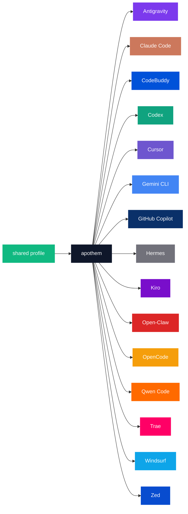

{/* SPDX-License-Identifier: MIT */}

Les énumérations canoniques nom de marque × code couleur ci-dessous sont placées dans un bloc délimité `text` afin de préserver à l'identique les identifiants par environnement qu'exige la fonction de catalogue de la palette.

## Cœur d'Apothem

| Jeton | Clair | Sombre | Usage |
|---|---|---|---|
| `apothem-hub` | `#0F172A` | `#F1F5F9` | Le nœud de distribution central (« apothem ») dans chaque diagramme d'architecture. |
| `shared-profile` | `#10B981` | `#34D399` | Le profil source de vérité qui alimente le cœur d'apothem. |

## Palette des environnements

Quinze des dix-sept environnements sont colorés selon leur identité de marque
principale, afin qu'un lecteur puisse distinguer les outils dans un diagramme.
La marque Apothem elle-même n'utilise que les couleurs ardoise et émeraude de la
page [palette](/docs/brand/palette) ; elle ne porte aucune couleur
d'environnement. Les deux restants — `glm` et `kimi-code` — n'ont pas encore de
couleur de marque définie ; leurs lignes sont ajoutées une fois la couleur de
marque amont fixée, selon l'étape de propagation décrite sous
[Mises à jour](#mises-à-jour).

```text
| Token             | Light     | Dark      | Source                                                                                                                                              |
|-------------------|-----------|-----------|-----------------------------------------------------------------------------------------------------------------------------------------------------|
| `antigravity`     | `#7C3AED` | `#9F67FF` | Google Antigravity deep-purple.                                                                                                                     |
| `claude-code`     | `#CC785C` | `#E89378` | Anthropic terracotta-orange.                                                                                                                        |
| `codebuddy`       | `#0052D9` | `#5E8EF7` | Tencent CodeBuddy blue.                                                                                                                             |
| `codex`           | `#10A37F` | `#19C796` | OpenAI signature teal.                                                                                                                              |
| `cursor`          | `#6E56CF` | `#9B85E3` | Cursor brand purple.                                                                                                                                |
| `gemini-cli`      | `#4285F4` | `#6BA4F7` | Google blue.                                                                                                                                        |
| `github-copilot`  | `#0A3069` | `#5B8FE3` | GitHub Mona deep-blue.                                                                                                                              |
| `hermes`          | `#71717A` | `#A1A1AA` | Community silver-grey.                                                                                                                              |
| `kiro`            | `#790ECB` | `#A862DD` | Kiro violet.                                                                                                                                        |
| `open-claw`       | `#DC2626` | `#F87171` | Community red-orange.                                                                                                                               |
| `opencode`        | `#F59E0B` | `#FBBF24` | Community amber.                                                                                                                                    |
| `qwen-code`       | `#FF6A00` | `#FF8C40` | Alibaba Qwen orange.                                                                                                                                |
| `trae`            | `#FF0066` | `#FF599C` | ByteDance Trae magenta.                                                                                                                             |
| `windsurf`        | `#0EA5E9` | `#38BDF8` | Windsurf sky-blue.                                                                                                                                  |
| `zed`             | `#084CCF` | `#5E8BE0` | Zed Industries blue.                                                                                                                                |
```

## Marques commerciales

Les noms d'environnements, les noms de produits et les couleurs de marque
figurant sur cette page et sur l'ensemble du site appartiennent à leurs
propriétaires et sont des marques de leurs propriétaires respectifs. Apothem ne
nomme un outil que pour indiquer lequel il configure, et n'utilise la couleur
d'un outil que pour le distinguer dans un diagramme. Apothem est un projet
indépendant ; il n'est affilié à aucune de ces entreprises ni à aucun de ces
projets, n'est ni parrainé ni approuvé par eux, et ne distribue aucun de leurs
logos.

## Justification des noms

- **`apothem-hub`** — le centre géométrique qu'évoque le nom (l'apothème d'un polygone régulier pointe vers l'intérieur, vers son centre).
- **`shared-profile`** — la source amont, distincte de la couleur de tout environnement particulier afin qu'elle se lise comme la flèche d'« entrée » dans chaque diagramme.
- **Les jetons par environnement** reprennent le slug d'environnement utilisé dans toute la base de code (`harnesses/<slug>/`, la clé du point d'entrée, l'argument `--harness <slug>` de la CLI). Un mot par concept ; la même chaîne partout.

## Utilisation dans Mermaid



## Accessibilité

Chaque jeton du mode clair atteint le contraste WCAG 2.2 AA face à un texte blanc (≥4.5 : 1) là où le contraste le permet sans dénaturer la couleur de marque. Lorsque la couleur de marque native d'un environnement passe à elle seule sous le seuil AA face à un texte blanc (notamment la famille ambre / orange et la famille bleu ciel / sarcelle des jetons énumérés ci-dessus), les diagrammes qui exigent un contraste WCAG AA du texte sur la couleur utilisent la **variante du mode sombre** (la teinte éclaircie) comme remplissage du diagramme, afin que le texte blanc se lise nettement. La colonne du mode sombre est calibrée à cette fin : chaque jeton du mode sombre franchit le seuil AA face à un texte blanc.

## Mises à jour

La palette n'est mise à jour que lorsqu'un environnement ratifie un changement de marque en amont. Les changements de marque d'un environnement se propagent de manière atomique dans `site/app/global.css`, dans cette page et dans chaque master SVG concerné sous `assets/src/`.
