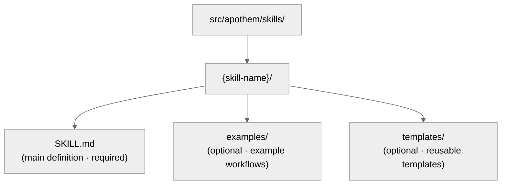

{/* SPDX-License-Identifier: MIT */}

Ce guide aide les développeurs à maintenir et à étendre l'écosystème Apothem
selon des standards de qualité SOTA.

## Référence rapide : types d'artefacts

Ce guide couvre cinq types d'artefacts, chacun avec une finalité précise. Les
règles, les commandes, les auxiliaires et les skills portent un frontmatter
YAML ; les hooks sont enregistrés dans `hooks.json` et `settings.json` et n'en
portent aucun. Les output-styles forment une classe d'artefacts supplémentaire,
avec deux clés de frontmatter requises, `name` et `description` ; voir le
[schéma du frontmatter](/docs/reference/frontmatter-schema).

| Artefact | Chemin | Finalité | Quand le créer |
| -------- | ---- | ------- | -------------- |
| **Règle** | `src/apothem/rules/*.md` | Mandat comportemental ou directive opérationnelle | Nouveau principe, nouvelle politique ou nouveau mandat de gouvernance établi |
| **Commande** | `src/apothem/commands/*.md` | Commande slash (`/command-name`) pour les flux de travail complexes | Nouveau flux de travail utilisateur en plusieurs étapes |
| **Auxiliaire** | `src/apothem/agents/*.md` | Définition persistante de travailleur délégué pour les tâches parallèles | Nouvelle tâche spécialisée récurrente (audit, exploration, contrôle qualité) |
| **Skill** | `src/apothem/skills/{name}/SKILL.md` | Technique réutilisable dotée d'un signal de détection | Nouveau motif de technique détectable et réutilisable |
| **Hook** | `src/apothem/hooks/` + `hooks.json` + `settings.json` | Validation ou gestion d'état déclenchée par un événement | Nouvel événement de cycle de vie ou nouveau besoin de validation |

## Contrat d'adaptateur d'environnement

Les faits d'identité et de capacités des environnements se trouvent dans
`src/apothem/lib/harness_registry.py`. Une modification d'environnement n'est
complète que lorsque ces surfaces concordent :

| Surface | Mise à jour requise |
| --- | --- |
| Ligne du registre | Identifiant public, clé de paquet, point d'entrée, portée, format de sortie, chemins cibles, chemins de documentation, fichier de capacités, épinglage de standard, tests de fixtures, clé de package-data, sources de templates et statuts de capacités. |
| Paquet d'adaptateur | `__init__.py`, `install.py`, `update.py`, `uninstall.py`, `verify.py` ; ajoutez `materializer.py` uniquement lorsque l'environnement rend un fichier de configuration natif. |
| Manifeste de propagation | Chemins de templates et de cohortes pour les adaptateurs adossés au manifeste. |
| Capacités | `src/apothem/harnesses/<package>/capabilities.yml` avec chaque capacité requise et la justification des états non pris en charge ou en attente de découverte, plus une table de correspondance `conversion_losses` pour chaque cohorte de commandes, d'auxiliaires ou de règles convertie (voir le [registre des environnements](/docs/reference/harness-registry)). |
| Épinglage de convention | `STANDARD-CONVENTION-PIN.md` avec l'URL de l'éditeur, la date d'instantané, le nom de fichier/schéma canonique, la référence de preuve et la justification des capacités non prises en charge. |
| Tests | Parité du registre, test de fixture d'adaptateur, ligne golden du plan d'installation, comportement à blanc/sans écriture, idempotence et couverture de package-data. |
| Documentation | Page de référence de l'environnement, page de comparaison, notes de capacités/MCP et exemples qui utilisent des espaces réservés fictifs. |

Les adaptateurs de portée projet doivent définir `requires_project = True`,
accepter `project: Path | None` sur les méthodes de cycle de vie et rejeter les
racines de projet manquantes ou non sûres avant toute écriture. Les adaptateurs
de portée utilisateur doivent conserver les chemins sous la racine de
configuration utilisateur documentée de l'environnement.

## Politique des fixtures golden

`tests/fixtures/harness-golden-plans.json` enregistre la forme publique du plan
d'installation pour les dix-sept environnements du registre : identifiant
public, mode de matérialisation, chemin de cohorte/template source et chemin
cible normalisé sous `<ROOT>`. Lorsque le comportement du registre, du manifeste
ou des cibles de templates change intentionnellement, mettez à jour la fixture
golden dans le même commit que la modification source, afin que le diff montre
l'écart de comportement.

## Validation avant écriture

Le pilote d'installation partagé valide chaque source et chaque cible avant la
première écriture. Il rejette les sources de manifeste manquantes, la traversée
de cible, les chemins cibles situés hors de la racine sélectionnée et les
franchissements de liens symboliques. Les exécutions à blanc effectuent la même
validation et renvoient des résultats structurés `skipped` ou `unchanged` sans
créer de fichiers.

## Masquage et données d'exemple

Les diagnostics du profil masquent les champs en forme de jeton, de secret, de
mot de passe, d'identifiant, de clé d'API, de clé privée, d'autorisation, d'auth
et d'en-tête. La documentation, les fixtures, les exemples et les extraits JSON
utilisent `example.invalid`, `Example User`, `example-user` et des espaces
réservés évidents plutôt que des secrets ou des comptes personnels d'apparence
réelle.

## Avant d'écrire : le schéma canonique

**Le contrat lisible par machine et appliqué par le portail est constitué des
schémas JSON par classe sous `src/apothem/schemas/*.schema.json` —
`additionalProperties` rejette les clés inconnues, de sorte que le portail de
conformité a le dernier mot.** Deux projections lisibles par un humain les
suivent : `site/content/docs/reference/frontmatter-schema.mdx` (l'index des clés
requises) et `site/content/docs/reference/artifact-schema.mdx` (templates par
classe et exemples détaillés). Lorsqu'une page diverge des schémas JSON, les
schémas l'emportent.

- Lisez le schéma JSON de votre type d'artefact sous `src/apothem/schemas/`
- Lisez `site/content/docs/reference/artifact-schema.mdx` § « Schéma » pour le
  template et un exemple détaillé
- Copiez les champs requis, renseignez les valeurs obligatoires, ajoutez les champs optionnels selon les besoins

## Vérification rapide du frontmatter

Le frontmatter de chaque artefact doit passer ces vérifications. N'appliquez les
vérifications `version`, `updated` et `portability` qu'à une classe qui porte la
clé : les règles n'en portent aucune, et les skills ne portent pas `portability`.

```yaml
✓ Valid YAML syntax (use tools: `yamllint` or PowerShell `ConvertFrom-Yaml` where available)
✓ All mandatory fields present (per schema for artifact type)
✓ name: uses kebab-case
✓ version: semantic MAJOR.MINOR.PATCH
✓ updated: ISO 8601 date (YYYY-MM-DD)
✓ description: single-line, non-empty
✓ scope fields valid per artifact type (rules: pathFilter + alwaysApply; CLAUDE.md root: scope)
✓ portability: valid enum (`universal` | `universal-with-windows-caveats` | `unix-only` | `windows-only`)
✓ No typos in field names — must match canonical schema exactly
✓ Optional fields use correct enum values
```

## Conventions de nommage

### Noms d'artefacts (kebab-case)

- **Règles :** `operational-mandates`, `clean-room-generation`, `context-management`
- **Commandes :** `plan-execute`, `plan-spec`, `plan-generate`
- **Auxiliaires :** `codebase-explorer`, `convention-auditor`, `quality-gate`
- **Skills :** `plan-suite`, `ecosystem-audit`

Motif : minuscules, traits d'union entre les mots, ni espaces ni traits de
soulignement.

### Nommage des fichiers

- **Règles :** `{name}.md`
- **Commandes :** `{name}.md`
- **Auxiliaires :** `{name}.md`
- **Skills :** dans le dossier `src/apothem/skills/{name}/SKILL.md` (casse exacte : `SKILL.md`)
- **Hooks :** dans le dossier `src/apothem/hooks/`. Tous les gestionnaires
  d'événements sont en Python. Chaque commande de hook du template `settings.json`
  de Claude Code utilise la forme exec : `command` est l'espace réservé
  d'interpréteur `${PYTHON_BIN}`, résolu au moment de l'installation, et `args`
  contient le chemin du script et ses arguments. Ce template exécute
  `${HARNESS_ROOT}/.apothem/support/hooks/dispatch.py <event> [<message-name>]` et
  `${HARNESS_ROOT}/.apothem/support/conformity/gate.py --hook` par chemin absolu,
  de sorte que la copie installée n'a pas besoin d'un paquet `apothem` importable.
  Le plugin Claude Code enregistre à la place les hooks dans
  `src/apothem/hooks/hooks.json`, sous forme de commandes shell qui exécutent
  `hooks/lib/bootstrap.sh` via `bash` ; ce stub localise Python et exécute
  `dispatch.py`, de sorte que les gestionnaires restent en Python. Enregistrez un
  nouveau hook dans `hooks.json` et dans le template `settings.json` de Claude
  Code. `dispatch.py` achemine `SessionStart` vers
  `session_start_bootstrap.main()` et tout autre événement de la liste blanche
  vers `emit_hook_context.main()`. Les seuls stubs shell autorisés sous
  `src/apothem/hooks/` ou `scripts/` sont les six fichiers de localisation et
  d'amorçage (`find-python.{ps1,sh}`, `find-pwsh.{ps1,sh}`, `bootstrap.{ps1,sh}`) ;
  tout autre fichier `.ps1` / `.sh` échoue à la vérification d'hygiène de
  `scripts/dev/validate_hooks.py`.

### Références croisées

Lorsque vous référencez d'autres artefacts, utilisez les noms exacts :

- Règles : `"operational-mandates"` (valeur du champ name)
- Commandes : `/plan-execute` (avec la barre oblique dans la documentation destinée aux humains ; sans, dans le code)
- Auxiliaires : `codebase-explorer` (valeur du champ name)
- Skills : `plan-suite` (valeur du champ name)

N'utilisez jamais de chemins de fichiers ni de noms tronqués dans la prose.

## Portabilité : Windows vs. Unix

Chaque commande DOIT déclarer explicitement son statut de portabilité dans le
champ `portability`. Un auxiliaire PEUT le déclarer. Les skills, les règles et
les output-styles ne portent aucun champ `portability`.

### Universel

- Fonctionne à l'identique sous Windows, macOS et Linux
- Aucune hypothèse sur le shell
- Les chemins utilisent des barres obliques (`/`)
- Aucun chemin absolu codé en dur
- Aucune syntaxe PowerShell propre à Windows

```yaml
portability: "universal"
```

### Universel avec réserves Windows

- Universel sur les hôtes POSIX ; la réserve nommée s'applique à la variante de plateforme Windows déclarée dans le contenu
- Documentez explicitement la réserve dans le contenu
- Exemple : « Liens symboliques non pris en charge sous Windows avant Win 10 »

```yaml
portability: "universal-with-windows-caveats"
```

Documentez la réserve dans une note placée immédiatement après le titre.

### Unix uniquement / Windows uniquement

- Explicitement restreint à une seule plateforme
- Rare dans Apothem — la plupart devraient être universels
- À utiliser uniquement si des fonctionnalités propres à la plateforme sont essentielles

```yaml
portability: "unix-only"
```

Documentez la raison dans la première section de l'artefact.

## Portée : toujours active vs. filtrée par chemin

### Toujours active

La règle s'applique partout.

```yaml
pathFilter: ""
alwaysApply: true
```

### Filtrée par chemin

La règle s'applique de manière conditionnelle selon le chemin du fichier.

```yaml
pathFilter: "**/*.py, **/*.toml"
alwaysApply: false
```

Le `pathFilter` utilise des motifs glob (même format que `.gitignore`). Lorsqu'un
fichier correspond au filtre, la règle s'active.

## Sémantique de version

Chaque artefact versionné porte sa propre version sémantique
(`MAJOR.MINOR.PATCH`). Les commandes et les skills l'exigent, les auxiliaires et
les output-styles PEUVENT la porter, et les règles n'en portent aucune :

- **PATCH** — corrections de fautes de frappe, mise en forme, rafraîchissement de liens, modifications portant uniquement sur des commentaires. Comportement inchangé.
- **MINOR** — changements additifs non incompatibles : nouvelles sections optionnelles, nouveaux champs de frontmatter optionnels, nouveaux exemples. Les consommateurs existants continuent de fonctionner sans modification.
- **MAJOR** — changements incompatibles de schéma ou de contrat : sections supprimées, champs renommés, comportement modifié d'une directive existante, changements qui obligent les artefacts en aval à s'adapter.

Exemples :

- `vX.Y.Z` → `vX.Y.(Z+1)` (PATCH : correction d'une faute de frappe)
- `vX.Y.Z` → `vX.(Y+1).0` (MINOR : ajout d'une nouvelle section optionnelle)
- `v0.Y.Z` → `v(0+1).0.0` (MAJOR : contrat déclaré stable ; les nouveaux artefacts démarrent à `v0.Y.Z`)
- `vX.Y.Z` → `v(X+1).0.0` (MAJOR : suppression d'un champ de frontmatter obligatoire)

Faites évoluer `version` et `updated` ensemble à chaque modification qui change
le comportement d'un artefact qui les porte. Ajoutez une ligne correspondante au
`CHANGELOG.md` de niveau écosystème pour les publications qui regroupent des
changements d'artefacts.

## Quand modifier un artefact

### Règles

- Traitez la structure Obligatoire/Optionnel comme porteuse — la restructurer
  se répercute sur chaque artefact dépendant.
- Affinez les Anti-Patterns, les exemples de Seriousness Scaling et les
  citations à mesure que la compréhension s'approfondit.
- Consignez la justification de tout changement structurel dans le fichier de
  sujet de mémoire concerné.

### Commandes

- La forme des arguments fait partie du contrat public — ne la rompez qu'avec
  une intention explicite et propagez le changement à chaque appelant (incrément
  MAJOR).
- Gardez les étapes du flux de travail et les contrats de retour concis et à jour.
- Documentez directement dans le texte le séquencement non évident des étapes.

### Auxiliaires

- Gardez `disallowedTools` minimal mais suffisant ; documentez la justification
  lorsqu'il change.
- Affinez les Operating Principles et les Return Contracts à mesure que le rôle
  de l'auxiliaire mûrit (incrément MINOR).
- Suivez directement dans le texte les évolutions de capacités afin que les
  appelants puissent réajuster leurs attentes.

### Skills

- Gardez les étapes de Procedure et les Examples synchronisés avec la réalité.
- Les signaux de détection doivent refléter la formulation réelle des
  utilisateurs dans l'usage actuel.
- Scindez une skill dès qu'elle dépasse ~150 lignes (voir
  `auto-memory.md` § Topic File Management).

## Pas à pas : ajouter une nouvelle règle

### 1. Évaluer l'orthogonalité

Cette règle chevauche-t-elle des règles existantes ? Cherchez du contenu connexe dans `src/apothem/rules/`.

Si le chevauchement dépasse 50 %, envisagez plutôt d'étendre une règle
existante. Voir `persistent-conventions-vigilance.md` § Artifact Evolution.

### 2. Rédiger le contenu

Suivez la structure :

- Titre : `# Rule: {Title}`
- Section Purpose
- Obligations / directives centrales (numérotées, liées)
- Tableau Seriousness Scaling (toujours requis)
- Section Anti-Patterns
- Section Enforcement

### 3. Créer le frontmatter

Utilisez le schéma de `site/content/docs/reference/artifact-schema.mdx` § Schéma : règles. Définissez :

- `name:` identifiant en kebab-case
- `description:` résumé d'une ligne pour les registres
- `pathFilter:` liste de globs pour les règles filtrées par chemin ; la chaîne vide (`""`) pour les règles toujours actives
- `alwaysApply:` `true` pour les règles toujours actives, `false` pour les règles filtrées par chemin

Les règles ne portent que ces quatre champs — pas de `version` / `updated` / `scope` / `portability` / `implements`.

Exemple :

```yaml
---
name: "my-new-rule"
description: "Brief one-liner"
pathFilter: ""
alwaysApply: true
---
```

### 4. Mettre à jour le README des règles

Ajoutez une ligne au tableau de la famille de la règle, dans la section Rule
families de `src/apothem/rules/README.md` :

```markdown
| `my-new-rule.md` | One-line concern of the new rule. |
```

Choisissez le tableau de famille dont le domaine correspond à la règle.

### 5. Ajouter une entrée au CHANGELOG.md

Ajoutez une ligne décrivant la nouvelle règle sous la section `### Added` de la
prochaine publication.

### 6. Lancer la validation

Invoquez la skill `ecosystem-audit` pour vérifier la nouvelle règle, en ciblant
le domaine des règles :

```text
Invoke the ecosystem-audit skill with --focus rules --fix
```

Vérifiez qu'aucune erreur n'est signalée pour votre nouvelle règle.

## Pas à pas : ajouter une nouvelle commande

Les commandes sont des commandes slash telles que `/plan-spec`, `/plan-execute`, `/security-audit`, etc.

### 1. Déterminer le rôle

Les commandes sont des flux de travail déclenchés par l'utilisateur. Le modèle
n'en exécute une de son propre chef que lorsque son réglage
`disable-model-invocation` vaut `false` (étape 2). Demandez-vous :

- S'agit-il d'un flux de travail que l'utilisateur déclenche en tapant `/command-name` ?
- Orchestre-t-il plusieurs étapes ?
- Pourrait-il expirer ou nécessiter une saisie de l'utilisateur en cours d'exécution ?

Si la réponse est « non » à l'une de ces questions, il s'agit probablement
d'une skill, pas d'une commande.

### 2. Créer le fichier

Chemin : `src/apothem/commands/{name}.md`

Frontmatter (d'après `site/content/docs/reference/artifact-schema.mdx` § Schéma : commandes) :

```yaml
---
name: "my-command"
version: "X.Y.Z"
updated: "2026-04-20"
description: "What this command does"
argument-hint: "[path/to/input] [--flag VALUE]"
disable-model-invocation: true
portability: "universal"
allowed-tools: "Read, Glob, Grep"
---
```

`disable-model-invocation: true` réserve une commande à l'invocation par
l'opérateur ; avec `false`, le modèle peut l'exécuter lorsqu'une requête
correspond à sa description. La plupart des commandes utilisent `true`, mais la
plupart des étapes des pipelines de planification et de recherche utilisent
`false`. Le tableau d'invocation de `src/apothem/commands/README.md` liste le
réglage de chaque commande ; ajoutez-y une ligne pour toute nouvelle commande.
Gardez `allowed-tools` en lecture seule : un environnement qui le respecte
exécute ces outils sans demander. N'accordez un outil à effets de bord que sous
forme de règle délimitée, comme `Bash(git log *)` ; le schéma rejette `"*"`
ainsi que tout élément parmi `Bash`, `PowerShell`, `Write`, `Edit`,
`NotebookEdit` ou `WebFetch` écrit sans portée.

### 3. Rédiger le contenu

Structure :

- Titre : `# /{name} — Human-Readable Title`
- Section Role (qui l'exécute)
- Instructions de haut niveau
- Section Workflow avec les étapes
- Contrat de retour / format de sortie

### 4. Mettre à jour le README et CHANGELOG.md

Ajoutez une ligne au tableau de la section de la commande dans `src/apothem/commands/README.md`, en plus de la ligne du tableau d'invocation de l'étape 2 ; ajoutez une ligne de CHANGELOG sous la section `### Added` de la prochaine publication.

### 5. Valider

Invoquez la skill `ecosystem-audit` en ciblant les commandes :

```text
Invoke the ecosystem-audit skill with --focus commands --fix
```

## Pas à pas : ajouter un nouvel auxiliaire

Les auxiliaires sont des définitions persistantes de travailleurs délégués pour
le travail en parallèle.

### 1. Identifier le motif

Cet auxiliaire correspond-il à l'un des motifs d'équipe listés ci-dessous ?

- Équipe de recherche : lecture seule, collecte d'informations
- Équipe d'audit : vérification, contrôles de cohérence
- Équipe d'implémentation : modifications de code en parallèle
- Équipe qualité : lint, tests, vérification de types, sécurité
- Équipe de documentation : mises à jour de la documentation
- Autre : tâche spécialisée

### 2. Créer le fichier

Chemin :

```text
src/apothem/agents/{name}.md
```

Frontmatter :

```yaml
---
name: "my-helper"
version: "X.Y.Z"
updated: "2026-04-20"
description: "What this helper specializes in"
tools: "Read, Glob, Grep, Bash"
disallowedTools: "Write, Edit"
maxTurns: 15
portability: "universal"
---
```

Omettez `model`, `effort` et `permissionMode` pour que l'auxiliaire hérite des
choix de la session (la posture agnostique), et omettez `memory` sauf si
l'auxiliaire a besoin d'une portée de mémoire persistante (`user`, `project` ou
`local`).

### 3. Rédiger le contenu

Sections :

- Operating Principles (lecture seule, fondé sur des preuves, verdicts binaires, exhaustif)
- Workflow (étapes numérotées)
- Return Contract (nombre maximal de tokens, structure, champs requis)

### 4. Mettre à jour le README et CHANGELOG.md

Ajoutez une ligne au tableau Index de `src/apothem/agents/README.md` ; ajoutez une ligne de CHANGELOG sous la section `### Added` de la prochaine publication.

### 5. Tester

Déployez l'auxiliaire dans un scénario réel et vérifiez qu'il fonctionne comme
documenté.

## Pas à pas : ajouter une nouvelle skill

Les skills sont des techniques réutilisables et détectables.

### 1. Identifier la réutilisabilité

Avant d'écrire une skill :

- Avez-vous rencontré ce problème/cette technique 3 fois ou plus ?
- Est-ce détectable ? (Un motif de requête utilisateur le signale-t-il ?)
- Pouvez-vous le codifier de façon reproductible ?

Si la réponse est oui aux trois questions, écrivez une skill.

### 2. Créer la structure



### 3. Rédiger SKILL.md

Frontmatter :

```yaml
---
name: "skill-name"
version: "X.Y.Z"
updated: "2026-04-20"
description: "What this skill teaches"
archetype: "workflow-template"
userInvocable: true | false
disable-model-invocation: true | false
allowed-tools: "Read, Glob, Grep"
argument-hint: "[args]"               # optional; if userInvocable
---
```

Structure du contenu :

- Purpose
- When to Use This Skill
- Prerequisites
- Step-by-Step Procedure
- Common Mistakes
- Examples

### 4. Mettre à jour le README et CHANGELOG.md

Ajoutez une ligne au tableau Index et une ligne pour chacun des fichiers de la skill au tableau Folder contents de `src/apothem/skills/README.md` ; ajoutez une ligne de CHANGELOG sous la section `### Added` de la prochaine publication.

### 5. Valider

Invoquez la skill `ecosystem-audit` en ciblant les skills :

```text
Invoke the ecosystem-audit skill with --focus skills --fix
```

## Liste de vérification avant le commit

- [ ] Le frontmatter passe la vérification de syntaxe YAML
- [ ] Tous les champs obligatoires sont présents selon le schéma
- [ ] Le champ `name` utilise le kebab-case
- [ ] `version` (classes versionnées uniquement ; les règles n'en portent aucune) est sémantique (`MAJOR.MINOR.PATCH`) et a été incrémentée si le comportement a changé
- [ ] `updated` correspond à la date du jour pour tout artefact que vous avez modifié et qui porte ce champ
- [ ] Le champ `portability` est défini et valide (obligatoire sur les commandes, optionnel sur les auxiliaires)
- [ ] CHANGELOG.md consigne le changement dans la catégorie appropriée, sous la section de la prochaine publication
- [ ] Aucune référence interne au plan (conformité CM-7)
- [ ] Les références croisées sont cohérentes avec les autres artefacts
- [ ] Le nouvel artefact est enregistré dans l'index du README de son dossier
- [ ] L'artefact est testé (le cas échéant)
- [ ] La skill `ecosystem-audit` s'exécute sans erreur
- [ ] Le contenu suit les conventions structurelles (format du titre, sections, etc.)

## Référencer d'autres artefacts

Utilisez exactement ces conventions :

### Référencer une règle

```markdown
See `src/apothem/rules/operational-mandates.md` or shorthand: the Operational Mandates rule.
In prose: ... per CM-1–10 (Operational Mandates rule) ...
```

### Référencer une commande

```markdown
See `/plan-execute` command. Or: Run `/plan-execute`.
In prose: The `/plan-execute` command handles phase execution.
```

### Référencer un auxiliaire

```markdown
Deploy the `codebase-explorer` delegated worker.
In prose: The codebase-explorer worker finds patterns.
```

### Référencer une skill

```markdown
Use the `plan-suite` skill.
In prose: The plan-suite skill provides the Master Plan Suite template.
```

### Référencer des sections de CLAUDE.md

```markdown
See CLAUDE.md § Harness Adapter Pattern.
Or: § Plans Discipline.
```

## Linting et format

Tous les artefacts utilisent :

- **Markdown :** GFM (GitHub Flavored Markdown)
- **YAML :** conforme à YAML 1.2
- **Fins de ligne :** LF (style Unix)
- **Encodage :** UTF-8
- **Largeur de ligne :** retour à la ligne souple à 100 caractères pour le contenu (pas de retours à la ligne forcés)

Utilisez le formateur / linter `Ruff` pour les fichiers Python. Pour le
Markdown, utilisez `prettier` ou un équivalent.

## Tests et mesure

### Exécuter la suite

```bash
python -m pytest                      # unit, integration, property, conformity, scripts
python -m pytest tests/property       # Hypothesis properties (profile loader, frontmatter, merge)
```

La suite est hermétique : elle réussit avec le checkout sous `$TMPDIR` et avec
un `python` dans le `PATH` dépourvu des prérequis de la CLI, car les tests
d'intégration exécutent l'interpréteur qui exécute pytest et remplacent par des
jetons les chemins temporaires et sources imbriqués, en commençant par le plus
long.

### Couverture par paquet

La CI mesure trois paquets et soumet chacun à son propre plancher. Aucun d'eux
n'est fusionné dans un autre.

| Paquet | Chemins | Plancher | Emplacement du plancher |
| --- | --- | --- | --- |
| moteur | `cli`, `harnesses`, `lib`, `hooks`, `statuslines` | 80 | `[tool.coverage.report] fail_under` |
| conformité | `src/apothem/conformity` | 81 | `[tool.coverage.package-floors]` |
| audit | `src/apothem/audit` | 70 | `[tool.coverage.package-floors]` |

Le chiffre correspond à la couverture des lignes plus celle des branches, soit
le même pourcentage que coverage.py rapporte avec `branch = true` ; l'artefact de
métriques consigne aussi le chiffre portant sur les seules instructions sous
`coverage_lines`. Le plancher de chaque paquet est la valeur mesurée lignes plus
branches, arrondie à l'inférieur. Relevez un plancher lorsque la couverture
augmente ; ne l'abaissez jamais pour faire passer une modification. Pour
vérifier en local :

```bash
python -m pytest --cov=src/apothem --cov-report=json:coverage.json
python scripts/dev/collect_metrics.py --coverage-json coverage.json --check-floors \
  --skip-hooks --skip-coldstart --harness zed
```

### L'artefact de métriques

Le job CI `metrics` exécute `scripts/dev/collect_metrics.py` à chaque push et à
chaque pull request, et téléverse `metrics.json` (`schema_version: 1`). Chaque
valeur `null` porte sa raison sous `nulls`.

| Clé | Ce qu'elle mesure |
| --- | --- |
| `coverage.engine`, `coverage.conformity`, `coverage.audit` | Pourcentage lignes plus branches par paquet, avec `coverage_floors`. |
| `always_on_bytes[harness]`, `always_on_files[harness]` | Pour chacun des 17 environnements, après `profile init` et `install --harness <id>` dans un `HOME` et un projet jetables : octets sur disque des fichiers d'instructions que cet environnement charge intégralement au lancement. |
| `cli_coldstart_ms` | Médiane de `python -m apothem --version` (avec `--help` sous `cli_coldstart_detail_ms`). |
| `hook_e2e_ms[event]`, `hook_injected_chars[event]` | Par événement et matcher enregistrés (`PreToolUse:Write`, `Stop`, …) : le temps total médian de la chaîne de hooks sur une charge utile réelle, et les caractères de contexte qu'elle injecte. |

Les fichiers comptés comme chargés au lancement relèvent d'une règle propre à
chaque environnement, tirée des surfaces d'instructions documentées par chaque
éditeur. Les listes qui ne portent qu'une description (skills, commandes,
sous-assistants) ne sont pas comptées. Le texte de la règle est aussi écrit dans
l'artefact sous `rules.always_on_bytes` :

```text
antigravity     ~/.gemini/{GEMINI,AGENTS}.md, ~/.gemini/config/{GEMINI,AGENTS}.md,
                ~/.gemini/config/rules/*.md with trigger: always_on, project
                GEMINI.md and AGENTS.md. The plugin rules/ folder is not a
                documented launch surface.
claude-code     ~/.claude/CLAUDE.md and ~/.claude/rules/**/*.md without paths:
                frontmatter, plus the project equivalents.
codebuddy       .codebuddy/rules/**/*.md (project and home) unless
                alwaysApply: false, plus CODEBUDDY.md.
codex           ~/.codex/AGENTS.md and the project AGENTS.md.
cursor          .cursor/rules/**/*.mdc with alwaysApply: true, and AGENTS.md.
gemini-cli      ~/.gemini/GEMINI.md and the project GEMINI.md.
github-copilot  .github/copilot-instructions.md and the project AGENTS.md.
hermes          ~/.hermes/SOUL.md, project .hermes.md, AGENTS.md, CLAUDE.md.
                The support tree and apothem/rules/ are not launch surfaces.
kimi-code       ~/.kimi-code/AGENTS.md, project AGENTS.md and .kimi-code/AGENTS.md.
kiro            .kiro/steering/**/*.md with inclusion: always or no inclusion
                key, and the project AGENTS.md.
open-claw       Workspace bootstrap files ~/.openclaw/workspace/*.md.
opencode        ~/.config/opencode/AGENTS.md, the project AGENTS.md, and every
                file the instructions globs in opencode.json match.
qwen-code       The context files named by context.fileName in
                ~/.qwen/settings.json (default QWEN.md), in ~/.qwen/ and the project.
trae            .trae/rules/**/*.md with alwaysApply: true, and
                ~/.trae/user_rules/*.md.
windsurf        .devin/rules/**/*.md and .windsurf/rules/**/*.md with
                trigger: always_on, the global global_rules.md, and AGENTS.md.
zed             The first of .rules, .cursorrules, .windsurfrules, .clinerules,
                .github/copilot-instructions.md, AGENT.md, AGENTS.md, CLAUDE.md,
                GEMINI.md in the project, plus ~/.config/zed/AGENTS.md.
glm             Nothing: GLM is a model backend and loads no instruction files.
```

### Évaluations comportementales

La suite sous `evals/` mesure le comportement plutôt que la forme : 64 cas de
déclenchement (chaque commande et chaque sous-assistant invocables par le modèle
se déclenchent sur une requête de leur domaine et restent silencieux face à une
requête voisine), 32 cas de résultat (un par étape de planification, étape de
recherche et dimension d'audit) et 6 paires d'effet de règle (le texte d'une
règle toujours active, activé puis désactivé). Les cas sont de simples données,
validées gratuitement par `python -m pytest tests/unit/test_eval_suite.py` ;
leur exécution est facturée et manuelle. Voir
[Exécuter les évaluations comportementales](/docs/how-to/evals) pour le flux de
travail `Evals`, une exécution locale et la façon d'ajouter un cas. Après avoir
modifié une règle toujours active dotée d'une paire, exécutez
`python scripts/dev/sync_eval_rule_cases.py`.

### Benchmarks

`make benchmarks` exécute les pilotes par classe sous `src/apothem/benchmarks/`,
à l'exception de `bench_agents.py`. Chaque pilote se termine avec `0` en cas de
réussite, `1` en cas de dépassement du budget, `2` en cas d'erreur (l'exécution
mesurée n'a pas eu lieu) ou `3` en l'absence de mesure.

- `bench_hooks.py` exécute chaque commande `shell: bash` que `hooks/hooks.json`
  enregistre, telle qu'elle est écrite, sur une charge utile réelle par
  événement et matcher, puis rapporte le temps total médian, la commande la plus
  lente (comparée au budget de l'événement) et les caractères injectés. Une
  commande qui ne peut pas s'exécuter telle qu'enregistrée (code de sortie 126
  lorsqu'un script n'a pas son bit d'exécution) est une erreur, pas une réussite.
- `bench_agents.py` signale `NOT MEASURED` (code de sortie 3) : le lancement
  d'un sous-assistant nécessite un environnement hôte et un appel au modèle.
  `make benchmarks` ne l'exécute pas.

La vérification du budget des règles toujours actives (`always-on-budget-grep`)
compte les mots séparés par des espaces, en excluant la section Bindings et les
lignes de renvoi vers les compagnons. Son rapport JSON porte aussi
`always-on-loaded` : les octets, caractères et mots des corps sans frontmatter
qu'un environnement charge, additionnés sur l'ensemble des règles toujours
actives.

## Audit de l'écosystème : exécuter la validation

Deux surfaces de validation complémentaires couvrent l'écosystème :

**Vérifiable par machine (validateurs Python)** — à exécuter avant chaque
commit :

```bash
python scripts/dev/validate_hooks.py       # Hook structure + Python-only hygiene
python scripts/dev/validate_ecosystem.py   # Full tree + frontmatter + delegated hook checks
python scripts/dev/chaos_pass.py           # Adversarial sweep across configured hooks
pytest tests                                    # Unit tests for the hook runtime
```

**Piloté par l'assistant** — pour les audits de références croisées, de récit
et de conventions :

```bash
/ecosystem-audit --focus all --fix
```

Cela exécute en parallèle :

- **Audit de structure :** exactitude du registre, existence des fichiers, validité du frontmatter
- **Audit d'artefacts :** références croisées, couverture des mandats, ordre du pipeline
- **Audit de mémoire :** affirmations des fichiers de mémoire vs. état du système de fichiers

Sortie attendue : `PASS` avec zéro constat sur les deux surfaces.

Si des `FINDINGS` sont signalés :

- Examinez la gravité de chaque constat (Critique / Important / Indicatif)
- Traitez immédiatement les éléments Critiques
- Planifiez les éléments Importants pour le prochain cycle
- Envisagez les éléments Indicatifs pour la prochaine itération

---

## Des questions ?

Consultez :

- Schéma de frontmatter : `site/content/docs/reference/artifact-schema.mdx`
- Cycle de vie des artefacts : `src/apothem/rules/persistent-conventions-vigilance.md` § Artifact Evolution
- Mandats opérationnels : `src/apothem/rules/operational-mandates.md` CM-1–10
- Référence de la suite de planification : `src/apothem/skills/plan-suite/master-template.md`
- Notes de publication : `CHANGELOG.md`
