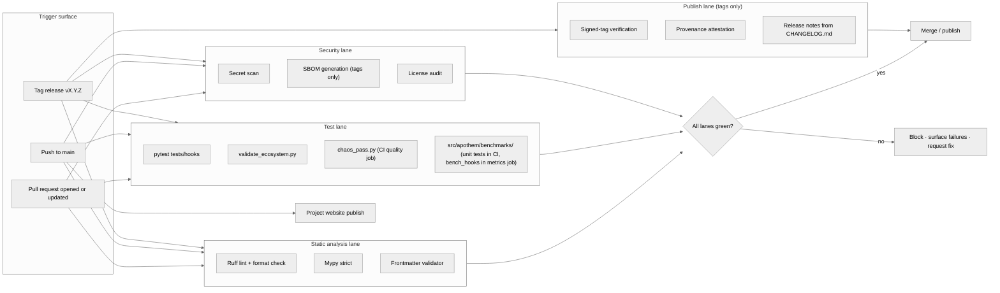

{/* SPDX-License-Identifier: MIT */}

**बिल्ड · सत्यापन · प्रकाशन वर्कफ़्लो का संरचनात्मक मानचित्र, जो Apothem पारिस्थितिकी-तंत्र के हर परिवर्तन को गेट करता है।** यह दस्तावेज़ दृश्यांकन सतह संस्थापित करता है। इसमें वर्णित GitHub Actions वर्कफ़्लो फ़ाइलें `.github/workflows/` में रहती हैं (उदाहरण के लिए `ci.yml` और `release.yml`), और रिलीज़ टूलिंग `scripts/release/` में रहती है।

## पाइपलाइन का आकार

## लेन की भूमिकाएँ

- **स्थैतिक विश्लेषण लेन** — त्वरित प्रतिक्रिया। Ruff Python शैली और एक चुने हुए नियम-समुच्चय को कवर करता है; mypy strict पर प्रकार-अनुशासन लागू करता है; frontmatter वैलिडेटर नियमों, स्किल्स, प्रत्यायोजित वर्कर, और कमांडों के लिए आर्टिफ़ैक्ट-स्कीमा अनुपालन को गेट करता है। markdownlint इस लेन में नहीं है: वह केवल pre-commit हुक के रूप में चलता है, और CI उसे नहीं चलाता ([Markdown परंपराएँ](/docs/reference/markdown-conventions) देखें)।
- **टेस्ट लेन** — `pytest tests/hooks` पूर्ण इवेंट-मैट्रिक्स के विरुद्ध हुक रनटाइम का परीक्षण करता है; `validate_ecosystem.py` आर्टिफ़ैक्ट-अंतर संगति के लिए प्राथमिक संरचनात्मक गेट है; `chaos_pass.py` `main` की ओर पुश और पुल रिक्वेस्ट पर CI गुणवत्ता जॉब में चलता है (पथ-फ़िल्टर्ड), ताकि क्षीण इनपुट के अंतर्गत गिरावट पकड़ी जा सके। `src/apothem/benchmarks/` के अंतर्गत प्रति-वर्ग बेंचमार्क ड्राइवर CI में pytest सूट के माध्यम से और `metrics` जॉब के माध्यम से चलते हैं। CI में हर पूर्ण pytest रन `tests/unit/test_benchmarks.py` को एकत्र करता है, जो `bench_install.py` को छोड़कर हर ड्राइवर को कॉल करता है। `metrics` जॉब `scripts/dev/collect_metrics.py` चलाता है, जो `bench_hooks.py --json` चलाता है और परिणाम को `hook_e2e_ms` के रूप में दर्ज करता है। `bench_tests.py` और `bench_install.py` वास्तविक रनों का समय केवल `make benchmarks` के अंतर्गत मापते हैं। कोई वर्कफ़्लो `make benchmarks` नहीं चलाता।
- **सुरक्षा लेन** — `ci.yml` में gitleaks आकस्मिक रूप से कमिट किए गए प्रमाण-पत्रों को पकड़ता है। लाइसेंस ऑडिट (`license-audit.yml`) किसी ऐसी डिपेंडेंसी पर विफल होता है जिसका लाइसेंस उसकी अनुमति-सूची से बाहर है। यह साप्ताहिक रूप से चलता है, और जब डिपेंडेंसी या लाइसेंस फ़ाइलें बदलती हैं तब भी। REUSE गेट (`reuse.yml`) हर परिवर्तन पर चलता है और तब विफल होता है जब किसी फ़ाइल में कोई लाइसेंस पंक्ति न हो या कोई SPDX अभिव्यक्ति पार्स न हो। `release.yml` हर टैग किए गए रिलीज़ के लिए SBOM बनाता है।
- **प्रकाशन लेन** — रिलीज़ वर्कफ़्लो टैग पुश से ट्रिगर होते हैं; npm और VS Code प्रकाशकों को किसी मौजूदा टैग के लिए मैन्युअल डिस्पैच से भी फिर से चलाया जा सकता है। हस्ताक्षरित-टैग सत्यापन रिलीज़-शाखा के प्रोवेनेंस की पुष्टि करता है; रिलीज़ नोट्स `CHANGELOG.md` के Keep-A-Changelog प्रारूप से व्युत्पन्न होते हैं। परियोजना की वेबसाइट, build इनपुट छूने वाले `main` पर पुश पर, या मैन्युअल डिस्पैच पर, `site/dist/` से GitHub Pages लक्ष्य पर प्रकाशित होती है।

## ठोस विन्यास

वास्तविक वर्कफ़्लो फ़ाइलें (`.github/workflows/ci.yml`,
`.github/workflows/release.yml`, आदि) रिपॉज़िटरी में हैं। यह आरेख वह विहित आकार परिभाषित करता है जिसे हर भविष्य का विन्यास प्रतिबिंबित करता है।

## आधिकारिक प्रति-संदर्भ

- `pyproject.toml` — Ruff / mypy / pytest विन्यास का सत्य-स्रोत।
- `scripts/dev/validate_ecosystem.py` — प्राथमिक आर्टिफ़ैक्ट-अंतर गेट।
- `scripts/dev/validate_hooks.py` — हुक-विशिष्ट संरचनात्मक सत्यापन।
- `scripts/dev/chaos_pass.py` — प्रत्येक विन्यस्त हुक का प्रतिकूल स्वीप।
- `src/apothem/benchmarks/` — प्रति-वर्ग रनटाइम-बजट सत्यापक।
- `site/content/docs/developer-guide.mdx` — संचालक-मुखी योगदानकर्ता वर्कफ़्लो।
- `CHANGELOG.md` — रिलीज़-नोट स्रोत।
