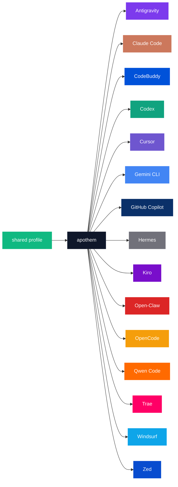

{/* SPDX-License-Identifier: MIT */}

नीचे दी गई विहित ब्रांड-नाम × रंग-कोड गणनाएँ एक `text` फ़ेंस में लपेटी गई हैं, ताकि वे शब्दशः प्रति-हार्नेस पहचानकर्ता संरक्षित रहें जिनकी पैलेट के कैटलॉग प्रयोजन को आवश्यकता है।

## Apothem कोर

| टोकन | लाइट | डार्क | उपयोग |
|---|---|---|---|
| `apothem-hub` | `#0F172A` | `#F1F5F9` | हर आर्किटेक्चर डायग्राम में केंद्रीय वितरण नोड ("apothem")। |
| `shared-profile` | `#10B981` | `#34D399` | सत्य-का-स्रोत प्रोफ़ाइल जो apothem कोर को इनपुट देती है। |

## हार्नेस पैलेट

सत्रह में से पंद्रह हार्नेसों को उनकी प्राथमिक ब्रांड पहचान से मेल खाते रंग दिए
गए हैं, ताकि पाठक किसी डायग्राम में टूलों को अलग-अलग पहचान सके। Apothem मार्क
स्वयं केवल [पैलेट](/docs/brand/palette) पृष्ठ पर दिए गए स्लेट और एमरल्ड रंगों का
उपयोग करता है; उसमें कोई हार्नेस रंग नहीं होता। शेष दो — `glm` और `kimi-code` — का अभी कोई परिभाषित
ब्रांड रंग नहीं है; [अद्यतन](#अद्यतन) के अंतर्गत दिए गए प्रसार चरण के अनुसार,
अपस्ट्रीम ब्रांड रंग तय हो जाने पर उनकी पंक्तियाँ जोड़ी जाती हैं।

```text
| Token             | Light     | Dark      | Source                                                                                                                                              |
|-------------------|-----------|-----------|-----------------------------------------------------------------------------------------------------------------------------------------------------|
| `antigravity`     | `#7C3AED` | `#9F67FF` | Google Antigravity deep-purple.                                                                                                                     |
| `claude-code`     | `#CC785C` | `#E89378` | Anthropic terracotta-orange.                                                                                                                        |
| `codebuddy`       | `#0052D9` | `#5E8EF7` | Tencent CodeBuddy blue.                                                                                                                             |
| `codex`           | `#10A37F` | `#19C796` | OpenAI signature teal.                                                                                                                              |
| `cursor`          | `#6E56CF` | `#9B85E3` | Cursor brand purple.                                                                                                                                |
| `gemini-cli`      | `#4285F4` | `#6BA4F7` | Google blue.                                                                                                                                        |
| `github-copilot`  | `#0A3069` | `#5B8FE3` | GitHub Mona deep-blue.                                                                                                                              |
| `hermes`          | `#71717A` | `#A1A1AA` | Community silver-grey.                                                                                                                              |
| `kiro`            | `#790ECB` | `#A862DD` | Kiro violet.                                                                                                                                        |
| `open-claw`       | `#DC2626` | `#F87171` | Community red-orange.                                                                                                                               |
| `opencode`        | `#F59E0B` | `#FBBF24` | Community amber.                                                                                                                                    |
| `qwen-code`       | `#FF6A00` | `#FF8C40` | Alibaba Qwen orange.                                                                                                                                |
| `trae`            | `#FF0066` | `#FF599C` | ByteDance Trae magenta.                                                                                                                             |
| `windsurf`        | `#0EA5E9` | `#38BDF8` | Windsurf sky-blue.                                                                                                                                  |
| `zed`             | `#084CCF` | `#5E8BE0` | Zed Industries blue.                                                                                                                                |
```

## ट्रेडमार्क

इस पृष्ठ पर और पूरी साइट पर दिए गए हार्नेस नाम, उत्पाद नाम और ब्रांड रंग उनके
स्वामियों के हैं और अपने-अपने स्वामियों के ट्रेडमार्क हैं। Apothem किसी टूल का
नाम केवल यह बताने के लिए लेता है कि वह किसे कॉन्फ़िगर करता है, और किसी टूल का रंग
केवल डायग्राम में उसे अलग पहचानने के लिए उपयोग करता है। Apothem एक स्वतंत्र
परियोजना है; यह इनमें से किसी भी कंपनी या परियोजना से संबद्ध, प्रायोजित या
समर्थित नहीं है, और यह उनका कोई भी लोगो शिप नहीं करता।

## नामकरण का तर्क

- **`apothem-hub`** — वह ज्यामितीय केंद्र जिसकी याद यह नाम दिलाता है (किसी नियमित बहुभुज का अपोथेम भीतर की ओर, उसके कोर की ओर इंगित करता है)।
- **`shared-profile`** — अपस्ट्रीम स्रोत, किसी भी एकल हार्नेस रंग से भिन्न, ताकि यह हर डायग्राम में "इनपुट" तीर के रूप में पढ़ा जाए।
- **प्रति-हार्नेस टोकन** पूरे कोडबेस में उपयोग किए गए हार्नेस slug को प्रतिबिंबित करते हैं (`harnesses/<slug>/`, एंट्री-पॉइंट कुंजी, CLI का `--harness <slug>` आर्ग्युमेंट)। प्रति अवधारणा एक शब्द; हर जगह वही स्ट्रिंग।

## Mermaid उपयोग



## सुगम्यता

प्रत्येक लाइट-मोड टोकन अपना ब्रांड रंग बिना विकृत किए रखता है, इसलिए उनमें से आठ सफ़ेद टेक्स्ट के विरुद्ध WCAG 2.2 AA कंट्रास्ट (≥4.5 : 1) से नीचे आते हैं। शेष लाइट-मोड टोकन इसे पूरा करते हैं। वे आठ, सफ़ेद के विरुद्ध उनके कंट्रास्ट के साथ:

```text
shared-profile   2.54 : 1
claude-code      3.28 : 1
codex            3.20 : 1
gemini-cli       3.56 : 1
opencode         2.15 : 1
qwen-code        2.87 : 1
trae             3.86 : 1
windsurf         2.77 : 1
```

डार्क-मोड कॉलम डार्क पृष्ठभूमियों के लिए है, और उसका कोई भी टोकन सफ़ेद टेक्स्ट के विरुद्ध 4.5 : 1 तक नहीं पहुँचता। जिस डायग्राम को उन आठ भरावों में से किसी एक पर WCAG AA टेक्स्ट-ऑन-कलर कंट्रास्ट चाहिए, वह सफ़ेद के बजाय गहरे टेक्स्ट (`#0F172A`, जो उन पर 4.63 : 1 से 8.31 : 1 मापा गया है) का उपयोग MUST करे।

## अद्यतन

पैलेट केवल तभी अद्यतन होती है जब कोई हार्नेस अपस्ट्रीम में किसी ब्रांड परिवर्तन की पुष्टि करता है। हार्नेस रंग इसी पृष्ठ पर परिभाषित हैं, `assets/design-tokens.css` या `site/app/global.css` में नहीं। प्रति-हार्नेस ब्रांड परिवर्तन इस पृष्ठ और `assets/src/` के अंतर्गत प्रत्येक प्रभावित SVG मास्टर में परमाणविक रूप से प्रसारित होते हैं।
