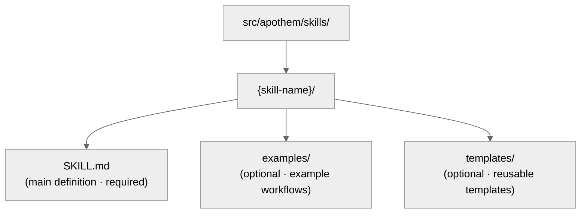

{/* SPDX-License-Identifier: MIT */}

यह मार्गदर्शिका डेवलपरों को SOTA गुणवत्ता मानकों के साथ Apothem इकोसिस्टम का
रखरखाव और विस्तार करने में मदद करती है।

## त्वरित संदर्भ: आर्टिफ़ैक्ट प्रकार

यह मार्गदर्शिका पाँच आर्टिफ़ैक्ट प्रकारों को कवर करती है, जिनमें से प्रत्येक का
एक विशिष्ट उद्देश्य है। नियम, कमांड, हेल्पर और स्किल YAML फ़्रंटमैटर रखते हैं;
हुक `hooks.json` और `settings.json` में पंजीकृत होते हैं और कोई फ़्रंटमैटर नहीं
रखते। आउटपुट-स्टाइल एक अतिरिक्त आर्टिफ़ैक्ट वर्ग है, जिसकी दो आवश्यक फ़्रंटमैटर
कुंजियाँ हैं, `name` और `description`; देखें
[फ़्रंटमैटर स्कीमा](/docs/reference/frontmatter-schema)।

| आर्टिफ़ैक्ट | पथ | उद्देश्य | कब बनाएँ |
| -------- | ---- | ------- | -------------- |
| **नियम** | `src/apothem/rules/*.md` | व्यवहार-संबंधी अधिदेश या परिचालन निर्देश | कोई नया सिद्धांत, नीति या शासन अधिदेश स्थापित हुआ हो |
| **कमांड** | `src/apothem/commands/*.md` | जटिल वर्कफ़्लो के लिए स्लैश कमांड (`/command-name`) | नया बहु-चरणीय उपयोगकर्ता वर्कफ़्लो |
| **हेल्पर** | `src/apothem/agents/*.md` | समानांतर कार्यों के लिए स्थायी प्रत्यायोजित-वर्कर परिभाषा | नया आवर्ती विशेषीकृत कार्य (ऑडिट, अन्वेषण, गुणवत्ता-जाँच) |
| **स्किल** | `src/apothem/skills/{name}/SKILL.md` | पहचान संकेत वाली पुन: प्रयोज्य तकनीक | नया पहचाना जा सकने वाला, पुन: प्रयोज्य तकनीक पैटर्न |
| **हुक** | `src/apothem/hooks/` + `hooks.json` + `settings.json` | इवेंट-ट्रिगर सत्यापन या स्थिति प्रबंधन | नया जीवनचक्र इवेंट या सत्यापन आवश्यकता |

## हार्नेस अडैप्टर अनुबंध

हार्नेस की पहचान और क्षमता संबंधी तथ्य
`src/apothem/lib/harness_registry.py` में रहते हैं। कोई हार्नेस परिवर्तन केवल
तभी पूर्ण होता है जब ये सतहें आपस में सहमत हों:

| सतह | आवश्यक अपडेट |
| --- | --- |
| रजिस्ट्री पंक्ति | सार्वजनिक ID, पैकेज कुंजी, एंट्री पॉइंट, दायरा, आउटपुट प्रारूप, लक्ष्य पथ, डॉक्स पथ, क्षमता फ़ाइल, स्टैंडर्ड पिन, फ़िक्स्चर परीक्षण, पैकेज-डेटा कुंजी, टेम्पलेट स्रोत, और क्षमता स्थितियाँ। |
| अडैप्टर पैकेज | `__init__.py`, `install.py`, `update.py`, `uninstall.py`, `verify.py`; `materializer.py` केवल तभी जोड़ें जब हार्नेस कोई नेटिव कॉन्फ़िग फ़ाइल रेंडर करता हो। |
| प्रसार मैनिफ़ेस्ट | मैनिफ़ेस्ट-आधारित अडैप्टरों के लिए टेम्पलेट और समूह पथ। |
| क्षमताएँ | `src/apothem/harnesses/<package>/capabilities.yml`, जिसमें हर आवश्यक क्षमता हो और असमर्थित या खोज-लंबित स्थितियों का औचित्य हो, साथ ही कमांड, एजेंट या नियमों के प्रत्येक परिवर्तित समूह के लिए एक `conversion_losses` मैप हो ([हार्नेस रजिस्ट्री](/docs/reference/harness-registry) देखें)। |
| परिपाटी पिन | `STANDARD-CONVENTION-PIN.md`, जिसमें वेंडर URL, स्नैपशॉट तिथि, कैनोनिकल फ़ाइल-नाम/स्कीमा, साक्ष्य संदर्भ, और असमर्थित क्षमता का औचित्य हो। |
| परीक्षण | रजिस्ट्री समता, अडैप्टर फ़िक्स्चर परीक्षण, गोल्डन इंस्टॉल-योजना पंक्ति, ड्राई-रन/नो-राइट व्यवहार, इडेम्पोटेंसी, और पैकेज-डेटा कवरेज। |
| डॉक्स | हार्नेस संदर्भ पृष्ठ, तुलना पृष्ठ, क्षमता/MCP नोट्स, और ऐसे उदाहरण जो नकली प्लेसहोल्डर का उपयोग करते हैं। |

प्रोजेक्ट-दायरे वाले अडैप्टरों को अवश्य `requires_project = True` सेट करना
चाहिए, जीवनचक्र मेथड पर `project: Path | None` स्वीकार करना चाहिए, और लिखने से
पहले लुप्त या असुरक्षित प्रोजेक्ट रूट को अस्वीकार करना चाहिए। उपयोगकर्ता-दायरे
वाले अडैप्टरों को पथ अवश्य हार्नेस के प्रलेखित उपयोगकर्ता कॉन्फ़िगरेशन रूट के
अंतर्गत ही रखने चाहिए।

## गोल्डन फ़िक्स्चर नीति

`tests/fixtures/harness-golden-plans.json` रजिस्ट्री के सभी सत्रह हार्नेसों के
लिए सार्वजनिक इंस्टॉल-योजना का आकार दर्ज करता है: सार्वजनिक ID, मटेरियलाइज़ेशन
मोड, स्रोत समूह/टेम्पलेट पथ, और `<ROOT>` के अंतर्गत सामान्यीकृत लक्ष्य पथ। जब
रजिस्ट्री, मैनिफ़ेस्ट या टेम्पलेट का लक्ष्य व्यवहार जानबूझकर बदलता है, तो गोल्डन
फ़िक्स्चर को स्रोत परिवर्तन वाले उसी कमिट में अपडेट करें, ताकि डिफ़ में व्यवहार का
अंतर दिखाई दे।

## लिखने से पहले सत्यापन

साझा इंस्टॉल ड्राइवर पहला लेखन होने से पहले हर स्रोत और लक्ष्य का सत्यापन करता
है। यह लुप्त मैनिफ़ेस्ट स्रोतों, लक्ष्य ट्रैवर्सल, चयनित रूट के बाहर के लक्ष्य
पथों, और सिमलिंक क्रॉसिंग को अस्वीकार करता है। ड्राई-रन वही सत्यापन निष्पादित
करते हैं और कोई फ़ाइल बनाए बिना संरचित `skipped` या `unchanged` परिणाम लौटाते हैं।

## रिडैक्शन और उदाहरण डेटा

प्रोफ़ाइल निदान टोकन, सीक्रेट, पासवर्ड, क्रेडेंशियल, API कुंजी, प्राइवेट कुंजी,
ऑथराइज़ेशन, ऑथ, और हेडर-आकार के फ़ील्ड को रिडैक्ट कर देते हैं। दस्तावेज़,
फ़िक्स्चर, उदाहरण और JSON स्निपेट असली-जैसे दिखने वाले सीक्रेट या व्यक्तिगत
खातों के बजाय `example.invalid`, `Example User`, `example-user`, और स्पष्ट
प्लेसहोल्डर का उपयोग करते हैं।

## लिखने से पहले: कैनोनिकल स्कीमा

**मशीन-पठनीय, गेट-प्रवर्तित अनुबंध `src/apothem/schemas/*.schema.json` के
अंतर्गत प्रति-वर्ग JSON स्कीमा हैं — `additionalProperties` अज्ञात कुंजियों को
अस्वीकार करता है, इसलिए अनुरूपता गेट का निर्णय ही अंतिम है।** दो मानव-पठनीय
प्रक्षेपण इनका अनुसरण करते हैं: `site/content/docs/reference/frontmatter-schema.mdx`
(आवश्यक-कुंजी सूचकांक) और `site/content/docs/reference/artifact-schema.mdx`
(प्रति-वर्ग टेम्पलेट और हल किए गए उदाहरण)। जहाँ कोई पृष्ठ JSON स्कीमा से असहमत
हो, वहाँ स्कीमा ही मान्य होते हैं।

- `src/apothem/schemas/` के अंतर्गत अपने आर्टिफ़ैक्ट प्रकार का JSON स्कीमा पढ़ें
- टेम्पलेट और एक हल किए गए उदाहरण के लिए
  `site/content/docs/reference/artifact-schema.mdx` § "Schema" पढ़ें
- आवश्यक फ़ील्ड कॉपी करें, अनिवार्य मान भरें, आवश्यकतानुसार वैकल्पिक फ़ील्ड जोड़ें

## फ़्रंटमैटर त्वरित-जाँच

प्रत्येक आर्टिफ़ैक्ट के फ़्रंटमैटर को अवश्य ये जाँचें पास करनी चाहिए।
`version`, `updated` और `portability` की जाँचें केवल उस वर्ग पर लागू करें जो
वह कुंजी रखता है: नियम इनमें से कोई भी नहीं रखते, और स्किल में `portability`
नहीं होता।

```yaml
✓ Valid YAML syntax (use tools: `yamllint` or PowerShell `ConvertFrom-Yaml` where available)
✓ All mandatory fields present (per schema for artifact type)
✓ name: uses kebab-case
✓ version: semantic MAJOR.MINOR.PATCH
✓ updated: ISO 8601 date (YYYY-MM-DD)
✓ description: single-line, non-empty
✓ scope fields valid per artifact type (rules: pathFilter + alwaysApply; CLAUDE.md root: scope)
✓ portability: string, for example `universal` (the schemas do not enumerate its values)
✓ No typos in field names — must match canonical schema exactly
✓ Optional fields use correct enum values
```

## नामकरण परिपाटियाँ

### आर्टिफ़ैक्ट नाम (kebab-case)

- **नियम:** `operational-mandates`, `clean-room-generation`, `context-management`
- **कमांड:** `plan-execute`, `plan-spec`, `plan-generate`
- **हेल्पर:** `codebase-explorer`, `convention-auditor`, `quality-gate`
- **स्किल:** `plan-suite`, `ecosystem-audit`

पैटर्न: लोअरकेस, शब्दों के बीच हाइफ़न, कोई स्पेस या अंडरस्कोर नहीं।

### फ़ाइल नामकरण

- **नियम:** `{name}.md`
- **कमांड:** `{name}.md`
- **हेल्पर:** `{name}.md`
- **स्किल:** फ़ोल्डर `src/apothem/skills/{name}/SKILL.md` के अंदर (सटीक केस: `SKILL.md`)
- **हुक:** फ़ोल्डर `src/apothem/hooks/` के अंदर। सभी इवेंट हैंडलर Python में हैं। Claude Code
  `settings.json` टेम्पलेट का हर हुक कमांड exec रूप का उपयोग करता है: `command`
  इंस्टॉल के समय हल होने वाला इंटरप्रेटर प्लेसहोल्डर `${PYTHON_BIN}` है, और
  `args` में स्क्रिप्ट पथ तथा उसके आर्ग्युमेंट होते हैं। वह टेम्पलेट
  `${HARNESS_ROOT}/.apothem/support/hooks/dispatch.py <event> [<message-name>]` और
  `${HARNESS_ROOT}/.apothem/support/conformity/gate.py --hook` को निरपेक्ष पथ से चलाता है, इसलिए
  इंस्टॉल की गई प्रति को आयात-योग्य `apothem` पैकेज की आवश्यकता नहीं होती। Claude Code प्लगइन
  इसके बजाय हुक को `src/apothem/hooks/hooks.json` में पंजीकृत करता है, ऐसे शेल कमांड के रूप में
  जो `hooks/lib/bootstrap.sh` को `bash` के माध्यम से चलाते हैं; वह स्टब Python का स्थान खोजता है और
  `dispatch.py` चलाता है, इसलिए हैंडलर Python में ही रहते हैं। नया हुक `hooks.json` में
  और Claude Code `settings.json` टेम्पलेट में पंजीकृत करें। `dispatch.py`
  `SessionStart` को
  `session_start_bootstrap.main()` पर, और हर अन्य अनुमत-सूची वाले इवेंट को
  `emit_hook_context.main()` पर रूट करता है। `src/apothem/hooks/` या `scripts/` के अंतर्गत
  अनुमत शेल स्टब केवल छह लोकेटर और बूटस्ट्रैप फ़ाइलें हैं
  (`find-python.{ps1,sh}`, `find-pwsh.{ps1,sh}`, `bootstrap.{ps1,sh}`); कोई भी अन्य `.ps1` /
  `.sh` फ़ाइल `scripts/dev/validate_hooks.py` स्वच्छता जाँच में विफल होती है।

### क्रॉस-संदर्भ

अन्य आर्टिफ़ैक्ट का संदर्भ देते समय सटीक नामों का उपयोग करें:

- नियम: `"operational-mandates"` (name फ़ील्ड का मान)
- कमांड: `/plan-execute` (मानव दस्तावेज़ों के लिए स्लैश के साथ; कोड में स्लैश के बिना)
- हेल्पर: `codebase-explorer` (name फ़ील्ड का मान)
- स्किल: `plan-suite` (name फ़ील्ड का मान)

गद्य में कभी भी फ़ाइल पथ या छोटे किए गए नामों का उपयोग न करें।

## पोर्टेबिलिटी: Windows बनाम Unix

प्रत्येक कमांड अपनी पोर्टेबिलिटी स्थिति `portability` फ़ील्ड में स्पष्ट रूप से MUST
घोषित करे। हेल्पर इसे MAY घोषित करे। स्किल, नियम और आउटपुट-स्टाइल में
`portability` फ़ील्ड नहीं होता।

### सार्वभौमिक

- Windows, macOS और Linux पर एक समान काम करता है
- कोई शेल धारणा नहीं
- पथ फ़ॉरवर्ड स्लैश (`/`) का उपयोग करते हैं
- कोई हार्डकोड किया गया निरपेक्ष पथ नहीं
- कोई Windows-विशिष्ट PowerShell सिंटैक्स नहीं

```yaml
portability: "universal"
```

### Windows चेतावनियों के साथ सार्वभौमिक

- सभी POSIX होस्ट पर सार्वभौमिक; नामित चेतावनी सामग्री में घोषित Windows प्लेटफ़ॉर्म वैरिएंट पर लागू होती है
- चेतावनी को सामग्री में स्पष्ट रूप से प्रलेखित करें
- उदाहरण: "Win 10 से पहले के Windows पर सिमलिंक समर्थित नहीं"

```yaml
portability: "universal-with-windows-caveats"
```

चेतावनी को शीर्षक के ठीक बाद एक नोट में प्रलेखित करें।

### केवल-Unix / केवल-Windows

- स्पष्ट रूप से एक प्लेटफ़ॉर्म तक सीमित
- Apothem में दुर्लभ — अधिकांश को सार्वभौमिक होना चाहिए
- केवल तभी उपयोग करें जब प्लेटफ़ॉर्म-विशिष्ट सुविधाएँ अनिवार्य हों

```yaml
portability: "unix-only"
```

कारण को आर्टिफ़ैक्ट के पहले अनुभाग में प्रलेखित करें।

## दायरा: सदैव-चालू बनाम पथ-फ़िल्टर्ड

### सदैव-चालू

नियम हर जगह लागू होता है।

```yaml
pathFilter: ""
alwaysApply: true
```

### पथ-फ़िल्टर्ड

नियम फ़ाइल पथ के आधार पर सशर्त रूप से लागू होता है।

```yaml
pathFilter: "**/*.py, **/*.toml"
alwaysApply: false
```

`pathFilter` ग्लोब पैटर्न का उपयोग करता है (`.gitignore` जैसा ही प्रारूप)। जब कोई
फ़ाइल फ़िल्टर से मेल खाती है, तो नियम सक्रिय हो जाता है।

## संस्करण शब्दार्थ

प्रत्येक संस्करण-युक्त आर्टिफ़ैक्ट का अपना सिमेंटिक संस्करण (`MAJOR.MINOR.PATCH`)
होता है। कमांड और स्किल के लिए यह आवश्यक है, हेल्पर और आउटपुट-स्टाइल इसे MAY रखें,
और नियम कोई संस्करण नहीं रखते:

- **PATCH** — एक व्यवहार-संबंधी परिवर्तन जो अनुबंध को तोड़े बिना किसी मौजूदा निर्देश को सुधारता है।
- **MINOR** — योगात्मक, गैर-ब्रेकिंग परिवर्तन: नए वैकल्पिक अनुभाग, नए वैकल्पिक frontmatter फ़ील्ड, नए उदाहरण। मौजूदा उपभोक्ता बिना किसी बदलाव के काम करते रहते हैं।
- **MAJOR** — ब्रेकिंग स्कीमा या अनुबंध परिवर्तन: हटाए गए अनुभाग, पुनर्नामित फ़ील्ड, किसी मौजूदा निर्देश के व्यवहार में बदलाव, ऐसे परिवर्तन जिनके लिए डाउनस्ट्रीम आर्टिफ़ैक्ट को स्वयं को अनुकूलित करना पड़े।

टाइपो सुधार, लिंक सुधार, फ़ॉर्मेटिंग, और केवल-टिप्पणी या केवल-दस्तावेज़ संपादन संस्करण को अपरिवर्तित छोड़ते हैं। केवल व्यवहार-संबंधी परिवर्तन ही संस्करण बढ़ाता है। ऐसा संपादन फिर भी आर्टिफ़ैक्ट की `updated` तिथि को अद्यतन करता है।

उदाहरण:

- `vX.Y.Z` → `vX.Y.(Z+1)` (PATCH: व्यवहार बदलने वाला संशोधित निर्देश)
- `vX.Y.Z` → `vX.Y.Z` (कोई वृद्धि नहीं: टाइपो या लिंक सुधार; `updated` बदलता है)
- `vX.Y.Z` → `vX.(Y+1).0` (MINOR: नया वैकल्पिक अनुभाग जोड़ा गया)
- `v0.Y.Z` → `v(0+1).0.0` (MAJOR: अनुबंध को स्थिर घोषित किया गया; नए आर्टिफ़ैक्ट `v0.Y.Z` से आरंभ होते हैं)
- `vX.Y.Z` → `v(X+1).0.0` (MAJOR: अनिवार्य frontmatter फ़ील्ड हटाया गया)

जो आर्टिफ़ैक्ट `version` और `updated` रखता है, उसके हर व्यवहार-बदलने वाले संपादन पर
दोनों को एक साथ बढ़ाएँ। जो रिलीज़ आर्टिफ़ैक्ट परिवर्तनों को बंडल करती हैं, उनके लिए
इकोसिस्टम-स्तरीय `CHANGELOG.md` में एक संगत पंक्ति जोड़ें।

## आर्टिफ़ैक्ट कब संपादित करें

### नियम

- अनिवार्य/वैकल्पिक संरचना को भार-वहन करने वाला मानें — इसका पुनर्गठन हर निर्भर
  आर्टिफ़ैक्ट तक फैलता है।
- जैसे-जैसे समझ गहरी हो, एंटी-पैटर्न, गंभीरता-मापन उदाहरणों और उद्धरणों को
  परिष्कृत करें।
- किसी भी संरचनात्मक परिवर्तन का औचित्य संबंधित मेमोरी विषय फ़ाइल में दर्ज
  करें।

### कमांड

- आर्ग्युमेंट का आकार सार्वजनिक अनुबंध का हिस्सा है — इसे केवल स्पष्ट इरादे से
  तोड़ें और परिवर्तन को हर कॉलर तक पहुँचाएँ (MAJOR वृद्धि)।
- वर्कफ़्लो चरणों और रिटर्न अनुबंधों को सटीक और अद्यतन रखें।
- गैर-स्पष्ट चरण क्रम को इनलाइन प्रलेखित करें।

### हेल्पर

- `disallowedTools` को न्यूनतम-किंतु-पर्याप्त रखें; जब यह बदले, तो औचित्य
  प्रलेखित करें।
- जैसे-जैसे हेल्पर की भूमिका परिपक्व हो, परिचालन सिद्धांतों और रिटर्न अनुबंधों
  को परिष्कृत करें (MINOR वृद्धि)।
- क्षमता में बदलावों को इनलाइन ट्रैक करें ताकि कॉलर अपनी अपेक्षाएँ फिर से
  समायोजित कर सकें।

### स्किल

- प्रक्रिया चरणों और उदाहरणों को वास्तविकता के साथ सिंक्रनाइज़ रखें।
- पहचान संकेतों को वर्तमान उपयोग में उपयोगकर्ताओं की वास्तविक शब्दावली को अवश्य
  प्रतिबिंबित करना चाहिए।
- कोई स्किल ~150 पंक्तियाँ पार करते ही उसे विभाजित करें (देखें
  `auto-memory.md` § Topic File Management)।

## चरण-दर-चरण: नया नियम जोड़ना

### 1. ऑर्थोगोनैलिटी का आकलन करें

क्या यह नियम मौजूदा नियमों से ओवरलैप करता है? संबंधित सामग्री के लिए
`src/apothem/rules/` में खोजें।

यदि ओवरलैप >50% है, तो इसके बजाय किसी मौजूदा नियम का विस्तार करने पर विचार करें।
देखें `persistent-conventions-vigilance.md` § Artifact Evolution।

### 2. सामग्री लिखें

इस संरचना का पालन करें:

- शीर्षक: `# Rule: {Title}`
- उद्देश्य अनुभाग
- दायित्व / मूल निर्देश (क्रमांकित, लिंक किए गए)
- गंभीरता-मापन तालिका (सदैव आवश्यक)
- एंटी-पैटर्न अनुभाग
- प्रवर्तन अनुभाग

### 3. फ़्रंटमैटर बनाएँ

`site/content/docs/reference/artifact-schema.mdx` § Schema: Rules से स्कीमा का
उपयोग करें। सेट करें:

- `name:` kebab-case पहचानकर्ता
- `description:` रजिस्ट्रियों के लिए एक-पंक्ति सारांश
- `pathFilter:` पथ-फ़िल्टर्ड नियमों के लिए ग्लोब सूची; सदैव-चालू नियमों के लिए खाली स्ट्रिंग (`""`)
- `alwaysApply:` सदैव-चालू नियमों के लिए `true`, पथ-फ़िल्टर्ड नियमों के लिए `false`

नियमों में केवल ये चार फ़ील्ड होते हैं — कोई `version` / `updated` / `scope` /
`portability` / `implements` नहीं।

उदाहरण:

```yaml
---
name: "my-new-rule"
description: "Brief one-liner"
pathFilter: ""
alwaysApply: true
---
```

### 4. नियम README अपडेट करें

`src/apothem/rules/README.md` के Rule families अनुभाग में, नियम के परिवार की
तालिका में एक पंक्ति जोड़ें:

```markdown
| `my-new-rule.md` | One-line concern of the new rule. |
```

वह परिवार-तालिका चुनें जिसका सरोकार नियम से मेल खाता हो।

### 5. CHANGELOG.md में जोड़ें

अगली रिलीज़ के `### Added` अनुभाग के अंतर्गत नए नियम का वर्णन करने वाली एक
पंक्ति जोड़ें।

### 6. सत्यापन चलाएँ

नए नियम का सत्यापन करने के लिए, नियम क्षेत्र पर केंद्रित करते हुए
`ecosystem-audit` स्किल को चलाएँ:

```text
Invoke the ecosystem-audit skill with --focus rules --fix
```

पुष्टि करें कि आपके नए नियम के लिए कोई त्रुटि रिपोर्ट नहीं हुई।

## चरण-दर-चरण: नया कमांड जोड़ना

कमांड `/plan-spec`, `/plan-execute`, `/security-audit` आदि जैसे स्लैश कमांड हैं।

### 1. भूमिका निर्धारित करें

कमांड उपयोगकर्ता-ट्रिगर वर्कफ़्लो हैं। मॉडल किसी कमांड को अपने आप केवल तभी चलाता
है जब उसकी `disable-model-invocation` सेटिंग `false` हो (चरण 2)। पूछें:

- क्या यह ऐसा वर्कफ़्लो है जिसके लिए उपयोगकर्ता `/command-name` टाइप करता है?
- क्या यह कई चरणों का समन्वय (ऑर्केस्ट्रेशन) करता है?
- क्या इसका टाइमआउट हो सकता है या निष्पादन के बीच उपयोगकर्ता इनपुट की आवश्यकता हो सकती है?

यदि इनमें से किसी का भी उत्तर "नहीं" है, तो यह संभवतः एक स्किल है, कमांड नहीं।

### 2. फ़ाइल बनाएँ

पथ: `src/apothem/commands/{name}.md`

फ़्रंटमैटर (`site/content/docs/reference/artifact-schema.mdx` § Schema: Commands से):

```yaml
---
name: "my-command"
version: "X.Y.Z"
updated: "2026-04-20"
description: "What this command does"
argument-hint: "[path/to/input] [--flag VALUE]"
disable-model-invocation: true
portability: "universal"
allowed-tools: "Read, Glob, Grep"
---
```

`disable-model-invocation: true` किसी कमांड को केवल ऑपरेटर द्वारा चलाए जाने
योग्य बनाता है; `false` होने पर, जब कोई अनुरोध उसके विवरण से मेल खाता है तो मॉडल
उसे चला सकता है। अधिकांश कमांड `true` का उपयोग करते हैं, लेकिन अधिकांश प्लान और
रिसर्च पाइपलाइन चरण `false` का उपयोग करते हैं। `src/apothem/commands/README.md`
में इनवोकेशन तालिका हर कमांड की सेटिंग सूचीबद्ध करती है; नए कमांड के लिए एक
पंक्ति जोड़ें। `allowed-tools` को केवल-पढ़ने योग्य रखें: जो हार्नेस इसका पालन
करता है, वह उन टूल को बिना पूछे चलाता है। किसी साइड-इफ़ेक्ट वाले टूल की अनुमति
केवल दायरे-युक्त नियम के रूप में दें, जैसे `Bash(git log *)`; स्कीमा `"*"` को और
बिना दायरे के लिखे गए `Bash`, `PowerShell`, `Write`, `Edit`, `NotebookEdit` या
`WebFetch` में से किसी को भी अस्वीकार करता है।

### 3. सामग्री लिखें

संरचना:

- शीर्षक: `# /{name} — Human-Readable Title`
- भूमिका अनुभाग (इसे कौन निष्पादित करता है)
- उच्च-स्तरीय निर्देश
- चरणों के साथ वर्कफ़्लो अनुभाग
- रिटर्न अनुबंध / आउटपुट प्रारूप

### 4. README और CHANGELOG.md अपडेट करें

`src/apothem/commands/README.md` में कमांड के अनुभाग की तालिका में एक पंक्ति जोड़ें, चरण 2 की इनवोकेशन-तालिका वाली पंक्ति के अतिरिक्त; अगली रिलीज़ के `### Added` अनुभाग के अंतर्गत एक CHANGELOG पंक्ति जोड़ें।

### 5. सत्यापित करें

कमांड पर केंद्रित करते हुए `ecosystem-audit` स्किल को चलाएँ:

```text
Invoke the ecosystem-audit skill with --focus commands --fix
```

## चरण-दर-चरण: नया हेल्पर जोड़ना

हेल्पर समानांतर कार्य के लिए स्थायी प्रत्यायोजित-वर्कर परिभाषाएँ हैं।

### 1. पैटर्न पहचानें

क्या यह हेल्पर नीचे सूचीबद्ध टीम पैटर्नों में से किसी एक में फ़िट होता है?

- रिसर्च टीम: केवल-पढ़ने वाला, जानकारी एकत्र करना
- ऑडिट टीम: सत्यापन, संगति जाँच
- कार्यान्वयन टीम: समानांतर कोड परिवर्तन
- गुणवत्ता टीम: लिंट, परीक्षण, टाइप-जाँच, सुरक्षा
- प्रलेखन टीम: दस्तावेज़ अपडेट
- अन्य: विशेषीकृत कार्य

### 2. फ़ाइल बनाएँ

पथ:

```text
src/apothem/agents/{name}.md
```

फ़्रंटमैटर:

```yaml
---
name: "my-helper"
version: "X.Y.Z"
updated: "2026-04-20"
description: "What this helper specializes in"
tools: "Read, Glob, Grep, Bash"
disallowedTools: "Write, Edit"
maxTurns: 15
portability: "universal"
---
```

`model`, `effort` और `permissionMode` को छोड़ दें ताकि हेल्पर सत्र के विकल्प
विरासत में ले (अज्ञेय मुद्रा), और `memory` को तब तक छोड़ दें जब तक हेल्पर को किसी
स्थायी-मेमोरी दायरे (`user`, `project`, या `local`) की आवश्यकता न हो।

### 3. सामग्री लिखें

अनुभाग:

- परिचालन सिद्धांत (केवल-पढ़ने वाला, साक्ष्य-आधारित, द्विआधारी निर्णय, संपूर्ण)
- वर्कफ़्लो (क्रमांकित चरण)
- रिटर्न अनुबंध (अधिकतम टोकन, संरचना, आवश्यक फ़ील्ड)

### 4. README और CHANGELOG.md अपडेट करें

`src/apothem/agents/README.md` की Index तालिका में एक पंक्ति जोड़ें; अगली रिलीज़ के `### Added` अनुभाग के अंतर्गत एक CHANGELOG पंक्ति जोड़ें।

### 5. परीक्षण करें

हेल्पर को किसी वास्तविक परिदृश्य में तैनात करें और पुष्टि करें कि यह प्रलेखित
रूप में काम करता है।

## चरण-दर-चरण: नई स्किल जोड़ना

स्किल पुन: प्रयोज्य, पहचानी जा सकने वाली तकनीकें हैं।

### 1. पुन: प्रयोज्यता पहचानें

स्किल लिखने से पहले:

- क्या आपने यह समस्या/तकनीक 3+ बार देखी है?
- क्या इसे पहचाना जा सकता है? (क्या कोई उपयोगकर्ता अनुरोध पैटर्न इसका संकेत देता है?)
- क्या आप इसे पुनरुत्पादनीय रूप से संहिताबद्ध कर सकते हैं?

यदि तीनों का उत्तर हाँ है, तो स्किल लिखें।

### 2. संरचना बनाएँ



### 3. SKILL.md लिखें

फ़्रंटमैटर:

```yaml
---
name: "skill-name"
version: "X.Y.Z"
updated: "2026-04-20"
description: "What this skill teaches"
archetype: "workflow-template"
userInvocable: true | false
disable-model-invocation: true | false
allowed-tools: "Read, Glob, Grep"
argument-hint: "[args]"               # optional; if userInvocable
---
```

सामग्री संरचना:

- उद्देश्य
- इस स्किल का उपयोग कब करें
- पूर्वापेक्षाएँ
- चरण-दर-चरण प्रक्रिया
- सामान्य गलतियाँ
- उदाहरण

### 4. README और CHANGELOG.md अपडेट करें

`src/apothem/skills/README.md` की Index तालिका में एक पंक्ति और Folder contents तालिका में स्किल की प्रत्येक फ़ाइल के लिए एक-एक पंक्ति जोड़ें; अगली रिलीज़ के `### Added` अनुभाग के अंतर्गत एक CHANGELOG पंक्ति जोड़ें।

### 5. सत्यापित करें

स्किल पर केंद्रित करते हुए `ecosystem-audit` स्किल को चलाएँ:

```text
Invoke the ecosystem-audit skill with --focus skills --fix
```

## कमिट करने से पहले सत्यापन जाँचसूची

- [ ] फ़्रंटमैटर YAML सिंटैक्स जाँच पास करता है
- [ ] स्कीमा के अनुसार सभी अनिवार्य फ़ील्ड मौजूद हैं
- [ ] `name` फ़ील्ड kebab-case का उपयोग करता है
- [ ] `version` (केवल संस्करण-युक्त वर्गों में; नियम कोई संस्करण नहीं रखते) सिमेंटिक (`MAJOR.MINOR.PATCH`) है और व्यवहार बदलने पर बढ़ाया गया है
- [ ] आपके द्वारा छुए गए जिस भी आर्टिफ़ैक्ट में यह फ़ील्ड है, उसके लिए `updated` आज की तिथि से मेल खाता है
- [ ] `portability` फ़ील्ड सेट और वैध है (कमांड पर आवश्यक, हेल्पर पर वैकल्पिक)
- [ ] CHANGELOG.md में परिवर्तन अगली रिलीज़ के अनुभाग के अंतर्गत उपयुक्त श्रेणी में दर्ज है
- [ ] कोई प्लान-आंतरिक संदर्भ नहीं (CM-7 अनुपालन)
- [ ] क्रॉस-संदर्भ अन्य आर्टिफ़ैक्ट के साथ संगत हैं
- [ ] नया आर्टिफ़ैक्ट अपने फ़ोल्डर के README सूचकांक में पंजीकृत है
- [ ] आर्टिफ़ैक्ट का परीक्षण किया गया है (यदि लागू हो)
- [ ] `ecosystem-audit` स्किल बिना त्रुटियों के चलती है
- [ ] सामग्री संरचनात्मक परिपाटियों का पालन करती है (शीर्षक प्रारूप, अनुभाग, आदि)

## अन्य आर्टिफ़ैक्ट का संदर्भ देना

इन सटीक परिपाटियों का उपयोग करें:

### किसी नियम का संदर्भ दें

```markdown
See `src/apothem/rules/operational-mandates.md` or shorthand: the Operational Mandates rule.
In prose: ... per CM-1–10 (Operational Mandates rule) ...
```

### किसी कमांड का संदर्भ दें

```markdown
See `/plan-execute` command. Or: Run `/plan-execute`.
In prose: The `/plan-execute` command handles phase execution.
```

### किसी हेल्पर का संदर्भ दें

```markdown
Deploy the `codebase-explorer` delegated worker.
In prose: The codebase-explorer worker finds patterns.
```

### किसी स्किल का संदर्भ दें

```markdown
Use the `plan-suite` skill.
In prose: The plan-suite skill provides the Master Plan Suite template.
```

### CLAUDE.md अनुभागों का संदर्भ दें

```markdown
See CLAUDE.md § Harness Adapter Pattern.
Or: § Plans Discipline.
```

## लिंटिंग और प्रारूप

सभी आर्टिफ़ैक्ट इनका उपयोग करते हैं:

- **Markdown:** GFM (GitHub Flavored Markdown)
- **YAML:** YAML 1.2 अनुरूप
- **लाइन एंडिंग:** LF (Unix-शैली)
- **एन्कोडिंग:** UTF-8
- **पंक्ति चौड़ाई:** सामग्री के लिए 100 अक्षरों पर सॉफ़्ट रैप (कोई हार्ड ब्रेक नहीं)

Python फ़ाइलों के लिए `Ruff` फ़ॉर्मेटर / लिंटर का उपयोग करें। Markdown के लिए
`prettier` या समतुल्य का उपयोग करें।

## परीक्षण और मापन

### सूट चलाएँ

```bash
python -m pytest                      # unit, integration, property, conformity, scripts
python -m pytest tests/property       # Hypothesis properties (profile loader, frontmatter, merge)
```

सूट हर्मेटिक है: यह तब भी पास होता है जब चेकआउट `$TMPDIR` के अंतर्गत हो और
`PATH` पर ऐसा `python` हो जिसमें CLI पूर्वापेक्षाएँ न हों, क्योंकि इंटीग्रेशन
परीक्षण उसी इंटरप्रेटर को चलाते हैं जो pytest चलाता है, और नेस्टेड अस्थायी तथा
स्रोत पथों को सबसे-लंबे-पहले क्रम में टोकनाइज़ करते हैं।

### प्रति पैकेज कवरेज

CI तीन पैकेजों को मापता है और प्रत्येक को उसके अपने फ़्लोर पर बनाए रखता है।
इनमें से कोई भी किसी दूसरे में शामिल नहीं किया जाता।

| पैकेज | पथ | फ़्लोर | फ़्लोर कहाँ रहता है |
| --- | --- | --- | --- |
| engine | `cli`, `harnesses`, `lib`, `hooks`, `statuslines` | 80 | `[tool.coverage.report] fail_under` |
| conformity | `src/apothem/conformity` | 81 | `[tool.coverage.package-floors]` |
| audit | `src/apothem/audit` | 70 | `[tool.coverage.package-floors]` |

यह आँकड़ा लाइन और ब्रांच का संयुक्त कवरेज है, वही प्रतिशत जो coverage.py
`branch = true` के साथ रिपोर्ट करता है; मेट्रिक्स आर्टिफ़ैक्ट केवल-स्टेटमेंट
आँकड़ा भी `coverage_lines` के अंतर्गत दर्ज करता है। प्रत्येक पैकेज फ़्लोर मापे गए
लाइन और ब्रांच मान को नीचे की ओर पूर्णांकित करके तय होता है। जब कवरेज बढ़े तो
फ़्लोर बढ़ाएँ; किसी परिवर्तन को पास कराने के लिए फ़्लोर को कभी कम न करें।
स्थानीय रूप से जाँचने के लिए:

```bash
python -m pytest --cov=src/apothem --cov-report=json:coverage.json
python scripts/dev/collect_metrics.py --coverage-json coverage.json --check-floors \
  --skip-hooks --skip-coldstart --harness zed
```

### मेट्रिक्स आर्टिफ़ैक्ट

CI का `metrics` जॉब हर पुश और पुल रिक्वेस्ट पर `scripts/dev/collect_metrics.py`
चलाता है और `metrics.json` (`schema_version: 1`) अपलोड करता है। `null` वाले हर
मान का कारण `nulls` के अंतर्गत दर्ज होता है।

| कुंजी | यह क्या मापती है |
| --- | --- |
| `coverage.engine`, `coverage.conformity`, `coverage.audit` | प्रति पैकेज लाइन और ब्रांच प्रतिशत, `coverage_floors` के साथ। |
| `always_on_bytes[harness]`, `always_on_files[harness]` | 17 हार्नेसों में से प्रत्येक के लिए, एक अस्थायी `HOME` और प्रोजेक्ट में `profile init` और `install --harness <id>` के बाद: उन निर्देश फ़ाइलों के डिस्क पर बाइट जिन्हें वह हार्नेस लॉन्च पर पूरी तरह लोड करता है। |
| `cli_coldstart_ms` | `python -m apothem --version` की माध्यिका (`cli_coldstart_detail_ms` के अंतर्गत `--help` के साथ)। |
| `hook_e2e_ms[event]`, `hook_injected_chars[event]` | प्रति पंजीकृत इवेंट और मैचर (`PreToolUse:Write`, `Stop`, …): वास्तविक पेलोड पर हुक श्रृंखला का माध्यिका कुल समय, और उसके द्वारा इंजेक्ट किए गए संदर्भ वर्ण। |

कौन-सी फ़ाइलें लॉन्च पर लोड मानी जाती हैं, यह एक प्रति-हार्नेस नियम है जो
प्रत्येक वेंडर की प्रलेखित निर्देश सतहों से लिया गया है। जिन सूचियों में केवल
विवरण होता है (स्किल, कमांड, सबएजेंट), उन्हें नहीं गिना जाता। नियम का पाठ
आर्टिफ़ैक्ट में `rules.always_on_bytes` के अंतर्गत भी लिखा जाता है:

```text
antigravity     ~/.gemini/{GEMINI,AGENTS}.md, ~/.gemini/config/{GEMINI,AGENTS}.md,
                ~/.gemini/config/rules/*.md with trigger: always_on, project
                GEMINI.md and AGENTS.md. The plugin rules/ folder is not a
                documented launch surface.
claude-code     ~/.claude/CLAUDE.md and ~/.claude/rules/**/*.md without paths:
                frontmatter, plus the project equivalents.
codebuddy       .codebuddy/rules/**/*.md (project and home) unless
                alwaysApply: false, plus CODEBUDDY.md.
codex           ~/.codex/AGENTS.md and the project AGENTS.md.
cursor          .cursor/rules/**/*.mdc with alwaysApply: true, and AGENTS.md.
gemini-cli      ~/.gemini/GEMINI.md and the project GEMINI.md.
github-copilot  .github/copilot-instructions.md and the project AGENTS.md.
hermes          ~/.hermes/SOUL.md, project .hermes.md, AGENTS.md, CLAUDE.md.
                The support tree and apothem/rules/ are not launch surfaces.
kimi-code       ~/.kimi-code/AGENTS.md, project AGENTS.md and .kimi-code/AGENTS.md.
kiro            .kiro/steering/**/*.md with inclusion: always or no inclusion
                key, and the project AGENTS.md.
open-claw       Workspace bootstrap files ~/.openclaw/workspace/*.md.
opencode        ~/.config/opencode/AGENTS.md, the project AGENTS.md, and every
                file the instructions globs in opencode.json match.
qwen-code       The context files named by context.fileName in
                ~/.qwen/settings.json (default QWEN.md), in ~/.qwen/ and the project.
trae            .trae/rules/**/*.md with alwaysApply: true, and
                ~/.trae/user_rules/*.md.
windsurf        .devin/rules/**/*.md and .windsurf/rules/**/*.md with
                trigger: always_on, the global global_rules.md, and AGENTS.md.
zed             The first of .rules, .cursorrules, .windsurfrules, .clinerules,
                .github/copilot-instructions.md, AGENT.md, AGENTS.md, CLAUDE.md,
                GEMINI.md in the project, plus ~/.config/zed/AGENTS.md.
glm             Nothing: GLM is a model backend and loads no instruction files.
```

### व्यवहार-संबंधी इवैल्स

`evals/` के अंतर्गत सूट रूप के बजाय व्यवहार को मापता है: 64 ट्रिगर केस (हर
मॉडल-आह्वान-योग्य कमांड और सबएजेंट अपने क्षेत्र के अनुरोध पर सक्रिय होता है और
लगभग-मेल खाने वाले अनुरोध पर शांत रहता है), 32 परिणाम केस (प्रति प्लान चरण,
रिसर्च चरण और ऑडिट आयाम एक) और 6 नियम-प्रभाव जोड़े (किसी सदैव-चालू नियम का पाठ
चालू और बंद)। ये केस सादा डेटा हैं जिन्हें
`python -m pytest tests/unit/test_eval_suite.py` बिना शुल्क के सत्यापित करता है;
इन्हें चलाना शुल्क-योग्य और मैनुअल है। `Evals` वर्कफ़्लो, स्थानीय रन और केस जोड़ने
के तरीक़े के लिए [व्यवहार-संबंधी इवैल्स चलाएँ](/docs/how-to/evals) देखें। जिस
सदैव-चालू नियम का कोई जोड़ा है, उसे संपादित करने के बाद
`python scripts/dev/sync_eval_rule_cases.py` चलाएँ।

### बेंचमार्क

`make benchmarks` `src/apothem/benchmarks/` के अंतर्गत प्रति-वर्ग ड्राइवर चलाता
है, `bench_agents.py` को छोड़कर। प्रत्येक ड्राइवर इन कोड के साथ बाहर निकलता है:
`0` पास, `1` बजट से अधिक, `2` त्रुटि (मापा जाने वाला रन निष्पादित नहीं हुआ), या
`3` मापा नहीं गया।

- `bench_hooks.py` हर उस `shell: bash` कमांड को, जिसे `hooks/hooks.json` पंजीकृत
  करता है, जैसा लिखा है वैसा ही, प्रति इवेंट और मैचर एक वास्तविक पेलोड पर चलाता
  है, और माध्यिका कुल समय, सबसे धीमा कमांड (इवेंट के बजट के विरुद्ध जाँचा गया)
  और इंजेक्ट किए गए वर्ण रिपोर्ट करता है। जो कमांड पंजीकृत रूप में नहीं चल सकता
  (जब किसी स्क्रिप्ट में उसका एक्ज़ीक्यूटेबल बिट न हो तो exit 126), वह त्रुटि है,
  पास नहीं।
- `bench_agents.py` `NOT MEASURED` (exit 3) रिपोर्ट करता है: किसी सबएजेंट को
  शुरू करने के लिए एक होस्ट हार्नेस और एक मॉडल कॉल की आवश्यकता होती है।
  `make benchmarks` इसे नहीं चलाता।

सदैव-चालू बजट जाँच (`always-on-budget-grep`) Bindings अनुभाग और सहयोगी पॉइंटर
पंक्तियों को छोड़कर, व्हाइटस्पेस से अलग किए गए शब्द गिनती है। इसकी JSON रिपोर्ट
में `always-on-loaded` भी होता है: किसी हार्नेस द्वारा लोड की जाने वाली,
फ़्रंटमैटर-रहित बॉडी के बाइट, वर्ण और शब्द, सभी सदैव-चालू नियमों पर जोड़कर।

## इकोसिस्टम ऑडिट: सत्यापन चलाना

दो पूरक सत्यापन सतहें इकोसिस्टम को कवर करती हैं:

**मशीन-जाँच-योग्य (Python वैलिडेटर)** — हर कमिट से पहले चलाएँ:

```bash
python scripts/dev/validate_hooks.py       # Hook structure + Python-only hygiene
python scripts/dev/validate_ecosystem.py   # Full tree + frontmatter + delegated hook checks
python scripts/dev/chaos_pass.py           # Adversarial sweep across configured hooks
pytest tests                                    # Unit tests for the hook runtime
```

**सहायक-संचालित** — क्रॉस-संदर्भ, विवरणात्मक और परिपाटी ऑडिट के लिए:

```bash
/ecosystem-audit --focus all --fix
```

यह समानांतर में चलाता है:

- **संरचना ऑडिट:** रजिस्ट्री सटीकता, फ़ाइल अस्तित्व, फ़्रंटमैटर वैधता
- **आर्टिफ़ैक्ट ऑडिट:** क्रॉस-संदर्भ, अधिदेश कवरेज, पाइपलाइन क्रम
- **मेमोरी ऑडिट:** मेमोरी फ़ाइल के दावे बनाम फ़ाइल सिस्टम की स्थिति

अपेक्षित आउटपुट: दोनों सतहों से शून्य निष्कर्षों के साथ `PASS`।

यदि `FINDINGS` रिपोर्ट हो:

- प्रत्येक निष्कर्ष की गंभीरता की समीक्षा करें (क्रिटिकल / इम्पॉर्टेंट / एडवाइज़री)
- क्रिटिकल मदों को तुरंत संबोधित करें
- इम्पॉर्टेंट मदों को अगले चक्र के लिए योजनाबद्ध करें
- एडवाइज़री मदों पर अगली पुनरावृत्ति के लिए विचार करें

---

## प्रश्न?

देखें:

- फ़्रंटमैटर स्कीमा: `site/content/docs/reference/artifact-schema.mdx`
- आर्टिफ़ैक्ट जीवनचक्र: `src/apothem/rules/persistent-conventions-vigilance.md` § Artifact Evolution
- परिचालन अधिदेश: `src/apothem/rules/operational-mandates.md` CM-1–10
- प्लान सूट संदर्भ: `src/apothem/skills/plan-suite/master-template.md`
- रिलीज़ नोट्स: `CHANGELOG.md`
