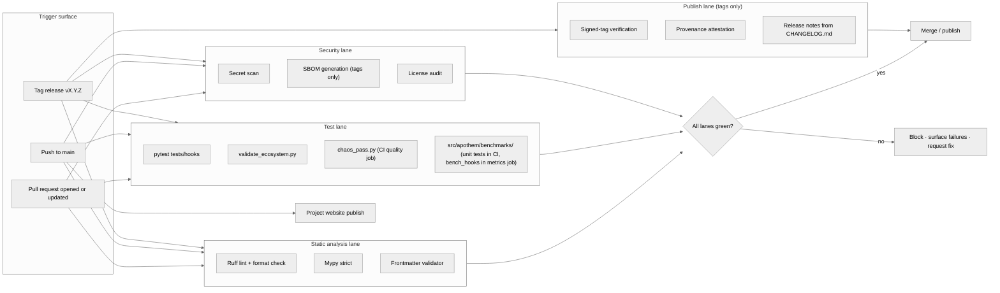

{/* SPDX-License-Identifier: MIT */}

**Peta struktural alur kerja build · validasi · publikasi yang mengawal setiap perubahan pada ekosistem Apothem.** Dokumen ini memasang permukaan visualisasi. Berkas alur kerja GitHub Actions yang dijelaskannya berada di `.github/workflows/` (misalnya `ci.yml` dan `release.yml`), dan perkakas rilis berada di `scripts/release/`.

## Bentuk pipeline

## Peran jalur

- **Jalur analisis statis** — umpan balik cepat. Ruff mencakup gaya Python dan satu set aturan yang dikurasi; mypy menegakkan disiplin tipe pada tingkat strict; validator frontmatter mengawal kepatuhan skema artefak untuk aturan, skill, pekerja terdelegasi, dan command. markdownlint tidak termasuk dalam jalur ini: ia hanya berjalan sebagai hook pre-commit, dan CI tidak menjalankannya (lihat [Konvensi Markdown](/docs/reference/markdown-conventions)).
- **Jalur uji** — `pytest tests/hooks` menjalankan runtime hook terhadap matriks peristiwa lengkap; `validate_ecosystem.py` adalah gerbang struktural utama untuk konsistensi lintas-artefak; `chaos_pass.py` berjalan di job kualitas CI pada push dan pull request ke `main` (difilter menurut jalur) untuk menangkap degradasi di bawah masukan yang terdegradasi. Driver benchmark per-kelas di bawah `src/apothem/benchmarks/` berjalan di CI melalui suite pytest dan melalui job `metrics`. Setiap eksekusi pytest penuh di CI mengumpulkan `tests/unit/test_benchmarks.py`, yang memanggil setiap driver kecuali `bench_install.py`. Job `metrics` menjalankan `scripts/dev/collect_metrics.py`, yang menjalankan `bench_hooks.py --json` dan mencatat hasilnya sebagai `hook_e2e_ms`. `bench_tests.py` dan `bench_install.py` hanya mengukur eksekusi nyata di bawah `make benchmarks`. Tidak ada workflow yang menjalankan `make benchmarks`.
- **Jalur keamanan** — gitleaks di `ci.yml` menangkap kredensial yang tidak sengaja di-commit. Audit lisensi (`license-audit.yml`) gagal ketika sebuah dependensi memiliki lisensi di luar daftar izinnya. Audit ini berjalan mingguan dan ketika berkas dependensi atau lisensi berubah. `release.yml` menghasilkan SBOM untuk setiap rilis yang diberi tag.
- **Jalur publikasi** — workflow rilis dipicu oleh push tag; penerbit npm dan VS Code juga dapat dijalankan ulang melalui dispatch manual untuk tag yang sudah ada. Verifikasi tag yang ditandatangani memastikan asal-usul cabang rilis; catatan rilis berasal dari format Keep-A-Changelog `CHANGELOG.md`. Situs web proyek dipublikasikan dari `site/dist/` ke target GitHub Pages pada push ke `main` yang menyentuh masukan build-nya, atau melalui dispatch manual.

## Konfigurasi konkret

Berkas alur kerja yang sebenarnya (`.github/workflows/ci.yml`,
`.github/workflows/release.yml`, dst.) ada di dalam repositori. Diagram ini
mendefinisikan bentuk kanonik yang dicerminkan oleh setiap konfigurasi mendatang.

## Referensi silang otoritatif

- `pyproject.toml` — sumber kebenaran konfigurasi Ruff / mypy / pytest.
- `scripts/dev/validate_ecosystem.py` — gerbang lintas-artefak utama.
- `scripts/dev/validate_hooks.py` — validasi struktural khusus hook.
- `scripts/dev/chaos_pass.py` — sapuan adversarial pada setiap hook yang dikonfigurasi.
- `src/apothem/benchmarks/` — verifikator anggaran runtime per-kelas.
- `site/content/docs/developer-guide.mdx` — alur kerja kontributor yang berorientasi operator.
- `CHANGELOG.md` — sumber catatan rilis.
