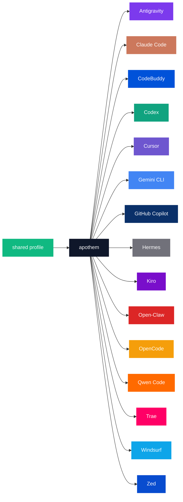

{/* SPDX-License-Identifier: MIT */}

Enumerasi kanonik nama merek × kode warna di bawah ini dibungkus dalam fence `text` untuk mempertahankan pengidentifikasi per harness secara verbatim, sebagaimana dibutuhkan oleh tujuan katalog palet ini.

## Inti Apothem

| Token | Terang | Gelap | Penggunaan |
|---|---|---|---|
| `apothem-hub` | `#0F172A` | `#F1F5F9` | Simpul distribusi pusat ("apothem") di setiap diagram arsitektur. |
| `shared-profile` | `#10B981` | `#34D399` | Profil sumber kebenaran yang memasok inti apothem. |

## Palet harness

Lima belas dari tujuh belas harness diberi warna yang sesuai dengan identitas
merek utamanya, sehingga pembaca dapat membedakan alat-alat tersebut dalam
sebuah diagram. Tanda Apothem sendiri hanya menggunakan warna slate dan emerald
pada halaman [palet](/docs/brand/palette); tanda tersebut tidak membawa warna
harness apa pun. Dua sisanya — `glm` dan `kimi-code` — belum memiliki warna merek
yang ditetapkan; baris keduanya ditambahkan setelah warna merek di hulu
ditetapkan, sesuai langkah propagasi di bawah [Pembaruan](#pembaruan).

```text
| Token             | Light     | Dark      | Source                                                                                                                                              |
|-------------------|-----------|-----------|-----------------------------------------------------------------------------------------------------------------------------------------------------|
| `antigravity`     | `#7C3AED` | `#9F67FF` | Google Antigravity deep-purple.                                                                                                                     |
| `claude-code`     | `#CC785C` | `#E89378` | Anthropic terracotta-orange.                                                                                                                        |
| `codebuddy`       | `#0052D9` | `#5E8EF7` | Tencent CodeBuddy blue.                                                                                                                             |
| `codex`           | `#10A37F` | `#19C796` | OpenAI signature teal.                                                                                                                              |
| `cursor`          | `#6E56CF` | `#9B85E3` | Cursor brand purple.                                                                                                                                |
| `gemini-cli`      | `#4285F4` | `#6BA4F7` | Google blue.                                                                                                                                        |
| `github-copilot`  | `#0A3069` | `#5B8FE3` | GitHub Mona deep-blue.                                                                                                                              |
| `hermes`          | `#71717A` | `#A1A1AA` | Community silver-grey.                                                                                                                              |
| `kiro`            | `#790ECB` | `#A862DD` | Kiro violet.                                                                                                                                        |
| `open-claw`       | `#DC2626` | `#F87171` | Community red-orange.                                                                                                                               |
| `opencode`        | `#F59E0B` | `#FBBF24` | Community amber.                                                                                                                                    |
| `qwen-code`       | `#FF6A00` | `#FF8C40` | Alibaba Qwen orange.                                                                                                                                |
| `trae`            | `#FF0066` | `#FF599C` | ByteDance Trae magenta.                                                                                                                             |
| `windsurf`        | `#0EA5E9` | `#38BDF8` | Windsurf sky-blue.                                                                                                                                  |
| `zed`             | `#084CCF` | `#5E8BE0` | Zed Industries blue.                                                                                                                                |
```

## Merek dagang

Nama harness, nama produk, dan warna merek di halaman ini dan di seluruh situs
adalah milik pemiliknya dan merupakan merek dagang dari pemiliknya
masing-masing. Apothem menyebut sebuah alat hanya untuk menyatakan alat mana
yang dikonfigurasinya, dan menggunakan warna sebuah alat hanya untuk
membedakannya dalam diagram. Apothem adalah proyek independen; Apothem tidak
berafiliasi dengan, tidak disponsori oleh, dan tidak didukung oleh perusahaan
atau proyek mana pun di antara mereka, dan Apothem tidak menyertakan satu pun
logo mereka.

## Alasan penamaan

- **`apothem-hub`** — pusat geometris yang dibangkitkan oleh nama ini (apotema sebuah poligon beraturan mengarah ke dalam, menuju intinya).
- **`shared-profile`** — sumber di hulu, berbeda dari warna harness tunggal mana pun sehingga terbaca sebagai panah "masukan" di setiap diagram.
- **Token per harness** mencerminkan slug harness yang digunakan di seluruh basis kode (`harnesses/<slug>/`, kunci entry-point, argumen CLI `--harness <slug>`). Satu kata per konsep; string yang sama di mana-mana.

## Penggunaan Mermaid



## Aksesibilitas

Setiap token mode terang mempertahankan warna mereknya tanpa distorsi, sehingga delapan di antaranya berada di bawah kontras WCAG 2.2 AA terhadap teks putih (≥4.5 : 1). Token mode terang lainnya memenuhinya. Kedelapan token tersebut, beserta kontrasnya terhadap warna putih:

```text
shared-profile   2.54 : 1
claude-code      3.28 : 1
codex            3.20 : 1
gemini-cli       3.56 : 1
opencode         2.15 : 1
qwen-code        2.87 : 1
trae             3.86 : 1
windsurf         2.77 : 1
```

Kolom mode gelap diperuntukkan bagi latar belakang gelap, dan tidak ada satu pun tokennya yang mencapai 4.5 : 1 terhadap teks putih. Diagram yang membutuhkan kontras teks-pada-warna WCAG AA pada salah satu dari kedelapan isian itu HARUS menggunakan teks gelap (`#0F172A`, yang terukur 4.63 : 1 hingga 8.31 : 1 pada isian tersebut) sebagai ganti teks putih.

## Pembaruan

Palet diperbarui hanya ketika sebuah harness meratifikasi perubahan merek di hulu. Warna harness didefinisikan di halaman ini, bukan di `assets/design-tokens.css` atau `site/app/global.css`. Perubahan merek per harness merambat secara atomik di halaman ini dan di setiap master SVG terdampak di bawah `assets/src/`.
