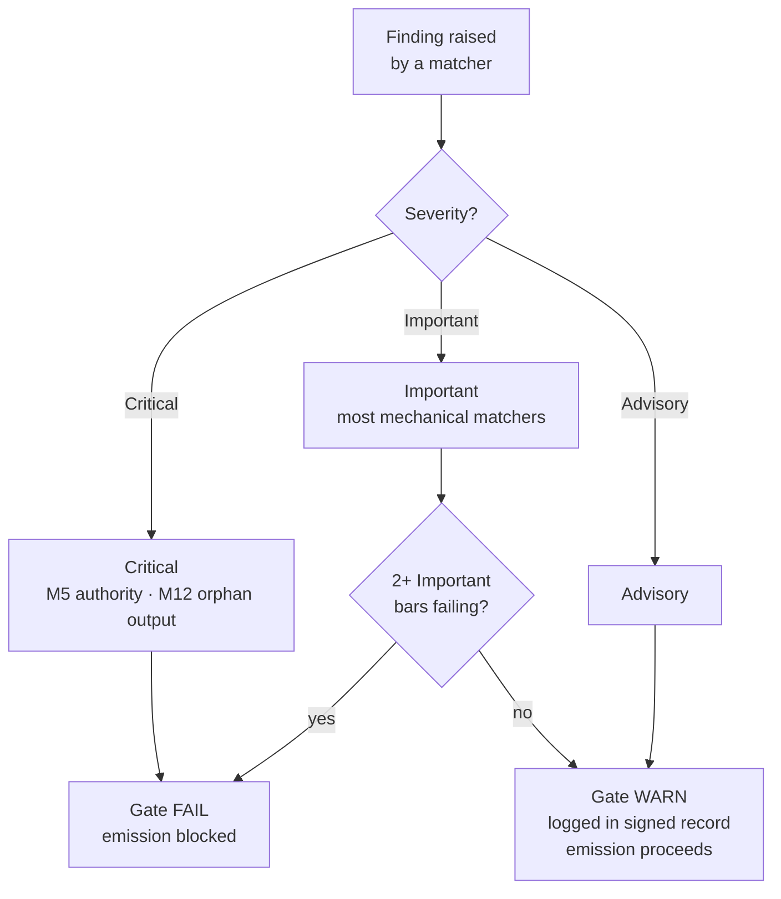

{/* SPDX-License-Identifier: MIT */}

## Lima belas bar

| Bar | ID | Mandat | Kelas pemeriksaan | Kegagalan → tindakan |
|---|---|---|---|---|
| 1 | M1 | Keagnostikan Proyek-Inang | Bernalar | Revisi agar sesuai dengan konvensi inang |
| 2 | M2 | Disiplin Editorial (buku besar pengungkapan) | Mekanis | Tambahkan penanda pengungkapan |
| 3 | M3 | Sepuluh Dimensi Kualitas | Bernalar | Revisi pada dimensi yang gagal |
| 4 | M4 | Penerapan-Diri (catatan bertanda tangan gerbang ada) | Mekanis | Catat blok catatan bertanda tangan |
| 5 | M5 | Prinsip Otoritas (tanpa identitas / endpoint / rahasia yang dikarang) | Mekanis | Arahkan ke inkuiri |
| 6 | M6 | Penggabungan Keahlian (celah yang dimunculkan) | Bernalar | Munculkan celah; kutip penyempurnaan |
| 7 | M7 | Anotasi Opsi (penanda Recommended + alasan pendorong) | Mekanis | Anotasikan himpunan opsi |
| 8 | M8 | Ketegasan (tanpa pengelakan dalam prosa preskriptif) | Mekanis | Naikkan pengelakan menjadi kondisional |
| 9 | M9 | Daya Ungkit Visual (subjek struktural membawa diagram) | Bernalar | Buat / segarkan diagram |
| 10 | M10 | Pengikatan Dua Arah (penunjuk balik timbal balik tertutup) | Mekanis | Tutup separuh-tepi |
| 11 | M11 | Sprint Agile (Tujuan / Backlog / DoR / DoD / Review / Retrospektif) | Bernalar | Strukturkan ulang sebagai sprint |
| 12 | M12 | Pelaporan Fase & Tata Letak Kanonik | Mekanis | Buat ringkasan; pindahkan ke tata letak kanonik |
| 13 | M13 | Kriya Kode (lint / format / pemeriksaan tipe; angka ajaib; bare-except) | Mekanis | Terapkan aturan kriya kode per bahasa |
| 14 | M14 | Sistemisitas (mendeklarasikan hulu / hilir / sejawat / penegak) | Bernalar | Deklarasikan; indeks di registri |
| 15 | M15 | Siap Produksi (pengujian + dokumentasi + CHANGELOG + commit yang patuh + CI hijau + stabilitas semver) | Mekanis | Tambahkan permukaan yang hilang |

## Tangga tingkat keparahan

| Tingkat keparahan | Efek pada gerbang |
|---|---|
| **Kritis** | Gerbang FAIL — emisi diblokir tanpa syarat |
| **Penting** | Gerbang FAIL ketika 2+ bar Penting gagal secara bersamaan |
| **Anjuran** | Gerbang WARN — dicatat dalam catatan bertanda tangan; tidak memblokir emisi |

Sebagian besar pencocok bagian mekanis secara default bertingkat **Penting**. M5 (otoritas — rahasia, endpoint yang dikarang) dan M12 (keluaran yatim) bertingkat **Kritis**.



## Validator

Bagian mekanis berada di [`src/apothem/conformity/`](https://github.com/ahmed-g-gad/apothem/tree/main/src/apothem/conformity), diorkestrasi oleh [`src/apothem/conformity/gate.py`](https://github.com/ahmed-g-gad/apothem/blob/main/src/apothem/conformity/gate.py).
Gerbang menjalankan setiap validator dengan salah satu dari tiga cara:

- **per-write**: pada setiap penulisan yang tertunda (`--hook`), atau pada setiap berkas yang dilacak dengan `--all-perwrite`.
- **standalone**: di seluruh repositori dengan `--all`, atau satu per satu dengan `--check <name>`.
- **change-set**: terhadap diff yang di-stage, di luar sapuan gerbang.

Tabel di bawah ini dihasilkan dari modul-modul validator.

{/* apothem:generated-reference:start */}

The conformity package ships 53 validators: 22 per-write, 30 standalone and 1 change-set. The gate registers the per-write and standalone ones.

| Validator | Runs | Rule anchor | What it checks |
| --- | --- | --- | --- |
| `agent-capability-grep` | standalone | agent-capability-discipline (per-harness capability matrix) | Verify every harness declares its agentic-capability matrix. |
| `agents-md-coverage-grep` | standalone | rules/agents-md-convention.md | Flag stale agent-companion files under the root-only AGENTS.md convention. |
| `agnosticism-grep` | standalone | rules/agnostic-posture.md §3 (harness neutrality) + §1 (default-off) | Flag harness bias and re-introduced enforcement presets in shipped surfaces. |
| `always-on-budget-grep` | per-write | D1 token-budget-discipline §Always-on body budget | Body-budget conformity matcher for always-on rules. |
| `bare-except-grep` | per-write | M13.3 error handling | Flag bare except clauses without typed exceptions or re-raise. |
| `binding-five-direction-grep` | standalone | M10 bidirectional-binding §1 (five-direction Bindings section) | Require the five-direction Bindings section on every rule, command, agent, and skill. |
| `binding-reciprocity-corpus-grep` | standalone | M10 bidirectional-binding §2 (↔ self-reciprocal) | Cross-file binding-reciprocity corpus walk — the ↔-symmetric half-edge check. |
| `binding-reciprocity-grep` | per-write | M10 bidirectional-binding §Notation | Flag binding declarations using non-canonical arrow notation. |
| `brand-mark-grep` | per-write | rules/plain-language.md (brand-mark display/identifier casing) | Flag brand-mark display/identifier form drift on brand-touched surfaces. |
| `commented-out-code-grep` | per-write | M13.1 why-not-what comments | Flag substantial commented-out code blocks left in source. |
| `completion-claim-grep` | per-write | rules/session-closure.md (verifiable-close output honesty) | Flag unsupported completion / guarantee claims in cohort prose. |
| `conventional-commit-grep` | standalone | CLAUDE.md Coding Conventions — Conventional Commits | Flag HEAD commit messages that drift from the Conventional-Commits grammar. |
| `copilot-instructions-presence-grep` | per-write | — | GitHub Copilot surface presence check. |
| `cross-platform-matrix-grep` | standalone | cross-platform OS x Python CI matrix | Verify CI declares a cross-platform OS x Python matrix. |
| `determinism-grep` | standalone | rules/determinism.md | Prove every command and skill surface has a deterministic output shape. |
| `diagram-staleness-grep` | per-write | M9 visual-leverage §Fidelity | Flag diagrams whose verification date is missing or stale. |
| `dynamism-grep` | standalone | rules/dynamism.md (static-version embeds) | Flag static-string version embeds in dynamism-required surfaces. |
| `editorconfig-presence-grep` | standalone | supply-chain SOTA-rigor §editorconfig | Verify a canonical .editorconfig is present at the project root. |
| `file-header-grep` | per-write | — | Authorship-header presence and canonical-form check. |
| `freshness-token-grep` | standalone | rules/freshness-facade.md | Flag freshness-narrative phrases on shipped public surfaces. |
| `frontmatter-grep` | per-write | the per-class frontmatter JSON Schemas (src/apothem/schemas/) | Validate per-artifact-class YAML frontmatter against required-key sets. |
| `frontmatter-value-grep` | standalone | per-class JSON Schema enum/pattern value constraints | Validate frontmatter VALUES against the per-class JSON Schema enum/pattern constraints. |
| `gitattributes-presence-grep` | standalone | supply-chain .gitattributes contract | Verify the repo-root ``.gitattributes`` carries the canonical contract. |
| `harden-runner-grep` | standalone | harden-runner egress baseline | Verify every workflow job opens with a conformant harden-runner step. |
| `hedging-grep` | per-write | M8 definitiveness §Hedging | Flag hedging vocabulary in prescriptive contexts. |
| `license-author-consistency-grep` | per-write | — | LICENSE author-identity presence check. |
| `link-check` | per-write | rules/code-craft-markdown.md §6 Link Discipline | Validate Markdown internal links against the on-disk reference graph. |
| `magic-number-grep` | per-write | M13.10 magic numbers | Flag magic numbers in source code. |
| `multi-surface-coherence-grep` | per-write | — | Shared-claim coherence across AI-conventions surfaces. |
| `naming-grep` | standalone | CLAUDE.md Coding Conventions (kebab-case naming) | Validate filesystem paths against the canonical naming convention. |
| `no-global-plans-grep` | standalone | CLAUDE.md Plans Discipline (no global plans) | Walk the git index for tracked plans paths; fail when found. |
| `no-toplevel-docs-grep` | standalone | single-source-of-truth (docs live in site/, not root docs/) | Fail when a top-level ``docs/`` directory exists at the repository root. |
| `oidc-trusted-publishing-grep` | standalone | OIDC trusted publishing | Verify release workflows use OIDC trusted publishing. |
| `option-annotation-grep` | per-write | M7 option-annotation (H6 per-option bind) | Enforce the per-option Recommended label-to-body bind (H6). |
| `orphan-output-grep` | per-write | M12 canonical-layout + M14 systemicity | Flag artifacts emitted to non-canonical locations or without provenance. |
| `permissions-minimum-scope-grep` | standalone | minimum-scope workflow permissions | Verify every GitHub Actions workflow declares a minimum-scope ``permissions:`` block. |
| `plain-language-grep` | standalone | rules/plain-language.md — user-facing prose | Flag mechanistic / harness-internal vocabulary in user-facing prose. |
| `plan-next-step-consistency-grep` | standalone | rules/recommend-next-step.md | Advisory: flag plan-suite infra files whose Recommended-Next-Step footer drifts from the suite's recorded next pipeline stage. |
| `plan-suite-structure-grep` | standalone | context-management-scratch 2 (suite-locality + closed vocab) + canonical-layout-reporting-tiers 2.1 (numeric-prefix discipline) | Validate plan-suite structure: suite-locality, closed vocab, numeric prefix. |
| `plans-discipline-language-grep` | standalone | CLAUDE.md Plans Discipline (multi-surface language) | Verify the canonical Plans Discipline language reaches every required surface. |
| `production-ready-pr-grep` | per-write | M15 production-ready §Same-change-set | Flag commits whose change-set lacks the production-ready four-class shape. |
| `recommend-next-step-grep` | standalone | rules/recommend-next-step.md | Verify every command file carries a `## Recommended Next Step` block. |
| `redundancy-grep` | standalone | rules/operational-mandates.md §CM-7 coherent-product non-redundancy | Flag substantively-duplicated paragraphs across the governed corpus. |
| `reference-token-grep` | standalone | rules/own-voice-reimplementation.md | Flag leaked reference-platform branding tokens on authored surfaces. |
| `registry-capability-consistency-grep` | standalone | rules/agent-capability-discipline.md — registry capability cells backed by evidence | Flag registry capability cells not backed by install / materializer / projection evidence. |
| `secret-leak-grep` | per-write | M13.8 security + M15 production-ready | Block emission of artifacts containing hardcoded credentials. |
| `semver-stability-grep` | change-set | M15 semver-stability | Semver stability matcher (M15 mechanical fraction). |
| `smoke-install-grep` | standalone | production-ready section 8.1 paired install scripts | Smoke-test the paired install scripts at the repository root. |
| `static-version-grep` | standalone | rules/dynamism.md §static-version-resolution | Verify version-bearing sites resolve dynamically, not as static literals. |
| `token-efficiency-grep` | per-write | clean-room-generation §5 + token-efficiency-rewrite | Flag filler phrases, throat-clearing openers, and content-free qualifiers. |
| `unpinned-action-grep` | per-write | M15 production-ready §Supply-chain | Flag GitHub Actions workflows that pin actions to mutable refs. |
| `user-confirm-grep` | per-write | M5 authority-inquiry §10 | Block emission of artifacts containing unresolved authority placeholders. |
| `workflow-concurrency-grep` | standalone | workflow concurrency + per-job timeouts | Enforce concurrency + per-job timeout discipline on GitHub workflows. |

{/* apothem:generated-reference:end */}

## Menjalankan gerbang

Pada harness yang terpasang, gerbang berjalan secara otomatis: `settings.json`
milik Claude Code merangkainya sebagai hook `PreToolUse` yang memanggil salinan
termaterialisasi di `~/.claude/.apothem/support/conformity/gate.py` sebelum
setiap Write/Edit. Dari checkout sumber, bentuk modul menjalankan kode yang
sama. Gerbang bersifat anjuran secara default: gerbang melaporkan temuan dan
keluar dengan `0`. Tambahkan `--strict` untuk keluar dengan `2` pada temuan yang
memblokir. Nama validator yang tidak dikenal keluar dengan `3`.

```shell
# Every standalone validator across the repository:
python -m apothem.conformity.gate --all .

# The same sweep, failing on a blocking finding (the CI form):
python -m apothem.conformity.gate --all --strict .

# Every per-write validator against every tracked file:
python -m apothem.conformity.gate --all-perwrite .

# One validator by name (names come from --list):
python -m apothem.conformity.gate --check naming-grep .

# List every registered validator as JSON:
python -m apothem.conformity.gate --list

# Single-file dispatch (mimics the PreToolUse hook):
echo '{"tool_input": {"file_path": "path/to/file", "content": "..."}}' \
    | python -m apothem.conformity.gate --hook
```

`python -m apothem.conformity.gate --help` mencetak ringkasan penggunaan.
Lihat [Menjalankan gerbang konformitas](/docs/usage/conformity-gate) untuk prosedur lengkapnya.

## Referensi

- [Registri gerbang pra-emisi](/docs/governance/pre-emission-gate-registry) — definisi bar kanonik
- [Registri konformitas ke luar](/docs/governance/outward-conformity-registry) — semantik terperinci M1-M15
- [Mandat lintas-bidang](/docs/governance/cross-cutting-mandates) — sumber kebenaran mandat
- [Disiplin kinerja](https://github.com/ahmed-g-gad/apothem/blob/main/src/apothem/rules/performance-discipline.md) — anggaran runtime per kelas
