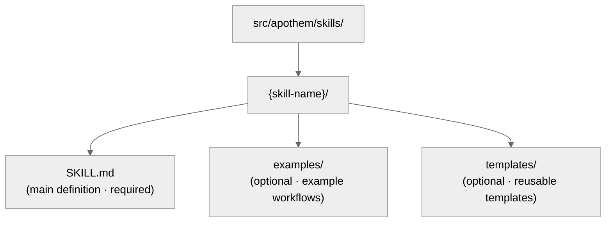

{/* SPDX-License-Identifier: MIT */}

Panduan ini membantu pengembang memelihara dan memperluas ekosistem Apothem
dengan standar kualitas SOTA.

## Rujukan Cepat: Jenis Artefak

Panduan ini mencakup lima jenis artefak, masing-masing dengan tujuan yang
spesifik. Aturan, command, helper, dan skill membawa frontmatter YAML; hook
didaftarkan di `hooks.json` dan `settings.json` dan tidak membawa frontmatter.
Output-style adalah kelas artefak tambahan dengan dua kunci frontmatter wajib,
`name` dan `description`; lihat [Skema Frontmatter](/docs/reference/frontmatter-schema).

| Artefak | Jalur | Tujuan | Kapan Dibuat |
| -------- | ---- | ------- | -------------- |
| **Aturan** | `src/apothem/rules/*.md` | Mandat perilaku atau direktif operasional | Prinsip, kebijakan, atau mandat tata kelola baru ditetapkan |
| **Command** | `src/apothem/commands/*.md` | Slash command (`/command-name`) untuk alur kerja yang kompleks | Alur kerja pengguna multi-langkah yang baru |
| **Helper** | `src/apothem/agents/*.md` | Definisi pekerja terdelegasi persisten untuk tugas paralel | Tugas khusus berulang yang baru (audit, eksplorasi, pemeriksaan kualitas) |
| **Skill** | `src/apothem/skills/{name}/SKILL.md` | Teknik yang dapat dipakai ulang dengan sinyal deteksi | Pola teknik baru yang dapat dideteksi dan dapat dipakai ulang |
| **Hook** | `src/apothem/hooks/` + `hooks.json` + `settings.json` | Validasi atau pengelolaan state yang dipicu peristiwa | Peristiwa siklus hidup atau kebutuhan validasi baru |

## Kontrak Adapter Harness

Fakta identitas dan kapabilitas harness berada di
`src/apothem/lib/harness_registry.py`. Sebuah perubahan harness selesai hanya
ketika permukaan-permukaan berikut selaras:

| Permukaan | Pembaruan yang diperlukan |
| --- | --- |
| Baris registri | ID publik, kunci paket, entry point, cakupan, format keluaran, jalur target, jalur dokumentasi, berkas kapabilitas, pin standar, pengujian fixture, kunci package-data, sumber templat, dan status kapabilitas. |
| Paket adapter | `__init__.py`, `install.py`, `update.py`, `uninstall.py`, `verify.py`; tambahkan `materializer.py` hanya ketika harness merender berkas konfigurasi native. |
| Manifest propagasi | Jalur templat dan kohor untuk adapter yang didukung manifest. |
| Kapabilitas | `src/apothem/harnesses/<package>/capabilities.yml` dengan setiap kapabilitas yang diwajibkan dan alasan untuk status tidak didukung atau menunggu penemuan, ditambah peta `conversion_losses` untuk setiap kohor command, agen, atau aturan yang dikonversi (lihat [registri harness](/docs/reference/harness-registry)). |
| Pin konvensi | `STANDARD-CONVENTION-PIN.md` dengan URL vendor, tanggal snapshot, nama berkas/skema kanonis, rujukan bukti, dan alasan untuk kapabilitas yang tidak didukung. |
| Pengujian | Paritas registri, pengujian fixture adapter, baris install-plan golden, perilaku dry-run/tanpa penulisan, idempotensi, dan cakupan package-data. |
| Dokumentasi | Halaman rujukan harness, halaman perbandingan, catatan kapabilitas/MCP, dan contoh yang menggunakan placeholder palsu. |

Adapter bercakupan proyek harus menyetel `requires_project = True`, menerima
`project: Path | None` pada metode siklus hidup, dan menolak akar proyek yang
hilang atau tidak aman sebelum penulisan. Adapter bercakupan pengguna harus
menjaga jalur tetap berada di bawah akar konfigurasi pengguna yang
terdokumentasi milik harness.

## Kebijakan Fixture Golden

`tests/fixtures/harness-golden-plans.json` mencatat bentuk install-plan publik
untuk seluruh tujuh belas harness registri: ID publik, mode materialisasi, jalur
kohor/templat sumber, dan jalur target ternormalisasi di bawah `<ROOT>`. Ketika
perilaku target registri, manifest, atau templat berubah secara sengaja,
perbarui fixture golden dalam commit yang sama dengan perubahan sumber agar diff
menunjukkan delta perilakunya.

## Validasi Sebelum Penulisan

Driver pemasangan bersama memvalidasi setiap sumber dan target sebelum
penulisan pertama. Driver ini menolak sumber manifest yang hilang, traversal
target, jalur target di luar akar yang dipilih, dan penyeberangan symlink.
Dry-run menjalankan validasi yang sama dan mengembalikan hasil `skipped` atau
`unchanged` yang terstruktur tanpa membuat berkas.

## Redaksi dan Data Contoh

Diagnostik profil meredaksi bidang token, rahasia, kata sandi, kredensial,
kunci API, kunci privat, otorisasi, auth, dan bidang berbentuk header.
Dokumentasi, fixture, contoh, dan cuplikan JSON menggunakan `example.invalid`,
`Example User`, `example-user`, dan placeholder yang jelas, bukan rahasia atau
akun pribadi yang tampak nyata.

## Sebelum Anda Menulis: Skema Kanonis

**Kontrak yang dapat dibaca mesin dan ditegakkan oleh gerbang adalah JSON Schema
per kelas di bawah `src/apothem/schemas/*.schema.json` — `additionalProperties`
menolak kunci yang tidak dikenal, sehingga gerbang konformitas memegang
keputusan akhir.** Dua proyeksi yang dapat dibaca manusia mengikutinya:
`site/content/docs/reference/frontmatter-schema.mdx` (indeks kunci wajib) dan
`site/content/docs/reference/artifact-schema.mdx` (templat per kelas dan contoh
terapan). Ketika sebuah halaman bertentangan dengan JSON Schema, skemanya yang
berlaku.

- Baca JSON Schema untuk jenis artefak Anda di bawah `src/apothem/schemas/`
- Baca `site/content/docs/reference/artifact-schema.mdx` § "Schema" untuk
  templat dan contoh terapan
- Salin bidang yang diwajibkan, isi nilai wajib, tambahkan bidang opsional sesuai kebutuhan

## Pemeriksaan Cepat Frontmatter

Setiap frontmatter artefak harus lolos pemeriksaan berikut. Terapkan pemeriksaan
`version`, `updated`, dan `portability` hanya pada kelas yang membawa kuncinya:
aturan tidak membawa satu pun dari ketiganya, dan skill tidak membawa
`portability`.

```yaml
✓ Valid YAML syntax (use tools: `yamllint` or PowerShell `ConvertFrom-Yaml` where available)
✓ All mandatory fields present (per schema for artifact type)
✓ name: uses kebab-case
✓ version: semantic MAJOR.MINOR.PATCH
✓ updated: ISO 8601 date (YYYY-MM-DD)
✓ description: single-line, non-empty
✓ scope fields valid per artifact type (rules: pathFilter + alwaysApply; CLAUDE.md root: scope)
✓ portability: string, for example `universal` (the schemas do not enumerate its values)
✓ No typos in field names — must match canonical schema exactly
✓ Optional fields use correct enum values
```

## Konvensi Penamaan

### Nama Artefak (kebab-case)

- **Aturan:** `operational-mandates`, `clean-room-generation`, `context-management`
- **Command:** `plan-execute`, `plan-spec`, `plan-generate`
- **Helper:** `codebase-explorer`, `convention-auditor`, `quality-gate`
- **Skill:** `plan-suite`, `ecosystem-audit`

Pola: huruf kecil, tanda hubung di antara kata, tanpa spasi atau garis bawah.

### Penamaan Berkas

- **Aturan:** `{name}.md`
- **Command:** `{name}.md`
- **Helper:** `{name}.md`
- **Skill:** Di dalam folder `src/apothem/skills/{name}/SKILL.md` (huruf besar-kecil persis: `SKILL.md`)
- **Hook:** Di dalam folder `src/apothem/hooks/`. Semua penangan peristiwa ditulis
  dengan Python. Setiap command hook dalam templat `settings.json` Claude Code
  menggunakan bentuk exec: `command` adalah placeholder interpreter
  `${PYTHON_BIN}`, yang di-resolve saat pemasangan, dan `args` berisi jalur
  skrip beserta argumennya. Templat tersebut menjalankan
  `${HARNESS_ROOT}/.apothem/support/hooks/dispatch.py <event> [<message-name>]` dan
  `${HARNESS_ROOT}/.apothem/support/conformity/gate.py --hook` dengan jalur
  absolut, sehingga salinan yang terpasang tidak memerlukan paket `apothem`
  yang dapat diimpor. Plugin Claude Code mendaftarkan hook di
  `src/apothem/hooks/hooks.json` sebagai gantinya, berupa command shell yang
  menjalankan `hooks/lib/bootstrap.sh` melalui `bash`; stub itu menemukan Python
  dan menjalankan `dispatch.py`, sehingga penangan tetap berupa Python. Daftarkan
  hook baru di `hooks.json` dan di templat `settings.json` Claude Code.
  `dispatch.py` merutekan `SessionStart` ke
  `session_start_bootstrap.main()` dan
  setiap peristiwa lain yang masuk daftar izin ke `emit_hook_context.main()`.
  Satu-satunya stub shell yang diizinkan di bawah `src/apothem/hooks/` atau
  `scripts/` adalah enam berkas pelokasi dan bootstrap
  (`find-python.{ps1,sh}`, `find-pwsh.{ps1,sh}`, `bootstrap.{ps1,sh}`); berkas
  `.ps1` / `.sh` lain mana pun gagal dalam pemeriksaan higiene
  `scripts/dev/validate_hooks.py`.

### Rujukan Silang

Saat merujuk artefak lain, gunakan nama yang persis:

- Aturan: `"operational-mandates"` (nilai bidang name)
- Command: `/plan-execute` (dengan garis miring untuk dokumentasi bagi manusia; tanpa garis miring di dalam kode)
- Helper: `codebase-explorer` (nilai bidang name)
- Skill: `plan-suite` (nilai bidang name)

Jangan pernah menggunakan jalur berkas atau nama yang terpotong di dalam prosa.

## Portabilitas: Windows vs. Unix

Setiap command HARUS mendeklarasikan status portabilitasnya secara eksplisit
dalam bidang `portability`. Sebuah helper BOLEH mendeklarasikannya. Skill,
aturan, dan output-style tidak membawa bidang `portability`.

### Universal

- Bekerja secara identik di Windows, macOS, dan Linux
- Tanpa asumsi shell
- Jalur menggunakan garis miring maju (`/`)
- Tanpa jalur absolut yang di-hardcode
- Tanpa sintaks PowerShell khusus Windows

```yaml
portability: "universal"
```

### Universal dengan Peringatan Windows

- Universal di seluruh host POSIX; peringatan yang disebutkan berlaku pada varian platform Windows yang dideklarasikan di dalam konten
- Dokumentasikan peringatan tersebut secara eksplisit di dalam konten
- Contoh: "Symlink tidak didukung di Windows sebelum Win 10"

```yaml
portability: "universal-with-windows-caveats"
```

Dokumentasikan peringatan tersebut dalam sebuah catatan tepat setelah judul.

### Khusus Unix / Khusus Windows

- Dibatasi secara eksplisit ke satu platform
- Jarang di Apothem — sebagian besar seharusnya universal
- Gunakan hanya jika fitur khusus platform bersifat esensial

```yaml
portability: "unix-only"
```

Dokumentasikan alasannya di bagian pertama artefak.

## Cakupan: Selalu Aktif vs. Difilter Jalur

### Selalu Aktif

Aturan berlaku di mana saja.

```yaml
pathFilter: ""
alwaysApply: true
```

### Difilter Jalur

Aturan berlaku secara kondisional berdasarkan jalur berkas.

```yaml
pathFilter: "**/*.py, **/*.toml"
alwaysApply: false
```

`pathFilter` menggunakan pola glob (format yang sama dengan `.gitignore`). Ketika
sebuah berkas cocok dengan filter tersebut, aturan menjadi aktif.

## Semantik Versi

Setiap artefak berversi membawa versi semantiknya sendiri (`MAJOR.MINOR.PATCH`).
Command dan skill mewajibkannya, helper dan output-style BOLEH membawanya, dan
aturan tidak membawanya:

- **PATCH** — perubahan perilaku yang memperbaiki direktif yang sudah ada tanpa merusak kontrak.
- **MINOR** — perubahan aditif yang tidak merusak: bagian opsional baru, bidang frontmatter opsional baru, contoh baru. Konsumen yang sudah ada tetap berfungsi tanpa perubahan.
- **MAJOR** — perubahan skema atau kontrak yang merusak: bagian yang dihapus, bidang yang diganti namanya, perilaku direktif yang sudah ada yang diubah, perubahan yang mengharuskan artefak hilir beradaptasi.

Perbaikan salah ketik, perbaikan tautan, pemformatan, serta suntingan yang hanya menyentuh komentar atau dokumentasi tidak mengubah versi. Hanya perubahan perilaku yang menaikkannya. Suntingan semacam itu tetap memperbarui tanggal `updated` artefak.

Contoh:

- `vX.Y.Z` → `vX.Y.(Z+1)` (PATCH: direktif yang diperbaiki sehingga perilakunya berubah)
- `vX.Y.Z` → `vX.Y.Z` (tanpa kenaikan: perbaikan salah ketik atau tautan; `updated` berubah)
- `vX.Y.Z` → `vX.(Y+1).0` (MINOR: menambahkan bagian opsional baru)
- `v0.Y.Z` → `v(0+1).0.0` (MAJOR: kontrak dinyatakan stabil; artefak baru dimulai pada `v0.Y.Z`)
- `vX.Y.Z` → `v(X+1).0.0` (MAJOR: menghapus bidang frontmatter wajib)

Naikkan `version` dan `updated` bersama-sama pada setiap suntingan yang mengubah
perilaku pada artefak yang membawa keduanya. Tambahkan baris yang sesuai ke
`CHANGELOG.md` tingkat ekosistem untuk rilis yang membundel perubahan artefak.

### Revisi suite rencana

Aturan artefak di atas tidak berlaku untuk suite rencana. Versi suite rencana adalah nilai `vX.Y.Z` yang tercatat di header `MASTER-PLAN.md` dan tabel Revision History-nya. Perbaikan salah ketik pada suite rencana merupakan revisi yang menaikkan nomor PATCH. Langkah 10.2 dari `/plan-review` menetapkan klasifikasi dan menambahkan baris Revision History.

- `vX.Y.Z` → `vX.Y.(Z+1)` (suite rencana, perbaikan salah ketik: PATCH)
- `vX.Y.Z` → `vX.Y.Z` (artefak, perbaikan salah ketik: tanpa kenaikan; aturan artefak di atas)

## Kapan Menyunting Artefak

### Aturan

- Perlakukan struktur Mandatory/Optional sebagai struktur penopang —
  merestrukturisasinya berdampak berantai ke setiap artefak yang bergantung
  padanya.
- Perhalus Anti-Patterns, contoh Seriousness Scaling, dan sitasi seiring
  pemahaman yang makin mendalam.
- Catat alasan setiap perubahan struktural di berkas topik memori yang
  relevan.

### Command

- Bentuk argumen adalah bagian dari kontrak publik — ubah secara tidak kompatibel
  hanya dengan niat yang eksplisit dan propagasikan perubahannya ke setiap
  pemanggil (kenaikan MAJOR).
- Jaga langkah alur kerja dan kontrak pengembalian tetap ringkas dan mutakhir.
- Dokumentasikan urutan langkah yang tidak jelas secara inline.

### Helper

- Jaga `disallowedTools` seminimal mungkin namun tetap memadai; dokumentasikan
  alasannya ketika daftar itu berubah.
- Perhalus Operating Principles dan Return Contracts seiring peran helper
  makin matang (kenaikan MINOR).
- Lacak pergeseran kapabilitas secara inline agar pemanggil dapat mengkalibrasi ulang ekspektasinya.

### Skill

- Jaga langkah Procedure dan Examples tetap selaras dengan kenyataan.
- Sinyal deteksi harus mencerminkan ungkapan pengguna yang sebenarnya dalam penggunaan saat ini.
- Pecah sebuah skill begitu panjangnya melewati ~150 baris (lihat
  `auto-memory.md` § Topic File Management).

## Langkah demi Langkah: Menambahkan Aturan Baru

### 1. Nilai Ortogonalitas

Apakah aturan ini tumpang tindih dengan aturan yang sudah ada? Cari konten terkait di `src/apothem/rules/`.

Jika tumpang tindihnya >50%, pertimbangkan untuk memperluas aturan yang sudah ada sebagai gantinya. Lihat
`persistent-conventions-vigilance.md` § Artifact Evolution.

### 2. Tulis Konten

Ikuti struktur berikut:

- Judul: `# Rule: {Title}`
- Bagian Purpose
- Obligations / Core directives (bernomor, tertaut)
- Tabel Seriousness Scaling (selalu diwajibkan)
- Bagian Anti-Patterns
- Bagian Enforcement

### 3. Buat Frontmatter

Gunakan skema dari `site/content/docs/reference/artifact-schema.mdx` § Schema: Rules. Setel:

- `name:` pengenal kebab-case
- `description:` ringkasan satu baris untuk registri
- `pathFilter:` daftar glob untuk aturan yang difilter jalur; string kosong (`""`) untuk aturan yang selalu aktif
- `alwaysApply:` `true` untuk aturan yang selalu aktif, `false` untuk aturan yang difilter jalur

Aturan hanya membawa keempat bidang ini — tanpa `version` / `updated` / `scope` / `portability` / `implements`.

Contoh:

```yaml
---
name: "my-new-rule"
description: "Brief one-liner"
pathFilter: ""
alwaysApply: true
---
```

### 4. Perbarui README Aturan

Tambahkan satu baris ke tabel untuk keluarga aturan tersebut di bagian Rule
families dalam `src/apothem/rules/README.md`:

```markdown
| `my-new-rule.md` | One-line concern of the new rule. |
```

Pilih tabel keluarga yang bidang perhatiannya sesuai dengan aturan tersebut.

### 5. Tambahkan ke CHANGELOG.md

Tambahkan sebuah baris di bawah bagian `### Added` rilis berikutnya yang menjelaskan aturan baru tersebut.

### 6. Jalankan Validasi

Panggil skill `ecosystem-audit` untuk memverifikasi aturan baru, dengan fokus pada area aturan:

```text
Invoke the ecosystem-audit skill with --focus rules --fix
```

Pastikan tidak ada kesalahan yang dilaporkan untuk aturan baru Anda.

## Langkah demi Langkah: Menambahkan Command Baru

Command adalah slash command seperti `/plan-spec`, `/plan-execute`, `/security-audit`, dan sebagainya.

### 1. Tentukan Peran

Command adalah alur kerja yang dipicu oleh pengguna. Model menjalankannya
sendiri hanya ketika setelan `disable-model-invocation` miliknya bernilai
`false` (langkah 2). Tanyakan:

- Apakah ini alur kerja yang dijalankan pengguna dengan mengetik `/command-name`?
- Apakah alur kerja ini mengorkestrasi beberapa langkah?
- Mungkinkah alur kerja ini mengalami timeout atau memerlukan masukan pengguna di tengah eksekusi?

Jika jawabannya "tidak" untuk salah satu pertanyaan ini, kemungkinan besar itu adalah skill, bukan command.

### 2. Buat Berkas

Jalur: `src/apothem/commands/{name}.md`

Frontmatter (dari `site/content/docs/reference/artifact-schema.mdx` § Schema: Commands):

```yaml
---
name: "my-command"
version: "X.Y.Z"
updated: "2026-04-20"
description: "What this command does"
argument-hint: "[path/to/input] [--flag VALUE]"
disable-model-invocation: true
portability: "universal"
allowed-tools: "Read, Glob, Grep"
---
```

`disable-model-invocation: true` membuat sebuah command hanya dapat dipanggil oleh
operator; dengan `false`, model dapat menjalankannya ketika sebuah permintaan cocok
dengan deskripsinya. Sebagian besar command menggunakan `true`, tetapi sebagian
besar tahap pipeline perencanaan dan riset menggunakan `false`. Tabel pemanggilan
di `src/apothem/commands/README.md` mencantumkan setelan setiap command;
tambahkan satu baris untuk command baru. Jaga
`allowed-tools` tetap hanya-baca: harness yang mematuhinya menjalankan alat-alat
tersebut tanpa bertanya. Berikan alat yang berefek samping hanya sebagai aturan
bercakupan, seperti `Bash(git log *)`; skema menolak `"*"` dan salah satu dari
`Bash`, `PowerShell`, `Write`, `Edit`, `NotebookEdit`, atau `WebFetch` yang
ditulis tanpa cakupan.

### 3. Tulis Konten

Struktur:

- Judul: `# /{name} — Human-Readable Title`
- Bagian Role (siapa yang mengeksekusi ini)
- Instruksi tingkat tinggi
- Bagian Workflow dengan langkah-langkah
- Kontrak pengembalian / format keluaran

### 4. Perbarui README dan CHANGELOG.md

Tambahkan satu baris ke tabel untuk bagian command tersebut di `src/apothem/commands/README.md`, selain baris tabel pemanggilan dari langkah 2; tambahkan satu baris CHANGELOG di bawah bagian `### Added` rilis berikutnya.

### 5. Validasi

Panggil skill `ecosystem-audit`, dengan fokus pada command:

```text
Invoke the ecosystem-audit skill with --focus commands --fix
```

## Langkah demi Langkah: Menambahkan Helper Baru

Helper adalah definisi pekerja terdelegasi persisten untuk pekerjaan paralel.

### 1. Identifikasi Pola

Apakah helper ini cocok dengan salah satu pola tim yang tercantum di bawah?

- Tim Riset: hanya-baca, pengumpulan informasi
- Tim Audit: verifikasi, pemeriksaan konsistensi
- Tim Implementasi: perubahan kode paralel
- Tim Kualitas: lint, pengujian, pemeriksaan tipe, keamanan
- Tim Dokumentasi: pembaruan dokumentasi
- Lainnya: tugas khusus

### 2. Buat Berkas

Jalur:

```text
src/apothem/agents/{name}.md
```

Frontmatter:

```yaml
---
name: "my-helper"
version: "X.Y.Z"
updated: "2026-04-20"
description: "What this helper specializes in"
tools: "Read, Glob, Grep, Bash"
disallowedTools: "Write, Edit"
maxTurns: 15
portability: "universal"
---
```

Hilangkan `model`, `effort`, dan `permissionMode` agar helper mewarisi pilihan
sesi (postur agnostik), dan hilangkan `memory` kecuali helper memerlukan cakupan
memori persisten (`user`, `project`, atau `local`).

### 3. Tulis Konten

Bagian:

- Operating Principles (hanya-baca, berbasis bukti, putusan biner, menyeluruh)
- Workflow (langkah-langkah bernomor)
- Return Contract (token maksimum, struktur, bidang wajib)

### 4. Perbarui README dan CHANGELOG.md

Tambahkan satu baris ke tabel Index di `src/apothem/agents/README.md`; tambahkan satu baris CHANGELOG di bawah bagian `### Added` rilis berikutnya.

### 5. Uji

Jalankan helper dalam skenario nyata dan verifikasi bahwa helper bekerja seperti yang didokumentasikan.

## Langkah demi Langkah: Menambahkan Skill Baru

Skill adalah teknik yang dapat dipakai ulang dan dapat dideteksi.

### 1. Identifikasi Keterpakaian Ulang

Sebelum menulis skill:

- Apakah Anda telah menemui masalah/teknik ini 3 kali atau lebih?
- Apakah teknik ini dapat dideteksi? (Apakah ada pola permintaan pengguna yang menandakannya?)
- Dapatkah Anda mengodifikasinya secara dapat direproduksi?

Jika jawaban ketiganya ya, tulis sebuah skill.

### 2. Buat Struktur



### 3. Tulis SKILL.md

Frontmatter:

```yaml
---
name: "skill-name"
version: "X.Y.Z"
updated: "2026-04-20"
description: "What this skill teaches"
archetype: "workflow-template"
userInvocable: true | false
disable-model-invocation: true | false
allowed-tools: "Read, Glob, Grep"
argument-hint: "[args]"               # optional; if userInvocable
---
```

Struktur konten:

- Purpose
- When to Use This Skill
- Prerequisites
- Step-by-Step Procedure
- Common Mistakes
- Examples

### 4. Perbarui README dan CHANGELOG.md

Tambahkan satu baris ke tabel Index dan satu baris untuk setiap berkas skill tersebut ke tabel Folder contents di `src/apothem/skills/README.md`; tambahkan satu baris CHANGELOG di bawah bagian `### Added` rilis berikutnya.

### 5. Validasi

Panggil skill `ecosystem-audit`, dengan fokus pada skill:

```text
Invoke the ecosystem-audit skill with --focus skills --fix
```

## Daftar Periksa Validasi Sebelum Commit

- [ ] Frontmatter lolos pemeriksaan sintaks YAML
- [ ] Semua bidang wajib ada sesuai skema
- [ ] Bidang `name` menggunakan kebab-case
- [ ] `version` (hanya kelas berversi; aturan tidak membawanya) bersifat semantik (`MAJOR.MINOR.PATCH`) dan telah dinaikkan jika perilaku berubah
- [ ] `updated` cocok dengan tanggal hari ini untuk setiap artefak yang Anda sentuh dan yang membawa bidang tersebut
- [ ] Bidang `portability` disetel dan valid (wajib pada command, opsional pada helper)
- [ ] CHANGELOG.md memuat perubahan dalam kategori yang sesuai di bawah bagian rilis berikutnya
- [ ] Tidak ada rujukan internal rencana (kepatuhan CM-7)
- [ ] Rujukan silang konsisten dengan artefak lain
- [ ] Artefak baru terdaftar di indeks README foldernya
- [ ] Artefak telah diuji (jika berlaku)
- [ ] Skill `ecosystem-audit` berjalan tanpa kesalahan
- [ ] Konten mengikuti konvensi struktural (format judul, bagian, dan sebagainya)

## Merujuk Artefak Lain

Gunakan konvensi persis berikut:

### Merujuk Aturan

```markdown
See `src/apothem/rules/operational-mandates.md` or shorthand: the Operational Mandates rule.
In prose: ... per CM-1–10 (Operational Mandates rule) ...
```

### Merujuk Command

```markdown
See `/plan-execute` command. Or: Run `/plan-execute`.
In prose: The `/plan-execute` command handles phase execution.
```

### Merujuk Helper

```markdown
Deploy the `codebase-explorer` delegated worker.
In prose: The codebase-explorer worker finds patterns.
```

### Merujuk Skill

```markdown
Use the `plan-suite` skill.
In prose: The plan-suite skill provides the Master Plan Suite template.
```

### Merujuk Bagian CLAUDE.md

```markdown
See CLAUDE.md § Harness Adapter Pattern.
Or: § Plans Discipline.
```

## Linting dan Format

Semua artefak menggunakan:

- **Markdown:** GFM (GitHub Flavored Markdown)
- **YAML:** sesuai YAML 1.2
- **Akhir baris:** LF (gaya Unix)
- **Pengodean:** UTF-8
- **Lebar baris:** Soft wrap pada 100 karakter untuk konten (tanpa hard break)

Gunakan formatter / linter `Ruff` untuk berkas Python. Untuk Markdown, gunakan
`prettier` atau alat yang setara.

## Pengujian dan Pengukuran

### Menjalankan suite

```bash
python -m pytest                      # unit, integration, property, conformity, scripts
python -m pytest tests/property       # Hypothesis properties (profile loader, frontmatter, merge)
```

Suite ini hermetis: suite lolos ketika checkout berada di bawah `$TMPDIR` dan
ketika `python` di `PATH` tidak memiliki prasyarat CLI, karena pengujian
integrasi menjalankan interpreter yang menjalankan pytest dan mentokenisasi jalur
sementara dan jalur sumber yang bersarang, dimulai dari yang terpanjang.

### Cakupan pengujian per paket

CI mengukur tiga paket dan menahan masing-masing pada batas bawahnya sendiri.
Tidak satu pun dari paket tersebut digabungkan ke paket lain.

| Paket | Jalur | Batas bawah | Lokasi batas bawah |
| --- | --- | --- | --- |
| engine | `cli`, `harnesses`, `lib`, `hooks`, `statuslines` | 80 | `[tool.coverage.report] fail_under` |
| conformity | `src/apothem/conformity` | 81 | `[tool.coverage.package-floors]` |
| audit | `src/apothem/audit` | 70 | `[tool.coverage.package-floors]` |

Angka tersebut adalah cakupan baris ditambah cabang, persentase yang sama yang
dilaporkan coverage.py dengan `branch = true`; artefak metrik juga mencatat angka
yang hanya menghitung pernyataan di bawah `coverage_lines`. Setiap batas bawah
paket adalah nilai baris ditambah cabang yang terukur, dibulatkan ke bawah.
Naikkan batas bawah ketika cakupan meningkat; jangan pernah menurunkannya agar
sebuah perubahan lolos. Untuk memeriksa secara lokal:

```bash
python -m pytest --cov=src/apothem --cov-report=json:coverage.json
python scripts/dev/collect_metrics.py --coverage-json coverage.json --check-floors \
  --skip-hooks --skip-coldstart --harness zed
```

### Artefak metrik

Job `metrics` di CI menjalankan `scripts/dev/collect_metrics.py` pada setiap push
dan pull request serta mengunggah `metrics.json` (`schema_version: 1`). Setiap
nilai yang `null` membawa alasannya di bawah `nulls`.

| Kunci | Yang diukur |
| --- | --- |
| `coverage.engine`, `coverage.conformity`, `coverage.audit` | Persentase baris ditambah cabang per paket, beserta `coverage_floors`. |
| `always_on_bytes[harness]`, `always_on_files[harness]` | Untuk masing-masing dari 17 harness, setelah `profile init` dan `install --harness <id>` ke dalam `HOME` dan proyek sementara: jumlah byte di disk dari berkas instruksi yang dimuat penuh oleh harness tersebut saat diluncurkan. |
| `cli_coldstart_ms` | Median dari `python -m apothem --version` (dengan `--help` di bawah `cli_coldstart_detail_ms`). |
| `hook_e2e_ms[event]`, `hook_injected_chars[event]` | Per peristiwa dan matcher yang terdaftar (`PreToolUse:Write`, `Stop`, …): median waktu total rantai hook pada payload nyata, dan jumlah karakter konteks yang disuntikkannya. |

Berkas mana yang dihitung sebagai dimuat saat peluncuran ditentukan oleh aturan
per harness yang diambil dari permukaan instruksi terdokumentasi milik setiap
vendor. Daftar yang hanya membawa deskripsi (skill, command, subagen) tidak
dihitung. Teks aturan tersebut juga ditulis ke dalam artefak di bawah
`rules.always_on_bytes`:

```text
antigravity     ~/.gemini/{GEMINI,AGENTS}.md, ~/.gemini/config/{GEMINI,AGENTS}.md,
                ~/.gemini/config/rules/*.md with trigger: always_on, project
                GEMINI.md and AGENTS.md. The plugin rules/ folder is not a
                documented launch surface.
claude-code     ~/.claude/CLAUDE.md and ~/.claude/rules/**/*.md without paths:
                frontmatter, plus the project equivalents.
codebuddy       .codebuddy/rules/**/*.md (project and home) unless
                alwaysApply: false, plus CODEBUDDY.md.
codex           ~/.codex/AGENTS.md and the project AGENTS.md.
cursor          .cursor/rules/**/*.mdc with alwaysApply: true, and AGENTS.md.
gemini-cli      ~/.gemini/GEMINI.md and the project GEMINI.md.
github-copilot  .github/copilot-instructions.md and the project AGENTS.md.
hermes          ~/.hermes/SOUL.md, project .hermes.md, AGENTS.md, CLAUDE.md.
                The support tree and apothem/rules/ are not launch surfaces.
kimi-code       ~/.kimi-code/AGENTS.md, project AGENTS.md and .kimi-code/AGENTS.md.
kiro            .kiro/steering/**/*.md with inclusion: always or no inclusion
                key, and the project AGENTS.md.
open-claw       Workspace bootstrap files ~/.openclaw/workspace/*.md.
opencode        ~/.config/opencode/AGENTS.md, the project AGENTS.md, and every
                file the instructions globs in opencode.json match.
qwen-code       The context files named by context.fileName in
                ~/.qwen/settings.json (default QWEN.md), in ~/.qwen/ and the project.
trae            .trae/rules/**/*.md with alwaysApply: true, and
                ~/.trae/user_rules/*.md.
windsurf        .devin/rules/**/*.md and .windsurf/rules/**/*.md with
                trigger: always_on, the global global_rules.md, and AGENTS.md.
zed             The first of .rules, .cursorrules, .windsurfrules, .clinerules,
                .github/copilot-instructions.md, AGENT.md, AGENTS.md, CLAUDE.md,
                GEMINI.md in the project, plus ~/.config/zed/AGENTS.md.
glm             Nothing: GLM is a model backend and loads no instruction files.
```

### Eval perilaku

Suite di bawah `evals/` mengukur perilaku, bukan bentuk: 64 kasus pemicu
(setiap command dan subagen yang dapat dipanggil model terpicu oleh permintaan
dalam domainnya dan tetap diam pada permintaan yang nyaris cocok), 32 kasus hasil
(satu per tahap rencana, tahap riset, dan dimensi audit) dan 6 pasangan efek
aturan (teks aturan yang selalu aktif dalam keadaan disertakan dan tidak
disertakan). Kasus-kasus tersebut adalah data biasa yang divalidasi tanpa biaya
oleh `python -m pytest tests/unit/test_eval_suite.py`; menjalankannya dikenai
biaya dan dilakukan secara manual. Lihat
[Menjalankan eval perilaku](/docs/how-to/evals) untuk alur kerja `Evals`,
eksekusi lokal, dan cara menambahkan kasus. Setelah menyunting aturan selalu
aktif yang memiliki pasangan, jalankan `python scripts/dev/sync_eval_rule_cases.py`.

### Benchmark

`make benchmarks` menjalankan driver per kelas di bawah `src/apothem/benchmarks/`,
kecuali `bench_agents.py`. Setiap driver keluar dengan `0` lolos, `1` melebihi
anggaran, `2` galat (eksekusi yang diukur tidak berjalan), atau `3` tidak diukur.

- `bench_hooks.py` menjalankan setiap command `shell: bash` yang didaftarkan oleh
  `hooks/hooks.json`, sebagaimana tertulis, pada payload nyata per peristiwa dan
  matcher, lalu melaporkan median waktu total, command yang paling lambat
  (diperiksa terhadap anggaran peristiwa tersebut), dan jumlah karakter yang
  disuntikkan. Command yang tidak dapat berjalan sebagaimana terdaftar (exit 126
  ketika sebuah skrip tidak memiliki bit eksekusinya) adalah galat, bukan lolos.
- `bench_agents.py` melaporkan `NOT MEASURED` (exit 3): spawn subagen memerlukan
  harness host dan pemanggilan model. `make benchmarks` tidak menjalankannya.

Pemeriksaan anggaran selalu aktif (`always-on-budget-grep`) menghitung kata yang
dipisahkan spasi dengan mengecualikan bagian Bindings dan baris penunjuk
pendamping. Laporan JSON-nya juga memuat `always-on-loaded`: jumlah byte,
karakter, dan kata dari isi tanpa frontmatter yang dimuat oleh sebuah harness,
dijumlahkan atas seluruh aturan selalu aktif.

## Audit Ekosistem: Menjalankan Validasi

Dua permukaan validasi yang saling melengkapi mencakup ekosistem:

**Dapat diperiksa mesin (validator Python)** — jalankan sebelum setiap commit:

```bash
python scripts/dev/validate_hooks.py       # Hook structure + Python-only hygiene
python scripts/dev/validate_ecosystem.py   # Full tree + frontmatter + delegated hook checks
python scripts/dev/chaos_pass.py           # Adversarial sweep across configured hooks
pytest tests                                    # Unit tests for the hook runtime
```

**Digerakkan asisten** — untuk audit rujukan silang, naratif, dan konvensi:

```bash
/ecosystem-audit --focus all --fix
```

Perintah ini menjalankan hal berikut secara paralel:

- **Audit struktur:** Akurasi registri, keberadaan berkas, validitas frontmatter
- **Audit artefak:** Rujukan silang, cakupan mandat, urutan pipeline
- **Audit memori:** Klaim berkas memori vs. keadaan sistem berkas

Keluaran yang diharapkan: `PASS` dengan nol temuan dari kedua permukaan.

Jika `FINDINGS` dilaporkan:

- Tinjau tingkat keparahan setiap temuan (Critical / Important / Advisory)
- Tangani butir Critical segera
- Rencanakan butir Important untuk siklus berikutnya
- Pertimbangkan butir Advisory untuk iterasi berikutnya

---

## Pertanyaan?

Lihat:

- Skema frontmatter: `site/content/docs/reference/artifact-schema.mdx`
- Siklus hidup artefak: `src/apothem/rules/persistent-conventions-vigilance.md` § Artifact Evolution
- Mandat operasional: `src/apothem/rules/operational-mandates.md` CM-1–10
- Rujukan suite rencana: `src/apothem/skills/plan-suite/master-template.md`
- Catatan rilis: `CHANGELOG.md`
