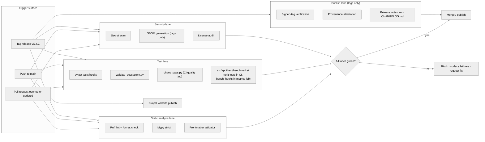

{/* SPDX-License-Identifier: MIT */}

**Apothem エコシステムへのあらゆる変更を門にかける、ビルド · 検証 · 公開ワークフローの構造マップです。** 本ドキュメントは可視化の表面を設置します。説明している GitHub Actions のワークフローファイルは `.github/workflows/` にあり（例：`ci.yml` と `release.yml`）、リリースツールは `scripts/release/` に置かれています。

## パイプラインの形

## レーンの役割

- **静的解析レーン** —— 高速なフィードバックです。Ruff は Python のスタイルと厳選されたルールセットを対象とします。mypy は strict モードで型の規律を強制します。frontmatter バリデーターは、ルール、スキル、委任されたワーカー、コマンドのアーティファクトスキーマへの準拠を門にかけます。markdownlint はこのレーンには含まれません。pre-commit フックとしてのみ実行され、CI では実行されません（[Markdown 規約](/docs/reference/markdown-conventions)を参照してください）。
- **テストレーン** —— `pytest tests/hooks` は、フックランタイムを完全なイベントマトリクスに対して実行します。`validate_ecosystem.py` は、アーティファクト横断の整合性に対する主要な構造ゲートです。`chaos_pass.py` は、`main` へのプッシュおよびプルリクエストに対して、CI の品質ジョブ内で（パスフィルター付きで）実行され、劣化した入力のもとでの品質低下を捕捉します。`src/apothem/benchmarks/` 配下のクラス別ベンチマークドライバーは、pytest スイートと `metrics` ジョブを通じて CI で実行されます。CI での pytest の各フル実行は、`bench_install.py` を除くすべてのドライバーを呼び出す `tests/unit/test_benchmarks.py` を収集します。`metrics` ジョブは `scripts/dev/collect_metrics.py` を実行します。このスクリプトは `bench_hooks.py --json` を実行し、結果を `hook_e2e_ms` として記録します。`bench_tests.py` と `bench_install.py` が実際の実行を計測するのは、`make benchmarks` の下だけです。`make benchmarks` を実行するワークフローはありません。
- **セキュリティレーン** —— `ci.yml` 内の gitleaks が、誤ってコミットされた認証情報を捕捉します。ライセンス監査（`license-audit.yml`）は、許可リストにない依存関係のライセンスを検出すると失敗します。毎週、および依存関係またはライセンスファイルが変更されたときに実行されます。REUSE ゲート（`reuse.yml`）はすべての変更で実行され、ファイルにライセンス行がない場合や SPDX 式を解析できない場合に失敗します。`release.yml` は、タグ付けされたリリースごとに SBOM を生成します。
- **公開レーン** —— リリースワークフローはタグのプッシュによって起動されます。npm と VS Code の公開処理は、既存のタグに対して手動ディスパッチで再実行することもできます。署名済みタグの検証は、リリースブランチの来歴を確認します。リリースノートは `CHANGELOG.md` の Keep-A-Changelog 形式から派生します。プロジェクトのウェブサイトは、そのビルド入力に変更を加えた `main` へのプッシュ時、または手動ディスパッチ時に、`site/dist/` から GitHub Pages のターゲットへ公開されます。

## 具体的な構成

実際のワークフローファイル（`.github/workflows/ci.yml`、
`.github/workflows/release.yml` など）はリポジトリにあります。この図は、今後のあらゆる構成が
反映する正規の形を定義します。

## 権威ある相互参照

- `pyproject.toml` —— Ruff / mypy / pytest 構成の真実の源。
- `scripts/dev/validate_ecosystem.py` —— 主要なアーティファクト横断ゲート。
- `scripts/dev/validate_hooks.py` —— フック固有の構造検証。
- `scripts/dev/chaos_pass.py` —— 構成された各フックへの敵対的スイープ。
- `src/apothem/benchmarks/` —— クラス別の実行時予算検証器。
- `site/content/docs/developer-guide.mdx` —— オペレーター向けの貢献者ワークフロー。
- `CHANGELOG.md` —— リリースノートの源。
