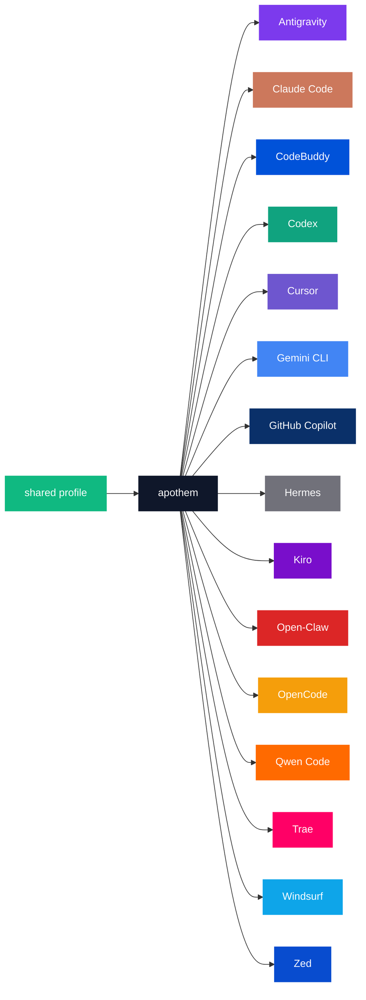

{/* SPDX-License-Identifier: MIT */}

以下の正規のブランド名 × カラーコードの列挙は、パレットのカタログという目的が必要とするハーネスごとの識別子を逐語的に保持するため、`text` フェンスで囲まれています。

## Apothem コア

| トークン | ライト | ダーク | 用途 |
|---|---|---|---|
| `apothem-hub` | `#0F172A` | `#F1F5F9` | すべてのアーキテクチャ図における中央の配布ノード（「apothem」）。 |
| `shared-profile` | `#10B981` | `#34D399` | apothem コアへ供給される、信頼できる情報源としてのプロファイル。 |

## ハーネスパレット

17 のハーネスのうち 15 は、読者が図の中でツールを見分けられるよう、それぞれの主要なブランドアイデンティティに合わせて着色されています。
Apothem のマーク自体は、[パレット](/docs/brand/palette)ページにあるスレートとエメラルドの色のみを使用し、ハーネスの色は含みません。
残りの 2 つ — `glm` と `kimi-code` — には、まだ定義されたブランドカラーがありません。それらの行は、[更新](#更新)にある伝播ステップに従い、上流のブランドカラーが設定された時点で追加されます。

```text
| Token             | Light     | Dark      | Source                                                                                                                                              |
|-------------------|-----------|-----------|-----------------------------------------------------------------------------------------------------------------------------------------------------|
| `antigravity`     | `#7C3AED` | `#9F67FF` | Google Antigravity deep-purple.                                                                                                                     |
| `claude-code`     | `#CC785C` | `#E89378` | Anthropic terracotta-orange.                                                                                                                        |
| `codebuddy`       | `#0052D9` | `#5E8EF7` | Tencent CodeBuddy blue.                                                                                                                             |
| `codex`           | `#10A37F` | `#19C796` | OpenAI signature teal.                                                                                                                              |
| `cursor`          | `#6E56CF` | `#9B85E3` | Cursor brand purple.                                                                                                                                |
| `gemini-cli`      | `#4285F4` | `#6BA4F7` | Google blue.                                                                                                                                        |
| `github-copilot`  | `#0A3069` | `#5B8FE3` | GitHub Mona deep-blue.                                                                                                                              |
| `hermes`          | `#71717A` | `#A1A1AA` | Community silver-grey.                                                                                                                              |
| `kiro`            | `#790ECB` | `#A862DD` | Kiro violet.                                                                                                                                        |
| `open-claw`       | `#DC2626` | `#F87171` | Community red-orange.                                                                                                                               |
| `opencode`        | `#F59E0B` | `#FBBF24` | Community amber.                                                                                                                                    |
| `qwen-code`       | `#FF6A00` | `#FF8C40` | Alibaba Qwen orange.                                                                                                                                |
| `trae`            | `#FF0066` | `#FF599C` | ByteDance Trae magenta.                                                                                                                             |
| `windsurf`        | `#0EA5E9` | `#38BDF8` | Windsurf sky-blue.                                                                                                                                  |
| `zed`             | `#084CCF` | `#5E8BE0` | Zed Industries blue.                                                                                                                                |
```

## 商標

このページおよびサイト全体に掲載されているハーネス名、製品名、ブランドカラーはそれぞれの所有者に帰属し、それぞれの所有者の商標です。
Apothem がツールの名前を挙げるのは、どのツールを設定するかを示すためだけであり、ツールの色を使うのは、図の中でそのツールを見分けるためだけです。
Apothem は独立したプロジェクトです。これらの企業やプロジェクトのいずれとも提携しておらず、いずれからも後援や推奨を受けておらず、それらのロゴを一切同梱していません。

## 命名の根拠

- **`apothem-hub`** — 名前が想起させる幾何学的な中心（正多角形の辺心距は、その中心へ向かって内向きに伸びます）。
- **`shared-profile`** — 上流のソースであり、どの単一のハーネスの色とも区別されるため、すべての図で「入力」の矢印として読み取れます。
- **ハーネスごとのトークン**は、コードベース全体で使用されるハーネスのスラッグ（`harnesses/<slug>/`、エントリーポイントのキー、CLI の `--harness <slug>` 引数）を反映します。1 つの概念に 1 つの語を使い、どこでも同じ文字列を使います。

## Mermaid での使用



## アクセシビリティ

各ライトモードトークンはブランドカラーを歪めずに保っているため、そのうち 8 つは、白色テキストに対する WCAG 2.2 AA のコントラスト（≥4.5 : 1）を下回ります。残りのライトモードトークンは、これを満たします。その 8 つと、白に対するコントラストは次のとおりです。

```text
shared-profile   2.54 : 1
claude-code      3.28 : 1
codex            3.20 : 1
gemini-cli       3.56 : 1
opencode         2.15 : 1
qwen-code        2.87 : 1
trae             3.86 : 1
windsurf         2.77 : 1
```

ダークモードの列はダーク背景向けであり、そのトークンはいずれも白色テキストに対して 4.5 : 1 に達しません。これら 8 つの塗りつぶしの上のテキストに WCAG AA のコントラストを必要とする図は、白の代わりに暗い色のテキスト（`#0F172A`。これらの上で 4.63 : 1 から 8.31 : 1 を示します）を使用しなければなりません（MUST）。

## 更新

パレットが更新されるのは、ハーネスが上流でブランド変更を正式に決定したときだけです。ハーネスの色は、`assets/design-tokens.css` や `site/app/global.css` ではなく、このページで定義されます。ハーネスごとのブランド変更は、このページと `assets/src/` 配下の影響を受けるすべての SVG マスターにわたって、アトミックに伝播します。
