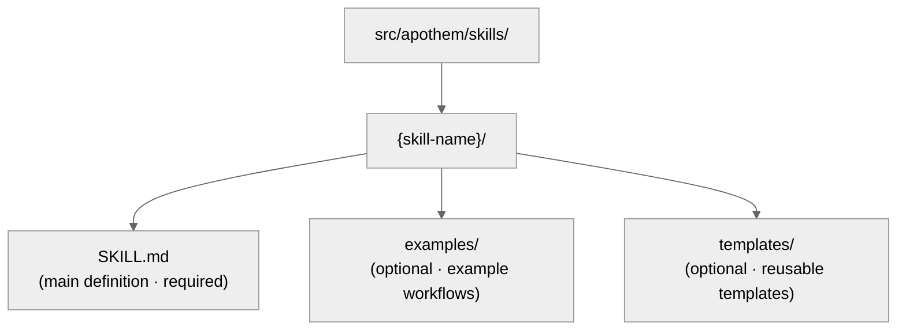

{/* SPDX-License-Identifier: MIT */}

このガイドは、開発者が SOTA の品質基準で Apothem エコシステムを保守・拡張するのを支援します。

## クイックリファレンス: アーティファクトの種類

Apothem エコシステムには 5 種類のアーティファクトがあり、それぞれに固有の目的とフロントマターの要件があります。

| アーティファクト | パス | 目的 | 作成する時機 |
| -------- | ---- | ------- | -------------- |
| **ルール** | `src/apothem/rules/*.md` | 振る舞いに関するマンデート、または運用上の指令 | 新しい原則、ポリシー、またはガバナンスマンデートが確立されたとき |
| **コマンド** | `src/apothem/commands/*.md` | 複雑なワークフロー向けのスラッシュコマンド（`/command-name`） | 新しい複数ステップのユーザーワークフロー |
| **ヘルパー** | `src/apothem/agents/*.md` | 並行タスク向けの永続的な委任ワーカー定義 | 新しく繰り返し発生する専門タスク（監査、探索、品質チェック） |
| **スキル** | `src/apothem/skills/{name}/SKILL.md` | 検出シグナルを伴う再利用可能な手法 | 新しい、検出可能で再利用可能な手法パターン |
| **フック** | `src/apothem/hooks/` + `settings.json` | イベントをトリガーとする検証または状態管理 | 新しいライフサイクルイベント、または検証のニーズ |

## ハーネスアダプターの契約

ハーネスのアイデンティティと能力に関する事実は `src/apothem/lib/harness_registry.py` にあります。
ハーネスの変更は、次の面がすべて一致したときにのみ完了します:

| 面 | 必要な更新 |
| --- | --- |
| レジストリの行 | 公開 ID、パッケージキー、エントリーポイント、スコープ、出力形式、ターゲットパス、ドキュメントパス、能力ファイル、標準ピン、フィクスチャテスト、package-data キー、テンプレートソース、能力ステータス。 |
| アダプターパッケージ | `__init__.py`、`install.py`、`update.py`、`uninstall.py`、`verify.py`。`materializer.py` は、ハーネスがネイティブ設定ファイルをレンダリングする場合にのみ追加します。 |
| 伝播マニフェスト | マニフェストに基づくアダプター向けの、テンプレートパスとコホートパス。 |
| 能力 | `src/apothem/harnesses/<package>/capabilities.yml`。必須のすべての能力と、サポート外または discovery-pending の状態についての根拠を記載し、さらに変換されるコマンド、エージェント、ルールの各コホートについて `conversion_losses` マップを含めます（[ハーネスレジストリ](/docs/reference/harness-registry)を参照）。 |
| 規約ピン | `STANDARD-CONVENTION-PIN.md`。ベンダー URL、スナップショット日付、正規のファイル名/スキーマ、証拠の参照、サポート外の能力についての根拠を記載します。 |
| テスト | レジストリのパリティ、アダプターのフィクスチャテスト、ゴールデンのインストールプラン行、ドライラン/書き込みなしの挙動、冪等性、package-data のカバレッジ。 |
| ドキュメント | ハーネスのリファレンスページ、比較ページ、能力/MCP に関する注記、架空のプレースホルダーを使う例。 |

プロジェクトスコープのアダプターは、`requires_project = True` を設定し、ライフサイクルメソッドで `project: Path | None` を受け取り、書き込みの前に、存在しないプロジェクトルートや安全でないプロジェクトルートを拒否しなければなりません。
ユーザースコープのアダプターは、パスを、ハーネスが文書化しているユーザー設定ルートの配下に保たなければなりません。

## ゴールデンフィクスチャのポリシー

`tests/fixtures/harness-golden-plans.json` は、レジストリにある 17 のハーネスすべてについて、公開インストールプランの形を記録します: 公開 ID、マテリアライズモード、ソースのコホート/テンプレートパス、`<ROOT>` 配下に正規化されたターゲットパスです。
レジストリ、マニフェスト、またはテンプレートのターゲット挙動を意図的に変更する場合は、差分に挙動の変化が表れるよう、ソースの変更と同じコミットでゴールデンフィクスチャを更新してください。

## 書き込み前の検証

共有のインストールドライバーは、最初の書き込みの前に、すべてのソースとターゲットを検証します。
存在しないマニフェストソース、ターゲットのトラバーサル、選択したルートの外にあるターゲットパス、シンボリックリンクの横断を拒否します。
ドライランも同じ検証を実行し、ファイルを作成せずに、構造化された `skipped` または `unchanged` の結果を返します。

## 伏せ字化とサンプルデータ

プロファイルの診断は、token、secret、password、credential、API key、private key、authorization、auth、header の形をしたフィールドを伏せ字にします。
ドキュメント、フィクスチャ、例、JSON スニペットでは、本物らしく見えるシークレットや個人アカウントの代わりに、`example.invalid`、`Example User`、`example-user`、そして明白なプレースホルダーを使用します。

## 書き始める前に: 正規スキーマ

**機械可読でゲートによって強制される契約は、`src/apothem/schemas/*.schema.json` 配下のクラスごとの JSON Schema です — `additionalProperties` が未知のキーを拒否するため、コンフォーミティゲートが最終的な判断を下します。**
人間が読むための 2 つの投影がこれらに追従しています: `site/content/docs/reference/frontmatter-schema.mdx`（必須キーの索引）と `site/content/docs/reference/artifact-schema.mdx`（クラスごとのテンプレートと実例）です。
ページが JSON Schema と食い違う場合は、スキーマが優先されます。

- `src/apothem/schemas/` 配下で、対象のアーティファクトの種類の JSON Schema を読む
- テンプレートと実例について、`site/content/docs/reference/artifact-schema.mdx` の §「Schema」を読む
- 必須フィールドをコピーし、必須の値を埋め、必要に応じて任意フィールドを追加する

## フロントマターのクイックチェック

すべてのアーティファクトのフロントマターは、次のチェックに合格しなければなりません:

```yaml
✓ Valid YAML syntax (use tools: `yamllint` or PowerShell `ConvertFrom-Yaml` where available)
✓ All mandatory fields present (per schema for artifact type)
✓ name: uses kebab-case
✓ version: semantic MAJOR.MINOR.PATCH
✓ updated: ISO 8601 date (YYYY-MM-DD)
✓ description: single-line, non-empty
✓ scope fields valid per artifact type (rules: pathFilter + alwaysApply; CLAUDE.md root: scope)
✓ portability: valid enum (`universal` | `universal-with-windows-caveats` | `unix-only` | `windows-only`)
✓ No typos in field names — must match canonical schema exactly
✓ Optional fields use correct enum values
```

## 命名規約

### アーティファクト名（kebab-case）

- **ルール:** `operational-mandates`、`clean-room-generation`、`context-management`
- **コマンド:** `plan-execute`、`plan-spec`、`plan-generate`
- **ヘルパー:** `codebase-explorer`、`convention-auditor`、`quality-gate`
- **スキル:** `plan-suite`、`ecosystem-audit`

パターン: 小文字、単語の間はハイフン、スペースやアンダースコアは使わない。

### ファイルの命名

- **ルール:** `{name}.md`
- **コマンド:** `{name}.md`
- **ヘルパー:** `{name}.md`
- **スキル:** フォルダ `src/apothem/skills/{name}/SKILL.md` の中（大文字小文字は厳密に `SKILL.md`）
- **フック:** フォルダ `src/apothem/hooks/` の中。すべてのイベントハンドラーは Python です。`settings.json` のすべてのフックコマンドは exec 形式を使い、`command` はインストール時に解決されるインタープリターのプレースホルダー `${PYTHON_BIN}`、`args` にはスクリプトのパスと引数が入ります。Claude Code のテンプレートは、`${HARNESS_ROOT}/.apothem/support/hooks/dispatch.py <event> [<message-name>]` と `${HARNESS_ROOT}/.apothem/support/conformity/gate.py --hook` を絶対パスで実行するため、インストール済みのコピーにはインポート可能な `apothem` パッケージは不要です。`dispatch.py` は、`SessionStart` を `session_start_bootstrap.main()` へ、許可リストにあるそのほかのすべてのイベントを `emit_hook_context.main()` へルーティングします。`src/apothem/hooks/` または `scripts/` の下で許可されるシェルスタブは、6 つのロケーターおよびブートストラップファイル（`find-python.{ps1,sh}`、`find-pwsh.{ps1,sh}`、`bootstrap.{ps1,sh}`）だけです。それ以外の `.ps1` / `.sh` ファイルは、`scripts/dev/validate_hooks.py` の衛生チェックで不合格になります。

### 相互参照

他のアーティファクトを参照するときは、正確な名前を使用します:

- ルール: `"operational-mandates"`（name フィールドの値）
- コマンド: `/plan-execute`（人間向けのドキュメントではスラッシュ付き、コード内ではスラッシュなし）
- ヘルパー: `codebase-explorer`（name フィールドの値）
- スキル: `plan-suite`（name フィールドの値）

散文の中では、ファイルパスや省略した名前を決して使用しないでください。

## ポータビリティ: Windows と Unix

すべてのアーティファクトは、ポータビリティのステータスを明示的に宣言しなければなりません。

### ユニバーサル（デフォルト）

- Windows、macOS、Linux で同一に動作する
- シェルに関する前提を置かない
- パスにはスラッシュ（`/`）を使う
- ハードコードされた絶対パスがない
- Windows 固有の PowerShell 構文がない

```yaml
portability: "universal"
```

### Windows の注意点付きユニバーサル

- POSIX ホスト全体でユニバーサル。コンテンツ内で宣言された Windows プラットフォームのバリアントでは、名指しされた注意点が適用される
- 注意点をコンテンツ内に明示的に文書化する
- 例: 「Win 10 より前の Windows ではシンボリックリンクはサポートされない」

```yaml
portability: "universal-with-windows-caveats"
```

注意点は、タイトルの直後の注記に文書化します。

### Unix 専用 / Windows 専用

- 明示的に 1 つのプラットフォームに限定される
- Apothem ではまれ — ほとんどはユニバーサルであるべき
- プラットフォーム固有の機能が不可欠な場合にのみ使用する

```yaml
portability: "unix-only"
```

理由は、ルールの最初のセクションに文書化します。

## スコープ: 常時オンとパスフィルター

### 常時オン

ルールはあらゆる場所に適用されます。

```yaml
scope: "always-on"
```

### パスフィルター

ルールはファイルパスに基づいて、条件付きで適用されます。

```yaml
scope: "path-filtered"
pathFilter: "**/*.py, **/*.toml"
```

`pathFilter` は glob パターン（`.gitignore` と同じ形式）を使用します。
ファイルがフィルターに一致すると、ルールが有効になります。

## バージョンのセマンティクス

すべてのアーティファクトは、独自のセマンティックバージョン（`MAJOR.MINOR.PATCH`）を持ちます:

- **PATCH** — 誤字の修正、整形、リンクの更新、コメントのみの編集。挙動は変わらない。
- **MINOR** — 追加的で互換性を壊さない変更: 新しい任意セクション、追加のアンチパターン、新しい任意のフロントマターフィールド、新しい例。既存の利用者は変更なしで動作し続ける。
- **MAJOR** — 互換性を壊すスキーマまたは契約の変更: セクションの削除、フィールドの名前変更、既存の指令の挙動の変更、下流のアーティファクトに適応を求める変更。

例:

- `vX.Y.Z` → `vX.Y.(Z+1)`（PATCH: 誤字の修正）
- `vX.Y.Z` → `vX.(Y+1).0`（MINOR: 新しい Anti-Patterns の項目を追加）
- `vX.Y.Z` → `v(X+1).0.0`（MAJOR: 契約を安定版と宣言）
- `vX.Y.Z` → `v(X+1).0.0`（MAJOR: 必須のフロントマターフィールドを削除）

挙動を変えるすべての編集で、`version` と `updated` をそろえて更新します。
アーティファクトの変更を含むリリースについては、エコシステムレベルの `CHANGELOG.md` に対応する行を追記します。

## アーティファクトを編集する時機

### ルール

- Mandatory/Optional の構造は全体を支える要素として扱う — これを再構成すると、依存するすべてのアーティファクトに波及する（MAJOR の引き上げが必要）。
- 理解が深まるにつれて、Anti-Patterns、Seriousness Scaling の例、引用を洗練する（MINOR の引き上げ）。
- どの構造上の変更についても、その根拠を該当するメモリトピックファイルに記録する。

### コマンド

- 引数の形は公開契約の一部である — 明示的な意図がある場合にのみ破壊し、その変更をすべての呼び出し元に伝播する（MAJOR の引き上げ）。
- ワークフローの手順と返却契約を、簡潔かつ最新の状態に保つ。
- 自明でない手順の順序は、インラインで文書化する。

### ヘルパー

- `disallowedTools` は最小限かつ十分に保ち、変更するときはその根拠を文書化する。
- ヘルパーの役割が成熟するにつれて、Operating Principles と Return Contracts を洗練する（MINOR の引き上げ）。
- 呼び出し元が期待値を調整し直せるよう、能力の変化をインラインで記録する。

### スキル

- Procedure のステップと Examples を、実態と同期させておく。
- 検出シグナルは、現在の利用における実際のユーザーの言い回しを反映しなければならない。
- スキルが約 150 行を超えたら分割する（`auto-memory.md` の § Topic File Management を参照）。

## ステップバイステップ: 新しいルールの追加

### 1. 直交性を評価する

このルールは既存のルールと重複していないか。関連する内容がないか `src/apothem/rules/` を検索します。

重複が 50% を超える場合は、代わりに既存のルールを拡張することを検討してください。
`persistent-conventions-vigilance.md` の § Artifact Evolution を参照してください。

### 2. 内容を書く

次の構造に従います:

- タイトル: `# Rule: {Title}`
- Purpose セクション
- Obligations / Core directives（番号付き、リンク付き）
- Seriousness Scaling の表（常に必須）
- Anti-Patterns セクション
- Enforcement セクション

### 3. フロントマターを作成する

`site/content/docs/reference/artifact-schema.mdx` の § Schema: Rules にあるスキーマを使用します。次を設定します:

- `name:` kebab-case の識別子
- `description:` レジストリ向けの 1 行の要約
- `pathFilter:` パスフィルター型のルールでは glob のリスト、常時オンのルールでは空文字列（`""`）
- `alwaysApply:` 常時オンのルールでは `true`、パスフィルター型のルールでは `false`

ルールが持つのはこの 4 つのフィールドだけです — `version` / `updated` / `scope` / `portability` / `implements` は持ちません。

例:

```yaml
---
name: "my-new-rule"
description: "Brief one-liner"
pathFilter: ""
alwaysApply: true
---
```

### 4. CLAUDE.md を更新する

`§7.2 Rules` のレジストリ表にエントリを追加します:

```markdown
| My New Rule | `src/apothem/rules/my-new-rule.md` | Always-on | CM-5/CM-21 |
```

表の中では、アルファベット順を維持します。

### 5. CHANGELOG.md に追記する

次のリリースの `### Added` セクションの下に、新しいルールを説明する行を追加します。

### 6. 検証を実行する

`ecosystem-audit` スキルを呼び出し、ルール領域に焦点を当てて新しいルールを検証します:

```text
Invoke the ecosystem-audit skill with --focus rules --fix
```

新しいルールについて、エラーが報告されていないことを確認します。

## ステップバイステップ: 新しいコマンドの追加

コマンドとは、`/plan-spec`、`/plan-execute`、`/security-audit` などのスラッシュコマンドです。

### 1. 役割を決める

コマンドは、ハーネスが単独で呼び出すことを**決して**意図していません。
コマンドは、ユーザーが起動するワークフローです。次を確認します:

- ユーザーが `/command-name` と入力するワークフローか。
- 複数のステップをオーケストレーションするか。
- タイムアウトしたり、実行の途中でユーザーの入力を必要としたりする可能性があるか。

いずれかの答えが「いいえ」なら、それはおそらくコマンドではなくスキルです。

### 2. ファイルを作成する

パス: `src/apothem/commands/{name}.md`

フロントマター（`site/content/docs/reference/artifact-schema.mdx` の § Schema: Commands より）:

```yaml
---
name: "my-command"
version: "X.Y.Z"
updated: "2026-04-20"
description: "What this command does"
argument-hint: "[path/to/input] [--flag VALUE]"
disable-model-invocation: true
portability: "universal"
allowed-tools: "Read, Glob, Grep"
---
```

`disable-model-invocation: true` にすると、コマンドはオペレーターだけが呼び出せるものになります。`false` の場合、リクエストがコマンドの説明に一致するとき、モデルがそれを実行してもかまいません。
ほとんどのコマンドは `true` を使いますが、計画パイプラインとリサーチパイプラインのステージの大半は `false` を使います。
`src/apothem/commands/README.md` の呼び出し表には、すべてのコマンドの設定が列挙されています。新しいコマンドには行を追加してください。
`allowed-tools` は読み取り専用に保ってください: それを尊重するハーネスは、確認を求めずにそれらのツールを実行します。
副作用のあるツールは、`Bash(git log *)` のようなスコープ付きのルールとしてのみ許可してください。スキーマは `"*"` と、修飾なしの `Bash`、`PowerShell`、`Write`、`Edit`、`NotebookEdit`、`WebFetch` を拒否します。

### 3. 内容を書く

構造:

- タイトル: `# /{name} — Human-Readable Title`
- Role セクション（誰がこれを実行するか）
- 概要レベルの指示
- 手順を含む Workflow セクション
- 返却契約 / 出力形式

### 4. CLAUDE.md と CHANGELOG.md を更新する

`§7.1 Commands` にレジストリの行。次のリリースの `### Added` セクションの下に CHANGELOG の行。

### 5. 検証する

コマンドに焦点を当てて、`ecosystem-audit` スキルを呼び出します:

```text
Invoke the ecosystem-audit skill with --focus commands --fix
```

## ステップバイステップ: 新しいヘルパーの追加

ヘルパーは、並行作業のための永続的な委任ワーカー定義です。

### 1. パターンを特定する

このヘルパーは、以下に挙げるチームパターンのいずれかに当てはまるか。

- リサーチチーム: 読み取り専用、情報収集
- 監査チーム: 検証、一貫性チェック
- 実装チーム: 並行したコード変更
- 品質チーム: lint、テスト、型チェック、セキュリティ
- ドキュメントチーム: ドキュメントの更新
- その他: 専門タスク

### 2. ファイルを作成する

パス:

```text
src/apothem/agents/{name}.md
```

フロントマター:

```yaml
---
name: "my-helper"
version: "X.Y.Z"
updated: "2026-04-20"
description: "What this helper specializes in"
tools: "Read, Glob, Grep, Bash"
disallowedTools: "Write, Edit"
maxTurns: 15
portability: "universal"
---
```

ヘルパーがセッションの選択を継承するよう（アグノスティックな姿勢）、`model`、`effort`、`permissionMode` は省略します。
また、ヘルパーが永続メモリのスコープ（`user`、`project`、または `local`）を必要としない限り、`memory` は省略します。

### 3. 内容を書く

セクション:

- Operating Principles（読み取り専用、証拠に基づく、二値の判定、網羅的）
- Workflow（番号付きの手順）
- Return Contract（最大トークン数、構造、必須フィールド）

### 4. CLAUDE.md と CHANGELOG.md を更新する

`§7.3 Helpers` にレジストリの行。次のリリースの `### Added` セクションの下に CHANGELOG の行。

### 5. テストする

実際のシナリオでヘルパーを投入し、文書どおりに動作することを確認します。

## ステップバイステップ: 新しいスキルの追加

スキルは、再利用可能で検出可能な手法です。

### 1. 再利用性を見極める

スキルを書く前に:

- この問題/手法を 3 回以上見たことがあるか。
- 検出可能か。（ユーザーのリクエストのパターンがそれを示すか。）
- 再現可能な形で体系化できるか。

3 つすべてが「はい」なら、スキルを書きます。

### 2. 構造を作成する



### 3. SKILL.md を書く

フロントマター:

```yaml
---
name: "skill-name"
version: "X.Y.Z"
updated: "2026-04-20"
description: "What this skill teaches"
archetype: "workflow-template"
userInvocable: true | false
disable-model-invocation: true | false
allowed-tools: "Read, Glob, Grep"
argument-hint: "[args]"               # optional; if userInvocable
---
```

内容の構造:

- Purpose
- When to Use This Skill
- Prerequisites
- Step-by-Step Procedure
- Common Mistakes
- Examples

### 4. CLAUDE.md と CHANGELOG.md を更新する

`§7.5 Skills` にレジストリの行。次のリリースの `### Added` セクションの下に CHANGELOG の行。

### 5. 検証する

スキルに焦点を当てて、`ecosystem-audit` スキルを呼び出します:

```text
Invoke the ecosystem-audit skill with --focus skills --fix
```

## コミット前の検証チェックリスト

- [ ] フロントマターが YAML 構文チェックに合格する
- [ ] スキーマに従って、必須フィールドがすべて存在する
- [ ] `name` フィールドが kebab-case を使っている
- [ ] `version` がセマンティック（`MAJOR.MINOR.PATCH`）であり、挙動が変わった場合は引き上げられている
- [ ] 触れたすべてのアーティファクトについて、`updated` が今日の日付と一致している
- [ ] `portability` フィールドが設定され、有効である
- [ ] CHANGELOG.md が、次のリリースのセクションの下の適切なカテゴリに変更を記載している
- [ ] プラン内部への参照がない（CM-7 への準拠）
- [ ] 相互参照が他のアーティファクトと一貫している
- [ ] 新しいアーティファクトが CLAUDE.md のレジストリに登録されている
- [ ] アーティファクトがテストされている（該当する場合）
- [ ] `ecosystem-audit` スキルがエラーなしで実行される
- [ ] 内容が構造上の規約（タイトルの形式、セクションなど）に従っている

## 他のアーティファクトの参照

次の規約をそのとおりに使用します:

### ルールを参照する

```markdown
See `src/apothem/rules/operational-mandates.md` or shorthand: the Operational Mandates rule.
In prose: ... per CM-1–10 (Operational Mandates rule) ...
```

### コマンドを参照する

```markdown
See `/plan-execute` command. Or: Run `/plan-execute`.
In prose: The `/plan-execute` command handles phase execution.
```

### ヘルパーを参照する

```markdown
Deploy the `codebase-explorer` delegated worker.
In prose: The codebase-explorer worker finds patterns.
```

### スキルを参照する

```markdown
Use the `plan-suite` skill.
In prose: The plan-suite skill provides the Master Plan Suite template.
```

### CLAUDE.md のセクションを参照する

```markdown
See CLAUDE.md § 7.2 (Rules registry).
Or: Section 4 (Seriousness-Scaled Governance).
```

## リントとフォーマット

すべてのアーティファクトは次を使用します:

- **Markdown:** GFM（GitHub Flavored Markdown）
- **YAML:** YAML 1.2 準拠
- **改行コード:** LF（Unix スタイル）
- **エンコーディング:** UTF-8
- **行幅:** コンテンツは 100 文字でソフトラップ（ハードな改行なし）

Python ファイルには `Ruff` のフォーマッター / リンターを使用します。
Markdown には `prettier` または同等のツールを使用します。

## テストと測定

### スイートを実行する

```bash
python -m pytest                      # unit, integration, property, conformity, scripts
python -m pytest tests/property       # Hypothesis properties (profile loader, frontmatter, merge)
```

このスイートは外部環境から隔離されています: チェックアウトが `$TMPDIR` 配下にある場合でも、`PATH` 上の `python` に CLI の前提条件が欠けている場合でも合格します。
これは、統合テストが pytest を実行しているインタープリターを起動し、入れ子になった一時パスとソースパスを長いものから順にトークン化するためです。

### パッケージごとのカバレッジ

CI は 3 つのパッケージを測定し、それぞれに独自の下限を課します。
どのパッケージも、他のパッケージに統合されることはありません。

| パッケージ | パス | 下限 | 下限の定義場所 |
| --- | --- | --- | --- |
| engine | `cli`、`harnesses`、`lib`、`hooks`、`statuslines` | 80 | `[tool.coverage.report] fail_under` |
| conformity | `src/apothem/conformity` | 81 | `[tool.coverage.package-floors]` |
| audit | `src/apothem/audit` | 70 | `[tool.coverage.package-floors]` |

この数値は行カバレッジと分岐カバレッジを合わせたもので、coverage.py が `branch = true` で報告するのと同じパーセンテージです。メトリクスアーティファクトは、ステートメントのみの数値も `coverage_lines` の下に記録します。
各パッケージの下限は、測定された行 + 分岐の値を切り捨てたものです。
カバレッジが上がったら下限を引き上げてください。変更を合格させるために下限を引き下げることは決してしないでください。
ローカルで確認するには:

```bash
python -m pytest --cov=src/apothem --cov-report=json:coverage.json
python scripts/dev/collect_metrics.py --coverage-json coverage.json --check-floors \
  --skip-hooks --skip-coldstart --harness zed
```

### メトリクスアーティファクト

CI の `metrics` ジョブは、すべてのプッシュとプルリクエストで `scripts/dev/collect_metrics.py` を実行し、`metrics.json`（`schema_version: 1`）をアップロードします。
`null` である値にはすべて、その理由が `nulls` の下に記録されています。

| キー | 測定対象 |
| --- | --- |
| `coverage.engine`、`coverage.conformity`、`coverage.audit` | パッケージごとの行 + 分岐のパーセンテージと、`coverage_floors`。 |
| `always_on_bytes[harness]`、`always_on_files[harness]` | 17 のハーネスそれぞれについて、スクラッチの `HOME` とプロジェクトに対して `profile init` と `install --harness <id>` を実行した後の、そのハーネスが起動時に全文を読み込む命令ファイルのディスク上のバイト数。 |
| `cli_coldstart_ms` | `python -m apothem --version` の中央値（`--help` は `cli_coldstart_detail_ms` の下）。 |
| `hook_e2e_ms[event]`、`hook_injected_chars[event]` | 登録されたイベントとマッチャーごと（`PreToolUse:Write`、`Stop`、…）: 実際のペイロードでのフックチェーンの合計時間の中央値と、それが注入するコンテキストの文字数。 |

どのファイルを起動時に読み込まれるものとして数えるかは、ハーネスごとの規則であり、各ベンダーが文書化している命令面から取られています。
説明だけを持つ一覧（スキル、コマンド、サブエージェント）は数えません。
規則のテキストは、`rules.always_on_bytes` の下でアーティファクトにも書き込まれます:

```text
antigravity     ~/.gemini/{GEMINI,AGENTS}.md, ~/.gemini/config/{GEMINI,AGENTS}.md,
                ~/.gemini/config/rules/*.md with trigger: always_on, project
                GEMINI.md and AGENTS.md. The plugin rules/ folder is not a
                documented launch surface.
claude-code     ~/.claude/CLAUDE.md and ~/.claude/rules/**/*.md without paths:
                frontmatter, plus the project equivalents.
codebuddy       .codebuddy/rules/**/*.md (project and home) unless
                alwaysApply: false, plus CODEBUDDY.md.
codex           ~/.codex/AGENTS.md and the project AGENTS.md.
cursor          .cursor/rules/**/*.mdc with alwaysApply: true, and AGENTS.md.
gemini-cli      ~/.gemini/GEMINI.md and the project GEMINI.md.
github-copilot  .github/copilot-instructions.md and the project AGENTS.md.
hermes          ~/.hermes/SOUL.md, project .hermes.md, AGENTS.md, CLAUDE.md.
                The support tree and apothem/rules/ are not launch surfaces.
kimi-code       ~/.kimi-code/AGENTS.md, project AGENTS.md and .kimi-code/AGENTS.md.
kiro            .kiro/steering/**/*.md with inclusion: always or no inclusion
                key, and the project AGENTS.md.
open-claw       Workspace bootstrap files ~/.openclaw/workspace/*.md.
opencode        ~/.config/opencode/AGENTS.md, the project AGENTS.md, and every
                file the instructions globs in opencode.json match.
qwen-code       The context files named by context.fileName in
                ~/.qwen/settings.json (default QWEN.md), in ~/.qwen/ and the project.
trae            .trae/rules/**/*.md with alwaysApply: true, and
                ~/.trae/user_rules/*.md.
windsurf        .devin/rules/**/*.md and .windsurf/rules/**/*.md with
                trigger: always_on, the global global_rules.md, and AGENTS.md.
zed             The first of .rules, .cursorrules, .windsurfrules, .clinerules,
                .github/copilot-instructions.md, AGENT.md, AGENTS.md, CLAUDE.md,
                GEMINI.md in the project, plus ~/.config/zed/AGENTS.md.
glm             Nothing: GLM is a model backend and loads no instruction files.
```

### 振る舞い評価

`evals/` 配下のスイートは、形式ではなく振る舞いを測定します: 64 件のトリガーケース（モデルが呼び出せる各コマンドとサブエージェントが、その領域のリクエストでは発火し、ニアミスでは反応しないこと）、32 件の結果ケース（計画ステージ、リサーチステージ、監査の観点ごとに 1 件）、6 組のルール効果ペア（常時オンのルールのテキストがある場合とない場合）です。
ケースは単なるデータであり、`python -m pytest tests/unit/test_eval_suite.py` によって無料で検証されます。ケースの実行は課金対象で、手動で行います。
`Evals` ワークフロー、ローカルでの実行、ケースの追加方法については、[振る舞い評価を実行する](/docs/how-to/evals)を参照してください。
ペアを持つ常時オンのルールを編集した後は、`python scripts/dev/sync_eval_rule_cases.py` を実行してください。

### ベンチマーク

`make benchmarks` は、`src/apothem/benchmarks/` 配下のクラスごとのドライバーを実行します。
各ドライバーは、合格で `0`、予算超過で `1`、エラー（測定対象の実行が行われなかった）で `2`、未測定で `3` を返して終了します。

- `bench_hooks.py` は、`hooks/hooks.json` が登録しているすべての `shell: bash` コマンドを、書かれたとおりに、イベントとマッチャーごとの実際のペイロードで実行し、合計時間の中央値、最も遅いコマンド（イベントの予算と照合）、注入された文字数を報告します。
  登録どおりに実行できないコマンド（スクリプトに実行ビットがない場合の終了コード 126）は、合格ではなくエラーです。
- `bench_agents.py` は `NOT MEASURED`（終了コード 3）を報告します: サブエージェントの起動には、ホストハーネスとモデル呼び出しが必要だからです。
  `make benchmarks` はこれを実行しません。

常時オンの予算チェック（`always-on-budget-grep`）は、Bindings セクションとコンパニオンポインター行を除外して、空白区切りの単語を数えます。
その JSON レポートには `always-on-loaded` も含まれます: ハーネスが読み込む、フロントマターを除去した本文のバイト数、文字数、単語数を、常時オンのルール全体で合計したものです。

## エコシステム監査: 検証の実行

2 つの補完的な検証面が、エコシステムをカバーします:

**機械チェック可能（Python バリデーター）** — すべてのコミットの前に実行します:

```bash
python scripts/dev/validate_hooks.py       # Hook structure + Python-only hygiene
python scripts/dev/validate_ecosystem.py   # Full tree + frontmatter + delegated hook checks
python scripts/dev/chaos_pass.py           # Adversarial sweep across configured hooks
pytest tests                                    # Unit tests for the hook runtime
```

**アシスタント駆動** — 相互参照、説明文、規約の監査向け:

```bash
/ecosystem-audit --focus all --fix
```

これは次を並行して実行します:

- **構造監査:** レジストリの正確性、ファイルの存在、フロントマターの妥当性
- **アーティファクト監査:** 相互参照、マンデートのカバレッジ、パイプラインの順序
- **メモリ監査:** メモリファイルの主張とファイルシステムの状態の比較

期待される出力: 両方の面から所見ゼロの `PASS`。

`FINDINGS` が報告された場合:

- 各所見の重大度（Critical / Important / Advisory）を確認する
- Critical の項目には直ちに対処する
- Important の項目は次のサイクルに計画する
- Advisory の項目は次の反復で検討する

---

## 質問は？

次を参照してください:

- フロントマタースキーマ: `site/content/docs/reference/artifact-schema.mdx`
- アーティファクトのライフサイクル: `src/apothem/rules/persistent-conventions-vigilance.md` § Artifact Evolution
- 運用マンデート: `src/apothem/rules/operational-mandates.md` CM-1–10
- プランスイートのリファレンス: `src/apothem/skills/plan-suite/master-template.md`
- リリースノート: `CHANGELOG.md`
