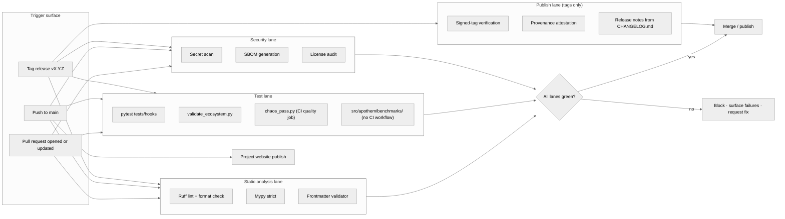

{/* SPDX-License-Identifier: MIT */}

**Apothem 생태계의 모든 변경을 게이트하는 빌드 · 검증 · 게시 워크플로의
구조적 지도입니다.** 이 문서는 시각화 표면을 설치합니다. 이 문서가 설명하는 GitHub Actions 워크플로 파일은 `.github/workflows/`(예: `ci.yml`과 `release.yml`)에 있으며, 릴리스 도구는 `scripts/release/`에 있습니다.

## 파이프라인 형태

## 레인 역할

- **정적 분석 레인** — 빠른 피드백. Ruff는 Python 스타일과 엄선된 규칙 집합을 다룹니다. mypy는 strict로 타입 규율을 강제합니다. frontmatter 검증기는 규칙, 스킬, 위임된 워커, 명령에 대한 아티팩트 스키마 준수를 게이트합니다. markdownlint는 이 레인에 속하지 않습니다. 이 도구는 pre-commit 훅으로만 실행되며, CI는 이를 실행하지 않습니다([Markdown 규약](/docs/reference/markdown-conventions) 참조).
- **테스트 레인** — `pytest tests/hooks`는 훅 런타임을 전체 이벤트 매트릭스에 대해 실행합니다. `validate_ecosystem.py`는 아티팩트 간 일관성을 위한 주요 구조 게이트입니다. `chaos_pass.py`는 `main`을 대상으로 하는 push 및 pull request에서 CI 품질 작업으로 실행되며(경로 필터 적용), 저하된 입력에서의 품질 저하를 잡아냅니다. `src/apothem/benchmarks/` 아래의 클래스별 벤치마크 스위트는 어떤 CI 워크플로에서도 실행되지 않습니다.
- **보안 레인** — 시크릿 스캔은 실수로 커밋된 자격 증명을 잡아냅니다. SBOM 생성과 라이선스 감사는 모든 프로덕션 준비 설치에 대해 공급망 표면을 게이트합니다.
- **게시 레인** — 릴리스 워크플로는 태그 push로 트리거됩니다. npm 및 VS Code 게시기는 기존 태그에 대해 수동 디스패치로 다시 실행할 수도 있습니다. 서명된 태그 검증은 릴리스 브랜치의 출처를 확인하며, 릴리스 노트는 `CHANGELOG.md`의 Keep-A-Changelog 형식에서 파생됩니다. 프로젝트 웹사이트는 빌드 입력을 변경하는 `main` push 시 또는 수동 디스패치 시 `site/dist/`에서 GitHub Pages 대상으로 게시됩니다.

## 구체적 구성

실제 워크플로 파일(`.github/workflows/ci.yml`,
`.github/workflows/release.yml` 등)은 저장소에 있습니다. 이 다이어그램은 앞으로 모든 구성이 따르는 정규 형태를 정의합니다.

## 권위 있는 상호 참조

- `pyproject.toml` — Ruff / mypy / pytest 구성의 진실의 출처.
- `scripts/dev/validate_ecosystem.py` — 주요 아티팩트 간 게이트.
- `scripts/dev/validate_hooks.py` — 훅 전용 구조 검증.
- `scripts/dev/chaos_pass.py` — 구성된 각 훅에 대한 적대적 스윕.
- `src/apothem/benchmarks/` — 클래스별 런타임 예산 검증기.
- `site/content/docs/developer-guide.mdx` — 운영자 대상 기여자 워크플로.
- `CHANGELOG.md` — 릴리스 노트 출처.
