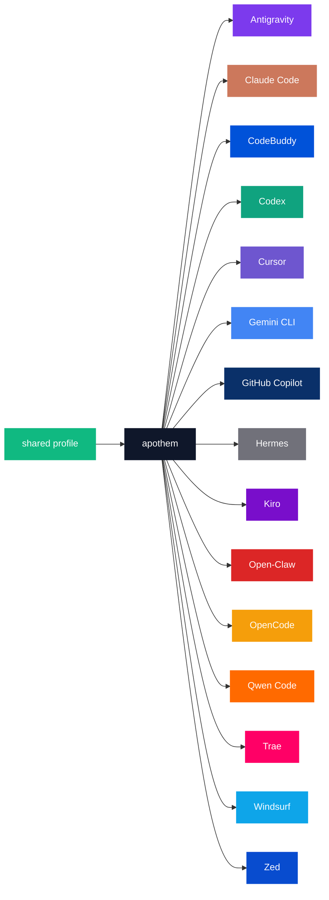

{/* SPDX-License-Identifier: MIT */}

아래의 정식 브랜드 이름 × 색상 코드 열거는 팔레트의 카탈로그 목적에 필요한 하니스별 식별자를 그대로 보존하기 위해 `text` 펜스로 감싸여 있습니다.

## Apothem 코어

| 토큰 | 라이트 | 다크 | 용도 |
|---|---|---|---|
| `apothem-hub` | `#0F172A` | `#F1F5F9` | 모든 아키텍처 다이어그램의 중앙 배포 노드("apothem"). |
| `shared-profile` | `#10B981` | `#34D399` | apothem 코어에 입력을 공급하는 진실의 원천 프로필. |

## 하니스 팔레트

열일곱 개 하니스 중 열다섯 개는 독자가 다이어그램에서 도구를 구별할 수 있도록
각자의 주요 브랜드 정체성에 맞춰 색을 입혔습니다. Apothem 마크 자체는
[팔레트](/docs/brand/palette) 페이지의 슬레이트와 에메랄드 색상만 사용하며,
하니스 색상은 담지 않습니다. 나머지 두 개 — `glm`과 `kimi-code` — 는 아직
정의된 브랜드 색상이 없습니다. 이들의 행은 [업데이트](#업데이트)의 전파 단계에
따라 상류 브랜드 색상이 정해지면 추가됩니다.

```text
| Token             | Light     | Dark      | Source                                                                                                                                              |
|-------------------|-----------|-----------|-----------------------------------------------------------------------------------------------------------------------------------------------------|
| `antigravity`     | `#7C3AED` | `#9F67FF` | Google Antigravity deep-purple.                                                                                                                     |
| `claude-code`     | `#CC785C` | `#E89378` | Anthropic terracotta-orange.                                                                                                                        |
| `codebuddy`       | `#0052D9` | `#5E8EF7` | Tencent CodeBuddy blue.                                                                                                                             |
| `codex`           | `#10A37F` | `#19C796` | OpenAI signature teal.                                                                                                                              |
| `cursor`          | `#6E56CF` | `#9B85E3` | Cursor brand purple.                                                                                                                                |
| `gemini-cli`      | `#4285F4` | `#6BA4F7` | Google blue.                                                                                                                                        |
| `github-copilot`  | `#0A3069` | `#5B8FE3` | GitHub Mona deep-blue.                                                                                                                              |
| `hermes`          | `#71717A` | `#A1A1AA` | Community silver-grey.                                                                                                                              |
| `kiro`            | `#790ECB` | `#A862DD` | Kiro violet.                                                                                                                                        |
| `open-claw`       | `#DC2626` | `#F87171` | Community red-orange.                                                                                                                               |
| `opencode`        | `#F59E0B` | `#FBBF24` | Community amber.                                                                                                                                    |
| `qwen-code`       | `#FF6A00` | `#FF8C40` | Alibaba Qwen orange.                                                                                                                                |
| `trae`            | `#FF0066` | `#FF599C` | ByteDance Trae magenta.                                                                                                                             |
| `windsurf`        | `#0EA5E9` | `#38BDF8` | Windsurf sky-blue.                                                                                                                                  |
| `zed`             | `#084CCF` | `#5E8BE0` | Zed Industries blue.                                                                                                                                |
```

## 상표

이 페이지와 사이트 전반의 하니스 이름, 제품 이름, 브랜드 색상은 해당 소유자에게
속하며 각 소유자의 상표입니다. Apothem은 어떤 도구를 구성하는지 밝히기 위해서만
도구 이름을 사용하고, 다이어그램에서 도구를 구별하기 위해서만 도구의 색상을
사용합니다. Apothem은 독립 프로젝트로, 이들 회사나 프로젝트 중 어느 것과도
제휴 관계가 없고 후원이나 보증을 받지 않으며, 이들의 로고를 전혀 함께 배포하지
않습니다.

## 명명 근거

- **`apothem-hub`** — 이름이 연상시키는 기하학적 중심(정다각형의 변심거리는 그 중심을 향해 안쪽을 가리킵니다).
- **`shared-profile`** — 어떤 단일 하니스 색상과도 구별되는 상류 소스로, 모든 다이어그램에서 "입력" 화살표로 읽힙니다.
- **하니스별 토큰**은 코드베이스 전반에서 사용하는 하니스 슬러그(`harnesses/<slug>/`, 진입점 키, CLI `--harness <slug>` 인자)를 그대로 따릅니다. 개념 하나에 단어 하나, 어디서나 같은 문자열입니다.

## Mermaid 사용법



## 접근성

모든 라이트 모드 토큰은 브랜드 색상을 왜곡하지 않고 대비를 확보할 수 있는 범위에서 흰색 텍스트에 대해 WCAG 2.2 AA 대비(≥4.5 : 1)를 충족합니다. 하니스의 네이티브 브랜드 색상 자체가 흰색 텍스트에 대해 AA 임계값에 못 미치는 경우(특히 위에 열거한 토큰 중 앰버 / 오렌지 계열과 스카이블루 / 틸 계열), WCAG AA 수준의 색상 위 텍스트 대비가 필요한 다이어그램은 흰색 텍스트가 깔끔하게 읽히도록 **다크 모드 변형**(밝게 끌어올린 색조)을 다이어그램 채움 색으로 사용합니다. 다크 모드 열은 이 목적에 맞춰 보정되어 있으며, 모든 다크 모드 토큰은 흰색 텍스트에 대해 AA를 통과합니다.

## 업데이트

팔레트는 하니스가 상류에서 브랜드 변경을 확정할 때만 업데이트됩니다. 하니스별 브랜드 변경은 `site/app/global.css`, 이 페이지, 그리고 `assets/src/` 아래의 영향을 받는 모든 SVG 마스터에 걸쳐 원자적으로 전파됩니다.
