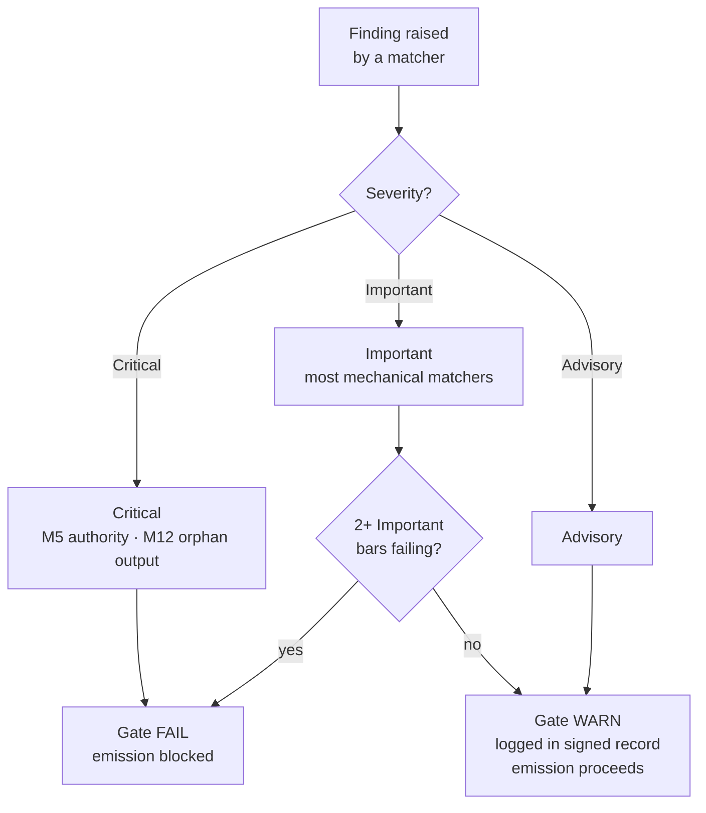

{/* SPDX-License-Identifier: MIT */}

## 15개 막대

| 막대 | ID | 맨데이트 | 검사 분류 | 실패 → 조치 |
|---|---|---|---|---|
| 1 | M1 | 호스트 프로젝트 불가지론 | 추론형 | 호스트 규약에 맞게 수정 |
| 2 | M2 | 편집 규율(공개 원장) | 기계형 | 공개 표시 추가 |
| 3 | M3 | 열 가지 품질 차원 | 추론형 | 실패한 차원을 수정 |
| 4 | M4 | 자기 적용(게이트 서명 기록 존재) | 기계형 | 서명 기록 블록 기록 |
| 5 | M5 | 권한 원칙(조작된 신원 / 엔드포인트 / 시크릿 없음) | 기계형 | 질의로 전달 |
| 6 | M6 | 전문성 반영(드러난 공백) | 추론형 | 공백을 드러내고 개선 사항 인용 |
| 7 | M7 | 옵션 주석(Recommended 표시 + 결정 요인 근거) | 기계형 | 옵션 집합에 주석 달기 |
| 8 | M8 | 확정성(규범적 산문에 얼버무림 없음) | 기계형 | 얼버무림을 조건문으로 격상 |
| 9 | M9 | 시각적 활용(구조적 주제에는 다이어그램 포함) | 추론형 | 다이어그램 작성 / 갱신 |
| 10 | M10 | 양방향 바인딩(상호 역방향 포인터가 닫혀 있음) | 기계형 | 반쪽 간선 닫기 |
| 11 | M11 | 애자일 스프린트(목표 / 백로그 / DoR / DoD / 검토 / 회고) | 추론형 | 스프린트로 재구성 |
| 12 | M12 | 단계 보고 및 표준 레이아웃 | 기계형 | 롤업 작성, 표준 레이아웃으로 재배치 |
| 13 | M13 | 코드 작성 기술(린트 / 포맷 / 타입 검사, 매직 넘버, bare-except) | 기계형 | 언어별 코드 작성 규칙 적용 |
| 14 | M14 | 체계성(업스트림 / 다운스트림 / 동료 / 시행 주체 선언) | 추론형 | 선언하고 레지스트리에 색인 |
| 15 | M15 | 프로덕션 준비(테스트 + 문서 + CHANGELOG + 규약 준수 커밋 + CI 녹색 + semver 안정성) | 기계형 | 누락된 표면 추가 |

## 심각도 단계

| 심각도 | 게이트에 미치는 영향 |
|---|---|
| **치명** | 게이트 FAIL — 방출이 무조건 차단됨 |
| **중요** | 중요 막대 2개 이상이 동시에 실패하면 게이트 FAIL |
| **권고** | 게이트 WARN — 서명 기록에 기록되며, 방출을 차단하지 않음 |

기계적 부분의 매처는 대부분 기본값이 **중요**입니다. M5(권한 — 시크릿, 조작된 엔드포인트)와 M12(고아 출력)는 **치명**입니다.



## 검증기

기계적 부분은 [`src/apothem/conformity/`](https://github.com/ahmed-g-gad/apothem/tree/main/src/apothem/conformity)에 있으며, [`src/apothem/conformity/gate.py`](https://github.com/ahmed-g-gad/apothem/blob/main/src/apothem/conformity/gate.py)가 이를 조율합니다.
게이트는 각 검증기를 다음 세 가지 방식 중 하나로 실행합니다.

- **per-write**: 보류 중인 모든 쓰기마다(`--hook`), 또는 `--all-perwrite`로 추적되는 모든 파일에 대해 실행합니다.
- **standalone**: `--all`로 저장소 전체에 걸쳐 실행하거나, `--check <name>`으로 하나씩 실행합니다.
- **change-set**: 게이트의 스윕과 별도로, 스테이징된 diff를 대상으로 실행합니다.

아래 표는 검증기 모듈에서 생성됩니다.

{/* apothem:generated-reference:start */}

The gate registers 53 validators: 22 per-write, 30 standalone and 1 change-set.

| Validator | Runs | Rule anchor | What it checks |
| --- | --- | --- | --- |
| `agent-capability-grep` | standalone | agent-capability-discipline (per-harness capability matrix) | Verify every harness declares its agentic-capability matrix. |
| `agents-md-coverage-grep` | standalone | rules/agents-md-convention.md | Flag stale agent-companion files under the root-only AGENTS.md convention. |
| `agnosticism-grep` | standalone | rules/agnostic-posture.md §3 (harness neutrality) + §1 (default-off) | Flag harness bias and re-introduced enforcement presets in shipped surfaces. |
| `always-on-budget-grep` | per-write | D1 token-budget-discipline §Always-on body budget | Body-budget conformity matcher for always-on rules. |
| `bare-except-grep` | per-write | M13.3 error handling | Flag bare except clauses without typed exceptions or re-raise. |
| `binding-five-direction-grep` | standalone | M10 bidirectional-binding §1 (five-direction Bindings section) | Require the five-direction Bindings section on every rule, command, agent, and skill. |
| `binding-reciprocity-corpus-grep` | standalone | M10 bidirectional-binding §2 (↔ self-reciprocal) | Cross-file binding-reciprocity corpus walk — the ↔-symmetric half-edge check. |
| `binding-reciprocity-grep` | per-write | M10 bidirectional-binding §Notation | Flag binding declarations using non-canonical arrow notation. |
| `brand-mark-grep` | per-write | rules/plain-language.md (brand-mark display/identifier casing) | Flag brand-mark display/identifier form drift on brand-touched surfaces. |
| `commented-out-code-grep` | per-write | M13.1 why-not-what comments | Flag substantial commented-out code blocks left in source. |
| `completion-claim-grep` | per-write | rules/session-closure.md (verifiable-close output honesty) | Flag unsupported completion / guarantee claims in cohort prose. |
| `conventional-commit-grep` | standalone | CLAUDE.md Coding Conventions — Conventional Commits | Flag HEAD commit messages that drift from the Conventional-Commits grammar. |
| `copilot-instructions-presence-grep` | per-write | — | GitHub Copilot surface presence check. |
| `cross-platform-matrix-grep` | standalone | cross-platform OS x Python CI matrix | Verify CI declares a cross-platform OS x Python matrix. |
| `determinism-grep` | standalone | rules/determinism.md | Prove every command and skill surface has a deterministic output shape. |
| `diagram-staleness-grep` | per-write | M9 visual-leverage §Fidelity | Flag diagrams whose verification date is missing or stale. |
| `dynamism-grep` | standalone | rules/dynamism.md (static-version embeds) | Flag static-string version embeds in dynamism-required surfaces. |
| `editorconfig-presence-grep` | standalone | supply-chain SOTA-rigor §editorconfig | Verify a canonical .editorconfig is present at the project root. |
| `file-header-grep` | per-write | — | Authorship-header presence and canonical-form check. |
| `freshness-token-grep` | standalone | rules/freshness-facade.md | Flag freshness-narrative phrases on shipped public surfaces. |
| `frontmatter-grep` | per-write | the per-class frontmatter JSON Schemas (src/apothem/schemas/) | Validate per-artifact-class YAML frontmatter against required-key sets. |
| `frontmatter-value-grep` | standalone | per-class JSON Schema enum/pattern value constraints | Validate frontmatter VALUES against the per-class JSON Schema enum/pattern constraints. |
| `gitattributes-presence-grep` | standalone | supply-chain .gitattributes contract | Verify the repo-root ``.gitattributes`` carries the canonical contract. |
| `harden-runner-grep` | standalone | harden-runner egress baseline | Verify every workflow job opens with a conformant harden-runner step. |
| `hedging-grep` | per-write | M8 definitiveness §Hedging | Flag hedging vocabulary in prescriptive contexts. |
| `license-author-consistency-grep` | per-write | — | LICENSE author-identity presence check. |
| `link-check` | per-write | rules/code-craft-markdown.md §6 Link Discipline | Validate Markdown internal links against the on-disk reference graph. |
| `magic-number-grep` | per-write | M13.10 magic numbers | Flag magic numbers in source code. |
| `multi-surface-coherence-grep` | per-write | — | Shared-claim coherence across AI-conventions surfaces. |
| `naming-grep` | standalone | CLAUDE.md Coding Conventions (kebab-case naming) | Validate filesystem paths against the canonical naming convention. |
| `no-global-plans-grep` | standalone | CLAUDE.md Plans Discipline (no global plans) | Walk the git index for tracked plans paths; fail when found. |
| `no-toplevel-docs-grep` | standalone | single-source-of-truth (docs live in site/, not root docs/) | Fail when a top-level ``docs/`` directory exists at the repository root. |
| `oidc-trusted-publishing-grep` | standalone | OIDC trusted publishing | Verify release workflows use OIDC trusted publishing. |
| `option-annotation-grep` | per-write | M7 option-annotation (H6 per-option bind) | Enforce the per-option Recommended label-to-body bind (H6). |
| `orphan-output-grep` | per-write | M12 canonical-layout + M14 systemicity | Flag artifacts emitted to non-canonical locations or without provenance. |
| `permissions-minimum-scope-grep` | standalone | minimum-scope workflow permissions | Verify every GitHub Actions workflow declares a minimum-scope ``permissions:`` block. |
| `plain-language-grep` | standalone | rules/plain-language.md — user-facing prose | Flag mechanistic / harness-internal vocabulary in user-facing prose. |
| `plan-next-step-consistency-grep` | standalone | rules/recommend-next-step.md | Advisory: flag plan-suite infra files whose Recommended-Next-Step footer drifts from the suite's recorded next pipeline stage. |
| `plan-suite-structure-grep` | standalone | context-management-scratch 2 (suite-locality + closed vocab) + canonical-layout-reporting-tiers 2.1 (numeric-prefix discipline) | Validate plan-suite structure: suite-locality, closed vocab, numeric prefix. |
| `plans-discipline-language-grep` | standalone | CLAUDE.md Plans Discipline (multi-surface language) | Verify the canonical Plans Discipline language reaches every required surface. |
| `production-ready-pr-grep` | per-write | M15 production-ready §Same-change-set | Flag commits whose change-set lacks the production-ready four-class shape. |
| `recommend-next-step-grep` | standalone | rules/recommend-next-step.md | Verify every command file carries a `## Recommended Next Step` block. |
| `redundancy-grep` | standalone | rules/operational-mandates.md §CM-7 coherent-product non-redundancy | Flag substantively-duplicated paragraphs across the governed corpus. |
| `reference-token-grep` | standalone | rules/own-voice-reimplementation.md | Flag leaked reference-platform branding tokens on authored surfaces. |
| `registry-capability-consistency-grep` | standalone | rules/agent-capability-discipline.md — registry capability cells backed by evidence | Flag registry capability cells not backed by install / materializer / projection evidence. |
| `secret-leak-grep` | per-write | M13.8 security + M15 production-ready | Block emission of artifacts containing hardcoded credentials. |
| `semver-stability-grep` | change-set | M15 semver-stability | Semver stability matcher (M15 mechanical fraction). |
| `smoke-install-grep` | standalone | production-ready section 8.1 paired install scripts | Smoke-test the paired install scripts at the repository root. |
| `static-version-grep` | standalone | rules/dynamism.md §static-version-resolution | Verify version-bearing sites resolve dynamically, not as static literals. |
| `token-efficiency-grep` | per-write | clean-room-generation §5 + token-efficiency-rewrite | Flag filler phrases, throat-clearing openers, and content-free qualifiers. |
| `unpinned-action-grep` | per-write | M15 production-ready §Supply-chain | Flag GitHub Actions workflows that pin actions to mutable refs. |
| `user-confirm-grep` | per-write | M5 authority-inquiry §10 | Block emission of artifacts containing unresolved authority placeholders. |
| `workflow-concurrency-grep` | standalone | workflow concurrency + per-job timeouts | Enforce concurrency + per-job timeout discipline on GitHub workflows. |

{/* apothem:generated-reference:end */}

## 게이트 실행

설치된 하니스에서는 게이트가 자동으로 실행됩니다. Claude Code의
`settings.json`은 게이트를 `PreToolUse` 훅으로 연결하며, 이 훅은 모든
Write/Edit 전에 `~/.claude/.apothem/support/conformity/gate.py`에 머티리얼라이즈된
사본을 호출합니다. 소스 체크아웃에서는 모듈 형식이 같은 코드를 실행합니다.
게이트는 기본적으로 권고 모드입니다. 발견 사항을 보고하고 `0`으로 종료합니다.
차단 수준의 발견 사항이 있을 때 `2`로 종료하려면 `--strict`를 추가하세요. 알 수
없는 검증기 이름은 `3`으로 종료합니다.

```shell
# Every standalone validator across the repository:
python -m apothem.conformity.gate --all .

# The same sweep, failing on a blocking finding (the CI form):
python -m apothem.conformity.gate --all --strict .

# Every per-write validator against every tracked file:
python -m apothem.conformity.gate --all-perwrite .

# One validator by name (names come from --list):
python -m apothem.conformity.gate --check naming-grep .

# List every registered validator as JSON:
python -m apothem.conformity.gate --list

# Single-file dispatch (mimics the PreToolUse hook):
echo '{"tool_input": {"file_path": "path/to/file", "content": "..."}}' \
    | python -m apothem.conformity.gate --hook
```

`python -m apothem.conformity.gate --help`는 사용법 요약을 출력합니다.
전체 절차는 [적합성 게이트 실행](/docs/usage/conformity-gate)을 참조하세요.

## 참조

- [사전 방출 게이트 레지스트리](/docs/governance/pre-emission-gate-registry) — 표준 막대 정의
- [대외 적합성 레지스트리](/docs/governance/outward-conformity-registry) — M1-M15의 상세 의미
- [횡단 맨데이트](/docs/governance/cross-cutting-mandates) — 맨데이트의 기준 출처
- [성능 규율](https://github.com/ahmed-g-gad/apothem/blob/main/src/apothem/rules/performance-discipline.md) — 분류별 런타임 예산
