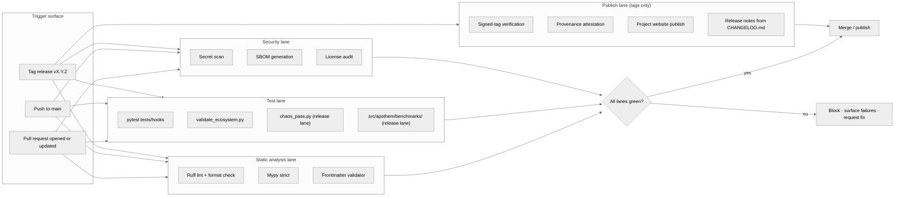

{/* SPDX-License-Identifier: MIT */}

**O mapa estrutural do fluxo de trabalho de build · validação · publicação que
controla cada alteração no ecossistema do Apothem.** Este documento instala a
superfície de visualização. Os arquivos de fluxo de trabalho do GitHub Actions que
ele descreve ficam em `.github/workflows/` (por exemplo, `ci.yml` e `release.yml`), e o
ferramental de lançamento fica em `scripts/release/`.

## Forma do pipeline

## Papéis das faixas

- **Faixa de análise estática** — feedback rápido. O Ruff cobre o estilo Python e
  um conjunto curado de regras; o mypy impõe disciplina de tipos no modo strict;
  o validador de frontmatter controla a conformidade com o schema dos artefatos
  para regras, skills, trabalhadores delegados e comandos. O markdownlint não
  faz parte desta faixa: ele roda apenas como hook de pre-commit, e o CI não o
  executa (consulte
  [Convenções de Markdown](/docs/reference/markdown-conventions)).
- **Faixa de testes** — `pytest tests/hooks` exercita o runtime de hooks contra a
  matriz completa de eventos; `validate_ecosystem.py` é o principal portão
  estrutural para a consistência entre artefatos; `chaos_pass.py` e a suíte de
  benchmarks por classe sob `src/apothem/benchmarks/` ativam-se na faixa de
  lançamento para detectar degradação sob entradas degradadas e regressões do
  orçamento de runtime.
- **Faixa de segurança** — a varredura de segredos detecta credenciais incluídas
  em commits por acidente; a geração de SBOM e as auditorias de licença
  controlam a superfície da cadeia de suprimentos em qualquer instalação de
  prontidão para produção.
- **Faixa de publicação** — roda apenas em lançamentos marcados com tag. A
  verificação de tag assinada confirma a procedência da branch de lançamento; o
  site do projeto é publicado a partir de `site/dist/` no destino do GitHub
  Pages; as notas de lançamento derivam do formato Keep-A-Changelog do
  `CHANGELOG.md`.

## Configuração concreta

Os arquivos de fluxo de trabalho reais (`.github/workflows/ci.yml`,
`.github/workflows/release.yml`, etc.) são instalados durante a construção do
ecossistema de prontidão para produção. Este diagrama define a forma canônica que
toda configuração futura espelha.

## Referências cruzadas autoritativas

- `pyproject.toml` — fonte da verdade da configuração do Ruff / mypy / pytest.
- `scripts/dev/validate_ecosystem.py` — o principal portão entre artefatos.
- `scripts/dev/validate_hooks.py` — validação estrutural específica de hooks.
- `scripts/dev/chaos_pass.py` — varredura adversarial de cada hook configurado.
- `src/apothem/benchmarks/` — verificadores do orçamento de runtime por classe.
- `site/content/docs/developer-guide.mdx` — o fluxo de trabalho do contribuidor voltado ao operador.
- `CHANGELOG.md` — fonte das notas de lançamento.
