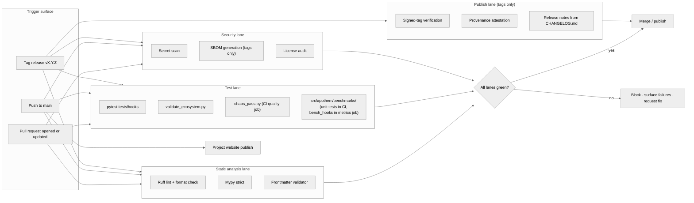

{/* SPDX-License-Identifier: MIT */}

**O mapa estrutural do fluxo de trabalho de build · validação · publicação que
controla cada alteração no ecossistema do Apothem.** Este documento instala a
superfície de visualização. Os arquivos de fluxo de trabalho do GitHub Actions que
ele descreve ficam em `.github/workflows/` (por exemplo, `ci.yml` e `release.yml`), e o
ferramental de lançamento fica em `scripts/release/`.

## Forma do pipeline

## Papéis das faixas

- **Faixa de análise estática** — feedback rápido. O Ruff cobre o estilo do
  Python e um conjunto curado de regras; o mypy impõe disciplina de tipos no
  modo strict; o validador de frontmatter controla a conformidade dos artefatos
  com o schema para regras, skills, trabalhadores delegados e comandos. O
  markdownlint não faz parte desta faixa: ele roda apenas como hook de
  pre-commit, e o CI não o executa (consulte [Convenções de
  Markdown](/docs/reference/markdown-conventions)).
- **Faixa de testes** — `pytest tests/hooks` exercita o runtime de hooks contra
  a matriz completa de eventos; `validate_ecosystem.py` é o principal portão
  estrutural para a consistência entre artefatos; `chaos_pass.py` roda no job de
  qualidade do CI em pushes e pull requests para `main` (com filtro de caminho),
  para detectar degradação sob entradas degradadas. Os drivers de benchmark por
  classe em `src/apothem/benchmarks/` rodam no CI pela suíte do pytest e pelo
  job `metrics`. Cada execução completa do pytest no CI coleta
  `tests/unit/test_benchmarks.py`, que chama todos os drivers, exceto
  `bench_install.py`. O job `metrics` executa `scripts/dev/collect_metrics.py`,
  que roda `bench_hooks.py --json` e registra o resultado como `hook_e2e_ms`.
  `bench_tests.py` e `bench_install.py` medem execuções reais somente sob `make benchmarks`. Nenhum fluxo de trabalho executa `make benchmarks`.
- **Faixa de segurança** — gitleaks em `ci.yml` detecta credenciais incluídas em
  commits por acidente. A auditoria de licenças (`license-audit.yml`) falha
  quando a licença de uma dependência está fora da sua lista de permissões. Ela
  roda semanalmente e quando arquivos de dependência ou de licença mudam.
  `release.yml` gera o SBOM de cada release marcada com tag.
- **Faixa de publicação** — os fluxos de trabalho de release são disparados por
  pushes de tags; os publicadores do npm e do VS Code também podem ser
  reexecutados por disparo manual para uma tag existente. A verificação de tag
  assinada confirma a procedência da branch de release; as notas de release
  derivam do `CHANGELOG.md`, no formato Keep-A-Changelog. O site do projeto é
  publicado a partir de `site/dist/` no destino do GitHub Pages em pushes para
  `main` que alterem seus insumos de build, ou por disparo manual.

## Configuração concreta

Os arquivos de fluxo de trabalho reais (`.github/workflows/ci.yml`,
`.github/workflows/release.yml`, etc.) estão no repositório. Este diagrama define a
forma canônica que toda configuração futura espelha.

## Referências cruzadas autoritativas

- `pyproject.toml` — fonte da verdade da configuração do Ruff / mypy / pytest.
- `scripts/dev/validate_ecosystem.py` — o principal portão entre artefatos.
- `scripts/dev/validate_hooks.py` — validação estrutural específica de hooks.
- `scripts/dev/chaos_pass.py` — varredura adversarial de cada hook configurado.
- `src/apothem/benchmarks/` — verificadores do orçamento de runtime por classe.
- `site/content/docs/developer-guide.mdx` — o fluxo de trabalho do contribuidor voltado ao operador.
- `CHANGELOG.md` — fonte das notas de lançamento.
