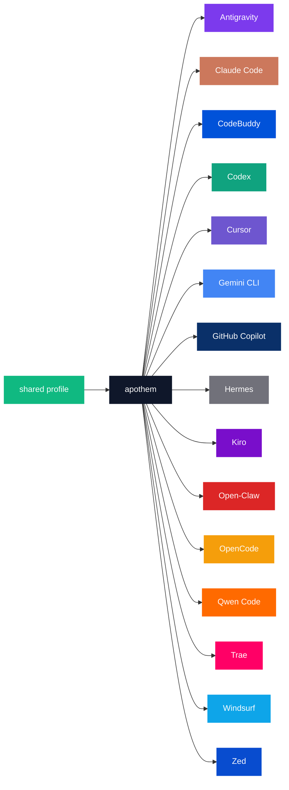

{/* SPDX-License-Identifier: MIT */}

As enumerações canônicas de nome de marca × código de cor abaixo estão envoltas em um bloco cercado `text` para preservar literalmente os identificadores por harness exigidos pelo propósito de catálogo da paleta.

## Núcleo do Apothem

| Token | Claro | Escuro | Uso |
|---|---|---|---|
| `apothem-hub` | `#0F172A` | `#F1F5F9` | O nó central de distribuição ("apothem") em cada diagrama de arquitetura. |
| `shared-profile` | `#10B981` | `#34D399` | O perfil que é a fonte da verdade e alimenta o núcleo do apothem. |

## Paleta dos harnesses

Quinze dos dezessete harnesses são coloridos para combinar com sua identidade de
marca principal, de modo que o leitor consiga distinguir as ferramentas em um
diagrama. A própria marca Apothem usa apenas as cores ardósia e esmeralda
da página de [paleta](/docs/brand/palette); ela não carrega nenhuma cor de
harness. Os dois restantes — `glm` e `kimi-code` — ainda não têm uma cor de
marca definida; suas linhas são adicionadas assim que a cor de marca a montante
for definida, conforme a etapa de propagação em
[Atualizações](#atualizações).

```text
| Token             | Light     | Dark      | Source                                                                                                                                              |
|-------------------|-----------|-----------|-----------------------------------------------------------------------------------------------------------------------------------------------------|
| `antigravity`     | `#7C3AED` | `#9F67FF` | Google Antigravity deep-purple.                                                                                                                     |
| `claude-code`     | `#CC785C` | `#E89378` | Anthropic terracotta-orange.                                                                                                                        |
| `codebuddy`       | `#0052D9` | `#5E8EF7` | Tencent CodeBuddy blue.                                                                                                                             |
| `codex`           | `#10A37F` | `#19C796` | OpenAI signature teal.                                                                                                                              |
| `cursor`          | `#6E56CF` | `#9B85E3` | Cursor brand purple.                                                                                                                                |
| `gemini-cli`      | `#4285F4` | `#6BA4F7` | Google blue.                                                                                                                                        |
| `github-copilot`  | `#0A3069` | `#5B8FE3` | GitHub Mona deep-blue.                                                                                                                              |
| `hermes`          | `#71717A` | `#A1A1AA` | Community silver-grey.                                                                                                                              |
| `kiro`            | `#790ECB` | `#A862DD` | Kiro violet.                                                                                                                                        |
| `open-claw`       | `#DC2626` | `#F87171` | Community red-orange.                                                                                                                               |
| `opencode`        | `#F59E0B` | `#FBBF24` | Community amber.                                                                                                                                    |
| `qwen-code`       | `#FF6A00` | `#FF8C40` | Alibaba Qwen orange.                                                                                                                                |
| `trae`            | `#FF0066` | `#FF599C` | ByteDance Trae magenta.                                                                                                                             |
| `windsurf`        | `#0EA5E9` | `#38BDF8` | Windsurf sky-blue.                                                                                                                                  |
| `zed`             | `#084CCF` | `#5E8BE0` | Zed Industries blue.                                                                                                                                |
```

## Marcas comerciais

Os nomes de harness, os nomes de produtos e as cores de marca nesta página e em
todo o site pertencem aos seus proprietários e são marcas comerciais de seus
respectivos proprietários. O Apothem nomeia uma ferramenta apenas para dizer
qual delas ele configura e usa a cor de uma ferramenta apenas para distingui-la
em um diagrama. O Apothem é um projeto independente; ele não é afiliado a,
patrocinado por nem endossado por nenhuma dessas empresas ou projetos, e não
distribui nenhum dos seus logotipos.

## Justificativa dos nomes

- **`apothem-hub`** — o centro geométrico que o nome evoca (o apótema de um polígono regular aponta para dentro, em direção ao seu núcleo).
- **`shared-profile`** — a fonte a montante, distinta da cor de qualquer harness isolado, para que se leia como a seta de "entrada" em cada diagrama.
- **Tokens por harness** espelham o slug do harness usado em toda a base de código (`harnesses/<slug>/`, a chave do ponto de entrada, o argumento `--harness <slug>` da CLI). Uma palavra por conceito; a mesma string em todos os lugares.

## Uso no Mermaid



## Acessibilidade

Cada token de modo claro desta página, tanto os centrais quanto os de harness, mantém sua cor de marca sem distorção, de modo que oito deles ficam abaixo do contraste WCAG 2.2 AA contra texto branco (≥4.5 : 1). Os demais tokens de modo claro o atendem. Os oito, com o contraste de cada um contra o branco:

```text
shared-profile   2.54 : 1
claude-code      3.28 : 1
codex            3.20 : 1
gemini-cli       3.56 : 1
opencode         2.15 : 1
qwen-code        2.87 : 1
trae             3.86 : 1
windsurf         2.77 : 1
```

A coluna de modo escuro é para uso em fundos escuros, e nenhum dos seus tokens atinge 4.5 : 1 contra texto branco. O exemplo de Mermaid acima define texto branco em todos os preenchimentos, de modo que seus rótulos nesses oito preenchimentos não atingem 4.5 : 1. Um diagrama que precisa de contraste WCAG AA de texto sobre cor em um desses oito preenchimentos DEVE usar texto escuro (`#0F172A`, que mede de 4.63 : 1 a 8.31 : 1 sobre eles) em vez de branco.

## Atualizações

A paleta é atualizada somente quando um harness ratifica uma mudança de marca a montante. As cores dos harnesses são definidas nesta página, não em `assets/design-tokens.css` nem em `site/app/global.css`. As mudanças de marca por harness se propagam atomicamente por esta página e por cada SVG mestre afetado em `assets/src/`.
