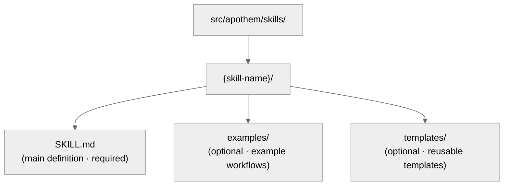

{/* SPDX-License-Identifier: MIT */}

Este guia ajuda os desenvolvedores a manter e estender o ecossistema do Apothem
com padrões de qualidade SOTA.

## Referência rápida: tipos de artefato

Este guia cobre cinco tipos de artefato, cada um com um propósito específico. As
regras, os comandos, os auxiliares e as skills carregam frontmatter YAML; os
hooks são registrados em `hooks.json` e `settings.json` e não carregam nenhum.
Os output-styles são uma classe de artefato adicional, com duas chaves
obrigatórias de frontmatter, `name` e `description`; consulte o
[Schema de frontmatter](/docs/reference/frontmatter-schema).

| Artefato | Caminho | Propósito | Quando criar |
| -------- | ---- | ------- | -------------- |
| **Regra** | `src/apothem/rules/*.md` | Mandato comportamental ou diretiva operacional | Novo princípio, política ou mandato de governança estabelecido |
| **Comando** | `src/apothem/commands/*.md` | Comando de barra (`/command-name`) para fluxos de trabalho complexos | Novo fluxo de trabalho do usuário em múltiplos passos |
| **Auxiliar** | `src/apothem/agents/*.md` | Definição persistente de trabalhador delegado para tarefas paralelas | Nova tarefa especializada recorrente (auditoria, exploração, verificação de qualidade) |
| **Skill** | `src/apothem/skills/{name}/SKILL.md` | Técnica reutilizável com sinal de detecção | Novo padrão de técnica detectável e reutilizável |
| **Hook** | `src/apothem/hooks/` + `hooks.json` + `settings.json` | Validação ou gerenciamento de estado acionados por evento | Novo evento de ciclo de vida ou nova necessidade de validação |

## Contrato do adaptador de harness

Os fatos de identidade e de capacidade de cada harness residem em
`src/apothem/lib/harness_registry.py`. Uma mudança de harness só está completa
quando estas superfícies concordam:

| Superfície | Atualização obrigatória |
| --- | --- |
| Linha do registro | ID público, chave do pacote, ponto de entrada, escopo, formato de saída, caminhos-alvo, caminhos da documentação, arquivo de capacidades, pin de padrão, testes de fixture, chave de package-data, fontes de template e status de capacidade. |
| Pacote do adaptador | `__init__.py`, `install.py`, `update.py`, `uninstall.py`, `verify.py`; adicione `materializer.py` somente quando o harness renderiza um arquivo de configuração nativo. |
| Manifesto de propagação | Caminhos de template e de cohort para os adaptadores baseados em manifesto. |
| Capacidades | `src/apothem/harnesses/<package>/capabilities.yml` com cada capacidade obrigatória e a justificativa para os estados não suportados ou pendentes de descoberta, além de um mapa `conversion_losses` para cada cohort convertido de comandos, agentes ou regras (consulte o [registro de harnesses](/docs/reference/harness-registry)). |
| Pin de convenção | `STANDARD-CONVENTION-PIN.md` com a URL do fornecedor, a data do snapshot, o nome de arquivo/schema canônico, a referência de evidência e a justificativa para as capacidades não suportadas. |
| Testes | Paridade do registro, teste de fixture do adaptador, linha golden do plano de instalação, comportamento de dry-run/sem gravação, idempotência e cobertura de package-data. |
| Documentação | Página de referência do harness, página de comparação, notas de capacidade/MCP e exemplos que usam placeholders fictícios. |

Os adaptadores de escopo de projeto devem definir `requires_project = True`,
aceitar `project: Path | None` nos métodos de ciclo de vida e rejeitar raízes de
projeto ausentes ou inseguras antes de qualquer gravação. Os adaptadores de
escopo de usuário devem manter os caminhos sob a raiz de configuração de usuário
documentada do harness.

## Política de fixture golden

`tests/fixtures/harness-golden-plans.json` registra a forma pública do plano de
instalação para todos os dezessete harnesses do registro: ID público, modo de
materialização, caminho do cohort/template de origem e caminho-alvo normalizado
sob `<ROOT>`. Quando o comportamento de alvo do registro, do manifesto ou do
template muda intencionalmente, atualize a fixture golden no mesmo commit da
mudança no código-fonte, para que o diff mostre o delta de comportamento.

## Validação antes da gravação

O driver de instalação compartilhado valida cada fonte e cada alvo antes da
primeira gravação. Ele rejeita fontes de manifesto ausentes, travessia de alvo,
caminhos-alvo fora da raiz selecionada e cruzamentos de links simbólicos. Os
dry-runs executam a mesma validação e retornam resultados estruturados `skipped`
ou `unchanged` sem criar arquivos.

## Ocultação e dados de exemplo

Os diagnósticos do perfil ocultam campos com formato de token, segredo, senha,
credencial, chave de API, chave privada, autorização, auth e cabeçalho. A
documentação, as fixtures, os exemplos e os trechos JSON usam `example.invalid`,
`Example User`, `example-user` e placeholders óbvios em vez de segredos ou
contas pessoais com aparência real.

## Antes de escrever: o schema canônico

**Os JSON Schemas por classe em `src/apothem/schemas/*.schema.json` são o
contrato legível por máquina e imposto pelo conformity gate —
`additionalProperties` rejeita chaves desconhecidas, então o conformity gate tem
a palavra final.** Duas projeções legíveis por humanos os acompanham:
`site/content/docs/reference/frontmatter-schema.mdx` (o índice de chaves
obrigatórias) e `site/content/docs/reference/artifact-schema.mdx` (templates por
classe e exemplos completos). Quando uma página diverge dos JSON Schemas, os
schemas prevalecem.

- Leia o JSON Schema do seu tipo de artefato em `src/apothem/schemas/`
- Leia `site/content/docs/reference/artifact-schema.mdx` § "Schema" para obter o
  template e um exemplo completo
- Copie os campos exigidos, preencha os valores obrigatórios e adicione campos opcionais conforme necessário

## Verificação rápida do frontmatter

Todo frontmatter de artefato deve passar nestas verificações. Aplique as
verificações de `version`, `updated` e `portability` somente a uma classe que
carrega a chave: as regras não carregam nenhuma delas, e as skills não carregam
`portability`.

```yaml
✓ Valid YAML syntax (use tools: `yamllint` or PowerShell `ConvertFrom-Yaml` where available)
✓ All mandatory fields present (per schema for artifact type)
✓ name: uses kebab-case
✓ version: semantic MAJOR.MINOR.PATCH
✓ updated: ISO 8601 date (YYYY-MM-DD)
✓ description: single-line, non-empty
✓ scope fields valid per artifact type (rules: pathFilter + alwaysApply; CLAUDE.md root: scope)
✓ portability: string, for example `universal` (the schemas do not enumerate its values)
✓ No typos in field names — must match canonical schema exactly
✓ Optional fields use correct enum values
```

## Convenções de nomenclatura

### Nomes de artefato (kebab-case)

- **Regras:** `operational-mandates`, `clean-room-generation`, `context-management`
- **Comandos:** `plan-execute`, `plan-spec`, `plan-generate`
- **Auxiliares:** `codebase-explorer`, `convention-auditor`, `quality-gate`
- **Skills:** `plan-suite`, `ecosystem-audit`

Padrão: letras minúsculas, hífens entre as palavras, sem espaços nem sublinhados.

### Nomenclatura de arquivos

- **Regras:** `{name}.md`
- **Comandos:** `{name}.md`
- **Auxiliares:** `{name}.md`
- **Skills:** Dentro da pasta `src/apothem/skills/{name}/SKILL.md` (capitalização exata: `SKILL.md`)
- **Hooks:** Dentro da pasta `src/apothem/hooks/`. Todos os manipuladores de evento são em Python. Todo
  comando de hook no template `settings.json` do Claude Code usa a forma exec: `command`
  é o marcador de posição do interpretador `${PYTHON_BIN}`, resolvido no momento da instalação, e
  `args` contém o caminho do script e os respectivos argumentos. Esse template executa
  `${HARNESS_ROOT}/.apothem/support/hooks/dispatch.py <event> [<message-name>]` e
  `${HARNESS_ROOT}/.apothem/support/conformity/gate.py --hook` pelo caminho absoluto, de modo que
  a cópia instalada não precisa de um pacote `apothem` importável. O plugin do Claude Code
  registra os hooks, em vez disso, em `src/apothem/hooks/hooks.json`, como comandos de shell que
  executam `hooks/lib/bootstrap.sh` por meio do `bash`; esse stub localiza o Python e executa
  `dispatch.py`, de modo que os manipuladores continuam em Python. Registre um novo hook em
  `hooks.json` e no template `settings.json` do Claude Code. `dispatch.py` encaminha
  `SessionStart` para
  `session_start_bootstrap.main()` e
  todos os demais eventos da lista de permissões para `emit_hook_context.main()`. Os únicos stubs
  de shell permitidos em `src/apothem/hooks/` ou `scripts/` são os seis arquivos de localizador e
  bootstrap (`find-python.{ps1,sh}`, `find-pwsh.{ps1,sh}`, `bootstrap.{ps1,sh}`); qualquer outro
  arquivo `.ps1` / `.sh` reprova na verificação de higiene de `scripts/dev/validate_hooks.py`.

### Referências cruzadas

Ao referenciar outros artefatos, use os nomes exatos:

- Regras: `"operational-mandates"` (valor do campo name)
- Comandos: `/plan-execute` (com barra na documentação para humanos; sem barra no código)
- Auxiliares: `codebase-explorer` (valor do campo name)
- Skills: `plan-suite` (valor do campo name)

Nunca use caminhos de arquivo nem nomes truncados na prosa.

## Portabilidade: Windows vs. Unix

Todo comando DEVE declarar explicitamente seu status de portabilidade no campo
`portability`. Um auxiliar PODE declará-lo. Skills, regras e output-styles não
carregam o campo `portability`.

### Universal

- Funciona de forma idêntica no Windows, no macOS e no Linux
- Nenhuma suposição sobre o shell
- Os caminhos usam barras normais (`/`)
- Nenhum caminho absoluto fixo no código
- Nenhuma sintaxe do PowerShell específica do Windows

```yaml
portability: "universal"
```

### Universal com ressalvas no Windows

- Universal entre hosts POSIX; a ressalva nomeada se aplica à variante da plataforma Windows declarada no conteúdo
- Documente a ressalva explicitamente no conteúdo
- Exemplo: "Links simbólicos não suportados no Windows antes do Win 10"

```yaml
portability: "universal-with-windows-caveats"
```

Documente a ressalva em uma nota imediatamente após o título.

### Apenas Unix / Apenas Windows

- Restrito explicitamente a uma plataforma
- Raro no Apothem — a maioria deve ser universal
- Use somente se recursos específicos da plataforma forem essenciais

```yaml
portability: "unix-only"
```

Documente o motivo na primeira seção do artefato.

## Escopo: sempre ativo vs. filtrado por caminho

### Sempre ativo

A regra se aplica em todos os lugares. Cinco regras são sempre ativas: `agnostic-posture`,
`authority-inquiry`, `session-closure`, `context-management` e o índice de
regras (`apothem-rule-index`). O conjunto é pequeno porque toda regra sempre
ativa custa contexto em todas as sessões.

```yaml
pathFilter: ""
alwaysApply: true
```

### Filtrado por caminho

A regra se aplica condicionalmente com base no caminho do arquivo.

```yaml
pathFilter: "**/*.py, **/*.toml"
alwaysApply: false
```

O `pathFilter` usa padrões glob (o mesmo formato do `.gitignore`). Quando um
arquivo corresponde ao filtro, a regra é ativada.

## Semântica de versão

Todo artefato versionado carrega sua própria versão semântica
(`MAJOR.MINOR.PATCH`). Os comandos e as skills a exigem, os auxiliares e os
output-styles PODEM carregá-la, e as regras não carregam nenhuma:

- **PATCH** — uma mudança de comportamento que corrige uma diretiva existente sem quebrar o contrato.
- **MINOR** — mudanças aditivas e compatíveis: novas seções opcionais, novos campos de frontmatter opcionais, novos exemplos. Os consumidores existentes continuam funcionando sem alteração.
- **MAJOR** — mudanças incompatíveis de schema ou de contrato: seções removidas, campos renomeados, comportamento alterado de uma diretiva existente, mudanças que exigem que os artefatos downstream se adaptem.

Correções de erro de digitação, correções de link, formatação e edições somente em comentários ou somente de documentação deixam a versão inalterada. Somente uma mudança de comportamento a incrementa. Uma edição desse tipo ainda atualiza a data `updated` do artefato.

Exemplos:

- `vX.Y.Z` → `vX.Y.(Z+1)` (PATCH: diretiva corrigida que altera o comportamento)
- `vX.Y.Z` → `vX.Y.Z` (sem incremento: correção de erro de digitação ou de link; `updated` muda)
- `vX.Y.Z` → `vX.(Y+1).0` (MINOR: seção opcional nova adicionada)
- `v0.Y.Z` → `v(0+1).0.0` (MAJOR: contrato declarado estável; os novos artefatos partem de `v0.Y.Z`)
- `vX.Y.Z` → `v(X+1).0.0` (MAJOR: campo de frontmatter obrigatório removido)

Incremente `version` e `updated` juntos a cada edição que altere o comportamento
de um artefato que os carrega. Acrescente uma linha correspondente ao
`CHANGELOG.md` de nível de ecossistema para os lançamentos que agrupam mudanças
de artefatos.

### Revisões da suíte de planejamento

A regra de artefato acima não se aplica às suítes de planejamento. A versão de uma
suíte de planejamento é o valor `vX.Y.Z` registrado no cabeçalho de `MASTER-PLAN.md` e
na tabela de Histórico de revisões. Uma correção de digitação em uma suíte de
planejamento é uma revisão que incrementa o número PATCH. O passo 10.2 de `/plan-review`
define a classificação e acrescenta a linha do Histórico de revisões.

- `vX.Y.Z` → `vX.Y.(Z+1)` (suíte de planejamento, correção de digitação: PATCH)
- `vX.Y.Z` → `vX.Y.Z` (artefato, correção de digitação: sem incremento; a regra de artefato acima)

## Quando editar um artefato

### Regras

- Trate a estrutura Obrigatório/Opcional como elemento de sustentação —
  reestruturá-la repercute em todos os artefatos dependentes.
- Refine os antipadrões, os exemplos de Escalonamento de Seriedade e as citações
  à medida que o entendimento se aprofunda.
- Registre a justificativa de qualquer mudança estrutural no arquivo de tópico
  de memória relevante.

### Comandos

- A forma dos argumentos faz parte do contrato público — quebre-a somente com
  intenção explícita e propague a mudança para todos os chamadores (incremento MAJOR).
- Mantenha os passos do fluxo de trabalho e os contratos de retorno enxutos e atualizados.
- Documente inline o sequenciamento não óbvio dos passos.

### Auxiliares

- Mantenha `disallowedTools` mínimo, mas adequado; documente a justificativa
  quando ele mudar.
- Refine os Princípios Operacionais e os Contratos de Retorno à medida que o
  papel do auxiliar amadurece (incremento MINOR).
- Acompanhe inline as mudanças de capacidade para que os chamadores possam recalibrar as expectativas.

### Skills

- Mantenha os passos do Procedimento e os Exemplos sincronizados com a realidade.
- Os sinais de detecção devem refletir a formulação real dos usuários no uso atual.
- Divida uma skill assim que ela ultrapassar ~150 linhas (consulte
  `auto-memory.md` § Topic File Management).

## Passo a passo: adicionando uma nova regra

### 1. Avalie a ortogonalidade

Esta regra se sobrepõe a regras existentes? Pesquise em `src/apothem/rules/` por conteúdo relacionado.

Se a sobreposição for >50%, considere estender uma regra existente em vez disso.
Consulte `persistent-conventions-vigilance.md` § Artifact Evolution.

### 2. Escreva o conteúdo

Siga a estrutura:

- Título: `# Rule: {Title}`
- Seção de propósito
- Obrigações / diretivas centrais (numeradas, com links)
- Tabela de Escalonamento de Seriedade (sempre obrigatória)
- Seção de antipadrões
- Seção de aplicação

### 3. Crie o frontmatter

Use o schema de `site/content/docs/reference/artifact-schema.mdx` § Schema: Rules. Defina:

- `name:` identificador em kebab-case
- `description:` resumo de uma linha para os registros
- `pathFilter:` lista de globs para as regras filtradas por caminho; a string vazia (`""`) para as regras sempre ativas
- `alwaysApply:` `true` para as regras sempre ativas, `false` para as regras filtradas por caminho

As regras carregam somente estes quatro campos — sem `version` / `updated` / `scope` / `portability` / `implements`.

Uma nova regra é filtrada por caminho. Uma nova regra sempre ativa exige que a
lista central e os tetos de bytes sejam elevados na mesma mudança: a lista em
`tests/unit/test_always_on_core.py` e os tetos em
`conformity/always_on_budget_grep.py`. Uma regra companheira
(`<parent>-<aspect>`) adota o `pathFilter` da sua regra-mãe, ou um mais restrito.

Exemplo:

```yaml
---
name: "my-new-rule"
description: "Brief one-liner"
pathFilter: "**/*.py"
alwaysApply: false
---
```

### 4. Atualize o README das regras

Adicione uma linha à tabela da família da regra na seção Rule families de
`src/apothem/rules/README.md`:

```markdown
| `my-new-rule.md` | One-line concern of the new rule. |
```

Escolha a tabela de família cujo tema corresponda ao da regra. Nomeie também a
regra na linha de `src/apothem/rules/apothem-rule-index.md` correspondente à
situação que a exige; `tests/unit/test_always_on_core.py` falha quando uma
regra está ausente do índice.

### 5. Acrescente ao CHANGELOG.md

Adicione uma linha sob a seção `### Added` do próximo lançamento descrevendo a nova regra.

### 6. Execute a validação

Invoque a skill `ecosystem-audit` para verificar a nova regra, com foco na área de regras:

```text
Invoke the ecosystem-audit skill with --focus rules --fix
```

Verifique se nenhum erro é reportado para a sua nova regra.

## Passo a passo: adicionando um novo comando

Comandos são comandos de barra como `/plan-spec`, `/plan-execute`, `/security-audit` etc.

### 1. Determine o papel

Os comandos são fluxos de trabalho acionados pelo usuário. O modelo executa um
por conta própria somente quando a sua configuração `disable-model-invocation` é
`false` (passo 2). Pergunte:

- Este é um fluxo de trabalho em que o usuário digita `/command-name`?
- Ele orquestra vários passos?
- Ele pode atingir o tempo limite ou exigir entrada do usuário no meio da execução?

Se a resposta for "não" a qualquer uma destas perguntas, provavelmente é uma
skill, não um comando.

### 2. Crie o arquivo

Caminho: `src/apothem/commands/{name}.md`

Frontmatter (de `site/content/docs/reference/artifact-schema.mdx` § Schema: Commands):

```yaml
---
name: "my-command"
version: "X.Y.Z"
updated: "2026-04-20"
description: "What this command does"
argument-hint: "[path/to/input] [--flag VALUE]"
disable-model-invocation: false
portability: "universal"
allowed-tools: "Read, Glob, Grep"
---
```

`disable-model-invocation: true` torna um comando invocável somente pelo
operador; com `false`, o modelo pode executá-lo quando uma solicitação
corresponde à sua descrição. O padrão é `false` para os comandos somente
leitura e consultivos, com uma descrição que começa pelo caso de uso; 35 dos 45
comandos o usam. Um comando permanece `true` quando altera o estado fora da
árvore de trabalho ou depende de o operador escolher o momento (10 comandos). A
tabela de invocação em `src/apothem/commands/README.md` lista a configuração de cada
comando; adicione uma linha para um novo comando. Mantenha `allowed-tools`
somente leitura: um harness que o respeita executa essas ferramentas sem
perguntar. Conceda uma ferramenta com efeitos colaterais somente como uma regra
com escopo, como `Bash(git log *)`; o schema rejeita `"*"` e qualquer um dentre
`Bash`, `PowerShell`, `Write`, `Edit`, `NotebookEdit` ou `WebFetch` escrito sem
escopo.

### 3. Escreva o conteúdo

Estrutura:

- Título: `# /{name} — Human-Readable Title`
- Seção de papel (quem executa isto)
- Instruções de alto nível
- Seção de fluxo de trabalho com os passos
- Contrato de retorno / formato de saída

A emissão de skills de um harness divide cada comando em um `SKILL.md` enxuto
mais arquivos `references/` por seção H2. Dê a um comando uma única seção
`## Workflow`, feche todas as cercas de código e classifique qualquer novo tipo
de H2 em `src/apothem/lib/claude_skill_split.py`;
`tests/unit/test_claude_skill_split.py` falha em um tipo não classificado. As
regras estão no contrato Skill-emission split de
`src/apothem/commands/README.md`.

### 4. Atualize o README e o CHANGELOG.md

Adicione uma linha à tabela da seção do comando em `src/apothem/commands/README.md`, além da linha da tabela de invocação do passo 2; adicione uma linha do CHANGELOG sob a seção `### Added` do próximo lançamento.

### 5. Valide

Invoque a skill `ecosystem-audit`, com foco em comandos:

```text
Invoke the ecosystem-audit skill with --focus commands --fix
```

## Passo a passo: adicionando um novo auxiliar

Auxiliares são definições persistentes de trabalhadores delegados para trabalho paralelo.

### 1. Identifique o padrão

Este auxiliar se encaixa em um dos padrões de equipe listados abaixo?

- Equipe de pesquisa: somente leitura, coleta de informações
- Equipe de auditoria: verificação, checagens de consistência
- Equipe de implementação: mudanças de código em paralelo
- Equipe de qualidade: lint, testes, verificação de tipos, segurança
- Equipe de documentação: atualizações da documentação
- Outro: tarefa especializada

### 2. Crie o arquivo

Caminho:

```text
src/apothem/agents/{name}.md
```

Frontmatter:

```yaml
---
name: "my-helper"
version: "X.Y.Z"
updated: "2026-04-20"
description: "What this helper specializes in"
tools: "Read, Glob, Grep, Bash"
disallowedTools: "Write, Edit"
maxTurns: 15
portability: "universal"
---
```

Omita `model`, `effort` e `permissionMode` para que o auxiliar herde as escolhas
da sessão (a postura agnóstica), e omita `memory`, a menos que o auxiliar
precise de um escopo de memória persistente (`user`, `project` ou `local`).

### 3. Escreva o conteúdo

Seções:

- Princípios Operacionais (somente leitura, baseados em evidências, vereditos binários, exaustivos)
- Fluxo de trabalho (passos numerados)
- Contrato de Retorno (máximo de tokens, estrutura, campos obrigatórios)

### 4. Atualize o README e o CHANGELOG.md

Adicione uma linha à tabela Index em `src/apothem/agents/README.md`; adicione uma linha do CHANGELOG sob a seção `### Added` do próximo lançamento.

### 5. Teste

Implante o auxiliar em um cenário real e verifique se ele funciona conforme documentado.

## Passo a passo: adicionando uma nova skill

Skills são técnicas reutilizáveis e detectáveis.

### 1. Identifique a reutilização

Antes de escrever uma skill:

- Você já viu este problema/técnica 3+ vezes?
- É detectável? (Um padrão de solicitação do usuário a sinaliza?)
- Você consegue codificá-la de forma reproduzível?

Se as três respostas forem sim, escreva uma skill.

### 2. Crie a estrutura



### 3. Escreva o SKILL.md

Frontmatter:

```yaml
---
name: "skill-name"
version: "X.Y.Z"
updated: "2026-04-20"
description: "What this skill teaches"
archetype: "workflow-template"
userInvocable: true | false
disable-model-invocation: true | false
allowed-tools: "Read, Glob, Grep"
argument-hint: "[args]"               # optional; if userInvocable
---
```

Estrutura do conteúdo:

- Propósito
- Quando usar esta skill
- Pré-requisitos
- Procedimento passo a passo
- Erros comuns
- Exemplos

### 4. Atualize o README e o CHANGELOG.md

Adicione uma linha à tabela Index e uma linha para cada arquivo da skill à tabela Folder contents em `src/apothem/skills/README.md`; adicione uma linha do CHANGELOG sob a seção `### Added` do próximo lançamento.

### 5. Valide

Invoque a skill `ecosystem-audit`, com foco em skills:

```text
Invoke the ecosystem-audit skill with --focus skills --fix
```

## Checklist de validação antes do commit

- [ ] O frontmatter passa na verificação de sintaxe YAML
- [ ] Todos os campos obrigatórios estão presentes conforme o schema
- [ ] O campo `name` usa kebab-case
- [ ] `version` (somente classes versionadas; as regras não carregam nenhuma) é semântica (`MAJOR.MINOR.PATCH`) e foi incrementada se o comportamento mudou
- [ ] `updated` corresponde à data de hoje em todo artefato que você alterou e que carrega o campo
- [ ] O campo `portability` está definido e é válido (obrigatório nos comandos, opcional nos auxiliares)
- [ ] O CHANGELOG.md registra a mudança na categoria apropriada sob a seção do próximo lançamento
- [ ] Nenhuma referência interna de plano (conformidade com CM-7)
- [ ] As referências cruzadas são consistentes com os outros artefatos
- [ ] Novo artefato registrado no índice do README da sua pasta
- [ ] Artefato testado (se aplicável)
- [ ] A skill `ecosystem-audit` é executada sem erros
- [ ] O conteúdo segue as convenções estruturais (formato do título, seções etc.)

## Referenciando outros artefatos

Use exatamente estas convenções:

### Referenciar uma regra

```markdown
See `src/apothem/rules/operational-mandates.md` or shorthand: the Operational Mandates rule.
In prose: ... per CM-1–10 (Operational Mandates rule) ...
```

### Referenciar um comando

```markdown
See `/plan-execute` command. Or: Run `/plan-execute`.
In prose: The `/plan-execute` command handles phase execution.
```

### Referenciar um auxiliar

```markdown
Deploy the `codebase-explorer` delegated worker.
In prose: The codebase-explorer worker finds patterns.
```

### Referenciar uma skill

```markdown
Use the `plan-suite` skill.
In prose: The plan-suite skill provides the Master Plan Suite template.
```

### Referenciar seções do CLAUDE.md

```markdown
See CLAUDE.md § Harness Adapter Pattern.
Or: § Plans Discipline.
```

## Lint e formatação

Todos os artefatos usam:

- **Markdown:** GFM (GitHub Flavored Markdown)
- **YAML:** compatível com YAML 1.2
- **Finais de linha:** LF (estilo Unix)
- **Codificação:** UTF-8
- **Largura de linha:** quebra suave em 100 caracteres para o conteúdo (sem quebras rígidas)

Use o formatador / linter `Ruff` para arquivos Python. Para Markdown, use
`prettier` ou equivalente.

## Testes e medição

### Executar a suíte

```bash
python -m pytest                      # unit, integration, property, conformity, scripts
python -m pytest tests/property       # Hypothesis properties (profile loader, frontmatter, merge)
```

A suíte é hermética: ela passa com o checkout sob `$TMPDIR` e com um `python` no
`PATH` que não tem os pré-requisitos da CLI, porque os testes de integração
executam o interpretador que executa o pytest e tokenizam os caminhos
temporários e de código-fonte aninhados do mais longo para o mais curto.

### Cobertura por pacote

O CI mede três pacotes e mantém cada um em seu próprio piso. Nenhum deles é
incorporado a outro.

| Pacote | Caminhos | Piso | Onde o piso fica definido |
| --- | --- | --- | --- |
| engine | `cli`, `harnesses`, `lib`, `hooks`, `statuslines` | 80 | `[tool.coverage.report] fail_under` |
| conformity | `src/apothem/conformity` | 81 | `[tool.coverage.package-floors]` |
| audit | `src/apothem/audit` | 70 | `[tool.coverage.package-floors]` |

O valor é a cobertura de linhas mais ramificações, a mesma porcentagem que o
coverage.py reporta com `branch = true`; o artefato de métricas também registra o
valor que considera apenas instruções em `coverage_lines`. Cada piso de pacote é
o valor medido de linhas mais ramificações, arredondado para baixo. Eleve um piso
quando a cobertura subir; nunca reduza um piso para fazer uma mudança passar.
Para verificar localmente:

```bash
python -m pytest --cov=src/apothem --cov-report=json:coverage.json
python scripts/dev/collect_metrics.py --coverage-json coverage.json --check-floors \
  --skip-hooks --skip-coldstart --harness zed
```

### O artefato de métricas

O job `metrics` do CI executa `scripts/dev/collect_metrics.py` em cada push e
pull request e faz o upload de `metrics.json` (`schema_version: 1`). Todo valor
que é `null` traz o seu motivo em `nulls`.

| Chave | O que mede |
| --- | --- |
| `coverage.engine`, `coverage.conformity`, `coverage.audit` | Porcentagem de linhas mais ramificações por pacote, com `coverage_floors`. |
| `always_on_bytes[harness]`, `always_on_files[harness]` | Para cada um dos 17 harnesses, após `profile init` e `install --harness <id>` em um `HOME` e um projeto temporários: os bytes em disco dos arquivos de instruções que esse harness carrega por inteiro na inicialização. |
| `cli_coldstart_ms` | Mediana de `python -m apothem --version` (com `--help` em `cli_coldstart_detail_ms`). |
| `hook_e2e_ms[event]`, `hook_injected_chars[event]` | Por evento e matcher registrados (`PreToolUse:Write`, `Stop`, …): o tempo total mediano da cadeia de hooks em um payload real e os caracteres de contexto que ela injeta. |

Quais arquivos contam como carregados na inicialização é uma regra por harness,
extraída das superfícies de instruções documentadas por cada fornecedor. As
listagens que trazem apenas uma descrição (skills, comandos, subagentes) não são
contadas. O texto da regra também é gravado no artefato em
`rules.always_on_bytes`:

```text
antigravity     ~/.gemini/{GEMINI,AGENTS}.md, ~/.gemini/config/{GEMINI,AGENTS}.md,
                ~/.gemini/config/rules/*.md with trigger: always_on, project
                GEMINI.md and AGENTS.md. The plugin rules/ folder is not a
                documented launch surface.
claude-code     ~/.claude/CLAUDE.md and ~/.claude/rules/**/*.md without paths:
                frontmatter, plus the project equivalents.
codebuddy       .codebuddy/rules/**/*.md (project and home) unless
                alwaysApply: false, plus CODEBUDDY.md.
codex           ~/.codex/AGENTS.md and the project AGENTS.md.
cursor          .cursor/rules/**/*.mdc with alwaysApply: true, and AGENTS.md.
gemini-cli      ~/.gemini/GEMINI.md and the project GEMINI.md.
github-copilot  .github/copilot-instructions.md and the project AGENTS.md.
hermes          ~/.hermes/SOUL.md, project .hermes.md, AGENTS.md, CLAUDE.md.
                The support tree and apothem/rules/ are not launch surfaces.
kimi-code       ~/.kimi-code/AGENTS.md, project AGENTS.md and .kimi-code/AGENTS.md.
kiro            .kiro/steering/**/*.md with inclusion: always or no inclusion
                key, and the project AGENTS.md.
open-claw       Workspace bootstrap files ~/.openclaw/workspace/*.md.
opencode        ~/.config/opencode/AGENTS.md, the project AGENTS.md, and every
                file the instructions globs in opencode.json match.
qwen-code       The context files named by context.fileName in
                ~/.qwen/settings.json (default QWEN.md), in ~/.qwen/ and the project.
trae            .trae/rules/**/*.md with alwaysApply: true, and
                ~/.trae/user_rules/*.md.
windsurf        .devin/rules/**/*.md and .windsurf/rules/**/*.md with
                trigger: always_on, the global global_rules.md, and AGENTS.md.
zed             The first of .rules, .cursorrules, .windsurfrules, .clinerules,
                .github/copilot-instructions.md, AGENT.md, AGENTS.md, CLAUDE.md,
                GEMINI.md in the project, plus ~/.config/zed/AGENTS.md.
glm             Nothing: GLM is a model backend and loads no instruction files.
```

### Avaliações comportamentais

A suíte em `evals/` mede o comportamento em vez da forma: 148 casos de
acionamento (cada comando, skill e subagente invocável pelo modelo dispara diante
de uma solicitação do seu domínio e permanece em silêncio diante de uma
solicitação quase correspondente, e seis comandos invocáveis somente pelo
usuário não iniciam por conta própria), 32 casos de resultado (um por etapa de plano, etapa de
pesquisa e dimensão de auditoria) e 6 pares de efeito de regra (o texto de uma
regra amostrada ligado e desligado). Os casos são dados simples, validados
gratuitamente por `python -m pytest tests/unit/test_eval_suite.py`; executá-los
é cobrado e manual. Consulte
[Executar as avaliações comportamentais](/docs/how-to/evals) para o fluxo de
trabalho `Evals`, uma execução local e como adicionar um caso. Depois de editar
uma regra que tem um par, execute
`python scripts/dev/sync_eval_rule_cases.py`.

### Benchmarks

`make benchmarks` executa os drivers por classe em `src/apothem/benchmarks/`,
exceto `bench_agents.py`. Cada driver sai com `0` aprovado, `1` acima do
orçamento, `2` erro (a execução medida não foi executada) ou `3` não medido.

- `bench_hooks.py` executa cada comando `shell: bash` que `hooks/hooks.json`
  registra, tal como escrito, em um payload real por evento e matcher, e reporta
  o tempo total mediano, o comando mais lento (verificado contra o orçamento do
  evento) e os caracteres injetados. Um comando que não pode ser executado como
  registrado (código de saída 126 quando um script não tem seu bit de execução) é
  um erro, não uma aprovação.
- `bench_agents.py` reporta `NOT MEASURED` (código de saída 3): iniciar um
  subagente exige um harness anfitrião e uma chamada ao modelo. `make benchmarks`
  não o executa.

A verificação do orçamento das regras sempre ativas (`always-on-budget-grep`)
conta palavras separadas por espaços em branco, excluindo a seção Bindings e as
linhas de ponteiro companheiras. Seu relatório JSON também traz
`always-on-loaded`: os bytes, os caracteres e as palavras dos corpos sem
frontmatter que um harness carrega, somados sobre as regras sempre ativas.
Apontada para o diretório de regras distribuído, a verificação também falha
quando essa soma excede um teto de bytes (reportado como
`always-on-ceiling-bytes`) ou quando o índice de regras excede o seu próprio. O
Claude Code carrega as suas cópias das regras sem a seção Bindings, portanto o
seu tamanho carregado é menor do que o valor que esta verificação reporta.

## Auditoria do ecossistema: executando a validação

Duas superfícies de validação complementares cobrem o ecossistema:

**Verificável por máquina (validadores Python)** — execute antes de cada commit:

```bash
python scripts/dev/validate_hooks.py       # Hook structure + Python-only hygiene
python scripts/dev/validate_ecosystem.py   # Full tree + frontmatter + delegated hook checks
python scripts/dev/chaos_pass.py           # Adversarial sweep across configured hooks
pytest tests                                    # Unit tests for the hook runtime
```

**Conduzida pelo assistente** — para auditorias de referências cruzadas, de narrativa e de convenções:

```bash
/ecosystem-audit --focus all --fix
```

Isto executa em paralelo:

- **Auditoria de estrutura:** precisão do registro, existência dos arquivos, validade do frontmatter
- **Auditoria de artefatos:** referências cruzadas, cobertura dos mandatos, ordenação do pipeline
- **Auditoria de memória:** afirmações dos arquivos de memória vs. estado do sistema de arquivos

Saída esperada: `PASS` com zero achados em ambas as superfícies.

Se `FINDINGS` for reportado:

- Revise a severidade de cada achado (Crítico / Importante / Consultivo)
- Trate os itens Críticos imediatamente
- Planeje os itens Importantes para o próximo ciclo
- Considere os itens Consultivos para a próxima iteração

---

## Dúvidas?

Consulte:

- Schema de frontmatter: `site/content/docs/reference/artifact-schema.mdx`
- Ciclo de vida dos artefatos: `src/apothem/rules/persistent-conventions-vigilance.md` § Artifact Evolution
- Mandatos operacionais: `src/apothem/rules/operational-mandates.md` CM-1–10
- Referência da suíte de planejamento: `src/apothem/skills/plan-suite/master-template.md`
- Notas de lançamento: `CHANGELOG.md`
