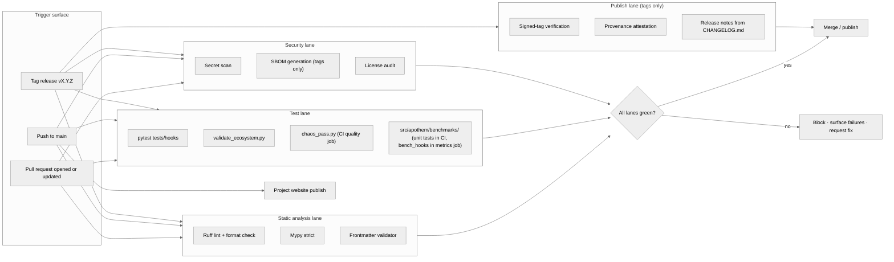

{/* SPDX-License-Identifier: MIT */}

**Структурная карта рабочего процесса сборки · валидации · публикации, который контролирует каждое изменение в экосистеме Apothem.** Этот документ устанавливает поверхность визуализации. Рабочие процессы GitHub Actions, которые он описывает, находятся в `.github/workflows/` (например, `ci.yml` и `release.yml`), а инструментарий релизов — в `scripts/release/`.

## Форма конвейера

## Роли дорожек

- **Дорожка статического анализа** — быстрая обратная связь. Ruff покрывает стиль Python и тщательно подобранный набор правил; mypy навязывает дисциплину типов в режиме strict; валидатор фронтматтера контролирует соответствие схеме артефактов для правил, навыков, делегированных исполнителей и команд. markdownlint в эту дорожку не входит: он запускается только как хук pre-commit, а CI его не запускает (см. [Соглашения по Markdown](/docs/reference/markdown-conventions)).
- **Дорожка тестов** — `pytest tests/hooks` прогоняет среду выполнения хуков по полной матрице событий; `validate_ecosystem.py` — основной структурный шлюз для проверки согласованности между артефактами; `chaos_pass.py` запускается в задании контроля качества CI при push и pull request в `main` (с фильтром по путям), чтобы выявлять деградацию при ухудшенных входных данных. Драйверы бенчмарков по классам в `src/apothem/benchmarks/` выполняются в CI через набор pytest и через задание `metrics`. Каждый полный запуск pytest в CI собирает `tests/unit/test_benchmarks.py`, который вызывает все драйверы, кроме `bench_install.py`. Задание `metrics` запускает `scripts/dev/collect_metrics.py`, который выполняет `bench_hooks.py --json` и записывает результат как `hook_e2e_ms`. `bench_tests.py` и `bench_install.py` замеряют реальные запуски только в рамках `make benchmarks`. Ни один рабочий процесс не запускает `make benchmarks`.
- **Дорожка безопасности** — gitleaks в `ci.yml` выявляет случайно закоммиченные учётные данные. Аудит лицензий (`license-audit.yml`) завершается ошибкой, если лицензия зависимости не входит в список разрешённых. Он запускается еженедельно и при изменении файлов зависимостей или лицензий. Шлюз REUSE (`reuse.yml`) запускается при каждом изменении и завершается ошибкой, если у файла нет строки лицензии или выражение SPDX не разбирается. `release.yml` генерирует SBOM для каждого релиза с тегом.
- **Дорожка публикации** — рабочие процессы релиза запускаются push-ами тегов; публикаторов npm и VS Code также можно перезапустить вручную для существующего тега. Проверка подписанного тега подтверждает происхождение релизной ветки; заметки о релизе формируются из `CHANGELOG.md` в формате Keep-A-Changelog. Сайт проекта публикуется из `site/dist/` в цель GitHub Pages при push в `main`, которые затрагивают его входные данные сборки, либо по ручному запуску.

## Конкретная конфигурация

Фактические файлы рабочего процесса (`.github/workflows/ci.yml`,
`.github/workflows/release.yml` и т. д.) находятся в репозитории. Эта диаграмма
задаёт каноническую форму, которой будет следовать каждая будущая конфигурация.

## Авторитетные перекрёстные ссылки

- `pyproject.toml` — источник истины для конфигурации Ruff / mypy / pytest.
- `scripts/dev/validate_ecosystem.py` — основной межартефактный шлюз.
- `scripts/dev/validate_hooks.py` — структурная валидация, специфичная для хуков.
- `scripts/dev/chaos_pass.py` — состязательный проход по каждому настроенному хуку.
- `src/apothem/benchmarks/` — верификаторы бюджета времени выполнения по классам.
- `site/content/docs/developer-guide.mdx` — рабочий процесс контрибьютора, ориентированный на оператора.
- `CHANGELOG.md` — источник заметок о релизе.
