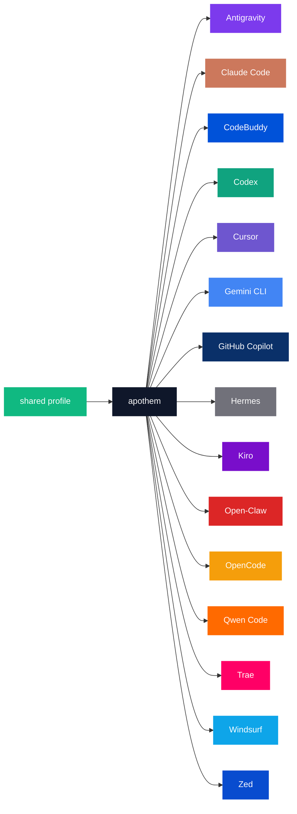

{/* SPDX-License-Identifier: MIT */}

Канонические перечисления «название бренда × код цвета» ниже заключены в блок кода `text`, чтобы сохранить дословные идентификаторы окружений, которых требует назначение палитры как каталога.

## Ядро Apothem

| Токен | Светлый | Тёмный | Назначение |
|---|---|---|---|
| `apothem-hub` | `#0F172A` | `#F1F5F9` | Центральный узел распределения («apothem») в каждой архитектурной диаграмме. |
| `shared-profile` | `#10B981` | `#34D399` | Профиль — источник истины, питающий ядро apothem. |

## Палитра окружений

Пятнадцать из семнадцати окружений окрашены в соответствии с их основной
фирменной идентичностью, чтобы читатель мог различать инструменты на диаграмме.
Сам знак Apothem использует только цвета slate и emerald со страницы
[палитры](/docs/brand/palette); цвета окружений в нём нет. Оставшиеся два —
`glm` и `kimi-code` — пока не имеют определённого фирменного цвета; их строки
добавляются, как только фирменный цвет задан в вышестоящем источнике, согласно
шагу распространения в разделе [Обновления](#обновления).

```text
| Token             | Light     | Dark      | Source                                                                                                                                              |
|-------------------|-----------|-----------|-----------------------------------------------------------------------------------------------------------------------------------------------------|
| `antigravity`     | `#7C3AED` | `#9F67FF` | Google Antigravity deep-purple.                                                                                                                     |
| `claude-code`     | `#CC785C` | `#E89378` | Anthropic terracotta-orange.                                                                                                                        |
| `codebuddy`       | `#0052D9` | `#5E8EF7` | Tencent CodeBuddy blue.                                                                                                                             |
| `codex`           | `#10A37F` | `#19C796` | OpenAI signature teal.                                                                                                                              |
| `cursor`          | `#6E56CF` | `#9B85E3` | Cursor brand purple.                                                                                                                                |
| `gemini-cli`      | `#4285F4` | `#6BA4F7` | Google blue.                                                                                                                                        |
| `github-copilot`  | `#0A3069` | `#5B8FE3` | GitHub Mona deep-blue.                                                                                                                              |
| `hermes`          | `#71717A` | `#A1A1AA` | Community silver-grey.                                                                                                                              |
| `kiro`            | `#790ECB` | `#A862DD` | Kiro violet.                                                                                                                                        |
| `open-claw`       | `#DC2626` | `#F87171` | Community red-orange.                                                                                                                               |
| `opencode`        | `#F59E0B` | `#FBBF24` | Community amber.                                                                                                                                    |
| `qwen-code`       | `#FF6A00` | `#FF8C40` | Alibaba Qwen orange.                                                                                                                                |
| `trae`            | `#FF0066` | `#FF599C` | ByteDance Trae magenta.                                                                                                                             |
| `windsurf`        | `#0EA5E9` | `#38BDF8` | Windsurf sky-blue.                                                                                                                                  |
| `zed`             | `#084CCF` | `#5E8BE0` | Zed Industries blue.                                                                                                                                |
```

## Товарные знаки

Названия окружений, названия продуктов и фирменные цвета на этой странице и по
всему сайту принадлежат их владельцам и являются товарными знаками
соответствующих владельцев. Apothem называет инструмент только для того, чтобы
указать, какой из них он настраивает, и использует цвет инструмента только для
того, чтобы отличить его на диаграмме. Apothem — независимый проект; он не
аффилирован ни с одной из этих компаний или проектов, не спонсируется и не
одобряется ими и не поставляет ни одного из их логотипов.

## Обоснование именования

- **`apothem-hub`** — геометрический центр, о котором напоминает название (апофема правильного многоугольника направлена внутрь, к его ядру).
- **`shared-profile`** — вышестоящий источник, отличающийся от цвета любого отдельного окружения, чтобы на каждой диаграмме он читался как стрелка «входа».
- **Токены по окружениям** повторяют slug окружения, используемый по всей кодовой базе (`harnesses/<slug>/`, ключ точки входа, аргумент CLI `--harness <slug>`). Одно слово на понятие; одна и та же строка везде.

## Использование в Mermaid



## Доступность

Каждый токен светлого режима обеспечивает контраст WCAG 2.2 AA с белым текстом (≥4.5 : 1) там, где контраст это позволяет без искажения фирменного цвета. Там, где нативный фирменный цвет окружения сам по себе не достигает порога AA с белым текстом (в частности, семейство янтарных / оранжевых и семейство небесно-голубых / бирюзовых токенов, перечисленных выше), диаграммы, которым нужен контраст текста на цвете уровня WCAG AA, используют в качестве заливки **вариант для тёмного режима** (осветлённый оттенок), чтобы белый текст читался чётко. Столбец тёмного режима откалиброван для этой цели: каждый токен тёмного режима проходит AA с белым текстом.

## Обновления

Палитра обновляется только тогда, когда окружение утверждает изменение бренда в вышестоящем источнике. Изменения бренда отдельного окружения распространяются атомарно на `site/app/global.css`, эту страницу и каждый затронутый мастер-файл SVG под `assets/src/`.
