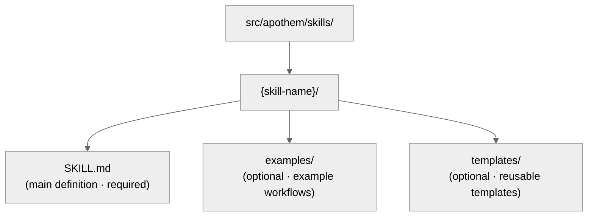

{/* SPDX-License-Identifier: MIT */}

Это руководство помогает разработчикам сопровождать и расширять экосистему
Apothem по стандартам качества уровня SOTA.

## Краткий справочник: типы артефактов

В этом руководстве рассматриваются пять типов артефактов, у каждого из которых
своё назначение. Правила, команды, помощники и навыки несут фронтматтер YAML;
хуки регистрируются в `hooks.json` и `settings.json` и фронтматтера не несут.
Output-стили — ещё один класс артефактов с двумя обязательными ключами
фронтматтера, `name` и `description`; см.
[Схема фронтматтера](/docs/reference/frontmatter-schema).

| Артефакт | Путь | Назначение | Когда создавать |
| -------- | ---- | ------- | -------------- |
| **Правило** | `src/apothem/rules/*.md` | Поведенческий мандат или операционная директива | Установлен новый принцип, политика или мандат управления |
| **Команда** | `src/apothem/commands/*.md` | Слеш-команда (`/command-name`) для сложных рабочих процессов | Новый многошаговый пользовательский рабочий процесс |
| **Помощник** | `src/apothem/agents/*.md` | Постоянное определение делегированного исполнителя для параллельных задач | Новая повторяющаяся специализированная задача (аудит, исследование, проверка качества) |
| **Навык** | `src/apothem/skills/{name}/SKILL.md` | Переиспользуемая методика с сигналом обнаружения | Новый обнаруживаемый переиспользуемый шаблон методики |
| **Хук** | `src/apothem/hooks/` + `hooks.json` + `settings.json` | Проверка или управление состоянием, запускаемые событием | Новое событие жизненного цикла или потребность в проверке |

## Контракт адаптера окружения

Идентичность окружения и факты о его возможностях находятся в
`src/apothem/lib/harness_registry.py`. Изменение окружения завершено только
тогда, когда эти поверхности согласованы:

| Поверхность | Требуемое обновление |
| --- | --- |
| Строка реестра | Публичный ID, ключ пакета, точка входа, область, формат вывода, целевые пути, пути документации, файл возможностей, пин стандарта, тесты на фикстурах, ключ данных пакета, источники шаблонов и статусы возможностей. |
| Пакет адаптера | `__init__.py`, `install.py`, `update.py`, `uninstall.py`, `verify.py`; добавляйте `materializer.py` только тогда, когда окружение рендерит нативный файл конфигурации. |
| Манифест распространения | Пути шаблонов и групп для адаптеров, опирающихся на манифест. |
| Возможности | `src/apothem/harnesses/<package>/capabilities.yml` с каждой требуемой возможностью и обоснованием для неподдерживаемых состояний и состояний, ожидающих обнаружения, а также карта `conversion_losses` для каждой преобразуемой группы команд, помощников или правил (см. [реестр окружений](/docs/reference/harness-registry)). |
| Пин соглашения | `STANDARD-CONVENTION-PIN.md` с URL вендора, датой снимка, каноническим именем файла/схемой, ссылкой на доказательства и обоснованием неподдерживаемых возможностей. |
| Тесты | Паритет реестра, тест адаптера на фикстурах, строка эталонного плана установки, поведение dry-run/без записи, идемпотентность и покрытие данных пакета. |
| Документация | Справочная страница окружения, страница сравнения, заметки о возможностях/MCP и примеры с вымышленными заполнителями. |

Адаптеры уровня проекта должны устанавливать `requires_project = True`,
принимать `project: Path | None` в методах жизненного цикла и отклонять
отсутствующие или небезопасные корни проекта до записи. Адаптеры
пользовательского уровня должны держать пути под документированным корнем
пользовательской конфигурации окружения.

## Политика эталонных фикстур

`tests/fixtures/harness-golden-plans.json` фиксирует публичную форму плана
установки для всех семнадцати окружений реестра: публичный ID, режим
материализации, путь к исходной группе/шаблону и нормализованный целевой путь
под `<ROOT>`. Когда поведение реестра, манифеста или целевых путей шаблонов
намеренно меняется, обновляйте эталонную фикстуру в том же коммите, что и
изменение исходного кода, чтобы diff показывал изменение поведения.

## Проверка перед записью

Общий драйвер установки проверяет каждый источник и каждую цель перед первой
записью. Он отклоняет отсутствующие источники манифеста, обход каталогов в
цели, целевые пути вне выбранного корня и пересечения символических ссылок.
Пробные прогоны (dry-run) выполняют ту же проверку и возвращают
структурированные результаты `skipped` или `unchanged`, не создавая файлов.

## Маскирование и примеры данных

Диагностика профиля маскирует поля вида token, secret, password, credential,
API key, private key, authorization, auth, а также поля в форме заголовков.
Документация, фикстуры, примеры и фрагменты JSON используют `example.invalid`,
`Example User`, `example-user` и очевидные заполнители вместо правдоподобных
секретов или личных учётных записей.

## Прежде чем писать: каноническая схема

**Машиночитаемый контракт, который применяет шлюз, — это JSON Schema для
каждого класса в `src/apothem/schemas/*.schema.json`: `additionalProperties`
отклоняет неизвестные ключи, поэтому последнее слово за шлюзом
соответствия.** Их отражают две проекции для чтения человеком:
`site/content/docs/reference/frontmatter-schema.mdx` (указатель обязательных
ключей) и `site/content/docs/reference/artifact-schema.mdx` (шаблоны и
разобранные примеры для каждого класса). Если страница расходится с JSON
Schema, приоритет у схем.

- Прочитайте JSON Schema для вашего типа артефакта в `src/apothem/schemas/`
- Прочитайте § «Schema» в `site/content/docs/reference/artifact-schema.mdx`,
  чтобы получить шаблон и разобранный пример
- Скопируйте обязательные поля, заполните обязательные значения, добавьте
  необязательные поля по мере необходимости

## Быстрая проверка фронтматтера

Фронтматтер каждого артефакта должен проходить эти проверки. Применяйте
проверки `version`, `updated` и `portability` только к тому классу, который
несёт этот ключ: правила не несут ни одного из них, а навыки не несут
`portability`.

```yaml
✓ Valid YAML syntax (use tools: `yamllint` or PowerShell `ConvertFrom-Yaml` where available)
✓ All mandatory fields present (per schema for artifact type)
✓ name: uses kebab-case
✓ version: semantic MAJOR.MINOR.PATCH
✓ updated: ISO 8601 date (YYYY-MM-DD)
✓ description: single-line, non-empty
✓ scope fields valid per artifact type (rules: pathFilter + alwaysApply; CLAUDE.md root: scope)
✓ portability: string, for example `universal` (the schemas do not enumerate its values)
✓ No typos in field names — must match canonical schema exactly
✓ Optional fields use correct enum values
```

## Соглашения об именовании

### Имена артефактов (kebab-case)

- **Правила:** `operational-mandates`, `clean-room-generation`, `context-management`
- **Команды:** `plan-execute`, `plan-spec`, `plan-generate`
- **Помощники:** `codebase-explorer`, `convention-auditor`, `quality-gate`
- **Навыки:** `plan-suite`, `ecosystem-audit`

Шаблон: строчные буквы, дефисы между словами, без пробелов и подчёркиваний.

### Именование файлов

- **Правила:** `{name}.md`
- **Команды:** `{name}.md`
- **Помощники:** `{name}.md`
- **Навыки:** внутри папки `src/apothem/skills/{name}/SKILL.md` (точный регистр: `SKILL.md`)
- **Хуки:** внутри папки `src/apothem/hooks/`. Все обработчики событий написаны на Python.
  Каждая команда хука в шаблоне `settings.json` для Claude Code использует exec-форму:
  `command` — это плейсхолдер интерпретатора `${PYTHON_BIN}`, который разрешается при
  установке, а `args` содержит путь к скрипту и его аргументы. Этот шаблон запускает
  `${HARNESS_ROOT}/.apothem/support/hooks/dispatch.py <event> [<message-name>]` и
  `${HARNESS_ROOT}/.apothem/support/conformity/gate.py --hook` по абсолютному пути, поэтому
  установленной копии не нужен импортируемый пакет `apothem`. Плагин Claude Code вместо
  этого регистрирует хуки в `src/apothem/hooks/hooks.json`, как shell-команды, которые
  запускают `hooks/lib/bootstrap.sh` через `bash`; эта заглушка находит Python и запускает
  `dispatch.py`, поэтому обработчики остаются на Python. Новый хук регистрируйте в
  `hooks.json` и в шаблоне `settings.json` для Claude Code. `dispatch.py` направляет
  `SessionStart` в `session_start_bootstrap.main()`, а каждое другое разрешённое событие — в
  `emit_hook_context.main()`. Единственные shell-заглушки, разрешённые в
  `src/apothem/hooks/` или `scripts/`, — это шесть файлов локатора и начальной загрузки
  (`find-python.{ps1,sh}`, `find-pwsh.{ps1,sh}`, `bootstrap.{ps1,sh}`); любой другой файл
  `.ps1` / `.sh` не проходит проверку гигиены `scripts/dev/validate_hooks.py`.

### Перекрёстные ссылки

Ссылаясь на другие артефакты, используйте точные имена:

- Правила: `"operational-mandates"` (значение поля name)
- Команды: `/plan-execute` (со слешем в документации для людей; без слеша в коде)
- Помощники: `codebase-explorer` (значение поля name)
- Навыки: `plan-suite` (значение поля name)

Никогда не используйте в прозе пути к файлам или усечённые имена.

## Переносимость: Windows и Unix

Каждая команда ДОЛЖНА явно объявлять свой статус переносимости в поле
`portability`. Помощник МОЖЕТ его объявлять. Навыки, правила и output-стили не
несут поля `portability`.

### Универсальный

- Работает одинаково в Windows, macOS и Linux
- Без предположений об оболочке
- Пути используют прямые слеши (`/`)
- Без жёстко заданных абсолютных путей
- Без специфичного для Windows синтаксиса PowerShell

```yaml
portability: "universal"
```

### Универсальный с оговорками для Windows

- Универсален на всех POSIX-хостах; названная оговорка действует для варианта платформы Windows, объявленного в содержимом
- Явно документируйте оговорку в содержимом
- Пример: «Символические ссылки не поддерживаются в Windows до Win 10»

```yaml
portability: "universal-with-windows-caveats"
```

Документируйте оговорку в примечании сразу после заголовка.

### Только Unix / только Windows

- Явно ограничен одной платформой
- Редкость в Apothem — большинство артефактов должны быть универсальными
- Используйте, только если платформенно-специфичные возможности необходимы

```yaml
portability: "unix-only"
```

Документируйте причину в первом разделе артефакта.

## Область действия: всегда активные или с фильтрацией по пути

### Всегда активные

Правило применяется везде.

```yaml
pathFilter: ""
alwaysApply: true
```

### С фильтрацией по пути

Правило применяется условно, в зависимости от пути файла.

```yaml
pathFilter: "**/*.py, **/*.toml"
alwaysApply: false
```

`pathFilter` использует glob-шаблоны (тот же формат, что и в `.gitignore`).
Когда файл соответствует фильтру, правило активируется.

## Семантика версий

Каждый версионируемый артефакт несёт собственную семантическую версию
(`MAJOR.MINOR.PATCH`). Команды и навыки требуют её, помощники и output-стили
МОГУТ её нести, а правила её не несут:

- **PATCH** — изменение поведения, которое исправляет существующую директиву, не нарушая контракт.
- **MINOR** — аддитивные изменения без нарушения совместимости: новые необязательные разделы, новые необязательные поля фронтматтера, новые примеры. Существующие потребители продолжают работать без изменений.
- **MAJOR** — ломающие изменения схемы или контракта: удалённые разделы, переименованные поля, изменённое поведение существующей директивы, изменения, которые требуют адаптации зависимых артефактов.

Исправления опечаток и ссылок, форматирование, а также правки, затрагивающие только комментарии или только документацию, не меняют версию. Версию повышает только изменение поведения. Такая правка всё равно обновляет дату `updated` артефакта.

Примеры:

- `vX.Y.Z` → `vX.Y.(Z+1)` (PATCH: исправленная директива, которая меняет поведение)
- `vX.Y.Z` → `vX.Y.Z` (без повышения: исправление опечатки или ссылки; `updated` меняется)
- `vX.Y.Z` → `vX.(Y+1).0` (MINOR: добавлен новый необязательный раздел)
- `v0.Y.Z` → `v(0+1).0.0` (MAJOR: контракт объявлен стабильным; новые артефакты начинаются с `v0.Y.Z`)
- `vX.Y.Z` → `v(X+1).0.0` (MAJOR: удалено обязательное поле фронтматтера)

Повышайте `version` и обновляйте `updated` вместе при каждой правке,
меняющей поведение артефакта, который несёт эти поля. Для релизов, которые
объединяют изменения артефактов, добавляйте соответствующую строку в
`CHANGELOG.md` уровня экосистемы.

### Ревизии набора планов

Правило для артефактов выше не распространяется на наборы планов. Версия набора
планов — это значение `vX.Y.Z`, записанное в заголовке `MASTER-PLAN.md` и в таблице
истории ревизий. Исправление опечатки в наборе планов — это ревизия, которая увеличивает
номер PATCH. Шаг 10.2 `/plan-review` задаёт классификацию и добавляет строку в таблицу
истории ревизий.

- `vX.Y.Z` → `vX.Y.(Z+1)` (набор планов, исправление опечатки: PATCH)
- `vX.Y.Z` → `vX.Y.Z` (артефакт, исправление опечатки: без увеличения; правило для артефактов выше)

## Когда редактировать артефакт

### Правила

- Считайте структуру Mandatory/Optional несущей — её перестройка затрагивает
  каждый зависимый артефакт.
- Уточняйте Anti-Patterns, примеры Seriousness Scaling и цитаты по мере
  углубления понимания.
- Фиксируйте обоснование любого структурного изменения в соответствующем
  тематическом файле памяти.

### Команды

- Форма аргументов — часть публичного контракта: ломайте её только с явным
  намерением и распространяйте изменение на каждого вызывающего (повышение MAJOR).
- Держите шаги рабочего процесса и контракты возврата сжатыми и актуальными.
- Документируйте неочевидный порядок шагов прямо в тексте.

### Помощники

- Держите `disallowedTools` минимальным, но достаточным; документируйте
  обоснование, когда он меняется.
- Уточняйте Operating Principles и Return Contracts по мере развития роли
  помощника (повышение MINOR).
- Отслеживайте изменения возможностей прямо в тексте, чтобы вызывающие могли
  скорректировать свои ожидания.

### Навыки

- Поддерживайте шаги Procedure и Examples в соответствии с действительностью.
- Сигналы обнаружения должны отражать реальные формулировки пользователей в
  текущем использовании.
- Разделяйте навык, как только он превышает ~150 строк (см.
  `auto-memory.md` § Topic File Management).

## Пошагово: добавление нового правила

### 1. Оцените ортогональность

Пересекается ли это правило с существующими правилами? Поищите связанное
содержимое в `src/apothem/rules/`.

Если пересечение >50%, рассмотрите вместо этого расширение существующего
правила. См. `persistent-conventions-vigilance.md` § Artifact Evolution.

### 2. Напишите содержимое

Следуйте структуре:

- Заголовок: `# Rule: {Title}`
- Раздел Purpose
- Obligations / Core directives (нумерованные, со ссылками)
- Таблица Seriousness Scaling (обязательна всегда)
- Раздел Anti-Patterns
- Раздел Enforcement

### 3. Создайте фронтматтер

Используйте схему из `site/content/docs/reference/artifact-schema.mdx` § Schema: Rules. Задайте:

- `name:` идентификатор в kebab-case
- `description:` однострочное описание для реестров
- `pathFilter:` список glob для правил с фильтрацией по пути; пустая строка (`""`) для всегда активных правил
- `alwaysApply:` `true` для всегда активных правил, `false` для правил с фильтрацией по пути

Правила содержат только эти четыре поля — без `version` / `updated` / `scope` / `portability` / `implements`.

Пример:

```yaml
---
name: "my-new-rule"
description: "Brief one-liner"
pathFilter: ""
alwaysApply: true
---
```

### 4. Обновите README правил

Добавьте строку в таблицу семейства этого правила в разделе Rule families файла
`src/apothem/rules/README.md`:

```markdown
| `my-new-rule.md` | One-line concern of the new rule. |
```

Выберите таблицу того семейства, чья область ответственности соответствует
правилу.

### 5. Дополните CHANGELOG.md

Добавьте в раздел `### Added` следующего релиза строку с описанием нового правила.

### 6. Запустите проверку

Вызовите навык `ecosystem-audit`, чтобы проверить новое правило, сосредоточившись
на области правил:

```text
Invoke the ecosystem-audit skill with --focus rules --fix
```

Убедитесь, что для вашего нового правила не сообщается ни об одной ошибке.

## Пошагово: добавление новой команды

Команды — это слеш-команды, такие как `/plan-spec`, `/plan-execute`, `/security-audit` и т. д.

### 1. Определите роль

Команды — это рабочие процессы, запускаемые пользователем. Модель запускает
команду сама только тогда, когда её настройка `disable-model-invocation`
равна `false` (шаг 2). Спросите:

- Это рабочий процесс, который пользователь запускает, набирая `/command-name`?
- Оркеструет ли он несколько шагов?
- Может ли он завершиться по тайм-ауту или потребовать ввода пользователя посреди выполнения?

Если на любой из этих вопросов ответ «нет», это, вероятно, навык, а не команда.

### 2. Создайте файл

Путь: `src/apothem/commands/{name}.md`

Фронтматтер (из `site/content/docs/reference/artifact-schema.mdx` § Schema: Commands):

```yaml
---
name: "my-command"
version: "X.Y.Z"
updated: "2026-04-20"
description: "What this command does"
argument-hint: "[path/to/input] [--flag VALUE]"
disable-model-invocation: true
portability: "universal"
allowed-tools: "Read, Glob, Grep"
---
```

`disable-model-invocation: true` делает команду вызываемой только оператором;
при `false` модель может запустить её, когда запрос соответствует её описанию.
Большинство команд используют `true`, но большинство этапов конвейеров
планирования и исследований используют `false`.
Таблица вызовов в `src/apothem/commands/README.md` перечисляет настройку
каждой команды; добавьте строку для новой команды. Держите
`allowed-tools` только для чтения: окружение, которое соблюдает это поле,
запускает перечисленные инструменты, не спрашивая разрешения. Предоставляйте
инструмент с побочными эффектами только в виде правила с указанием области,
например `Bash(git log *)`; схема отклоняет `"*"` и любой из инструментов
`Bash`, `PowerShell`, `Write`, `Edit`, `NotebookEdit` или `WebFetch`,
записанный без указания области.

### 3. Напишите содержимое

Структура:

- Заголовок: `# /{name} — Human-Readable Title`
- Раздел Role (кто это выполняет)
- Высокоуровневые инструкции
- Раздел Workflow с шагами
- Контракт возврата / формат вывода

### 4. Обновите README и CHANGELOG.md

Добавьте строку в таблицу раздела этой команды в `src/apothem/commands/README.md` — в дополнение к строке таблицы вызовов из шага 2; добавьте строку CHANGELOG в раздел `### Added` следующего релиза.

### 5. Проверьте

Вызовите навык `ecosystem-audit`, сосредоточившись на командах:

```text
Invoke the ecosystem-audit skill with --focus commands --fix
```

## Пошагово: добавление нового помощника

Помощники — это постоянные определения делегированных исполнителей для
параллельной работы.

### 1. Определите шаблон

Подходит ли этот помощник под один из шаблонов Team, перечисленных ниже?

- Research Team: только чтение, сбор информации
- Audit Team: верификация, проверки согласованности
- Implementation Team: параллельные изменения кода
- Quality Team: линтинг, тесты, проверка типов, безопасность
- Documentation Team: обновления документации
- Other: специализированная задача

### 2. Создайте файл

Путь:

```text
src/apothem/agents/{name}.md
```

Фронтматтер:

```yaml
---
name: "my-helper"
version: "X.Y.Z"
updated: "2026-04-20"
description: "What this helper specializes in"
tools: "Read, Glob, Grep, Bash"
disallowedTools: "Write, Edit"
maxTurns: 15
portability: "universal"
---
```

Не указывайте `model`, `effort` и `permissionMode`, чтобы помощник наследовал
выбор сессии (агностическая позиция), и не указывайте `memory`, если только
помощнику не нужна область постоянной памяти (`user`, `project` или `local`).

### 3. Напишите содержимое

Разделы:

- Operating Principles (только чтение, опора на доказательства, бинарные вердикты, исчерпывающая полнота)
- Workflow (нумерованные шаги)
- Return Contract (максимум токенов, структура, обязательные поля)

### 4. Обновите README и CHANGELOG.md

Добавьте строку в таблицу Index в `src/apothem/agents/README.md`; добавьте строку CHANGELOG в раздел `### Added` следующего релиза.

### 5. Протестируйте

Задействуйте помощника в реальном сценарии и убедитесь, что он работает так,
как задокументировано.

## Пошагово: добавление нового навыка

Навыки — это переиспользуемые обнаруживаемые методики.

### 1. Оцените переиспользуемость

Прежде чем писать навык:

- Встречали ли вы эту проблему/методику 3+ раз?
- Обнаруживаема ли она? (Сигнализирует ли о ней шаблон пользовательского запроса?)
- Можете ли вы воспроизводимо её формализовать?

Если на все три вопроса ответ «да», напишите навык.

### 2. Создайте структуру



### 3. Напишите SKILL.md

Фронтматтер:

```yaml
---
name: "skill-name"
version: "X.Y.Z"
updated: "2026-04-20"
description: "What this skill teaches"
archetype: "workflow-template"
userInvocable: true | false
disable-model-invocation: true | false
allowed-tools: "Read, Glob, Grep"
argument-hint: "[args]"               # optional; if userInvocable
---
```

Структура содержимого:

- Purpose
- When to Use This Skill
- Prerequisites
- Step-by-Step Procedure
- Common Mistakes
- Examples

### 4. Обновите README и CHANGELOG.md

Добавьте строку в таблицу Index и по строке для каждого файла навыка в таблицу Folder contents в `src/apothem/skills/README.md`; добавьте строку CHANGELOG в раздел `### Added` следующего релиза.

### 5. Проверьте

Вызовите навык `ecosystem-audit`, сосредоточившись на навыках:

```text
Invoke the ecosystem-audit skill with --focus skills --fix
```

## Контрольный список проверки перед коммитом

- [ ] Фронтматтер проходит проверку синтаксиса YAML
- [ ] Все обязательные поля присутствуют согласно схеме
- [ ] Поле `name` использует kebab-case
- [ ] `version` (только у версионируемых классов; правила её не несут) семантическая (`MAJOR.MINOR.PATCH`) и была повышена, если поведение изменилось
- [ ] `updated` совпадает с сегодняшней датой у каждого изменённого вами артефакта, который несёт это поле
- [ ] Поле `portability` задано и корректно (обязательно у команд, необязательно у помощников)
- [ ] CHANGELOG.md содержит изменение в соответствующей категории в разделе следующего релиза
- [ ] Нет ссылок на внутренние элементы планов (соответствие CM-7)
- [ ] Перекрёстные ссылки согласованы с другими артефактами
- [ ] Новый артефакт зарегистрирован в индексе README своей папки
- [ ] Артефакт протестирован (если применимо)
- [ ] Навык `ecosystem-audit` выполняется без ошибок
- [ ] Содержимое следует структурным соглашениям (формат заголовка, разделы и т. д.)

## Ссылки на другие артефакты

Используйте именно эти соглашения:

### Ссылка на правило

```markdown
See `src/apothem/rules/operational-mandates.md` or shorthand: the Operational Mandates rule.
In prose: ... per CM-1–10 (Operational Mandates rule) ...
```

### Ссылка на команду

```markdown
See `/plan-execute` command. Or: Run `/plan-execute`.
In prose: The `/plan-execute` command handles phase execution.
```

### Ссылка на помощника

```markdown
Deploy the `codebase-explorer` delegated worker.
In prose: The codebase-explorer worker finds patterns.
```

### Ссылка на навык

```markdown
Use the `plan-suite` skill.
In prose: The plan-suite skill provides the Master Plan Suite template.
```

### Ссылка на разделы CLAUDE.md

```markdown
See CLAUDE.md § Harness Adapter Pattern.
Or: § Plans Discipline.
```

## Линтинг и форматирование

Все артефакты используют:

- **Markdown:** GFM (GitHub Flavored Markdown)
- **YAML:** совместимость с YAML 1.2
- **Окончания строк:** LF (в стиле Unix)
- **Кодировка:** UTF-8
- **Ширина строки:** мягкий перенос на 100 символах для содержимого (без жёстких переносов)

Для файлов Python используйте форматировщик / линтер `Ruff`. Для Markdown
используйте `prettier` или аналог.

## Тестирование и измерения

### Запуск набора тестов

```bash
python -m pytest                      # unit, integration, property, conformity, scripts
python -m pytest tests/property       # Hypothesis properties (profile loader, frontmatter, merge)
```

Набор герметичен: он проходит, когда чекаут находится под `$TMPDIR`, и когда
`python` в `PATH` не имеет зависимостей, необходимых CLI, потому что
интеграционные тесты запускают тот интерпретатор, под которым работает pytest,
и токенизируют вложенные временные пути и пути к исходникам, начиная с самых
длинных.

### Покрытие по пакетам

CI измеряет три пакета и держит каждый на его собственном нижнем пороге. Ни
один из них не включается в другой.

| Пакет | Пути | Порог | Где задан порог |
| --- | --- | --- | --- |
| engine | `cli`, `harnesses`, `lib`, `hooks`, `statuslines` | 80 | `[tool.coverage.report] fail_under` |
| conformity | `src/apothem/conformity` | 81 | `[tool.coverage.package-floors]` |
| audit | `src/apothem/audit` | 70 | `[tool.coverage.package-floors]` |

Значение — это покрытие строк плюс ветвей, тот же процент, который coverage.py
сообщает при `branch = true`; артефакт метрик также записывает значение только
по операторам под `coverage_lines`. Порог каждого пакета — это измеренное
значение покрытия строк плюс ветвей, округлённое вниз. Повышайте порог, когда
покрытие растёт; никогда не понижайте его, чтобы изменение прошло проверку.
Чтобы проверить локально:

```bash
python -m pytest --cov=src/apothem --cov-report=json:coverage.json
python scripts/dev/collect_metrics.py --coverage-json coverage.json --check-floors \
  --skip-hooks --skip-coldstart --harness zed
```

### Артефакт метрик

Задание CI `metrics` запускает `scripts/dev/collect_metrics.py` при каждом push
и каждом pull request и загружает `metrics.json` (`schema_version: 1`). Для
каждого значения `null` его причина указана под `nulls`.

| Ключ | Что измеряет |
| --- | --- |
| `coverage.engine`, `coverage.conformity`, `coverage.audit` | Процент покрытия строк плюс ветвей по каждому пакету, вместе с `coverage_floors`. |
| `always_on_bytes[harness]`, `always_on_files[harness]` | Для каждого из 17 окружений после `profile init` и `install --harness <id>` во временные `HOME` и проект: байты на диске файлов инструкций, которые это окружение загружает целиком при запуске. |
| `cli_coldstart_ms` | Медиана для `python -m apothem --version` (вместе с `--help` под `cli_coldstart_detail_ms`). |
| `hook_e2e_ms[event]`, `hook_injected_chars[event]` | Для каждого зарегистрированного события и сопоставителя (`PreToolUse:Write`, `Stop`, …): медианное общее время цепочки хуков на реальной полезной нагрузке и число символов контекста, которые она внедряет. |

Какие файлы считаются загружаемыми при запуске — это правило для каждого
окружения, взятое из документированных поверхностей инструкций каждого
вендора. Перечни, которые несут только описание (навыки, команды, субагенты),
не учитываются. Текст правила также записывается в артефакт под
`rules.always_on_bytes`:

```text
antigravity     ~/.gemini/{GEMINI,AGENTS}.md, ~/.gemini/config/{GEMINI,AGENTS}.md,
                ~/.gemini/config/rules/*.md with trigger: always_on, project
                GEMINI.md and AGENTS.md. The plugin rules/ folder is not a
                documented launch surface.
claude-code     ~/.claude/CLAUDE.md and ~/.claude/rules/**/*.md without paths:
                frontmatter, plus the project equivalents.
codebuddy       .codebuddy/rules/**/*.md (project and home) unless
                alwaysApply: false, plus CODEBUDDY.md.
codex           ~/.codex/AGENTS.md and the project AGENTS.md.
cursor          .cursor/rules/**/*.mdc with alwaysApply: true, and AGENTS.md.
gemini-cli      ~/.gemini/GEMINI.md and the project GEMINI.md.
github-copilot  .github/copilot-instructions.md and the project AGENTS.md.
hermes          ~/.hermes/SOUL.md, project .hermes.md, AGENTS.md, CLAUDE.md.
                The support tree and apothem/rules/ are not launch surfaces.
kimi-code       ~/.kimi-code/AGENTS.md, project AGENTS.md and .kimi-code/AGENTS.md.
kiro            .kiro/steering/**/*.md with inclusion: always or no inclusion
                key, and the project AGENTS.md.
open-claw       Workspace bootstrap files ~/.openclaw/workspace/*.md.
opencode        ~/.config/opencode/AGENTS.md, the project AGENTS.md, and every
                file the instructions globs in opencode.json match.
qwen-code       The context files named by context.fileName in
                ~/.qwen/settings.json (default QWEN.md), in ~/.qwen/ and the project.
trae            .trae/rules/**/*.md with alwaysApply: true, and
                ~/.trae/user_rules/*.md.
windsurf        .devin/rules/**/*.md and .windsurf/rules/**/*.md with
                trigger: always_on, the global global_rules.md, and AGENTS.md.
zed             The first of .rules, .cursorrules, .windsurfrules, .clinerules,
                .github/copilot-instructions.md, AGENT.md, AGENTS.md, CLAUDE.md,
                GEMINI.md in the project, plus ~/.config/zed/AGENTS.md.
glm             Nothing: GLM is a model backend and loads no instruction files.
```

### Поведенческие оценки

Набор в `evals/` измеряет поведение, а не форму: 64 случая срабатывания
(каждая команда и каждый субагент, которых может вызывать модель, срабатывают
на запрос из своей области и молчат на почти подходящий запрос), 32 случая
результата (по одному на каждый этап планирования, этап исследования и
измерение аудита) и 6 пар эффекта правила (текст всегда активного правила
включён и выключен). Случаи — это простые данные, которые бесплатно проверяет
`python -m pytest tests/unit/test_eval_suite.py`; их запуск платный и
выполняется вручную. О рабочем процессе `Evals`, локальном запуске и о том,
как добавить случай, см. [Запуск поведенческих оценок](/docs/how-to/evals).
После редактирования всегда активного правила, у которого есть пара, запустите
`python scripts/dev/sync_eval_rule_cases.py`.

### Бенчмарки

`make benchmarks` запускает драйверы для каждого класса в
`src/apothem/benchmarks/`, кроме `bench_agents.py`. Каждый драйвер завершается
с кодом `0` — успех, `1` — превышение бюджета, `2` — ошибка (измеряемый прогон
не выполнился) или `3` — не измерено.

- `bench_hooks.py` запускает каждую команду `shell: bash`, которую регистрирует
  `hooks/hooks.json`, в том виде, как она записана, на реальной полезной
  нагрузке для каждого события и сопоставителя, и сообщает медианное общее
  время, самую медленную команду (сверяется с бюджетом события) и число
  внедрённых символов. Команда, которая не может выполниться в
  зарегистрированном виде (код выхода 126, когда у скрипта нет бита
  исполнения), — это ошибка, а не успешное прохождение.
- `bench_agents.py` сообщает `NOT MEASURED` (код выхода 3): для запуска
  субагента нужны хост-окружение и вызов модели. `make benchmarks` его не
  запускает.

Проверка бюджета всегда активных правил (`always-on-budget-grep`) считает
слова, разделённые пробельными символами, исключая раздел Bindings и
строки-указатели на компаньоны. Её JSON-отчёт также содержит
`always-on-loaded`: байты, символы и слова тел без фронтматтера, которые
загружает окружение, суммированные по всем всегда активным правилам.

## Аудит экосистемы: запуск проверки

Экосистему покрывают две взаимодополняющие поверхности проверки:

**Машинно проверяемая (валидаторы Python)** — запускайте перед каждым коммитом:

```bash
python scripts/dev/validate_hooks.py       # Hook structure + Python-only hygiene
python scripts/dev/validate_ecosystem.py   # Full tree + frontmatter + delegated hook checks
python scripts/dev/chaos_pass.py           # Adversarial sweep across configured hooks
pytest tests                                    # Unit tests for the hook runtime
```

**Управляемая ассистентом** — для аудита перекрёстных ссылок, повествования и
соглашений:

```bash
/ecosystem-audit --focus all --fix
```

Параллельно выполняются:

- **Аудит структуры:** точность реестра, существование файлов, корректность фронтматтера
- **Аудит артефактов:** перекрёстные ссылки, покрытие мандатов, порядок конвейера
- **Аудит памяти:** утверждения файлов памяти в сравнении с состоянием файловой системы

Ожидаемый вывод: `PASS` и ноль находок от обеих поверхностей.

Если сообщается `FINDINGS`:

- Оцените серьёзность каждой находки (Critical / Important / Advisory)
- Устраняйте пункты Critical немедленно
- Планируйте пункты Important на следующий цикл
- Рассмотрите пункты Advisory на следующей итерации

---

## Вопросы?

Обращайтесь к:

- Схема фронтматтера: `site/content/docs/reference/artifact-schema.mdx`
- Жизненный цикл артефактов: `src/apothem/rules/persistent-conventions-vigilance.md` § Artifact Evolution
- Операционные мандаты: `src/apothem/rules/operational-mandates.md` CM-1–10
- Справочник по набору планов: `src/apothem/skills/plan-suite/master-template.md`
- Примечания к релизам: `CHANGELOG.md`
