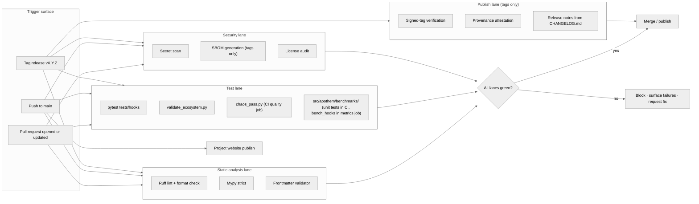

{/* SPDX-License-Identifier: MIT */}

**门控 Apothem 生态系统每次变更的构建 · 校验 · 发布工作流的结构性映射。**
本文档安装可视化表面。文中所述的 GitHub Actions 工作流文件位于 `.github/workflows/` 下（例如 `ci.yml` 与 `release.yml`），发布工具位于 `scripts/release/` 中。

## 流水线形态

## 泳道职责

- **静态分析泳道**——快速反馈。Ruff 覆盖 Python 风格与一套精选规则集；mypy 以 strict 强制类型纪律；frontmatter 校验器为规则、技能、委派工作者与命令的工件模式合规性设置闸门。markdownlint 不在这条泳道中：它仅作为 pre-commit 钩子运行，CI 不运行它（参见 [Markdown 约定](/docs/reference/markdown-conventions)）。
- **测试泳道**——`pytest tests/hooks` 针对完整事件矩阵演练钩子运行时；`validate_ecosystem.py` 是跨工件一致性的主要结构闸门；`chaos_pass.py` 在 CI 质量作业中运行，针对推送到 `main` 的推送与拉取请求（按路径过滤），以便在输入降级时捕捉退化。`src/apothem/benchmarks/` 下的按类基准驱动程序在 CI 中通过 pytest 套件以及 `metrics` 作业运行。CI 中每次完整的 pytest 运行都会收集 `tests/unit/test_benchmarks.py`，它会调用除 `bench_install.py` 之外的每个驱动程序。`metrics` 作业运行 `scripts/dev/collect_metrics.py`，该脚本运行 `bench_hooks.py --json`，并将结果记录为 `hook_e2e_ms`。`bench_tests.py` 与 `bench_install.py` 仅在 `make benchmarks` 下计时真实运行。没有任何工作流运行 `make benchmarks`。
- **安全泳道**——`ci.yml` 中的 gitleaks 会捕获意外提交的凭据。许可证审计（`license-audit.yml`）在依赖的许可证不在其允许列表中时失败。它每周运行一次，并且在依赖或许可证文件变化时也会运行。`release.yml` 为每个打标签的发布生成 SBOM。
- **发布泳道**——发布工作流由标签推送触发；npm 与 VS Code 发布器也可以通过手动派发，针对已存在的标签重新运行。签名标签验证确认发布分支的来源；发布说明派生自 `CHANGELOG.md` 的 Keep-A-Changelog 格式。项目网站在推送到 `main` 且触及其构建输入的提交时，或经手动派发时，从 `site/dist/` 发布到 GitHub Pages 目标。

## 具体配置

实际的工作流文件（`.github/workflows/ci.yml`、`.github/workflows/release.yml` 等）位于仓库中。本图定义了今后每个配置所对齐的规范形态。

## 权威交叉引用

- `pyproject.toml` —— Ruff / mypy / pytest 配置的真相来源。
- `scripts/dev/validate_ecosystem.py` —— 主要的跨工件门控。
- `scripts/dev/validate_hooks.py` —— 钩子专属的结构校验。
- `scripts/dev/chaos_pass.py` —— 对每个已配置钩子的对抗性扫描。
- `src/apothem/benchmarks/` —— 按类的运行时预算校验器。
- `site/content/docs/developer-guide.mdx` —— 面向操作者的贡献者工作流。
- `CHANGELOG.md` —— 发布说明来源。
