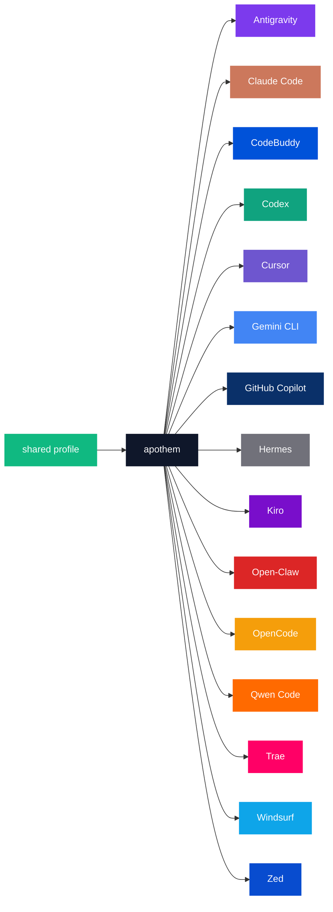

{/* SPDX-License-Identifier: MIT */}

下方规范的品牌名称 × 颜色代码枚举包裹在 `text` 围栏中，以逐字保留调板的目录用途所要求的逐工具标识符。

## Apothem 核心

| 令牌 | 浅色 | 深色 | 用途 |
|---|---|---|---|
| `apothem-hub` | `#0F172A` | `#F1F5F9` | 每张架构图中的中央分发节点（“apothem”）。 |
| `shared-profile` | `#10B981` | `#34D399` | 为 apothem 核心提供输入的事实来源配置档案。 |

## 工具调板

十七个工具中有十五个按其主要品牌识别着色，以便读者在图中区分各个工具。Apothem 标识本身只使用[调板](/docs/brand/palette)页面上的板岩色和翡翠色；它不带任何工具颜色。其余两个——`glm` 和 `kimi-code`——尚未定义品牌色；一旦上游品牌色确定，就会按照[更新](#更新)下的传播步骤添加它们的行。

```text
| Token             | Light     | Dark      | Source                                                                                                                                              |
|-------------------|-----------|-----------|-----------------------------------------------------------------------------------------------------------------------------------------------------|
| `antigravity`     | `#7C3AED` | `#9F67FF` | Google Antigravity deep-purple.                                                                                                                     |
| `claude-code`     | `#CC785C` | `#E89378` | Anthropic terracotta-orange.                                                                                                                        |
| `codebuddy`       | `#0052D9` | `#5E8EF7` | Tencent CodeBuddy blue.                                                                                                                             |
| `codex`           | `#10A37F` | `#19C796` | OpenAI signature teal.                                                                                                                              |
| `cursor`          | `#6E56CF` | `#9B85E3` | Cursor brand purple.                                                                                                                                |
| `gemini-cli`      | `#4285F4` | `#6BA4F7` | Google blue.                                                                                                                                        |
| `github-copilot`  | `#0A3069` | `#5B8FE3` | GitHub Mona deep-blue.                                                                                                                              |
| `hermes`          | `#71717A` | `#A1A1AA` | Community silver-grey.                                                                                                                              |
| `kiro`            | `#790ECB` | `#A862DD` | Kiro violet.                                                                                                                                        |
| `open-claw`       | `#DC2626` | `#F87171` | Community red-orange.                                                                                                                               |
| `opencode`        | `#F59E0B` | `#FBBF24` | Community amber.                                                                                                                                    |
| `qwen-code`       | `#FF6A00` | `#FF8C40` | Alibaba Qwen orange.                                                                                                                                |
| `trae`            | `#FF0066` | `#FF599C` | ByteDance Trae magenta.                                                                                                                             |
| `windsurf`        | `#0EA5E9` | `#38BDF8` | Windsurf sky-blue.                                                                                                                                  |
| `zed`             | `#084CCF` | `#5E8BE0` | Zed Industries blue.                                                                                                                                |
```

## 商标

本页及整个网站上的工具名称、产品名称和品牌色归其所有者所有，是其各自所有者的商标。Apothem 提及某个工具的名称，仅为说明它配置的是哪一个工具；使用某个工具的颜色，仅为在图中将其区分开来。Apothem 是一个独立项目；它与这些公司或项目均无关联，不受它们赞助或认可，也不附带它们的任何标志。

## 命名理据

- **`apothem-hub`**——该名称所唤起的几何中心（正多边形的边心距向内指向其核心）。
- **`shared-profile`**——上游来源，与任何单一工具颜色都不同，因此在每张图中都读作“输入”箭头。
- **逐工具令牌**与贯穿代码库使用的工具 slug 保持一致（`harnesses/<slug>/`、入口点键、CLI 的 `--harness <slug>` 参数）。一个概念一个词；处处使用同一字符串。

## Mermaid 用法



## 无障碍

本页上的每个浅色模式令牌，无论核心令牌还是工具令牌，都保持其品牌色不失真，因此其中有八个对白色文本的对比度低于 WCAG 2.2 AA（≥4.5 : 1）。其余的浅色模式令牌则满足该要求。这八个令牌及其对白色的对比度如下：

```text
shared-profile   2.54 : 1
claude-code      3.28 : 1
codex            3.20 : 1
gemini-cli       3.56 : 1
opencode         2.15 : 1
qwen-code        2.87 : 1
trae             3.86 : 1
windsurf         2.77 : 1
```

深色模式列用于深色背景，其中没有任何令牌对白色文本达到 4.5 : 1。上方的 Mermaid 示例在每种填充色上都使用白色文本，因此其中这八种填充色上的标签达不到 4.5 : 1。若某张图需要这八种填充色之一满足 WCAG AA 的文本对颜色对比度，则必须改用深色文本（`#0F172A`，它在这些填充色上的对比度为 4.63 : 1 至 8.31 : 1），而不是白色文本。

## 更新

只有当某个工具在上游正式确认品牌变更时，调板才会更新。工具颜色定义在本页上，而不是 `assets/design-tokens.css` 或 `site/app/global.css` 中。逐工具的品牌变更会以原子方式传播到本页以及 `assets/src/` 下每个受影响的 SVG 母版。
