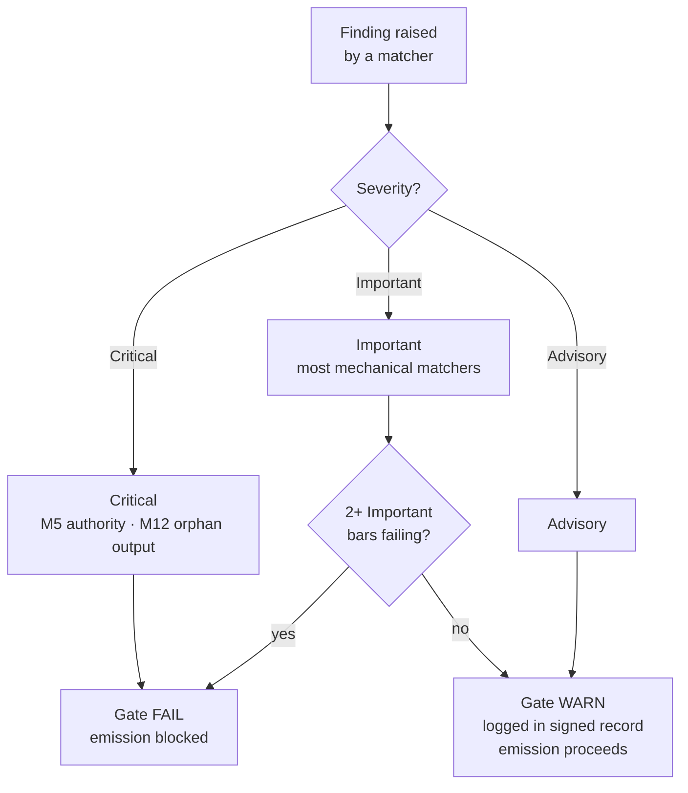

{/* SPDX-License-Identifier: MIT */}

## 十五道关卡

| 关卡 | ID | 强制规定 | 检查类别 | 失败 → 行动 |
|---|---|---|---|---|
| 1 | M1 | 宿主项目无关性 | 推理判断 | 修订以匹配宿主约定 |
| 2 | M2 | 编辑纪律（披露账本） | 机械 | 添加披露标记 |
| 3 | M3 | 十项质量维度 | 推理判断 | 针对未通过的维度进行修订 |
| 4 | M4 | 自我适用（存在闸门签署记录） | 机械 | 记录签署记录块 |
| 5 | M5 | 权威原则（不编造身份 / 端点 / 机密） | 机械 | 转交询问 |
| 6 | M6 | 专业知识融入（揭示的缺口） | 推理判断 | 揭示缺口；引用改进之处 |
| 7 | M7 | 选项标注（Recommended 标记 + 驱动因素理由） | 机械 | 标注选项集 |
| 8 | M8 | 确定性（规定性文字中不含含糊措辞） | 机械 | 将含糊措辞提升为条件句 |
| 9 | M9 | 视觉杠杆（结构性主题配有图示） | 推理判断 | 编写 / 刷新图示 |
| 10 | M10 | 双向绑定（互逆的反向指针已闭合） | 机械 | 闭合半边 |
| 11 | M11 | 敏捷冲刺（目标 / 待办列表 / DoR / DoD / 评审 / 回顾） | 推理判断 | 重构为冲刺 |
| 12 | M12 | 阶段报告与规范布局 | 机械 | 编写汇总；迁移到规范布局 |
| 13 | M13 | 代码工艺（lint / 格式化 / 类型检查；魔法数字；裸 except） | 机械 | 应用各语言的代码工艺规则 |
| 14 | M14 | 系统性（声明上游 / 下游 / 同级 / 执行者） | 推理判断 | 声明；在登记册中编入索引 |
| 15 | M15 | 生产就绪（测试 + 文档 + CHANGELOG + 合规提交 + CI 绿色 + semver 稳定性） | 机械 | 补齐缺失的表面 |

## 严重级别阶梯

| 严重级别 | 对闸门的影响 |
|---|---|
| **关键** | 闸门 FAIL——无条件阻止发布 |
| **重要** | 当 2 道及以上“重要”关卡同时失败时，闸门 FAIL |
| **建议性** | 闸门 WARN——记录在签署记录中；不阻止发布 |

大多数机械部分的匹配器默认为**重要**。M5（权威——机密、编造的端点）和 M12（孤儿输出）为**关键**。



## 校验器

机械部分位于 [`src/apothem/conformity/`](https://github.com/ahmed-g-gad/apothem/tree/main/src/apothem/conformity)，由 [`src/apothem/conformity/gate.py`](https://github.com/ahmed-g-gad/apothem/blob/main/src/apothem/conformity/gate.py) 编排。闸门以下列三种方式之一运行每个校验器：

- **per-write**：在每次待处理的写入时运行（`--hook`），或用 `--all-perwrite` 对每个已跟踪的文件运行。
- **standalone**：用 `--all` 在整个仓库范围内运行，或用 `--check <name>` 逐个运行。
- **change-set**：针对已暂存的差异运行，位于闸门的扫查之外。

下表由校验器模块生成。

{/* apothem:generated-reference:start */}

The conformity package ships 53 validators: 22 per-write, 30 standalone and 1 change-set. The gate registers the per-write and standalone ones.

| Validator | Runs | Rule anchor | What it checks |
| --- | --- | --- | --- |
| `agent-capability-grep` | standalone | agent-capability-discipline (per-harness capability matrix) | Verify every harness declares its agentic-capability matrix. |
| `agents-md-coverage-grep` | standalone | rules/agents-md-convention.md | Flag stale agent-companion files under the root-only AGENTS.md convention. |
| `agnosticism-grep` | standalone | rules/agnostic-posture.md §3 (harness neutrality) + §1 (default-off) | Flag harness bias and re-introduced enforcement presets in shipped surfaces. |
| `always-on-budget-grep` | per-write | D1 token-budget-discipline §Always-on body budget | Body-budget conformity matcher for always-on rules. |
| `bare-except-grep` | per-write | M13.3 error handling | Flag bare except clauses without typed exceptions or re-raise. |
| `binding-five-direction-grep` | standalone | M10 bidirectional-binding §1 (five-direction Bindings section) | Require the five-direction Bindings section on every rule, command, agent, and skill. |
| `binding-reciprocity-corpus-grep` | standalone | M10 bidirectional-binding §2 (↔ self-reciprocal) | Cross-file binding-reciprocity corpus walk — the ↔-symmetric half-edge check. |
| `binding-reciprocity-grep` | per-write | M10 bidirectional-binding §Notation | Flag binding declarations using non-canonical arrow notation. |
| `brand-mark-grep` | per-write | rules/plain-language.md (brand-mark display/identifier casing) | Flag brand-mark display/identifier form drift on brand-touched surfaces. |
| `commented-out-code-grep` | per-write | M13.1 why-not-what comments | Flag substantial commented-out code blocks left in source. |
| `completion-claim-grep` | per-write | rules/session-closure.md (verifiable-close output honesty) | Flag unsupported completion / guarantee claims in cohort prose. |
| `conventional-commit-grep` | standalone | CLAUDE.md Coding Conventions — Conventional Commits | Flag HEAD commit messages that drift from the Conventional-Commits grammar. |
| `copilot-instructions-presence-grep` | per-write | — | GitHub Copilot surface presence check. |
| `cross-platform-matrix-grep` | standalone | cross-platform OS x Python CI matrix | Verify CI declares a cross-platform OS x Python matrix. |
| `determinism-grep` | standalone | rules/determinism.md | Prove every command and skill surface has a deterministic output shape. |
| `diagram-staleness-grep` | per-write | M9 visual-leverage §Fidelity | Flag diagrams whose verification date is missing or stale. |
| `dynamism-grep` | standalone | rules/dynamism.md (static-version embeds) | Flag static-string version embeds in dynamism-required surfaces. |
| `editorconfig-presence-grep` | standalone | supply-chain SOTA-rigor §editorconfig | Verify a canonical .editorconfig is present at the project root. |
| `file-header-grep` | per-write | — | Authorship-header presence and canonical-form check. |
| `freshness-token-grep` | standalone | rules/freshness-facade.md | Flag freshness-narrative phrases on shipped public surfaces. |
| `frontmatter-grep` | per-write | the per-class frontmatter JSON Schemas (src/apothem/schemas/) | Validate per-artifact-class YAML frontmatter against required-key sets. |
| `frontmatter-value-grep` | standalone | per-class JSON Schema enum/pattern value constraints | Validate frontmatter VALUES against the per-class JSON Schema enum/pattern constraints. |
| `gitattributes-presence-grep` | standalone | supply-chain .gitattributes contract | Verify the repo-root ``.gitattributes`` carries the canonical contract. |
| `harden-runner-grep` | standalone | harden-runner egress baseline | Verify every workflow job opens with a conformant harden-runner step. |
| `hedging-grep` | per-write | M8 definitiveness §Hedging | Flag hedging vocabulary in prescriptive contexts. |
| `license-author-consistency-grep` | per-write | — | LICENSE author-identity presence check. |
| `link-check` | per-write | rules/code-craft-markdown.md §6 Link Discipline | Validate Markdown internal links against the on-disk reference graph. |
| `magic-number-grep` | per-write | M13.10 magic numbers | Flag magic numbers in source code. |
| `multi-surface-coherence-grep` | per-write | — | Shared-claim coherence across AI-conventions surfaces. |
| `naming-grep` | standalone | CLAUDE.md Coding Conventions (kebab-case naming) | Validate filesystem paths against the canonical naming convention. |
| `no-global-plans-grep` | standalone | CLAUDE.md Plans Discipline (no global plans) | Walk the git index for tracked plans paths; fail when found. |
| `no-toplevel-docs-grep` | standalone | single-source-of-truth (docs live in site/, not root docs/) | Fail when a top-level ``docs/`` directory exists at the repository root. |
| `oidc-trusted-publishing-grep` | standalone | OIDC trusted publishing | Verify release workflows use OIDC trusted publishing. |
| `option-annotation-grep` | per-write | M7 option-annotation (H6 per-option bind) | Enforce the per-option Recommended label-to-body bind (H6). |
| `orphan-output-grep` | per-write | M12 canonical-layout + M14 systemicity | Flag artifacts emitted to non-canonical locations or without provenance. |
| `permissions-minimum-scope-grep` | standalone | minimum-scope workflow permissions | Verify every GitHub Actions workflow declares a minimum-scope ``permissions:`` block. |
| `plain-language-grep` | standalone | rules/plain-language.md — user-facing prose | Flag mechanistic / harness-internal vocabulary in user-facing prose. |
| `plan-next-step-consistency-grep` | standalone | rules/recommend-next-step.md | Advisory: flag plan-suite infra files whose Recommended-Next-Step footer drifts from the suite's recorded next pipeline stage. |
| `plan-suite-structure-grep` | standalone | context-management-scratch 2 (suite-locality + closed vocab) + canonical-layout-reporting-tiers 2.1 (numeric-prefix discipline) | Validate plan-suite structure: suite-locality, closed vocab, numeric prefix. |
| `plans-discipline-language-grep` | standalone | CLAUDE.md Plans Discipline (multi-surface language) | Verify the canonical Plans Discipline language reaches every required surface. |
| `production-ready-pr-grep` | per-write | M15 production-ready §Same-change-set | Flag commits whose change-set lacks the production-ready four-class shape. |
| `recommend-next-step-grep` | standalone | rules/recommend-next-step.md | Verify every command file carries a `## Recommended Next Step` block. |
| `redundancy-grep` | standalone | rules/operational-mandates.md §CM-7 coherent-product non-redundancy | Flag substantively-duplicated paragraphs across the governed corpus. |
| `reference-token-grep` | standalone | rules/own-voice-reimplementation.md | Flag leaked reference-platform branding tokens on authored surfaces. |
| `registry-capability-consistency-grep` | standalone | rules/agent-capability-discipline.md — registry capability cells backed by evidence | Flag registry capability cells not backed by install / materializer / projection evidence. |
| `secret-leak-grep` | per-write | M13.8 security + M15 production-ready | Block emission of artifacts containing hardcoded credentials. |
| `semver-stability-grep` | change-set | M15 semver-stability | Semver stability matcher (M15 mechanical fraction). |
| `smoke-install-grep` | standalone | production-ready section 8.1 paired install scripts | Smoke-test the paired install scripts at the repository root. |
| `static-version-grep` | standalone | rules/dynamism.md §static-version-resolution | Verify version-bearing sites resolve dynamically, not as static literals. |
| `token-efficiency-grep` | per-write | clean-room-generation §5 + token-efficiency-rewrite | Flag filler phrases, throat-clearing openers, and content-free qualifiers. |
| `unpinned-action-grep` | per-write | M15 production-ready §Supply-chain | Flag GitHub Actions workflows that pin actions to mutable refs. |
| `user-confirm-grep` | per-write | M5 authority-inquiry §10 | Block emission of artifacts containing unresolved authority placeholders. |
| `workflow-concurrency-grep` | standalone | workflow concurrency + per-job timeouts | Enforce concurrency + per-job timeout discipline on GitHub workflows. |

{/* apothem:generated-reference:end */}

## 运行闸门

在已安装的工具上，闸门会自动运行：Claude Code 的 `settings.json` 将其接入为一个 `PreToolUse` 钩子，在每次 Write/Edit 之前调用位于 `~/.claude/.apothem/support/conformity/gate.py` 的物化副本。在源码检出中，模块形式驱动同一套代码。闸门默认是建议性的：它报告发现项并以 `0` 退出。添加 `--strict` 可在出现阻断性发现项时以 `2` 退出。未知的校验器名称以 `3` 退出。

```shell
# Every standalone validator across the repository:
python -m apothem.conformity.gate --all .

# The same sweep, failing on a blocking finding (the CI form):
python -m apothem.conformity.gate --all --strict .

# Every per-write validator against every tracked file:
python -m apothem.conformity.gate --all-perwrite .

# One validator by name (names come from --list):
python -m apothem.conformity.gate --check naming-grep .

# List every registered validator as JSON:
python -m apothem.conformity.gate --list

# Single-file dispatch (mimics the PreToolUse hook):
echo '{"tool_input": {"file_path": "path/to/file", "content": "..."}}' \
    | python -m apothem.conformity.gate --hook
```

`python -m apothem.conformity.gate --help` 会打印用法摘要。完整流程参见[运行合规闸门](/docs/usage/conformity-gate)。

## 参考

- [预发布闸门登记册](/docs/governance/pre-emission-gate-registry)——规范的关卡定义
- [对外合规登记册](/docs/governance/outward-conformity-registry)——M1-M15 的详细语义
- [横切强制规定](/docs/governance/cross-cutting-mandates)——强制规定的权威来源
- [性能纪律](https://github.com/ahmed-g-gad/apothem/blob/main/src/apothem/rules/performance-discipline.md)——按类别划分的运行时预算
