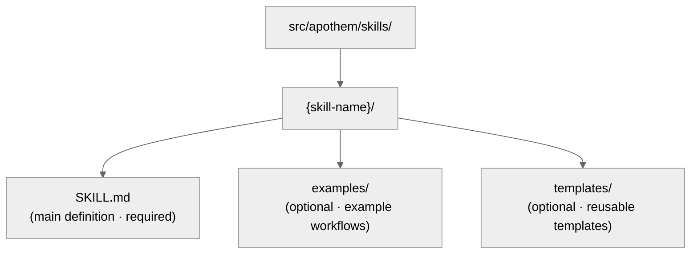

{/* SPDX-License-Identifier: MIT */}

本指南帮助开发者以 SOTA 质量标准维护并扩展 Apothem 生态。

## 快速参考：制品类型

Apothem 生态包含五种制品类型，每种都有各自特定的用途和 frontmatter 要求。

| 制品 | 路径 | 用途 | 何时创建 |
| -------- | ---- | ------- | -------------- |
| **规则** | `src/apothem/rules/*.md` | 行为强制规定或操作指令 | 确立了新的原则、策略或治理强制规定 |
| **命令** | `src/apothem/commands/*.md` | 用于复杂工作流的斜杠命令（`/command-name`） | 新的多步骤用户工作流 |
| **辅助器** | `src/apothem/agents/*.md` | 用于并行任务的持久化委派工作者定义 | 新的反复出现的专项任务（审计、探索、质量检查） |
| **技能** | `src/apothem/skills/{name}/SKILL.md` | 带有检测信号的可复用技法 | 新的可检测、可复用技法模式 |
| **钩子** | `src/apothem/hooks/` + `settings.json` | 由事件触发的验证或状态管理 | 新的生命周期事件或验证需求 |

## 工具适配器契约

工具的身份与能力事实位于
`src/apothem/lib/harness_registry.py`。只有当以下各个表面彼此一致时，一项工具
变更才算完成：

| 表面 | 所需更新 |
| --- | --- |
| 注册表行 | 公开 ID、包键、入口点、作用域、输出格式、目标路径、文档路径、能力文件、标准锁定、夹具测试、package-data 键、模板源以及能力状态。 |
| 适配器包 | `__init__.py`、`install.py`、`update.py`、`uninstall.py`、`verify.py`；仅当该工具会渲染原生配置文件时才添加 `materializer.py`。 |
| 传播清单 | 以清单为依据的适配器的模板与集合路径。 |
| 能力 | `src/apothem/harnesses/<package>/capabilities.yml`，其中包含每项必需能力，以及对不支持或待发现状态的理由说明；此外，每个经过转换的命令、委派工作者或规则集合都需要一份 `conversion_losses` 映射（参见[工具注册表](/docs/reference/harness-registry)）。 |
| 约定锁定 | `STANDARD-CONVENTION-PIN.md`，包含厂商 URL、快照日期、规范文件名/schema、证据引用，以及不支持能力的理由。 |
| 测试 | 注册表对等性、适配器夹具测试、黄金安装计划行、试运行/不写入行为、幂等性以及 package-data 覆盖。 |
| 文档 | 工具参考页、对比页、能力/MCP 说明，以及使用虚构占位符的示例。 |

项目作用域的适配器必须设置 `requires_project = True`，在生命周期方法上接受
`project: Path | None`，并在写入之前拒绝缺失或不安全的项目根目录。用户作用域的
适配器必须将路径保持在该工具文档所述的用户配置根目录之下。

## 黄金夹具策略

`tests/fixtures/harness-golden-plans.json` 记录注册表中全部十七个工具的公开
安装计划形态：公开 ID、物化模式、源集合/模板路径，以及 `<ROOT>` 下规范化后的
目标路径。当注册表、清单或模板的目标行为被有意更改时，请在与源变更相同的提交中
更新黄金夹具，使差异能显示出行为的变化量。

## 写入前验证

共享安装驱动在第一次写入之前验证每个源与目标。它会拒绝缺失的清单源、目标路径
遍历、位于所选根目录之外的目标路径，以及符号链接穿越。试运行执行相同的验证，并在
不创建文件的情况下返回结构化的 `skipped` 或 `unchanged` 结果。

## 脱敏与示例数据

配置档案诊断会对形如 token、secret、password、credential、API key、private key、
authorization、auth 和 header 的字段进行脱敏。文档、夹具、示例和 JSON 片段使用
`example.invalid`、`Example User`、`example-user` 以及显而易见的占位符，而不是
看起来像真实机密或个人账户的内容。

## 动笔之前：规范 schema

**机器可读、由闸门强制执行的契约，是 `src/apothem/schemas/*.schema.json` 下按类别
划分的 JSON Schema——`additionalProperties` 会拒绝未知键，因此合规闸门拥有最终
决定权。** 有两份供人阅读的投影跟随这些 schema：`site/content/docs/reference/frontmatter-schema.mdx`
（必填键索引）和 `site/content/docs/reference/artifact-schema.mdx`
（按类别的模板与完整示例）。当某个页面与 JSON Schema 不一致时，以 schema 为准。

- 阅读 `src/apothem/schemas/` 下对应你的制品类型的 JSON Schema
- 阅读 `site/content/docs/reference/artifact-schema.mdx` §“Schema”，获取模板和一个
  完整示例
- 复制必填字段，填入必需的值，并按需添加可选字段

## frontmatter 快速检查

每个制品的 frontmatter 都必须通过以下检查：

```yaml
✓ Valid YAML syntax (use tools: `yamllint` or PowerShell `ConvertFrom-Yaml` where available)
✓ All mandatory fields present (per schema for artifact type)
✓ name: uses kebab-case
✓ version: semantic MAJOR.MINOR.PATCH
✓ updated: ISO 8601 date (YYYY-MM-DD)
✓ description: single-line, non-empty
✓ scope fields valid per artifact type (rules: pathFilter + alwaysApply; CLAUDE.md root: scope)
✓ portability: valid enum (`universal` | `universal-with-windows-caveats` | `unix-only` | `windows-only`)
✓ No typos in field names — must match canonical schema exactly
✓ Optional fields use correct enum values
```

## 命名约定

### 制品名称（kebab-case）

- **规则：** `operational-mandates`、`clean-room-generation`、`context-management`
- **命令：** `plan-execute`、`plan-spec`、`plan-generate`
- **辅助器：** `codebase-explorer`、`convention-auditor`、`quality-gate`
- **技能：** `plan-suite`、`ecosystem-audit`

模式：小写，单词之间用连字符，不含空格或下划线。

### 文件命名

- **规则：** `{name}.md`
- **命令：** `{name}.md`
- **辅助器：** `{name}.md`
- **技能：** 位于文件夹 `src/apothem/skills/{name}/SKILL.md` 内（大小写须精确：`SKILL.md`）
- **钩子：** 位于文件夹 `src/apothem/hooks/` 内。所有事件处理器都用 Python 编写。每条
  `settings.json` 钩子命令都使用 exec 形式（`python` 加 `args`）来调用
  `-m apothem.hooks.dispatch <event> [<message-name>]` 或
  `-m apothem.conformity.gate --hook`。`dispatch.py` 将 `SessionStart` 路由到
  `session_start_bootstrap.main()`，并将其他每个白名单内的事件路由到
  `emit_hook_context.main()`。`src/apothem/hooks/` 或 `scripts/` 下唯一允许的 shell
  存根是四个定位器 + 引导文件（`find-python.{ps1,sh}`、`bootstrap.{ps1,sh}`）；任何其他 `.ps1` /
  `.sh` 文件都无法通过 `scripts/dev/validate_hooks.py` 卫生检查。

### 交叉引用

引用其他制品时，使用精确名称：

- 规则：`"operational-mandates"`（name 字段值）
- 命令：`/plan-execute`（面向人类的文档中带斜杠；代码中不带）
- 辅助器：`codebase-explorer`（name 字段值）
- 技能：`plan-suite`（name 字段值）

在正文叙述中绝不要使用文件路径或截断的名称。

## 可移植性：Windows 与 Unix

每个制品都必须显式声明其可移植性状态。

### 通用（默认）

- 在 Windows、macOS 和 Linux 上的行为完全相同
- 不对 shell 作任何假设
- 路径使用正斜杠（`/`）
- 没有硬编码的绝对路径
- 没有 Windows 特有的 PowerShell 语法

```yaml
portability: "universal"
```

### 通用但带 Windows 注意事项

- 在各 POSIX 主机上通用；所指明的注意事项适用于内容中声明的 Windows 平台变体
- 在内容中显式记录该注意事项
- 示例：“Win 10 之前的 Windows 不支持符号链接”

```yaml
portability: "universal-with-windows-caveats"
```

在标题之后紧接着用一条说明记录该注意事项。

### 仅 Unix / 仅 Windows

- 明确限定于单一平台
- 在 Apothem 中很少见——大多数应当是通用的
- 仅当平台特有的功能不可或缺时才使用

```yaml
portability: "unix-only"
```

在规则的第一节中记录原因。

## 作用域：始终生效与路径过滤

### 始终生效

规则在所有位置都适用。

```yaml
scope: "always-on"
```

### 路径过滤

规则根据文件路径有条件地适用。

```yaml
scope: "path-filtered"
pathFilter: "**/*.py, **/*.toml"
```

`pathFilter` 使用 glob 模式（与 `.gitignore` 格式相同）。当某个文件匹配该过滤器时，
规则即被激活。

## 版本语义

每个制品都带有其自身的语义化版本（`MAJOR.MINOR.PATCH`）：

- **PATCH**——拼写修正、格式调整、链接刷新、仅限注释的编辑。行为不变。
- **MINOR**——新增式的非破坏性变更：新的可选章节、额外的反模式、新的可选 frontmatter 字段、新的示例。现有使用方无需任何改动即可继续工作。
- **MAJOR**——破坏性的 schema 或契约变更：移除章节、重命名字段、改变现有指令的行为，以及要求下游制品作出适配的变更。

示例：

- `vX.Y.Z` → `vX.Y.(Z+1)`（PATCH：拼写修正）
- `vX.Y.Z` → `vX.(Y+1).0`（MINOR：新增一条反模式条目）
- `vX.Y.Z` → `v(X+1).0.0`（MAJOR：宣布契约稳定）
- `vX.Y.Z` → `v(X+1).0.0`（MAJOR：移除必填 frontmatter 字段）

在每次改变行为的编辑中，一并提升 `version` 和 `updated`。对于捆绑了制品变更的发布，
在生态级的 `CHANGELOG.md` 中追加一条相应的行。

## 何时编辑制品

### 规则

- 将“必需/可选”结构视为承重结构——重构它会波及每个依赖它的制品
  （需要 MAJOR 递增）。
- 随着理解加深，精炼反模式、严肃度分级示例和引用（MINOR 递增）。
- 在相关的记忆主题文件中记录任何结构性变更的理由。

### 命令

- 参数形态是公开契约的一部分——只有在明确有意时才打破它，并将该变更传播到每个
  调用方（MAJOR 递增）。
- 保持工作流步骤和返回契约精简且最新。
- 以内联方式记录不明显的步骤顺序。

### 辅助器

- 让 `disallowedTools` 保持最小但足够；在它变更时记录理由。
- 随着辅助器角色的成熟，精炼操作原则和返回契约（MINOR 递增）。
- 以内联方式追踪能力变化，以便调用方重新校准预期。

### 技能

- 保持流程步骤和示例与实际情况同步。
- 检测信号必须反映当前使用中用户的实际措辞。
- 技能一旦超过约 150 行就将其拆分（参见
  `auto-memory.md` § Topic File Management）。

## 分步指南：添加新规则

### 1. 评估正交性

这条规则是否与现有规则重叠？在 `src/apothem/rules/` 中搜索相关内容。

如果重叠超过 50%，请考虑改为扩展一条现有规则。参见
`persistent-conventions-vigilance.md` § Artifact Evolution。

### 2. 撰写内容

遵循以下结构：

- 标题：`# Rule: {Title}`
- 用途章节
- 义务 / 核心指令（编号、带链接）
- 严肃度分级表（始终必需）
- 反模式章节
- 强制执行章节

### 3. 创建 frontmatter

使用 `site/content/docs/reference/artifact-schema.mdx` § Schema: Rules 中的 schema。设置：

- `name:` kebab-case 标识符
- `description:` 用于注册表的单行摘要
- `pathFilter:` 路径过滤规则使用 glob 列表；始终生效规则使用空字符串（`""`）
- `alwaysApply:` 始终生效规则为 `true`，路径过滤规则为 `false`

规则只携带这四个字段——没有 `version` / `updated` / `scope` / `portability` / `implements`。

示例：

```yaml
---
name: "my-new-rule"
description: "Brief one-liner"
pathFilter: ""
alwaysApply: true
---
```

### 4. 更新 CLAUDE.md

在 `§7.2 Rules` 注册表表格中添加条目：

```markdown
| My New Rule | `src/apothem/rules/my-new-rule.md` | Always-on | CM-5/CM-21 |
```

在表格内保持字母顺序。

### 5. 追加到 CHANGELOG.md

在下一个发布的 `### Added` 部分下添加一行，描述这条新规则。

### 6. 运行验证

调用 `ecosystem-audit` 技能来验证新规则，并聚焦于规则区域：

```text
Invoke the ecosystem-audit skill with --focus rules --fix
```

确认没有针对你的新规则报告任何错误。

## 分步指南：添加新命令

命令是诸如 `/plan-spec`、`/plan-execute`、`/security-audit` 等斜杠命令。

### 1. 确定角色

命令**绝不**打算由工具单独调用。它们是由用户触发的工作流。请自问：

- 这是一个用户键入 `/command-name` 的工作流吗？
- 它是否编排多个步骤？
- 它是否可能超时，或在执行中途需要用户输入？

如果其中任何一项的回答为“否”，那么它很可能是一个技能，而不是命令。

### 2. 创建文件

路径：`src/apothem/commands/{name}.md`

frontmatter（来自 `site/content/docs/reference/artifact-schema.mdx` § Schema: Commands）：

```yaml
---
name: "my-command"
version: "X.Y.Z"
updated: "2026-04-20"
description: "What this command does"
argument-hint: "[path/to/input] [--flag VALUE]"
disable-model-invocation: true
portability: "universal"
allowed-tools: "Read, Glob, Grep"
---
```

`disable-model-invocation: true` 使命令只能由操作者调用；设为
`false` 时，当某个请求与其描述相匹配，模型可以运行它。大多数命令使用 `true`，
但大多数规划与研究流水线阶段使用 `false`。`src/apothem/commands/README.md` 中的
调用表列出了每个命令的设置；新增命令时要为其添加一行。让
`allowed-tools` 保持只读：遵循该字段的工具会直接运行其中所列的工具，而不先询问。
有副作用的工具只能以限定作用域的规则形式授予，例如
`Bash(git log *)`；schema 会拒绝 `"*"` 以及不带限定的 `Bash`、`PowerShell`、
`Write`、`Edit`、`NotebookEdit` 和 `WebFetch`。

### 3. 撰写内容

结构：

- 标题：`# /{name} — Human-Readable Title`
- 角色章节（由谁执行）
- 高层级指令
- 带步骤的工作流章节
- 返回契约 / 输出格式

### 4. 更新 CLAUDE.md 与 CHANGELOG.md

在 `§7.1 Commands` 中添加注册表行；在下一个发布的 `### Added` 部分下添加 CHANGELOG 行。

### 5. 验证

调用 `ecosystem-audit` 技能，聚焦于命令：

```text
Invoke the ecosystem-audit skill with --focus commands --fix
```

## 分步指南：添加新辅助器

辅助器是用于并行工作的持久化委派工作者定义。

### 1. 识别模式

这个辅助器是否符合下面列出的某种团队模式？

- 研究团队：只读，收集信息
- 审计团队：验证，一致性检查
- 实现团队：并行代码变更
- 质量团队：代码检查、测试、类型检查、安全
- 文档团队：文档更新
- 其他：专项任务

### 2. 创建文件

路径：

```text
src/apothem/agents/{name}.md
```

frontmatter：

```yaml
---
name: "my-helper"
version: "X.Y.Z"
updated: "2026-04-20"
description: "What this helper specializes in"
tools: "Read, Glob, Grep, Bash"
disallowedTools: "Write, Edit"
maxTurns: 15
portability: "universal"
---
```

省略 `model`、`effort` 和 `permissionMode`，使辅助器继承会话的选择（与宿主无关的
姿态）；并且除非辅助器需要持久记忆作用域（`user`、`project` 或 `local`），否则
省略 `memory`。

### 3. 撰写内容

章节：

- 操作原则（只读、基于证据、二元裁决、穷尽）
- 工作流（编号步骤）
- 返回契约（最大 token 数、结构、必填字段）

### 4. 更新 CLAUDE.md 与 CHANGELOG.md

在 `§7.3 Helpers` 中添加注册表行；在下一个发布的 `### Added` 部分下添加 CHANGELOG 行。

### 5. 测试

在真实场景中部署该辅助器，并验证它按文档所述工作。

## 分步指南：添加新技能

技能是可复用、可检测的技法。

### 1. 识别可复用性

在编写技能之前：

- 你是否已经见过这个问题/技法 3 次或更多？
- 它是否可被检测？（是否有某种用户请求模式能标示它？）
- 你能否以可复现的方式将它编码下来？

如果三项的回答都为“是”，就编写一个技能。

### 2. 创建结构



### 3. 编写 SKILL.md

frontmatter：

```yaml
---
name: "skill-name"
version: "X.Y.Z"
updated: "2026-04-20"
description: "What this skill teaches"
archetype: "workflow-template"
userInvocable: true | false
disable-model-invocation: true | false
allowed-tools: "Read, Glob, Grep"
argument-hint: "[args]"               # optional; if userInvocable
---
```

内容结构：

- 用途
- 何时使用此技能
- 前置条件
- 分步流程
- 常见错误
- 示例

### 4. 更新 CLAUDE.md 与 CHANGELOG.md

在 `§7.5 Skills` 中添加注册表行；在下一个发布的 `### Added` 部分下添加 CHANGELOG 行。

### 5. 验证

调用 `ecosystem-audit` 技能，聚焦于技能：

```text
Invoke the ecosystem-audit skill with --focus skills --fix
```

## 提交前验证清单

- [ ] frontmatter 通过 YAML 语法检查
- [ ] schema 要求的所有必填字段均已齐备
- [ ] `name` 字段使用 kebab-case
- [ ] `version` 为语义化版本（`MAJOR.MINOR.PATCH`），并且在行为变更时已递增
- [ ] 对于你改动过的任何制品，`updated` 与今天的日期一致
- [ ] `portability` 字段已设置且有效
- [ ] CHANGELOG.md 在下一个发布的部分下、以合适的类别记录了该变更
- [ ] 没有计划内部引用（符合 CM-7）
- [ ] 交叉引用与其他制品保持一致
- [ ] 新制品已在 CLAUDE.md 注册表中登记
- [ ] 制品已经过测试（如适用）
- [ ] `ecosystem-audit` 技能运行无错误
- [ ] 内容遵循结构约定（标题格式、章节等）

## 引用其他制品

使用以下确切约定：

### 引用规则

```markdown
See `src/apothem/rules/operational-mandates.md` or shorthand: the Operational Mandates rule.
In prose: ... per CM-1–10 (Operational Mandates rule) ...
```

### 引用命令

```markdown
See `/plan-execute` command. Or: Run `/plan-execute`.
In prose: The `/plan-execute` command handles phase execution.
```

### 引用辅助器

```markdown
Deploy the `codebase-explorer` delegated worker.
In prose: The codebase-explorer worker finds patterns.
```

### 引用技能

```markdown
Use the `plan-suite` skill.
In prose: The plan-suite skill provides the Master Plan Suite template.
```

### 引用 CLAUDE.md 章节

```markdown
See CLAUDE.md § 7.2 (Rules registry).
Or: Section 4 (Seriousness-Scaled Governance).
```

## 代码检查与格式

所有制品都使用：

- **Markdown：** GFM（GitHub Flavored Markdown）
- **YAML：** 符合 YAML 1.2
- **行尾：** LF（Unix 风格）
- **编码：** UTF-8
- **行宽：** 内容在 100 个字符处软换行（不使用硬换行）

对 Python 文件使用 `Ruff` 格式化器 / 代码检查器。对 Markdown，使用
`prettier` 或同等工具。

## 测试与度量

### 运行测试套件

```bash
python -m pytest                      # unit, integration, property, conformity, scripts
python -m pytest tests/property       # Hypothesis properties (profile loader, frontmatter, merge)
```

该套件是封闭的：即使检出位于 `$TMPDIR` 之下，并且 `PATH` 上的
`python` 缺少 CLI 的前置依赖，它也能通过，因为集成测试运行的是正在运行 pytest
的那个解释器，并按最长优先的顺序对嵌套的临时路径和源路径进行标记化。

### 按包统计的覆盖率

CI 度量三个包，并让每个包遵守各自的下限。它们之中没有任何一个被并入另一个。

| 包 | 路径 | 下限 | 下限所在位置 |
| --- | --- | --- | --- |
| engine | `cli`、`harnesses`、`lib`、`hooks`、`statuslines` | 80 | `[tool.coverage.report] fail_under` |
| conformity | `src/apothem/conformity` | 81 | `[tool.coverage.package-floors]` |
| audit | `src/apothem/audit` | 70 | `[tool.coverage.package-floors]` |

该数值是行覆盖率加分支覆盖率，即 coverage.py 在 `branch = true` 时报告的同一百分比；
指标产物还会在 `coverage_lines` 下记录仅语句覆盖的数值。每个包的下限是实测的
行加分支覆盖值向下取整的结果。覆盖率上升时提高下限；绝不要为了让某项变更通过而
降低下限。在本地检查：

```bash
python -m pytest --cov=src/apothem --cov-report=json:coverage.json
python scripts/dev/collect_metrics.py --coverage-json coverage.json --check-floors \
  --skip-hooks --skip-coldstart --harness zed
```

### 指标产物

CI 的 `metrics` 作业在每次推送和拉取请求时运行 `scripts/dev/collect_metrics.py`，
并上传 `metrics.json`（`schema_version: 1`）。每个为 `null` 的值都在
`nulls` 下附有其原因。

| 键 | 度量内容 |
| --- | --- |
| `coverage.engine`、`coverage.conformity`、`coverage.audit` | 每个包的行加分支覆盖百分比，附带 `coverage_floors`。 |
| `always_on_bytes[harness]`、`always_on_files[harness]` | 对 17 个工具中的每一个，在向临时的 `HOME` 和项目执行 `profile init` 与 `install --harness <id>` 之后：该工具在启动时完整加载的指令文件在磁盘上的字节数。 |
| `cli_coldstart_ms` | `python -m apothem --version` 的中位数（`--help` 的结果位于 `cli_coldstart_detail_ms` 下）。 |
| `hook_e2e_ms[event]`、`hook_injected_chars[event]` | 按每个已注册的事件和匹配器（`PreToolUse:Write`、`Stop`……）：钩子链在真实负载上的中位总耗时，以及它注入的上下文字符数。 |

哪些文件算作在启动时加载，是按工具分别制定的规则，取自各厂商文档所述的指令表面。
仅携带描述的列表项（技能、命令、子代理）不计入。该规则文本也会写入产物的
`rules.always_on_bytes` 下：

```text
antigravity     ~/.gemini/{GEMINI,AGENTS}.md, ~/.gemini/config/{GEMINI,AGENTS}.md,
                ~/.gemini/config/rules/*.md with trigger: always_on, project
                GEMINI.md and AGENTS.md. The plugin rules/ folder is not a
                documented launch surface.
claude-code     ~/.claude/CLAUDE.md and ~/.claude/rules/**/*.md without paths:
                frontmatter, plus the project equivalents.
codebuddy       .codebuddy/rules/**/*.md (project and home) unless
                alwaysApply: false, plus CODEBUDDY.md.
codex           ~/.codex/AGENTS.md and the project AGENTS.md.
cursor          .cursor/rules/**/*.mdc with alwaysApply: true, and AGENTS.md.
gemini-cli      ~/.gemini/GEMINI.md and the project GEMINI.md.
github-copilot  .github/copilot-instructions.md and the project AGENTS.md.
hermes          ~/.hermes/SOUL.md, project .hermes.md, AGENTS.md, CLAUDE.md.
                The support tree and apothem/rules/ are not launch surfaces.
kimi-code       ~/.kimi-code/AGENTS.md, project AGENTS.md and .kimi-code/AGENTS.md.
kiro            .kiro/steering/**/*.md with inclusion: always or no inclusion
                key, and the project AGENTS.md.
open-claw       Workspace bootstrap files ~/.openclaw/workspace/*.md.
opencode        ~/.config/opencode/AGENTS.md, the project AGENTS.md, and every
                file the instructions globs in opencode.json match.
qwen-code       The context files named by context.fileName in
                ~/.qwen/settings.json (default QWEN.md), in ~/.qwen/ and the project.
trae            .trae/rules/**/*.md with alwaysApply: true, and
                ~/.trae/user_rules/*.md.
windsurf        .devin/rules/**/*.md and .windsurf/rules/**/*.md with
                trigger: always_on, the global global_rules.md, and AGENTS.md.
zed             The first of .rules, .cursorrules, .windsurfrules, .clinerules,
                .github/copilot-instructions.md, AGENT.md, AGENTS.md, CLAUDE.md,
                GEMINI.md in the project, plus ~/.config/zed/AGENTS.md.
glm             Nothing: GLM is a model backend and loads no instruction files.
```

### 行为评估

`evals/` 下的套件度量的是行为而非形式：64 个触发用例（每个可由模型调用的命令和
子代理都会在其领域内的请求上触发，并在似是而非的请求上保持静默）、32 个结果用例
（每个规划阶段、研究阶段和审计维度各一个），以及 6 个规则效果对（某条始终生效
规则的文本开启与关闭）。这些用例是纯数据，由
`python -m pytest tests/unit/test_eval_suite.py` 免费校验；运行它们则需付费，
且须手动进行。关于 `Evals` 工作流、本地运行以及如何添加用例，参见[运行行为评估](/docs/how-to/evals)。
编辑一条带有对应规则效果对的始终生效规则之后，运行 `python scripts/dev/sync_eval_rule_cases.py`。

### 基准测试

`make benchmarks` 运行 `src/apothem/benchmarks/` 下按类别划分的驱动程序。
每个驱动程序的退出码为：`0` 通过，`1` 超出预算，`2` 错误（被测运行未执行），
或 `3` 未测量。

- `bench_hooks.py` 按每个事件和匹配器，在真实负载上按原样运行 `hooks/hooks.json`
  注册的每条 `shell: bash` 命令，并报告中位总耗时、最慢的命令（对照该事件的预算
  进行检查）以及注入的字符数。无法按注册方式运行的命令（脚本缺少可执行位时退出码
  为 126）算作错误，而不是通过。
- `bench_agents.py` 报告 `NOT MEASURED`（退出码 3）：生成子代理需要一个宿主工具和
  一次模型调用。`make benchmarks` 不会运行它。

始终生效预算检查（`always-on-budget-grep`）统计以空白分隔的单词数，并排除 Bindings
部分和配套指针行。其 JSON 报告还带有 `always-on-loaded`：某个工具加载的、去除
frontmatter 后的正文的字节数、字符数和单词数，按所有始终生效规则求和。

## 生态审计：运行验证

两个互补的验证表面覆盖整个生态：

**可由机器检查（Python 验证器）**——在每次提交之前运行：

```bash
python scripts/dev/validate_hooks.py       # Hook structure + Python-only hygiene
python scripts/dev/validate_ecosystem.py   # Full tree + frontmatter + delegated hook checks
python scripts/dev/chaos_pass.py           # Adversarial sweep across configured hooks
pytest tests                                    # Unit tests for the hook runtime
```

**由助手驱动**——用于交叉引用、叙述和约定审计：

```bash
/ecosystem-audit --focus all --fix
```

它会并行运行：

- **结构审计：** 注册表准确性、文件存在性、frontmatter 有效性
- **制品审计：** 交叉引用、强制规定覆盖、流水线顺序
- **记忆审计：** 记忆文件中的声明与文件系统状态的对照

预期输出：两个表面均为 `PASS`，且零发现项。

如果报告了 `FINDINGS`：

- 审查每个发现项的严重程度（Critical / Important / Advisory）
- 立即处理 Critical 项
- 为下一个周期规划 Important 项
- 在下一次迭代中考虑 Advisory 项

---

## 有疑问？

请参考：

- frontmatter schema：`site/content/docs/reference/artifact-schema.mdx`
- 制品生命周期：`src/apothem/rules/persistent-conventions-vigilance.md` § Artifact Evolution
- 操作强制规定：`src/apothem/rules/operational-mandates.md` CM-1–10
- 计划套件参考：`src/apothem/skills/plan-suite/master-template.md`
- 发布说明：`CHANGELOG.md`
